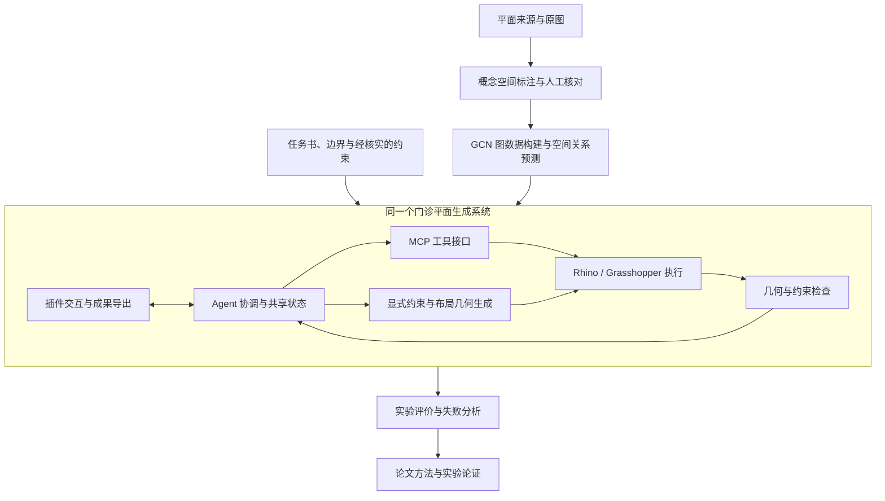

# 多智能体协同的单层门诊平面生成方法研究

**2026-11-07 跨电脑使用入口：** 本项目通过私有仓库 `AndrewHuStudio/thesis-writing` 同步。[Windows 主机与多电脑同步](docs/Windows主机与多电脑同步.md) 包含首次下载、Git LFS、Python 环境、已有 GCN 小试验及日常交接步骤；依赖见 [requirements-pilot.txt](requirements-pilot.txt)。当前已存在 [GCN 小试验代码](m-GCN模型/room_layout_pilot/README.md) 和 [实验记录](e-实验评估/20261103_09体检区_GCN复原/README.md)。下文是 2026-11-01 的历史进度快照，其“仅占位／尚无实验”等判断需要结合这些后续成果阅读。

本目录是硕士学位论文写作与相关技术研发的统一项目。论文正文、文献与设计资料、医院平面采集与标注、GCN 空间关系预测、门诊平面生成系统和实验评价在这里共同管理。Codex、CodeBuddy 或其他编程平台进入项目后，应先通过本文件了解研究边界、实际成果与当前任务。

**进度基准：2026-11-01（本地文件扫描快照）。** 本文件区分“已有文件”“人工确认”“代码实现”“运行验证”和“研究计划”，目录存在或论文写到某种方法，都不代表该方法已经实现。

**当前技术路线不采用 MAPPO，也不采用 MARL／多智能体强化学习。** 本项目的 Agent 指以任务分解、共享状态、工具调用、约束检查与反馈修复为核心的协同机制。早期稿件中的 MAPPO、策略训练、奖励函数等相关内容仅保留为历史研究方案，不是当前开发要求。涉及现行建筑标准的具体约束，实施前还需核实来源与适用版本。

## 1 研究对象与范围

研究对象是**功能自含的单层门诊平面**，重点关注该层内部从到达、挂号、候诊、诊疗、缴费、取药到离开的门诊服务组织，以及相关患者和医护流线。具体服务是否设置、数量及相互关系，应由任务书与案例条件确定；上述流程是研究覆盖范围，不要求所有就诊者机械地经过同一条固定路径。

研究以二维空间关系与平面布局为主，Rhino／Grasshopper 用于几何执行、可编辑成果输出及必要的三维验证与展示。跨楼层组织、整院总体规划和施工图深化不作为当前核心生成任务；已有资料中包含的急诊、住院、手术、医技等混合功能，应先筛选或划定边界，不能把全部医院图纸直接等同于目标训练集。

标注与学习的粒度以图纸可辨认的功能区、临床单元或空间为依据。已有房间级标签可以作为资料，但是否聚合为功能单元、预测哪一种关系、采用哪些输入特征，仍需形成正式数据约定。没有清晰依据的名称、门洞或联系应保留不确定性。

## 2 技术路线与系统架构

当前研究路线为：

**医院门诊平面资料采集／标注 → GCN 空间关系预测 → Agent 协调及显式约束驱动的 Rhino／Grasshopper 布局几何生成与插件集成 → 实验评价。**

下图表示拟采用的模块关系，不表示这些模块已全部实现：



GCN 负责研究空间关系的预测，为生成环节提供关系候选或先验；其输出需要与明确的硬约束区分。Agent 负责组织任务、调用模型和工具、交接状态、处理检查反馈。几何模块负责将关系与约束转化为平面布局，Rhino／Grasshopper 是建模与几何运算环境，MCP 是工具接入方式，插件是集成与交互载体。

**Agent、几何生成、MCP、Rhino 和插件属于同一个系统内部的不同职责，不是三个独立项目。** GCN 可以单独研发和评估，最终通过明确接口供该系统调用。论文提出问题和方法，研发提供实现证据，实验结果再支撑论文论证。

## 3 当前目录与用途

以下为本次整理后的实际顶层结构；已有参考资料和数据目录一并保留：

```text
大论文/
├── README.md
├── d-绘图/
├── d-门诊设计资料/
├── i-医院门诊平面/
├── p-平面标注与数据处理/
├── r-参考论文/
├── w-论文正文/
├── m-GCN模型/
├── s-门诊平面生成系统/
│   ├── agents/
│   └── geometry/
└── e-实验评估/
```

| 目录 | 用途与当前情况 |
| --- | --- |
| `d-绘图/` | 论文插图、技术路线图及可编辑绘图源文件；现有 PNG、PPTX、PSD。 |
| `d-门诊设计资料/` | 医院建筑设计资料及设计参考；现有 3 份 PDF，保留原文件。 |
| `i-医院门诊平面/` | 候选医院平面原始图像；当前为 53 张 JPG，不等于 53 个独立医院或合格训练样本。 |
| `p-平面标注与数据处理/` | 实际已有标注成果、数据适用性初评、临时核对及辅助脚本所在地；本次保持原路径。 |
| `r-参考论文/` | 现有参考论文资料，当前有 8 份 PDF；不因本次目标清单未列出而移除。 |
| `w-论文正文/` | 章节 Word 稿、学位论文模板及现有编辑临时文件；版本与具体内容需结合核查。 |
| `m-GCN模型/` | GCN 数据适配、编码、训练、推理与模型评估的预留入口；当前仅 `.gitkeep`。 |
| `s-门诊平面生成系统/` | Agent 协同、约束求解、Rhino／Grasshopper、MCP、插件及系统测试的统一研发入口；当前只有迁入的两个占位目录。 |
| `e-实验评估/` | 对比、消融、流线与约束评价、失败分析及复现实验材料的预留入口；当前仅 `.gitkeep`。 |

### 3.1 历史目录与当前数据路径

旧对话和部分历史脚本使用 `p-写作过程/标注试样/` 等路径；当前已有数据实际位于 `p-平面标注与数据处理/`。用户已确认主动删除 `p-写作过程/`，该目录不属于当前结构，不应按旧方案重新建立。现有标注成果保持原路径，不搬迁、不复制；后续过程记录的具体存放位置按实际任务确定。

阅读历史记录时，请以文件当前实际位置为准。已发现 08 号样本说明仍提到旧的 `p-写作过程/临时核对/…` 路径；其当前核对材料应从 `p-平面标注与数据处理/临时核对/` 查找。此类历史路径尚未全量修复，本次不批量改写已有样本、备份或历史脚本。

### 3.2 统一生成系统的内部规划

| 子目录 | 职责 | 当前状态 |
| --- | --- | --- |
| `agents/` | 角色与任务分配、共享状态、阶段交接、反馈修复调度 | 已由旧 `a-Agent系统/` 整目录迁入，仅 `.gitkeep` |
| `geometry/` | 边界处理、空间布局、交通组织、显式约束求解及几何检查 | 已由旧 `g-平面生成/` 整目录迁入，仅 `.gitkeep` |
| `rhino/` | Rhino／Grasshopper 执行适配、文档对象管理与几何交换 | 规划，尚未创建 |
| `mcp/` | 工具定义、输入输出校验、调用结果与错误返回 | 规划，尚未创建 |
| `plugin/` | 参数输入、方案查看、问题反馈、人工调整与导出 | 规划，尚未创建 |
| `tests/` | 接口、约束、几何和系统流程验证 | 规划，尚未创建 |

仅在有实际文件或实现任务时建立其余目录。当前没有可运行的统一生成系统，也没有可供发布的插件。

## 4 模块接口与数据成果建议

本节是**待确认的研发建议**，不是已经落地的 API、数据标准或运行说明。现有标注不因本节建议自动改写；GCN 输入白名单、预测目标和训练配置仍需单独确定。

| 交接环节 | 建议输入 | 建议输出与验收内容 |
| --- | --- | --- |
| 原始资料 → 标注 | 原图、来源、医院／院区／楼栋／楼层、功能边界 | 稳定案例编号、原图与来源索引、标注版本、疑点与确认记录；先核实来源及使用条件。 |
| 标注 → GCN 数据适配 | 已核对的空间与关系、类别映射、纳入范围和不确定项 | 图数据、节点编号映射、输入特征清单、关系标签及有效性掩码、按医院／项目分组的数据划分清单。 |
| GCN → 生成系统 | 功能空间实例与允许作为输入的任务条件 | 预测关系类型、候选边及分数、模型与数据版本、适用范围；不得将预测关系直接当成必须满足的建筑约束。 |
| Agent → 几何模块 | 场地边界、房间／功能单元实例表、面积或容量要求、关系建议、显式硬软约束 | 布局候选、交通组织、几何对象标识、约束检查结果及失败原因；不能求解时明确返回失败。 |
| 几何模块 ↔ Rhino／MCP | 约定坐标系、单位、对象编号及结构化工具参数 | 可编辑对象、执行状态与错误证据；接口应支持重复调用识别，避免静默重复建模。 |
| 生成系统 → 插件与实验 | 方案、输入快照、运行日志、模型／约束／程序版本 | 可编辑平面、查看与导出结果、评价记录、人工调整与重试过程；评价保留失败案例。 |

### 4.1 已有标注成果的使用

当前正式样本位于 [标注试样](p-平面标注与数据处理/标注试样/)，已形成每案例四文件的组织方式：原图、`annotation.json`、`标注.svg`、`标注说明.md`。临时核对、备份和脚本位于样本外的工作目录，不作为额外独立训练样本。

已检查的核心 JSON 顶层为 `image`、`spaces`、`relations`；空间具有稳定编号、名称、类型、层级、图面多边形及适用时的相对面积，关系区分人员可达、服务联系和入口连接。具体可选字段以相应样本和后续统一的数据约定为准，不将像素几何误写为实际建筑尺寸。

数据进入训练前建议完成以下核查：

- 将待确认名称、接受的概念假设、确定标签分别记录，不因名称非空而认定全部可靠。
- 区分物理邻接、可达与服务联系；不跨越中间房间推断直接可达，也不把缺少关系当作不可达负样本。
- 室内相对面积与露天庭院、挑空等范围分别处理，具体以样本标注口径为准。
- 同院、同项目的不同楼层或裁剪图分组管理；不能把节点对或局部裁剪数当作独立医院样本数。
- 明确预测目标后再选择特征，防止将待预测的关系或由目标推导的几何信息直接泄漏进输入。
- 通过结构检查后继续进行语义与来源核对；结构合法不代表名称、连通和训练适用性全部验收。

### 4.2 研发与实验成果的建议组织

GCN 后续可按需组织数据适配、配置、模型代码、训练记录、模型权重与推理结果；生成系统按上表组织职责。实验建议为每次运行建立独立记录，包含 `run_id`、输入案例及数据版本、程序版本、模型版本、约束来源、参数、随机种子（适用时）、环境版本、输出路径、检查结论和失败原因。

原图与人工标注作为可追溯依据保留；派生图数据、预测、生成方案和实验报告应另存，避免覆盖来源。生成的实际单位、坐标和面积参数在接口中显式声明，不能从标注像素默认推得。

## 5 截至 2026-11-01 的真实进度

核查依据为本地目录清单、三个章节 DOCX 的正文文本提取、正式样本 JSON 与说明文件及文本引用搜索。本次没有训练 GCN、运行 Rhino／Grasshopper、构建插件或执行研究实验，也没有对 53 张图逐一重新目检验收。

| 模块 | 当前判断 | 本地证据与限制 |
| --- | --- | --- |
| 论文第一章 | 已有稿，待持续修订 | [261005 第一章 .docx](<w-论文正文/261005 第一章 .docx>) 有实际正文；题名与章节安排仍需与本次路线统一。 |
| 论文第二章 | 已有稿，包含待清理的历史路线 | [261008 第二章 .docx](<w-论文正文/261008 第二章 .docx>) 有实际正文，涉及 GCN、MCP、Rhino 等，也仍包含 MAPPO 历史方案。 |
| 论文第三章 | 写作任务推进中；独立稿进度待核实 | 已有 [261025 第三章 .docx](<w-论文正文/261025 第三章 .docx>)，但本次提取的段落正文文本与第二章文件完全相同，不能按文件名认定独立第三章已完成。两个 DOCX 文件本身并非同一字节文件，本次均原样保留。 |
| 医院资料采集 | 进行中，已有候选资料 | `i-医院门诊平面/` 有 53 张 JPG；另外有设计资料与参考论文。来源身份、功能范围及独立性仍需逐项核实。 |
| 平面标注与核对 | 已有批量初稿与部分人工确认，仍在进行 | `标注试样/` 有 53 个编号样本及相应 `annotation.json`；不能称为 53 份均已完成的训练数据。见下方快照。 |
| GCN 编码与模型研究 | 准备阶段；本项目内未发现实现证据 | `m-GCN模型/` 仅 `.gitkeep`；已有 [GCN 适用性初评](p-平面标注与数据处理/门诊平面资料_GCN适用性初评.md)，以及论文方法讨论。临时标注脚本不等于模型训练代码。实际训练情况未知，未发现可归属于本模块的训练记录或权重。 |
| Agent／几何／Rhino／MCP／插件 | 方案阶段；本项目内未发现系统实现 | 两个旧目录均只有 `.gitkeep`，迁移后仍仅占位。论文中的方案不能作为代码实现或联调成功证据；是否在其他位置开发过仍待核实。 |
| 实验评价 | 尚未验证 | `e-实验评估/` 仅 `.gitkeep`；未发现本模块的实验配置、运行结果或评价报告。不填写任何准确率、提升率或生成性能数值。 |

### 5.1 标注进度快照

本次读取到 53 份正式样本 JSON，共 7,958 个空间记录。按 `type=unknown` 或名称包含“未确认／未知”的扫描口径，有 2,865 个待核记录，分布在 47 个样本中。该统计包含功能／属性不确定项，**不等同于纯粹的缺失房名数，也不等同于质量验收结果**；未来应按统一口径更新。

| 样本 | 当前文件体现的状态 |
| --- | --- |
| 01 山东省立医院儿科综合楼 | 名称已齐；空间与关系仍以原图和人工核对为依据。 |
| 02 嘉兴市第一医院迁建工程 | 当前为连通性复核草稿；S023、S273 的功能／空间属性待确认，另有连通疑点。不能沿用历史“已完成”结论。 |
| 03 晋中市第一人民医院迁建项目 | 名称已齐，含用户接受的概念功能假设；这些名称不全是原图清晰可读的原始房名。 |
| 04 兰州市安宁新城医院新建项目 | 名称已齐；仍需按具体使用目的判断关系与标签适用性。 |
| 05 兰州重离子医用加速应用示范区 | 名称已齐，含已接受的概念功能名称。 |
| 06 鹿邑县第一人民医院整体迁建项目 | 名称已齐；仍有 L01—L07 共 7 项连通疑点，不能宣布连通性全部完成。 |
| 07 内蒙古自治区儿童医院、妇产医院、妇幼保健院外迁合建项目 | 样本说明记录已于 2026-10-31 完成名称确认与正式四文件校验；这是已有记录，本次未重新执行该标注校验。 |
| 08 青岛西海岸医疗中心 | 当前说明与数据记录有 210 项名称／功能待确认。 |
| 09 深圳大学学府医院 | 当前说明与数据记录有 182 项名称／功能待确认。 |
| 10 石家庄第一医院新建赵卜口院区 | 当前说明与数据记录有 135 项名称／功能待确认。 |
| 11—53 其余样本 | 已有 JSON、SVG、说明和原图；当前各样本仍有未知项，不能按四文件齐备认定全部完成。 |

01、03、04、05、06、07 六个样本在上述扫描口径下没有未知项，但这不消除概念假设、连通疑点和用途筛选要求。

已有 [2026-10-25 的 GCN 适用性初评](p-平面标注与数据处理/门诊平面资料_GCN适用性初评.md) 针对当时的 17 张图，不能当作目前 53 张图均已通过评估的证明。后续需要更新来源索引与适用性清单。

## 6 下一阶段任务与交付条件

以下均为后续任务，没有标注为已完成；执行顺序可随实际研究调整。

| 阶段 | 主要任务 | 可核对的阶段成果 |
| --- | --- | --- |
| 1 统一论文与研究范围 | 核对第三章文件为何与第二章正文重复；统一题名、章节职责和路线，修订 MAPPO／MARL 相关旧段落 | 经确认的章节提纲、稿件版本清单、历史路线修改记录；修改 Word 前保留原稿。 |
| 2 数据核对与筛选 | 按单张平面推进人工确认，优先处理当前待核名称与连通问题；补齐来源及功能范围 | 案例清单、明确的纳入／排除理由、同步的四文件成果与疑点记录。 |
| 3 确定 GCN 数据约定 | 明确节点粒度、关系预测目标、输入白名单、负样本与未知项处理、按项目分组划分 | 数据说明、适配后的图数据、数据划分清单和可复现的最小基线方案。 |
| 4 建立 GCN 基线 | 实现最小训练与推理流程，记录配置及失败情况 | 代码、运行日志、模型与数据版本、实际评估结果；完成前不宣称已有模型性能。 |
| 5 打通系统最小流程 | 选一个功能自含的单层案例，串联任务输入、Agent 协调、显式约束、几何生成与检查 | 可追踪的一次输入至输出记录，含失败返回、人工检查与修复证据；先验证流程再扩展插件。 |
| 6 Rhino／MCP／插件集成 | 明确执行环境与接口，支持方案查看、参数调整和可编辑导出 | 实际联调记录、可打开的输出、工具错误处理与必要系统测试。 |
| 7 实验与论文验证 | 预先确定数据划分、基线、对比／消融条件、评价定义及失败统计 | 可复现配置与结果、案例分析、评价报告及与结果一致的论文章节。 |

实验可研究关系预测质量、几何与约束可行性、患者及医护层内可达与流线、运行时间和修复过程等维度。具体指标、单位、分母、权重和参照标准均需先定义；未实测前不编造数字。未完整核对的通行图不足以直接支撑完整流线效率结论。

## 7 维护规则

1. **以当前确认的研究路线为准。** 历史材料保留用于追溯，不将 MAPPO／MARL 自动恢复为当前计划；论文旧段落另行修订。
2. **保护已有成果。** 修改前检查实际文件、未提交改动和同名冲突。原图、设计资料、参考文献及旧稿保留；派生成果另存。不得用空模板覆盖现有内容。
3. **按证据写进度。** “文件存在”“名称确认”“结构校验”“运行成功”“研究验证”分别记录。空目录、论文方案和计划不能写成已实现；未找到证据应写“本目录未发现／待核实”。
4. **保持标注一致。** 同步维护 JSON、具名 SVG 与说明；一个样本核对后再继续后续人工确认。未知项和接受的假设显式保留，临时核对与备份不混入正式四文件成果。
5. **保持路径可用。** 新说明优先用项目相对路径。迁移前搜索引用、核对同名文件并建立旧新路径映射；有冲突时保留两份并记录，不能静默覆盖。历史失效绝对路径不直接执行。
6. **模块职责统一。** Agent、几何、MCP、Rhino 和插件均在 `s-门诊平面生成系统/` 内协同研发，不再新增并行的旧系统根目录。GCN 与实验通过版本化成果交接。
7. **更新进度入口。** 当完成一次人工核对、代码运行、论文修订或实验时，更新日期、证据路径、限制和下一步。样本统计使用同一口径；本文件是快照，不能替代后来产生的实际成果。
8. **区分说明与执行规则。** README 是项目概述与进度入口。本次不创建、不填写 `AGENTS.md`，其具体内容留待后续单独讨论。

### 7.1 进度更新模板

复制下列模板记录一次有实际证据的进展；没有结果时如实填写“尚未运行”或“待核实”。

```markdown
### YYYY-MM-DD 模块或任务名称

- 状态：准备／进行中／已形成初稿／已人工确认／已运行验证／待核实
- 本次变更：具体完成或调整了什么
- 证据路径：相对于项目根目录的文件或运行记录
- 验证方式与结果：检查了什么；没有执行的检查明确说明
- 数据与版本：案例编号、数据版本、代码版本、配置或模型版本（适用时）
- 未解决项：未知名称、路径问题、失败原因或研究限制
- 下一步：明确的一项后续任务及验收条件
- 对论文的影响：对应章节、图表或需要修订的结论
```

## 8 本次整理记录与待核实事项

### 8.1 2026-11-01 目录整理

| 原位置 | 整理后位置 | 已有文件处理 |
| --- | --- | --- |
| `a-Agent系统/` | `s-门诊平面生成系统/agents/` | 整目录迁移，原有空 `.gitkeep` 保留；扫描时没有其他内容。 |
| `g-平面生成/` | `s-门诊平面生成系统/geometry/` | 整目录迁移，原有空 `.gitkeep` 保留；扫描时没有其他内容。 |
| 历史目录 `p-写作过程/` | 不保留该目录 | 首次整理时曾新增占位；用户随后确认该目录已主动删除。复查时目录已不存在，README 已同步纠正，后续不自动重建。 |
| 无 | 根目录 `README.md` | 新建本说明；扫描时根目录没有同名 README。 |

迁移前已检查目标同名冲突并保存现有文件的校验值清单用于复核。对现有文本材料及三个章节正文进行旧系统目录名搜索，未发现需要因上述两次迁移而更新的引用。两个旧根目录迁移后不再保留重复入口；没有删除实质成果。已有标注、Word、原图、参考资料、Git 配置及未提交修改不属于本次改写范围。

### 8.2 待核实事项

- 第二、三章正文重复的原因、正确的第三章稿件位置，以及当前最终章节提纲；“第三章推进中”是任务状态，独立完成度尚无充分证据。
- 稿件题名差异及 MAPPO／强化学习历史段落的修订位置；本次只在 README 明确新路线，没有替用户改写论文正文。
- 既有标注中的未知项、概念假设及连通疑点；53 份标注是否分别满足后续训练任务，仍需逐项验收。
- GCN 节点粒度、输入白名单、预测目标与项目级数据划分尚未定稿；本根目录之外是否有训练代码或结果未知。
- Agent、几何、Rhino／Grasshopper、MCP、插件是否在其他位置已有实现，以及具体环境和依赖版本，尚未核实。
- 历史文档中旧 `p-写作过程/` 路径的逐项修复；该目录已由用户删除，当前数据仍以 `p-平面标注与数据处理/` 为准，不重建旧目录。
- 尚无实验证据支持方法有效性或性能优势；所有评价结论需等待真实实验。
