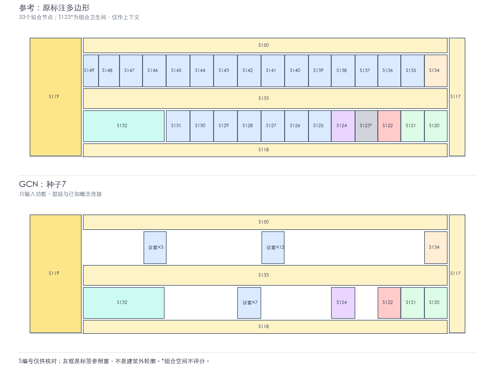

# 09体检区 GCN 小规模试验

已完成单图拟合诊断；没有独立测试集，不代表生成能力通过验收。

[打开正式结果说明](run_20261103_110918_324218/结果说明.md)

GCN三个种子的房间框平均IoU为0.317，基线为0.177。22条诊室记录被预测到3组重叠位置。下一步需要检验实例区分机制和非重叠、交通组织约束。

`run_20261103_110759_450629`为同次试验初版图面；正式展示使用上方链接，所有种子训练结果一致。未安装依赖，原09号四文件SHA-256前后相同。
