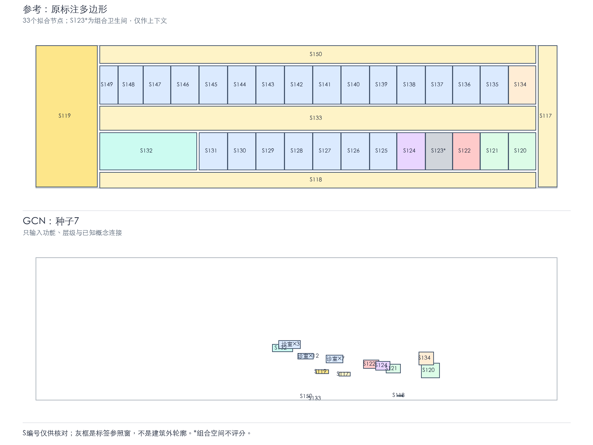

# 09号体检区：GCN房间布局复原试验

**状态：已完成实际训练与检查；这是同一片区的拟合诊断，不是跨医院测试。**



[查看包含全部基线的四图对照](平面对照.png)

## 本次怎样训练

- 来源：09_深圳大学学府医院，`scope=health_examination`。
- 34个节点、57条给定内部access；11条外接关系保存作边界说明，本次未把外部空间输入模型。
- 输入：功能类别和空间层级独热编码，以及给定概念access的对称归一化图。
- 答案：由多边形导出的中心x、中心y、外接框宽、高。
- S123“女卫男卫”仅作关系上下文，不参与几何损失与评分；33个节点拟合，28条房间记录评分。
- 两层GCN（64、32维）+逐节点四维输出，NumPy解析反向传播与Adam；无新装依赖。
- 每种模型运行1个种子，每次20步；全部种子均报告。
- 输入没有坐标、真实面积、门位、S编号特征、房名方位或唯一身份嵌入。
- 坐标采用等比例标签归一化；原图坐标系与变换可回查。参照窗不是建筑外轮廓，不是模型输入。
- 本次用几何损失训练，没有叠加非重叠、开门、走廊连续性约束，也没有用真实坐标修复预测。

## 实际结果

| 方法 | 种子 | 房间框平均IoU | 同类匹配IoU | 中心距离/片区长边 | 尺寸平均误差(px) | 重叠空间对 |
|---|---:|---:|---:|---:|---:|---:|
| 同功能/层级均值（同图答案统计基线） | — | 0.177 | 0.177 | 14.7% | 1.12 | 346 |
| GCN | 7 | 0.004 | 0.003 | 19.1% | 38.59 | 96 |
| MLP | 7 | 0.008 | 0.008 | 15.8% | 45.68 | 328 |

框IoU越高越好；其他误差和重叠越低越好。同类匹配按最小中心距离重配同功能房间，不保持原实例连接对应，故只作补充诊断。重叠统计包括房间与通道；阈值为1原图像素平方。
尺寸单位仅为原图像素，不是米；框面积不是房间净使用面积。

## 怎样理解

GCN三个种子的房间框平均IoU为0.004；无消息传递MLP为0.008。两者参数规模相同；MLP用单位矩阵代替图传播，节点输入相同。
预先选定展示种子7，其GCN结果有96对空间重叠；0个节点超出标签参照窗。参照窗越界是复原诊断，不是建筑边界合规判定。

### 连接图能够区分多少房间

- 功能、层级和图结构无法区分：S125、S126、S127、S128、S129、S130、S131
- 功能、层级和图结构无法区分：S135、S136、S137、S138、S139、S140、S141、S142、S143、S145、S147、S149
- 功能、层级和图结构无法区分：S144、S146、S148
这些节点在不输入额外区别信息的标准消息传递GCN中会得到相同输出。它们在原图中却可能位于不同位置；因此仅靠增加训练步数，不能保证逐间复原。

### 此次没有证明什么

- 没有独立验证集或测试集，不能报告跨项目准确率、泛化能力或样本量充分。
- 输出是空间外接框，不是完整墙体、门洞或任意形状多边形。
- 给定access不等于全部直接门；未记录关系不作为建筑不通行负例。
- 尚未验证房间实际入口、通道连续性、医患权限、建筑规范或完整医院平面的生成。

## 建议下一步

先将本结果作为基线。若重复诊室合并或重叠明显，下一步应比较：在同样给定条件下加入非重叠与交通组织约束，或用能产生多个候选的布局生成器。如果需要固定入口/交通核作为定位锚点，应另行声明新增输入，不能从答案中暗取。局部流程可用后，再按医院/项目留出样本检验。

## 可追溯材料

- [训练样本与输入白名单](训练样本.json)
- [全部配置、指标、源文件与代码哈希](实验记录.json)
- [所有模型的逐节点预测](预测结果.json)
- [完整训练日志](训练日志.json)
- [训练曲线](训练曲线.png)
- [可编辑SVG对照](平面对照.svg)
- `weights/`保存每种模型每个种子的权重。

- `code_snapshot/`保存本次运行的代码，便于后续复现。

原始四文件前后SHA-256一致：**True**。

复现命令（项目根目录）：

```bash
python m-GCN模型/room_layout_pilot/run.py --project-root . --epochs 6000 --seeds 7 19 43
```

[GCN原始方法论文](https://arxiv.org/abs/1609.02907)。
