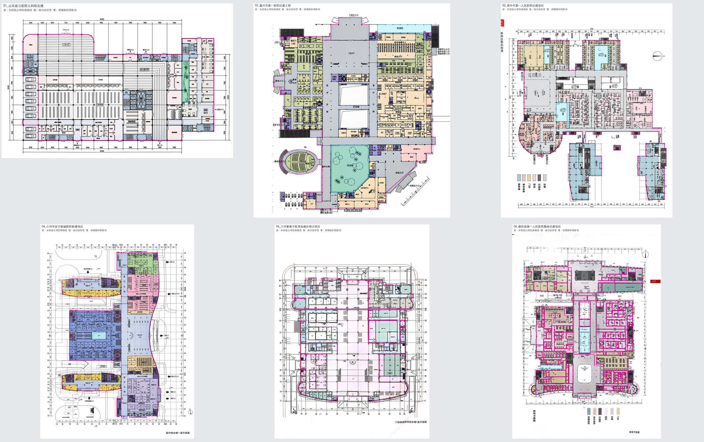
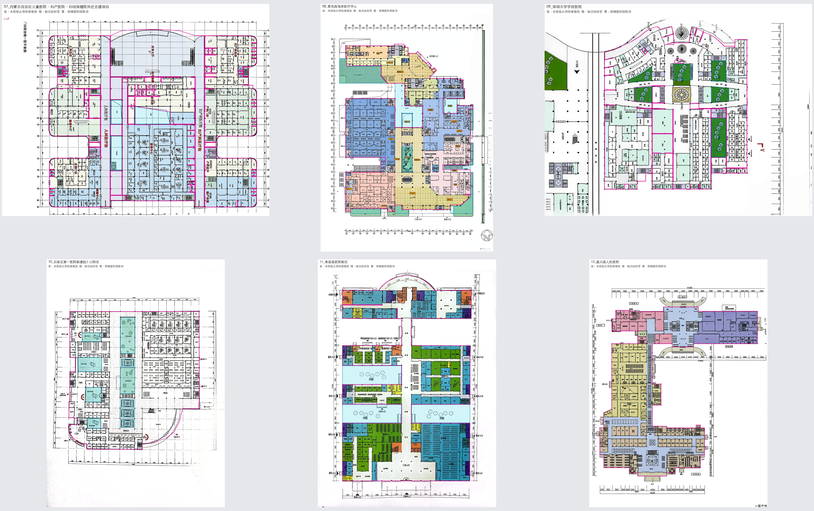
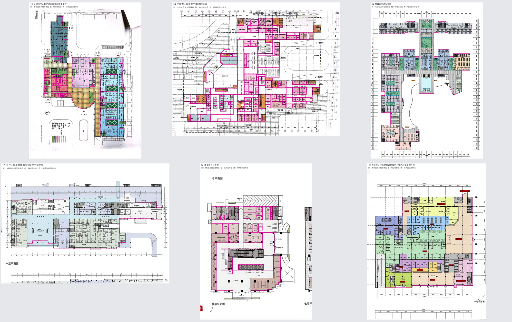
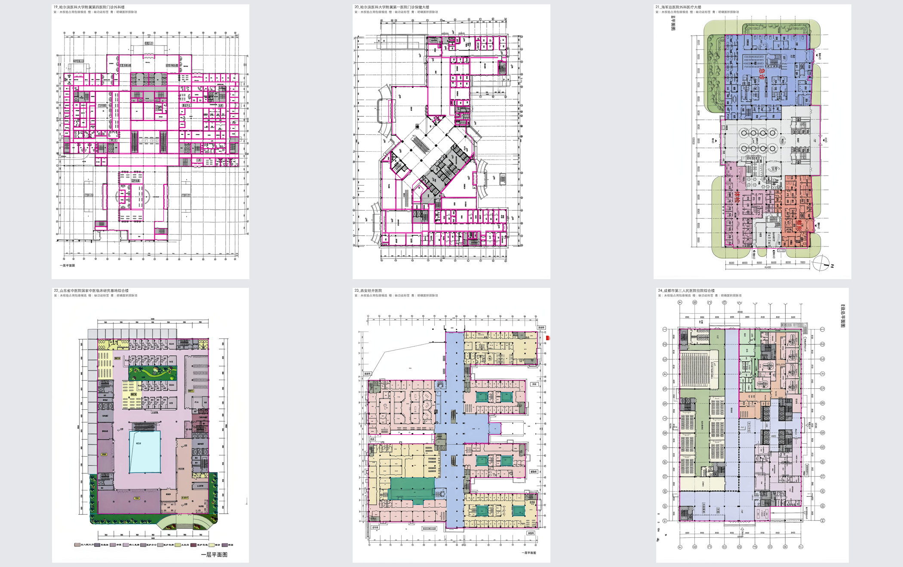
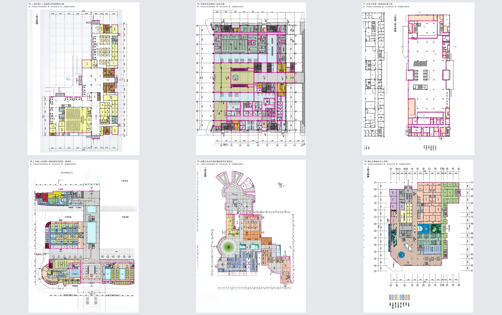
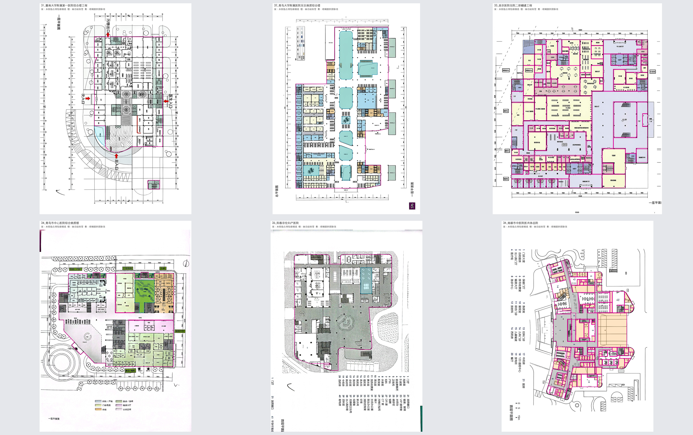
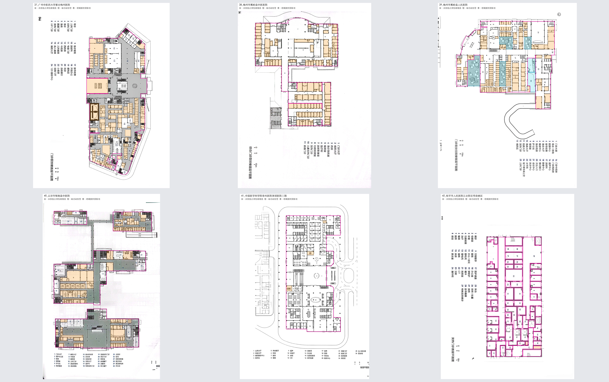
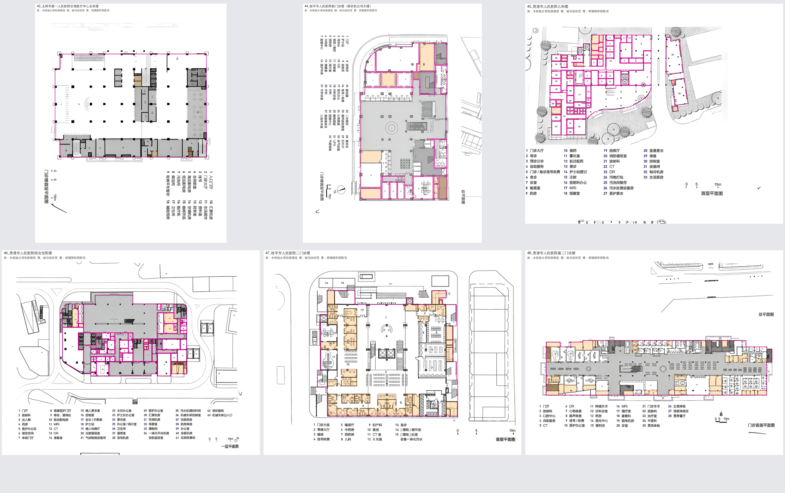
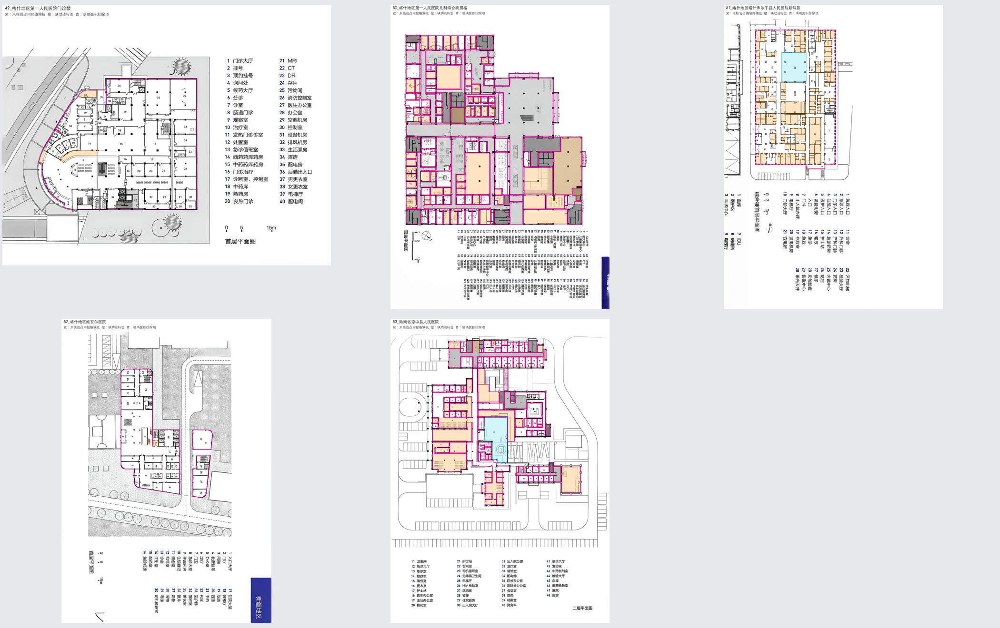

# 01—53号逐图训练用法清单

日期：2026-11-11。全部归入训练候选池，未划分验证/测试集，未导出训练张量。

每图均已做结构检查和总览检查；下表的候选房间数使用保守的组合名称筛选，不等于最终语义验收。
所有建筑边界仍需根据原图提取/核验；候选包络分片多不等于建筑真的不连通。

| 图号与项目 | 空间 | unknown | 已知room | 保守单房间候选 | 区域 | 定位距离>1%长边 | 外部记录 | 图面处理提示 |
| --- | ---: | ---: | ---: | ---: | ---: | ---: | --- | --- |
| [01_山东省立医院儿科综合楼](逐图审计/01_山东省立医院儿科综合楼.json) | 87 | 0 | 50 | 50 | 0 | 0 | 未定位独立state，保留MD/SVG依据 | 据原图提取外轮廓；保留庭院/室外排除。 |
| [02_嘉兴市第一医院迁建工程](逐图审计/02_嘉兴市第一医院迁建工程.json) | 274 | 0 | 195 | 195 | 0 | 0 | 未定位独立state，保留MD/SVG依据 | 据原图提取外轮廓；保留庭院/室外排除。 |
| [03_晋中市第一人民医院迁建项目](逐图审计/03_晋中市第一人民医院迁建项目.json) | 340 | 0 | 211 | 209 | 0 | 0 | 未定位独立state，保留MD/SVG依据 | 存在分翼和独立单元；保留多部件边界，不用凸包跨填空地。 |
| [04_兰州市安宁新城医院新建项目](逐图审计/04_兰州市安宁新城医院新建项目.json) | 246 | 0 | 154 | 154 | 0 | 0 | 未定位独立state，保留MD/SVG依据 | 据原图提取外轮廓；保留庭院/室外排除。 |
| [05_兰州重离子医用加速应用示范区](逐图审计/05_兰州重离子医用加速应用示范区.json) | 129 | 0 | 73 | 73 | 0 | 0 | 未定位独立state，保留MD/SVG依据 | 据原图提取外轮廓；保留庭院/室外排除。 |
| [06_鹿邑县第一人民医院整体迁建项目](逐图审计/06_鹿邑县第一人民医院整体迁建项目.json) | 288 | 0 | 181 | 178 | 0 | 0 | 未定位独立state，保留MD/SVG依据 | 据原图提取外轮廓；保留庭院/室外排除。 |
| [07_内蒙古自治区儿童医院、妇产医院、妇幼保健院外迁合建项目](逐图审计/07_内蒙古自治区儿童医院、妇产医院、妇幼保健院外迁合建项目.json) | 411 | 0 | 270 | 270 | 0 | 0 | 未定位独立state，保留MD/SVG依据 | 据原图提取外轮廓；保留庭院/室外排除。 |
| [08_青岛西海岸医疗中心](逐图审计/08_青岛西海岸医疗中心.json) | 319 | 0 | 206 | 205 | 0 | 0 | 未定位独立state，保留MD/SVG依据 | 据原图提取外轮廓；保留庭院/室外排除。 |
| [09_深圳大学学府医院](逐图审计/09_深圳大学学府医院.json) | 237 | 0 | 179 | 176 | 0 | 0 | 未定位独立state，保留MD/SVG依据 | 据原图提取外轮廓；保留庭院/室外排除。 |
| [10_石家庄第一医院新建赵卜口院区](逐图审计/10_石家庄第一医院新建赵卜口院区.json) | 222 | 0 | 141 | 141 | 0 | 0 | 未定位独立state，保留MD/SVG依据 | 据原图提取外轮廓；保留庭院/室外排除。 |
| [11_寿县县医院新区](逐图审计/11_寿县县医院新区.json) | 194 | 0 | 133 | 133 | 0 | 0 | 未定位独立state，保留MD/SVG依据 | 据原图提取外轮廓；保留庭院/室外排除。 |
| [12_遂川县人民医院](逐图审计/12_遂川县人民医院.json) | 187 | 0 | 110 | 109 | 0 | 0 | 未定位独立state，保留MD/SVG依据 | 据原图提取外轮廓；保留庭院/室外排除。 |
| [13_天津市中心妇产科医院迁址新建工程](逐图审计/13_天津市中心妇产科医院迁址新建工程.json) | 200 | 0 | 151 | 149 | 0 | 1 | 未定位独立state，保留MD/SVG依据 | 原图为拍摄页，见纸张遮挡和轻微透视；边界及尺度提取前检查校正。 |
| [14_无锡市人民医院二期建设项目](逐图审计/14_无锡市人民医院二期建设项目.json) | 199 | 0 | 132 | 131 | 0 | 3 | 未定位独立state，保留MD/SVG依据 | 据原图提取外轮廓；保留庭院/室外排除。 |
| [15_盐城市妇幼保健院](逐图审计/15_盐城市妇幼保健院.json) | 422 | 0 | 318 | 318 | 0 | 0 | 未定位独立state，保留MD/SVG依据 | 据原图提取外轮廓；保留庭院/室外排除。 |
| [16_浙江大学医学院邵逸夫医院下沙院区](逐图审计/16_浙江大学医学院邵逸夫医院下沙院区.json) | 207 | 0 | 132 | 132 | 0 | 0 | 未定位独立state，保留MD/SVG依据 | 页底含另一图残片；仅提取与当前标注对应的楼层范围。 |
| [17_成都市西区医院](逐图审计/17_成都市西区医院.json) | 49 | 0 | 28 | 28 | 0 | 2 | 未定位独立state，保留MD/SVG依据 | 同页可见另一层图；仅提取已标注的主要平面。 |
| [18_东营市人民医院急诊急救中心暨内科病房综合楼](逐图审计/18_东营市人民医院急诊急救中心暨内科病房综合楼.json) | 132 | 0 | 89 | 88 | 0 | 0 | 未定位独立state，保留MD/SVG依据 | 据原图提取外轮廓；保留庭院/室外排除。 |
| [19_哈尔滨医科大学附属第四医院门诊外科楼](逐图审计/19_哈尔滨医科大学附属第四医院门诊外科楼.json) | 173 | 0 | 108 | 108 | 0 | 0 | 未定位独立state，保留MD/SVG依据 | 据原图提取外轮廓；保留庭院/室外排除。 |
| [20_哈尔滨医科大学附属第一医院门诊保健大楼](逐图审计/20_哈尔滨医科大学附属第一医院门诊保健大楼.json) | 100 | 0 | 58 | 57 | 0 | 0 | 未定位独立state，保留MD/SVG依据 | 据原图提取外轮廓；保留庭院/室外排除。 |
| [21_海军总医院外科医疗大楼](逐图审计/21_海军总医院外科医疗大楼.json) | 158 | 0 | 113 | 113 | 0 | 0 | 未定位独立state，保留MD/SVG依据 | 据原图提取外轮廓；保留庭院/室外排除。 |
| [22_山东省中医院国家中医临床研究基地综合楼](逐图审计/22_山东省中医院国家中医临床研究基地综合楼.json) | 76 | 0 | 38 | 38 | 0 | 0 | 已匹配 | 据原图提取外轮廓；保留庭院/室外排除。 |
| [23_西安经开医院](逐图审计/23_西安经开医院.json) | 219 | 0 | 159 | 159 | 0 | 0 | 未定位独立state，保留MD/SVG依据 | 据原图提取外轮廓；保留庭院/室外排除。 |
| [24_成都市第三人民医院住院综合楼](逐图审计/24_成都市第三人民医院住院综合楼.json) | 91 | 0 | 56 | 56 | 0 | 0 | 未定位独立state，保留MD/SVG依据 | 据原图提取外轮廓；保留庭院/室外排除。 |
| [25_上海市第十人民医院内科病房综合楼](逐图审计/25_上海市第十人民医院内科病房综合楼.json) | 97 | 0 | 74 | 74 | 0 | 0 | 未定位独立state，保留MD/SVG依据 | 据原图提取外轮廓；保留庭院/室外排除。 |
| [26_济南军区总医院门诊综合楼](逐图审计/26_济南军区总医院门诊综合楼.json) | 113 | 0 | 67 | 64 | 0 | 0 | 已匹配 | 据原图提取外轮廓；保留庭院/室外排除。 |
| [27_北京大学第一医院改扩建工程](逐图审计/27_北京大学第一医院改扩建工程.json) | 55 | 22 | 15 | 15 | 0 | 0 | 已匹配 | 同页侧边有另一图残片；未知功能只保留缺失标签状态。 |
| [28_广东省人民医院心脑血管专科医院一期项目](逐图审计/28_广东省人民医院心脑血管专科医院一期项目.json) | 206 | 0 | 132 | 132 | 0 | 0 | 已匹配 | 据原图提取外轮廓；保留庭院/室外排除。 |
| [29_内蒙古自治区国际蒙医医院扩建项目](逐图审计/29_内蒙古自治区国际蒙医医院扩建项目.json) | 204 | 0 | 95 | 95 | 0 | 0 | 已匹配 | 据原图提取外轮廓；保留庭院/室外排除。 |
| [30_佛山市禅城区中心医院](逐图审计/30_佛山市禅城区中心医院.json) | 97 | 0 | 46 | 46 | 0 | 0 | 已匹配 | 据原图提取外轮廓；保留庭院/室外排除。 |
| [31_暨南大学附属第一医院综合楼工程](逐图审计/31_暨南大学附属第一医院综合楼工程.json) | 87 | 0 | 47 | 47 | 0 | 0 | 已匹配 | 主平面外另有独立标注单元，需确认是否纳入同一可布置域。 |
| [32_青岛大学附属医院东区病房综合楼](逐图审计/32_青岛大学附属医院东区病房综合楼.json) | 172 | 0 | 98 | 98 | 0 | 0 | 已匹配 | 据原图提取外轮廓；保留庭院/室外排除。 |
| [33_西京医院住院二部翻建工程](逐图审计/33_西京医院住院二部翻建工程.json) | 118 | 0 | 77 | 77 | 0 | 0 | 已匹配 | 据原图提取外轮廓；保留庭院/室外排除。 |
| [34_青岛市中心医院综合病房楼](逐图审计/34_青岛市中心医院综合病房楼.json) | 136 | 0 | 86 | 84 | 0 | 0 | 已匹配 | 据原图提取外轮廓；保留庭院/室外排除。 |
| [35_阳春京伦妇产医院](逐图审计/35_阳春京伦妇产医院.json) | 83 | 0 | 52 | 52 | 0 | 0 | 已匹配 | 据原图提取外轮廓；保留庭院/室外排除。 |
| [36_南雄市中医院医共体总院](逐图审计/36_南雄市中医院医共体总院.json) | 197 | 139 | 8 | 8 | 0 | 0 | 已匹配 | 据原图提取外轮廓；保留庭院/室外排除。 |
| [37_广州中医药大学紫合梅州医院](逐图审计/37_广州中医药大学紫合梅州医院.json) | 275 | 175 | 39 | 39 | 0 | 0 | 已匹配 | 据原图提取外轮廓；保留庭院/室外排除。 |
| [38_梅州市蕉岭县中医医院](逐图审计/38_梅州市蕉岭县中医医院.json) | 153 | 118 | 7 | 7 | 11 | 0 | 已匹配 | 据原图提取外轮廓；保留庭院/室外排除。 |
| [39_梅州市蕉岭县人民医院](逐图审计/39_梅州市蕉岭县人民医院.json) | 181 | 114 | 1 | 1 | 26 | 0 | 已匹配 | 据原图提取外轮廓；保留庭院/室外排除。 |
| [40_云浮市郁南县中医院](逐图审计/40_云浮市郁南县中医院.json) | 167 | 103 | 9 | 9 | 34 | 0 | 已匹配 | 存在多个组团/图块，需逐块核对目标层与连接范围，保留多部件表达。 |
| [41_中国医学科学院阜外医院深圳医院三期](逐图审计/41_中国医学科学院阜外医院深圳医院三期.json) | 108 | 3 | 63 | 63 | 10 | 0 | 已匹配 | 据原图提取外轮廓；保留庭院/室外排除。 |
| [42_桂平市人民医院江北院区传染病区](逐图审计/42_桂平市人民医院江北院区传染病区.json) | 73 | 2 | 40 | 38 | 7 | 0 | 已匹配 | 据原图提取外轮廓；保留庭院/室外排除。 |
| [43_玉林市第一人民医院区域医疗中心业务楼](逐图审计/43_玉林市第一人民医院区域医疗中心业务楼.json) | 32 | 4 | 13 | 13 | 7 | 0 | 已匹配 | 据原图提取外轮廓；保留庭院/室外排除。 |
| [44_桂平市人民医院新门诊楼（原农机公司大楼）](逐图审计/44_桂平市人民医院新门诊楼（原农机公司大楼）.json) | 34 | 8 | 8 | 8 | 7 | 0 | 已匹配 | 据原图提取外轮廓；保留庭院/室外排除。 |
| [45_贵港市人民医院儿科楼](逐图审计/45_贵港市人民医院儿科楼.json) | 83 | 20 | 41 | 40 | 9 | 0 | 已匹配 | 主翼与独立狭长翼之间有室外范围，不自动连成实心大轮廓。 |
| [46_贵港市人民医院综合住院楼](逐图审计/46_贵港市人民医院综合住院楼.json) | 71 | 10 | 37 | 35 | 8 | 1 | 已匹配 | 据原图提取外轮廓；保留庭院/室外排除。 |
| [47_桂平市人民医院二门诊楼](逐图审计/47_桂平市人民医院二门诊楼.json) | 72 | 44 | 2 | 2 | 9 | 0 | 已匹配 | 据原图提取外轮廓；保留庭院/室外排除。 |
| [48_贵港市人民医院第二门诊楼](逐图审计/48_贵港市人民医院第二门诊楼.json) | 106 | 45 | 28 | 28 | 9 | 0 | 已匹配 | 页面上方存在其它总图线条，提取范围限定为当前标注平面。 |
| [49_喀什地区第一人民医院门诊楼](逐图审计/49_喀什地区第一人民医院门诊楼.json) | 82 | 3 | 30 | 30 | 10 | 2 | 已匹配 | 据原图提取外轮廓；保留庭院/室外排除。 |
| [50_喀什地区第一人民医院儿科综合病房楼](逐图审计/50_喀什地区第一人民医院儿科综合病房楼.json) | 142 | 58 | 57 | 54 | 8 | 0 | 已匹配 | 据原图提取外轮廓；保留庭院/室外排除。 |
| [51_喀什地区塔什库尔干县人民医院新院区](逐图审计/51_喀什地区塔什库尔干县人民医院新院区.json) | 160 | 119 | 8 | 8 | 17 | 3 | 已匹配 | 页底存在另一层残片，按外部记录限定已标注完整平面。 |
| [52_喀什地区维吾尔医院](逐图审计/52_喀什地区维吾尔医院.json) | 47 | 3 | 27 | 27 | 9 | 1 | 已匹配 | 主翼与独立狭长翼分离，需保留组团与室外边界区别。 |
| [53_海南省琼中县人民医院](逐图审计/53_海南省琼中县人民医院.json) | 125 | 39 | 37 | 37 | 16 | 1 | 已匹配 | 建筑轮廓、庭院和潜在屋面/室内外范围须结合原图与原核对限制检查。 |

组合名称候选：

| 图号 | 空间 | 原名称 |
| --- | --- | --- |
| 03 | S081 | 器械／敷料 |
| 03 | S273 | 药品／无菌品 |
| 06 | S041 | 消防及保安监控室 |
| 06 | S177 | 女更衣及卫生间 |
| 06 | S178 | 男更衣及卫生间 |
| 08 | S028 | 男更衣+女更衣 |
| 09 | S116 | 污物间/洁具间 |
| 09 | S123 | 女卫男卫 |
| 09 | S215 | 女卫男卫 |
| 12 | S128 | 抢救室／洗胃间 |
| 13 | S035 | 更衣/财务 |
| 13 | S069 | 阅览室/病案接待 |
| 14 | S088 | 化验/采样 |
| 18 | S004 | 审单/打印 |
| 20 | S045 | 值班室、办公室 |
| 26 | S008 | 值班／更衣室 |
| 26 | S056 | 保洁间／污物暂存 |
| 26 | S061 | 准备／洗手 |
| 34 | S009 | 阴道镜／宫腔镜 |
| 34 | S105 | 采血／化验 |
| 42 | S035 | 采样／处置 |
| 42 | S037 | 采样／处置 |
| 45 | S022 | 门诊/急诊挂号收费 |
| 46 | S043 | 会议／示教室 |
| 46 | S050 | 办公室／阅片室 |
| 50 | S079 | 母婴室／治疗室 |
| 50 | S095 | 挂号／收费 |
| 50 | S124 | 挂号／收费 |

组合关键词只触发复核。例如“挂号／收费”“会议／示教室”可能本来就是同一物理房间，不自动拆分或删除。

门洞距离最高优先级14项见 [局部图与坐标](门洞距离优先复核.json)。距离提示只用于定位/端点复核，不等于关系已判错。

图面预览：紫色为占用包络候选，橙色为缺功能标签节点，青色为明确面积排除项。

