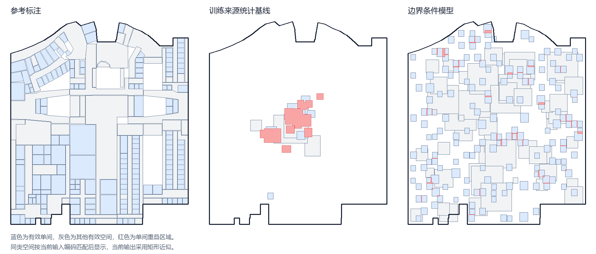
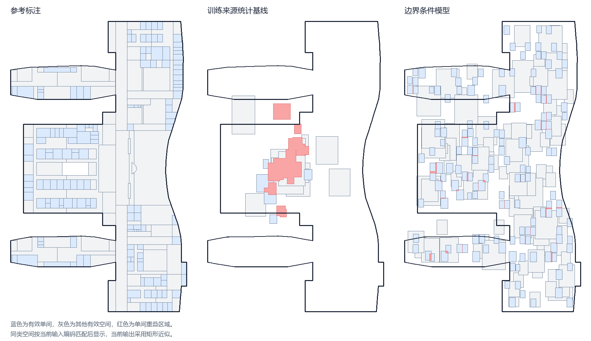
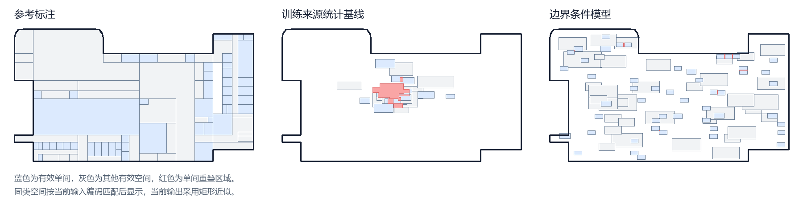
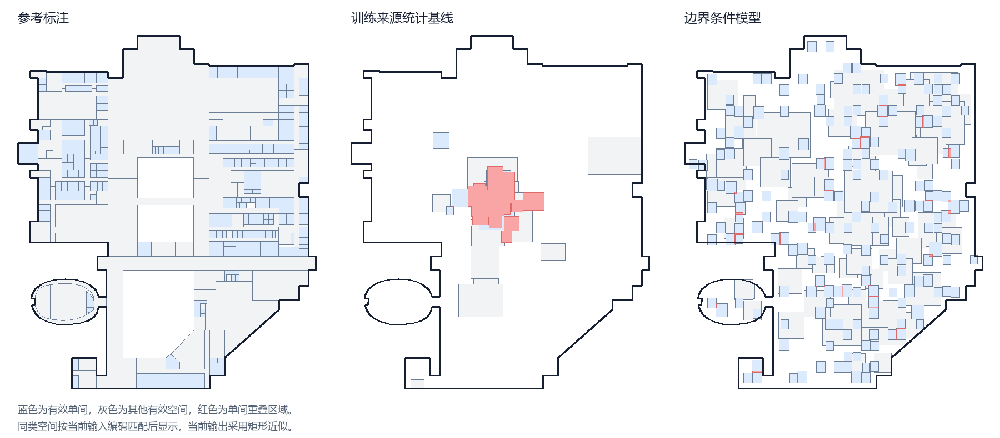
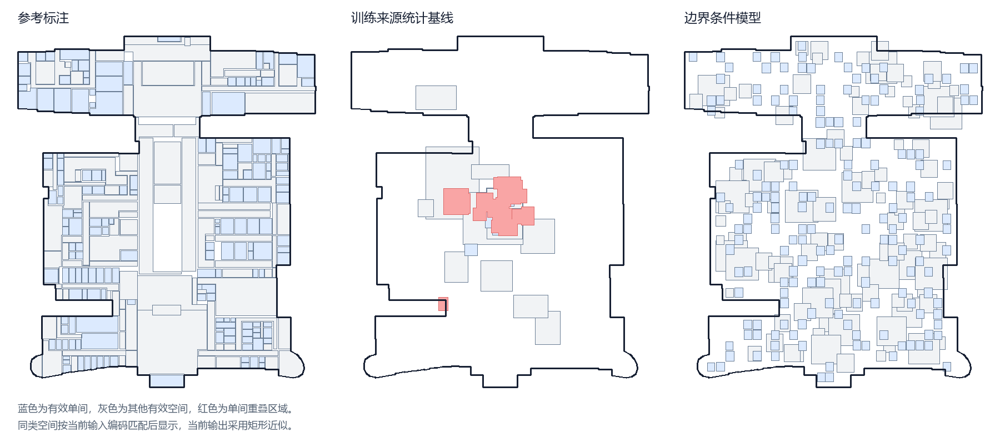

# 建筑边界与空间清单条件下的布局测试

已完成53图、48个暂定来源组的5折留出布局测试。边界条件模型使用3个随机种子，每次最长120轮，由验证集目标选择权重。统计对照仅使用每折训练来源中的几何标签。

输入为已知建筑边界及50维功能类别、空间层级和功能已知编码。模型根据边界内部随机槽位输出每个空间的中心、宽和高。每次生成4个候选，按软重叠与越界代价选择，候选选择与参考布局隔离。

本轮共覆盖4521个有效且功能明确的单间几何标签，每个随机种子分别评价一次。房间与其他有效空间分别汇总。表中先按医院来源组平均，再对随机种子取均值。

| 方法 | 房间位置误差占建筑长边 | 房间框IoU | 房间轮廓IoU | 房间面积相对误差 | 房间重叠占地 | 房间越界面积 |
| --- | --- | --- | --- | --- | --- | --- |
| 边界条件GCN | 31.79% | 0.004 | 0.004 | 57.39% | 1.39% | 1.15% |
| 训练来源统计均值 | 35.33% | 0.001 | 0.001 | 101.17% | 67.19% | 9.88% |

IoU越高表示越接近参考轮廓。其余表内误差和冲突比例越低越好。面积真值取原标注多边形，预测采用矩形。重叠区域按面积计一次，分母为预测房间占地并集。

匹配在几何监督有效且50维输入完全相同的空间之间进行，属于当前编码粒度下的实例对应假设。房间名称、科室归属、真实位置、真实面积、原图access和门位均作为输入之外的信息处理。名称不同但被编码为同一类的空间，仍需在后续语义建模与专业核查中区分。

来源身份分组仍为暂定，参考轮廓为概念图近似。测试给出与参考方案的接近程度和几何冲突情况，多个合理方案的设计质量还需要结合功能组织判断。

| 方法 | 其他有效空间位置误差占建筑长边 | 其他有效空间轮廓IoU | 其他有效空间面积相对误差 |
| --- | --- | --- | --- |
| 边界条件GCN | 23.87% | 0.028 | 254.62% |
| 训练来源统计均值 | 32.84% | 0.006 | 513.81% |

其他有效空间包括功能块、公共空间和按现有掩码保留的组合空间。其面积与位置监督按实际层级使用，不对跨层级包含关系统一计算互斥重叠。

已计算标注access端点在生成布局中的矩形几何间隔，逐图结果保存在result.json中。原access包含概念联系，端点间隔仅用于诊断。实际门洞、走廊行走路径和交通组织评价仍待后续生成模块。

预测文件保存在各折各随机种子的predictions目录。权重保存在weights.pt，history.json记录训练与验证目标，result.json保存逐图、逐空间指标及匹配对应。每份权重已重新加载并核验固定随机种子预测完全一致。

[汇总数值](summary.json)　[实验配置](config.json)

以下每折选取一张有房间监督的图，固定使用首个随机种子展示。

## 09_深圳大学学府医院

## 04_兰州市安宁新城医院新建项目

## 01_山东省立医院儿科综合楼

## 02_嘉兴市第一医院迁建工程

## 06_鹿邑县第一人民医院整体迁建项目

