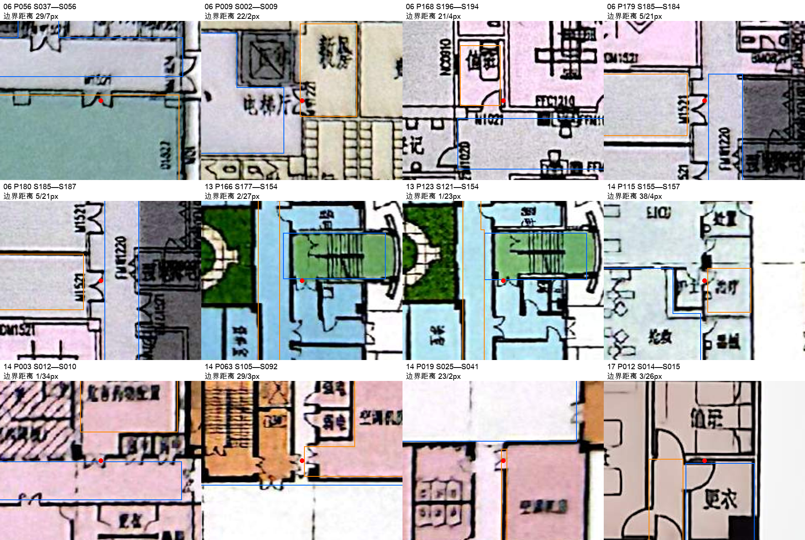
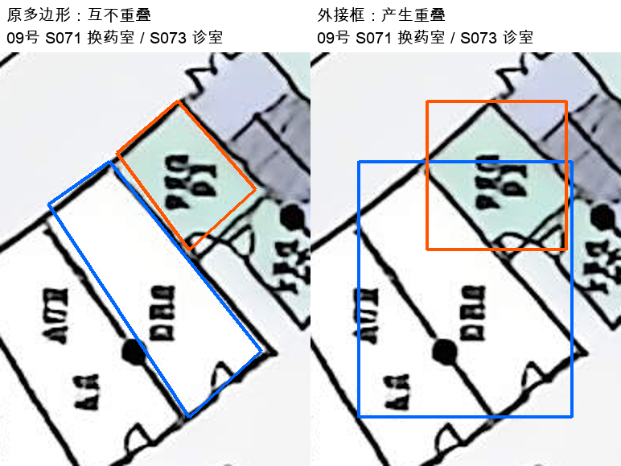

# 01—20 号标注与布局预测训练数据规范检查

检查时间：20261103_223922（Asia/Shanghai）。仅检查01—20；未修改原始四文件。

**结论：01—20符合现有概念标注的机器可检规范，可作为布局预测的监督数据来源；统一训练前仍需明确节点粒度、几何目标、条件输入、共用编码与分组划分。**

正式校验：20/20 通过；80个来源文件哈希一致：True。

本轮自动检查不能替代原图文字及门洞的逐项视觉判读，也不构成建筑合规或模型效果验收。

补充一致性检查：`{'area_ratio_errors': 0, 'svg_label_errors': 0, 'svg_geometry_errors': 0, 'missing_embedded_images': 0, 'image_size_mismatch': 0, 'svg_background_mismatch': 0}`；包括逐空间面积比例、SVG名称／类别／轮廓／入口坐标、SVG底图像素、原图尺寸和MD嵌入图片路径。20号声明旋转展示，按其显式变换核对轮廓、入口及底图，不能将展示坐标直接与原图坐标比较。

## 标注层检查

| 编号 | 空间 | room | 关系 | 开口 | 正式校验 | 面积比例逐项不符 | SVG文字不符 | 图片链接失效 |
| --- | ---: | ---: | ---: | ---: | --- | ---: | ---: | ---: |
| 01 | 87 | 50 | 119 | 88 | 通过 | 0 | 0 | 0 |
| 02 | 274 | 195 | 346 | 322 | 通过 | 0 | 0 | 0 |
| 03 | 340 | 211 | 376 | 253 | 通过 | 0 | 0 | 0 |
| 04 | 246 | 154 | 266 | 233 | 通过 | 0 | 0 | 0 |
| 05 | 129 | 73 | 161 | 119 | 通过 | 0 | 0 | 0 |
| 06 | 288 | 181 | 356 | 278 | 通过 | 0 | 0 | 0 |
| 07 | 411 | 270 | 477 | 337 | 通过 | 0 | 0 | 0 |
| 08 | 319 | 206 | 341 | 239 | 通过 | 0 | 0 | 0 |
| 09 | 237 | 179 | 317 | 280 | 通过 | 0 | 0 | 0 |
| 10 | 222 | 141 | 253 | 157 | 通过 | 0 | 0 | 0 |
| 11 | 194 | 133 | 275 | 211 | 通过 | 0 | 0 | 0 |
| 12 | 187 | 110 | 235 | 175 | 通过 | 0 | 0 | 0 |
| 13 | 200 | 151 | 210 | 181 | 通过 | 0 | 0 | 0 |
| 14 | 199 | 132 | 224 | 157 | 通过 | 0 | 0 | 0 |
| 15 | 422 | 318 | 751 | 420 | 通过 | 0 | 0 | 0 |
| 16 | 207 | 132 | 255 | 193 | 通过 | 0 | 0 | 0 |
| 17 | 49 | 28 | 92 | 47 | 通过 | 0 | 0 | 0 |
| 18 | 132 | 89 | 157 | 137 | 通过 | 0 | 0 | 0 |
| 19 | 173 | 108 | 197 | 120 | 通过 | 0 | 0 | 0 |
| 20 | 100 | 58 | 109 | 92 | 通过 | 0 | 0 | 0 |

## 训练数据层发现

- 总计 4416 个空间／区域，其中room层级 2919；完整层级分布：`{'open_space': 791, 'semi_open_space': 125, 'room': 2919, 'core_block': 325, 'functional_block': 220, 'landscape': 36}`。room字段不是逐个物理房间的完整验收结论。
- 共用type代码 42 种；scope取值 62 种，其中含未定／未分类标记的节点 449 个。scope尚不能直接当统一科室真值。
- 无定位开口的概念access共 936 条，属于现有允许语义；不能全部作为直接门洞邻接。shared_wall缺失也不作为无共墙负例。
- room多边形外接框填充率低于0.8有 63 个；room外接框重叠超过较小框5%的空间对有 54 对。外接框训练会损失真实轮廓，也可能让本来不相交的真值多边形变成重叠框。
- 输入必须与监督标签分开：polygon_px及派生坐标是几何目标；area_ratio如作为目标面积输入，须确认新任务也能提供。门位同理。
- 原图像素不是米；新项目的边界、参考方向、尺度如何提供，需要单独定义。面积占比的分母是当前保留标注范围，排除区域不能自动视为已覆盖。
- 20号JSON保持2444×3260原图坐标，SVG旋转为横向展示。训练标签读取JSON；如从SVG取几何，必须应用其显式变换的逆变换。
- 当前试验data.py按单图／scope动态生成type和level词表；多案例训练需要固定共用词表及编码版本。现有build_sample同时计算输入和答案，新任务推理需要不读取答案几何的独立入口。
- 按医院／同源项目分组划分训练、验证、测试；局部scope裁剪仍属于同一来源，不能随机分散至不同集合。裁剪后要处理跨scope的接口关系。

## 仅供复核的几何与图诊断

以下阈值仅用于排序复核，不能自动证明错误或生成修正。20像素在不同图上的物理尺度不同；未重新目检全部候选。

| 编号 | 未定scope节点 | 无门位access | 无access的room | 非室外access连通分量 | 低填充room | 重叠框对 | 开口距任一边界>20px | 同型同构房间组 |
| --- | ---: | ---: | ---: | ---: | ---: | ---: | ---: | ---: |
| 01 | 2 | 10 | 0 | 3 | 0 | 0 | 0 | 9 |
| 02 | 0 | 32 | 0 | 1 | 5 | 4 | 0 | 28 |
| 03 | 0 | 105 | 9 | 18 | 5 | 1 | 0 | 34 |
| 04 | 0 | 35 | 10 | 22 | 1 | 0 | 0 | 22 |
| 05 | 0 | 27 | 11 | 17 | 2 | 2 | 0 | 11 |
| 06 | 0 | 62 | 4 | 6 | 1 | 3 | 5 | 34 |
| 07 | 0 | 131 | 6 | 10 | 0 | 0 | 0 | 53 |
| 08 | 0 | 83 | 24 | 33 | 8 | 2 | 0 | 39 |
| 09 | 0 | 36 | 5 | 6 | 26 | 26 | 0 | 32 |
| 10 | 0 | 82 | 2 | 5 | 0 | 0 | 0 | 31 |
| 11 | 0 | 18 | 2 | 5 | 2 | 2 | 0 | 33 |
| 12 | 101 | 57 | 1 | 4 | 1 | 2 | 0 | 20 |
| 13 | 0 | 22 | 7 | 8 | 1 | 3 | 2 | 29 |
| 14 | 0 | 52 | 10 | 14 | 5 | 5 | 4 | 21 |
| 15 | 332 | 41 | 4 | 6 | 0 | 0 | 0 | 62 |
| 16 | 0 | 42 | 0 | 6 | 0 | 0 | 0 | 22 |
| 17 | 0 | 16 | 1 | 2 | 1 | 3 | 1 | 6 |
| 18 | 0 | 10 | 0 | 1 | 0 | 0 | 0 | 14 |
| 19 | 0 | 64 | 12 | 15 | 0 | 0 | 0 | 19 |
| 20 | 14 | 11 | 9 | 10 | 5 | 1 | 0 | 6 |

同型同构组仅基于type＋level及室内access图诊断；当前确定性消息传递模型缺少区分信息时可能输出相同位置。它不是标注错误，也不表示所有未来模型均无法区分。

## 逐图复核线索

### 01_山东省立医院儿科综合楼

- 原数据：[annotation.json](../../标注试样/01_山东省立医院儿科综合楼/annotation.json)
- 关系类型数量：`{'access': 94, 'service': 5, 'shared_wall': 14, 'entrance': 6}`；跨scope关系 23 条。
- scope：`{'public_service': 20, 'inpatient_public_service': 7, 'staff_or_public_unknown': 1, 'outpatient_support': 9, 'inpatient_support': 2, 'ordinary_outpatient': 13, 'south_clinic_scope_unknown': 1, 'fever_outpatient': 8, 'building_support': 1, 'nonclinical': 1, 'emergency': 24}`。

### 02_嘉兴市第一医院迁建工程

- 原数据：[annotation.json](../../标注试样/02_嘉兴市第一医院迁建工程/annotation.json)
- 关系类型数量：`{'access': 317, 'shared_wall': 12, 'service': 9, 'entrance': 8}`；跨scope关系 35 条。
- scope：`{'emergency': 76, 'ordinary_outpatient': 143, 'inpatient_support': 16, 'public_service': 26, 'administration': 13}`。
- 外接框重叠示例：`[{"a": "S029", "b": "S223", "overlap_over_smaller_box": 1.0}, {"a": "S030", "b": "S223", "overlap_over_smaller_box": 1.0}, {"a": "S032", "b": "S227", "overlap_over_smaller_box": 1.0}, {"a": "S033", "b": "S227", "overlap_over_smaller_box": 1.0}]`。

### 03_晋中市第一人民医院迁建项目

- 原数据：[annotation.json](../../标注试样/03_晋中市第一人民医院迁建项目/annotation.json)
- 关系类型数量：`{'access': 353, 'service': 10, 'entrance': 7, 'shared_wall': 6}`；跨scope关系 62 条。
- scope：`{'ordinary_outpatient': 99, 'outdoor_courtyard': 3, 'public_circulation': 31, 'public_service': 7, 'sterile_supply': 26, 'medical_technology': 85, 'emergency': 54, 'emergency_critical_care': 1, 'emergency_support': 3, 'inpatient_support': 31}`。
- 外接框重叠示例：`[{"a": "S088", "b": "S343", "overlap_over_smaller_box": 1.0}]`。
- 可能的组合房间名称（仅候选）：`[{"id": "S081", "name": "器械／敷料"}, {"id": "S273", "name": "药品／无菌品"}]`。

### 04_兰州市安宁新城医院新建项目

- 原数据：[annotation.json](../../标注试样/04_兰州市安宁新城医院新建项目/annotation.json)
- 关系类型数量：`{'service': 8, 'access': 246, 'shared_wall': 2, 'entrance': 10}`；跨scope关系 29 条。
- scope：`{'pediatric_outpatient': 26, 'pediatric_emergency': 2, 'pharmacy_support': 34, 'public_service': 14, 'outpatient_treatment': 17, 'emergency': 43, 'inpatient_support': 45, 'imaging': 65}`。

### 05_兰州重离子医用加速应用示范区

- 原数据：[annotation.json](../../标注试样/05_兰州重离子医用加速应用示范区/annotation.json)
- 关系类型数量：`{'access': 135, 'shared_wall': 8, 'service': 7, 'entrance': 11}`；跨scope关系 37 条。
- scope：`{'imaging': 38, 'public_service': 41, 'sterile_compounding': 11, 'infusion_support': 2, 'pharmacy_support': 6, 'inpatient_support': 1, 'emergency': 24, 'ordinary_outpatient': 6}`。
- 外接框重叠示例：`[{"a": "S066", "b": "S069", "overlap_over_smaller_box": 1.0}, {"a": "S093", "b": "S094", "overlap_over_smaller_box": 1.0}]`。

### 06_鹿邑县第一人民医院整体迁建项目

- 原数据：[annotation.json](../../标注试样/06_鹿邑县第一人民医院整体迁建项目/annotation.json)
- 关系类型数量：`{'access': 324, 'service': 14, 'shared_wall': 1, 'entrance': 17}`；跨scope关系 38 条。
- scope：`{'hospital_pharmacy_support': 28, 'inpatient_public_service': 7, 'hospital_public_service': 21, 'public_service': 14, 'emergency': 72, 'medical_imaging': 66, 'ordinary_outpatient': 45, 'pediatric_outpatient': 35}`。
- 外接框重叠示例：`[{"a": "S027", "b": "S028", "overlap_over_smaller_box": 1.0}, {"a": "S026", "b": "S027", "overlap_over_smaller_box": 0.5333333333333333}, {"a": "S020", "b": "S022", "overlap_over_smaller_box": 0.4126984126984127}]`。
- 开口边界距离候选：`[{"id": "P056", "relation": "R054", "source": "S037", "target": "S056", "boundary_distance_px": [29.0, 7.0], "max_distance_px": 29.0}, {"id": "P009", "relation": "R009", "source": "S002", "target": "S009", "boundary_distance_px": [22.0, 2.0], "max_distance_px": 22.0}, {"id": "P168", "relation": "R160", "source": "S196", "target": "S194", "boundary_distance_px": [21.0, 4.0], "max_distance_px": 21.0}, {"id": "P179", "relation": "R291", "source": "S185", "target": "S184", "boundary_distance_px": [5.0, 21.0], "max_distance_px": 21.0}, {"id": "P180", "relation": "R292", "source": "S185", "target": "S187", "boundary_distance_px": [5.0, 21.0], "max_distance_px": 21.0}]`。

### 07_内蒙古自治区儿童医院、妇产医院、妇幼保健院外迁合建项目

- 原数据：[annotation.json](../../标注试样/07_内蒙古自治区儿童医院、妇产医院、妇幼保健院外迁合建项目/annotation.json)
- 关系类型数量：`{'access': 451, 'service': 14, 'entrance': 6, 'shared_wall': 6}`；跨scope关系 63 条。
- scope：`{'emergency_pediatrics': 50, 'emergency_obstetrics_gynecology': 48, 'infusion_center': 27, 'outpatient_pharmacy': 35, 'obstetrics_outpatient': 50, 'fever_outpatient': 34, 'pediatric_asthma_outpatient': 25, 'medical_imaging': 78, 'obstetric_ultrasound': 24, 'perinatal_care': 22, 'public_service': 17, 'pediatric_outpatient': 1}`。

### 08_青岛西海岸医疗中心

- 原数据：[annotation.json](../../标注试样/08_青岛西海岸医疗中心/annotation.json)
- 关系类型数量：`{'access': 301, 'entrance': 8, 'service': 19, 'shared_wall': 13}`；跨scope关系 24 条。
- scope：`{'public_service': 61, 'inpatient_support': 1, 'medical_support': 88, 'pediatric': 2, 'pediatric_outpatient': 47, 'emergency': 56, 'southwest_clinical': 64}`。
- 外接框重叠示例：`[{"a": "S245", "b": "S249", "overlap_over_smaller_box": 1.0}, {"a": "S190", "b": "S191", "overlap_over_smaller_box": 0.5006127450980392}]`。
- 可能的组合房间名称（仅候选）：`[{"id": "S028", "name": "男更衣+女更衣"}]`。

### 09_深圳大学学府医院

- 原数据：[annotation.json](../../标注试样/09_深圳大学学府医院/annotation.json)
- 关系类型数量：`{'access': 309, 'entrance': 4, 'service': 4}`；跨scope关系 30 条。
- scope：`{'ordinary_outpatient': 105, 'public_service': 22, 'emergency': 38, 'health_examination': 34, 'pediatric_outpatient': 38}`。
- 外接框重叠示例：`[{"a": "S071", "b": "S073", "overlap_over_smaller_box": 0.5961703958691913}, {"a": "S064", "b": "S065", "overlap_over_smaller_box": 0.553812563042824}, {"a": "S068", "b": "S071", "overlap_over_smaller_box": 0.5029192234791164}, {"a": "S065", "b": "S068", "overlap_over_smaller_box": 0.48162665978607866}, {"a": "S057", "b": "S062", "overlap_over_smaller_box": 0.41315560031084764}]`。
- 可能的组合房间名称（仅候选）：`[{"id": "S116", "name": "污物间/洁具间"}, {"id": "S123", "name": "女卫男卫"}, {"id": "S215", "name": "女卫男卫"}]`。

### 10_石家庄第一医院新建赵卜口院区

- 原数据：[annotation.json](../../标注试样/10_石家庄第一医院新建赵卜口院区/annotation.json)
- 关系类型数量：`{'access': 232, 'service': 13, 'entrance': 8}`；跨scope关系 26 条。
- scope：`{'emergency': 44, 'public_service': 19, 'diagnostic_imaging': 54, 'diagnostic_treatment': 42, 'outpatient_pharmacy': 24, 'ordinary_outpatient': 39}`。

### 11_寿县县医院新区

- 原数据：[annotation.json](../../标注试样/11_寿县县医院新区/annotation.json)
- 关系类型数量：`{'entrance': 26, 'access': 215, 'service': 10, 'shared_wall': 24}`；跨scope关系 25 条。
- scope：`{'hospital_support': 25, 'staff_catering': 20, 'infectious_outpatient': 26, 'imaging_center': 42, 'pediatric_outpatient': 22, 'outdoor_courtyard': 3, 'infusion_center': 14, 'emergency': 21, 'public_service': 2, 'pharmacy_support': 19}`。
- 外接框重叠示例：`[{"a": "S054", "b": "S055", "overlap_over_smaller_box": 0.49019607843137253}, {"a": "S050", "b": "S051", "overlap_over_smaller_box": 0.4423076923076923}]`。
- 可能的组合房间名称（仅候选）：`[{"id": "S152", "name": "注射、配液"}, {"id": "S156", "name": "注射、配液"}, {"id": "S167", "name": "器械、药品"}]`。

### 12_遂川县人民医院

- 原数据：[annotation.json](../../标注试样/12_遂川县人民医院/annotation.json)
- 关系类型数量：`{'access': 218, 'service': 2, 'entrance': 15}`；跨scope关系 86 条。
- scope：`{'northwest_scope_unconfirmed': 20, 'public_service': 35, 'scope_unconfirmed': 1, 'inpatient_public_service': 1, 'northeast_scope_unconfirmed': 24, 'middle_north_scope_unconfirmed': 26, 'middle_south_scope_unconfirmed': 30, 'ordinary_outpatient': 50}`。
- 外接框重叠示例：`[{"a": "S003", "b": "S010", "overlap_over_smaller_box": 1.0}, {"a": "S035", "b": "S045", "overlap_over_smaller_box": 1.0}]`。
- 可能的组合房间名称（仅候选）：`[{"id": "S128", "name": "抢救室／洗胃间"}]`。

### 13_天津市中心妇产科医院迁址新建工程

- 原数据：[annotation.json](../../标注试样/13_天津市中心妇产科医院迁址新建工程/annotation.json)
- 关系类型数量：`{'access': 200, 'service': 3, 'entrance': 7}`；跨scope关系 27 条。
- scope：`{'radiology': 39, 'inpatient_support': 2, 'public_service': 3, 'pharmacy_support': 33, 'ordinary_outpatient': 94, 'emergency': 29}`。
- 外接框重叠示例：`[{"a": "S001", "b": "S003", "overlap_over_smaller_box": 1.0}, {"a": "S008", "b": "S009", "overlap_over_smaller_box": 0.2894736842105263}, {"a": "S050", "b": "S055", "overlap_over_smaller_box": 0.14285714285714285}]`。
- 开口边界距离候选：`[{"id": "P166", "relation": "R086", "source": "S177", "target": "S154", "boundary_distance_px": [2.0, 27.0], "max_distance_px": 27.0}, {"id": "P123", "relation": "R076", "source": "S121", "target": "S154", "boundary_distance_px": [1.0, 23.0], "max_distance_px": 23.0}]`。
- 可能的组合房间名称（仅候选）：`[{"id": "S035", "name": "更衣/财务"}, {"id": "S069", "name": "阅览室/病案接待"}, {"id": "S084", "name": "心电、B超"}]`。

### 14_无锡市人民医院二期建设项目

- 原数据：[annotation.json](../../标注试样/14_无锡市人民医院二期建设项目/annotation.json)
- 关系类型数量：`{'access': 197, 'service': 5, 'shared_wall': 10, 'entrance': 12}`；跨scope关系 22 条。
- scope：`{'pharmacy_support': 23, 'public_service': 19, 'infusion': 22, 'pediatric_outpatient': 13, 'laboratory_support': 9, 'outpatient_support': 20, 'health_examination': 26, 'emergency': 41, 'emergency_observation': 26}`。
- 外接框重叠示例：`[{"a": "S045", "b": "S046", "overlap_over_smaller_box": 1.0}, {"a": "S090", "b": "S092", "overlap_over_smaller_box": 1.0}, {"a": "S091", "b": "S092", "overlap_over_smaller_box": 1.0}, {"a": "S179", "b": "S180", "overlap_over_smaller_box": 1.0}, {"a": "S181", "b": "S182", "overlap_over_smaller_box": 1.0}]`。
- 开口边界距离候选：`[{"id": "P115", "relation": "R143", "source": "S155", "target": "S157", "boundary_distance_px": [38.0, 4.0], "max_distance_px": 38.0}, {"id": "P003", "relation": "R004", "source": "S012", "target": "S010", "boundary_distance_px": [1.0, 34.0], "max_distance_px": 34.0}, {"id": "P063", "relation": "R079", "source": "S105", "target": "S092", "boundary_distance_px": [29.0, 3.0], "max_distance_px": 29.0}, {"id": "P019", "relation": "R023", "source": "S025", "target": "S041", "boundary_distance_px": [23.0, 2.0], "max_distance_px": 23.0}]`。
- 可能的组合房间名称（仅候选）：`[{"id": "S088", "name": "化验/采样"}]`。

### 15_盐城市妇幼保健院

- 原数据：[annotation.json](../../标注试样/15_盐城市妇幼保健院/annotation.json)
- 关系类型数量：`{'access': 449, 'shared_wall': 299, 'entrance': 3}`；跨scope关系 337 条。
- scope：`{'public_circulation': 66, 'landscaped_area': 11, 'hospital_unclassified': 332, 'public_service': 13}`。

### 16_浙江大学医学院邵逸夫医院下沙院区

- 原数据：[annotation.json](../../标注试样/16_浙江大学医学院邵逸夫医院下沙院区/annotation.json)
- 关系类型数量：`{'service': 9, 'access': 230, 'entrance': 16}`；跨scope关系 27 条。
- scope：`{'infectious_outpatient': 26, 'ordinary_outpatient': 65, 'public_service': 19, 'inpatient_support': 28, 'emergency': 50, 'emergency_staff_support': 19}`。
- 可能的组合房间名称（仅候选）：`[{"id": "S009", "name": "控制、读片"}, {"id": "S066", "name": "弱电、强电"}]`。

### 17_成都市西区医院

- 原数据：[annotation.json](../../标注试样/17_成都市西区医院/annotation.json)
- 关系类型数量：`{'access': 56, 'service': 9, 'shared_wall': 22, 'entrance': 5}`；跨scope关系 28 条。
- scope：`{'building_support': 3, 'public_service': 18, 'diagnostic_support': 4, 'staff_support': 4, 'emergency': 16, 'inpatient_support': 2, 'ordinary_outpatient': 2}`。
- 外接框重叠示例：`[{"a": "S031", "b": "S032", "overlap_over_smaller_box": 1.0}, {"a": "S003", "b": "S005", "overlap_over_smaller_box": 0.6708860759493671}, {"a": "S002", "b": "S005", "overlap_over_smaller_box": 0.25316455696202533}]`。
- 开口边界距离候选：`[{"id": "P012", "relation": "R015", "source": "S014", "target": "S015", "boundary_distance_px": [3.0, 26.0], "max_distance_px": 26.0}]`。

### 18_东营市人民医院急诊急救中心暨内科病房综合楼

- 原数据：[annotation.json](../../标注试样/18_东营市人民医院急诊急救中心暨内科病房综合楼/annotation.json)
- 关系类型数量：`{'access': 139, 'service': 3, 'shared_wall': 9, 'entrance': 6}`；跨scope关系 27 条。
- scope：`{'public_service': 20, 'medical_support': 19, 'medical_technology': 25, 'medical_care': 17, 'emergency': 38, 'inpatient_support': 12, 'building_support': 1}`。
- 可能的组合房间名称（仅候选）：`[{"id": "S004", "name": "审单/打印"}, {"id": "S035", "name": "更衣、值班"}, {"id": "S036", "name": "更衣、值班"}]`。

### 19_哈尔滨医科大学附属第四医院门诊外科楼

- 原数据：[annotation.json](../../标注试样/19_哈尔滨医科大学附属第四医院门诊外科楼/annotation.json)
- 关系类型数量：`{'access': 181, 'service': 5, 'entrance': 11}`；跨scope关系 68 条。
- scope：`{'inpatient_support': 24, 'public_service': 46, 'ordinary_outpatient': 100, 'pediatric': 3}`。
- 可能的组合房间名称（仅候选）：`[{"id": "S139", "name": "观察、挂号"}]`。

### 20_哈尔滨医科大学附属第一医院门诊保健大楼

- 原数据：[annotation.json](../../标注试样/20_哈尔滨医科大学附属第一医院门诊保健大楼/annotation.json)
- 关系类型数量：`{'access': 98, 'service': 2, 'entrance': 9}`；跨scope关系 28 条。
- scope：`{'clinical_wing_undetermined': 14, 'building_support': 12, 'ordinary_outpatient': 51, 'inpatient_support': 2, 'public_service': 17, 'emergency': 4}`。
- 外接框重叠示例：`[{"a": "S019", "b": "S020", "overlap_over_smaller_box": 1.0}]`。
- 可能的组合房间名称（仅候选）：`[{"id": "S045", "name": "值班室、办公室"}]`。

## 本轮局部视觉复核

已查看12个开口边界距离候选的原图局部叠加图。这些点位位于门洞或其邻近位置，概念多边形与墙线之间的留白会使边界距离超过20像素；本轮不据此自动改动点位或关系。未重新逐点审查全部4039个开口。

已查看09号S071换药室与S073诊室：原多边形交叠面积为0，轴对齐外接框交叠占较小框约59.6%。该例是几何目标转换引入的重叠，不能将其归为原始空间轮廓错误。

