# 03 号一层｜13 组填写的确认结果

**状态：** 已按用户填写及后续聊天中接受的概念精度同步。原始填写单独归档，以下图与说明对应更新后的编号。

**精度：** 用户接受合理的概念连接和粗粒度用途；未逐门精确测绘。无定位红点的连接不等于已识别出直接门洞。

## 01｜北侧病房楼

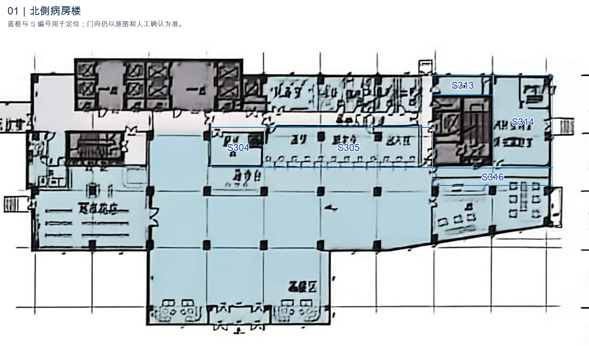

保留 R306：S316 与 S314 直接相通。配餐、医保／新农合前沿仍区分服务联系与工作人员通行，不把柜台窗口画成门。

[无编号原图细节](核对图/01_原图细节.png)

## 02｜中心供应

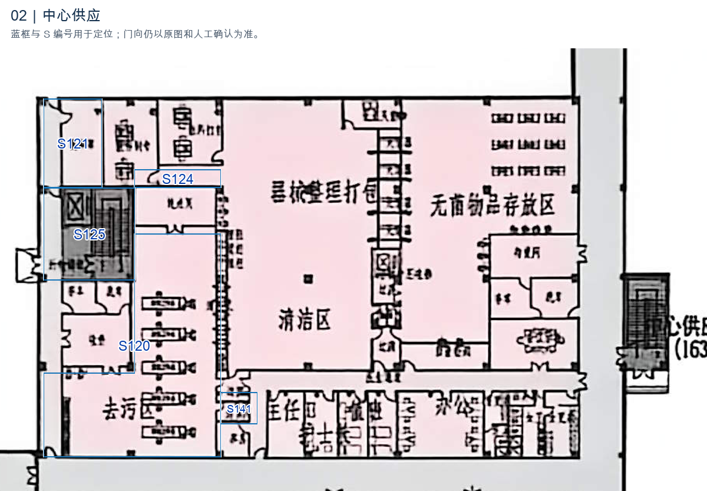

中心供应保留经左侧通路可达的概念联系 R134。该通路未另拆节点，R134 不表示 S120 与 S125 之间有直接门洞，也不新增红点。

[无编号原图细节](核对图/02_原图细节.png)

## 03｜MRI 上部及东侧用房

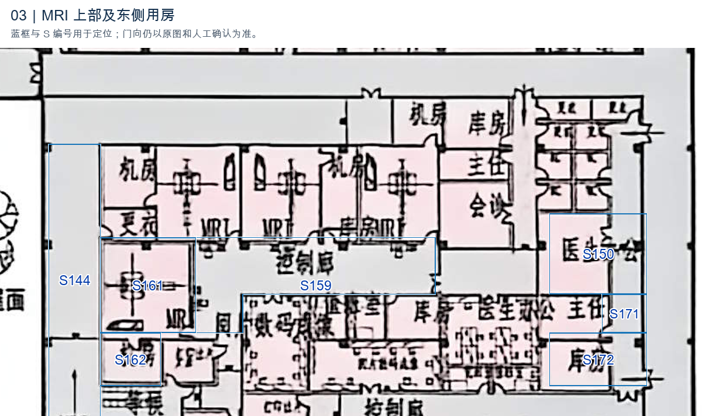

MRI S161 经右下侧门连控制廊 S159；控制廊补回回折段。删除 R162、R163，西侧 S144 不直接进入 MRI 或机房。补充 S161—S162；S172 右上门连接 S171。

[无编号原图细节](核对图/03_原图细节.png)

## 04｜MRI／CT 患者侧

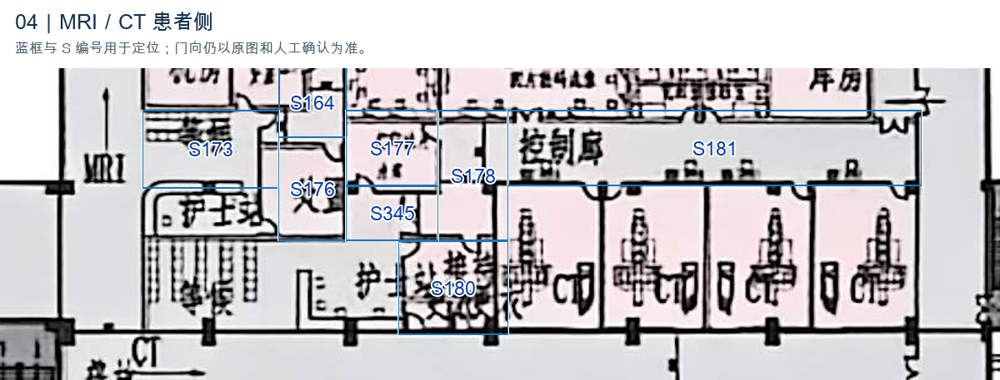

删除 R170、R180 两条跨越中间空间的直接边。等候 S173 经 S164 的合用前室部分进入处置 S176。打印出片 S177 经新增合用前室 S345 接护士站 S179、等候 S175，并接过渡间 S178；S178 与控制廊 S181 相通。

[无编号原图细节](核对图/04_原图细节.png)

## 05｜南侧病房楼

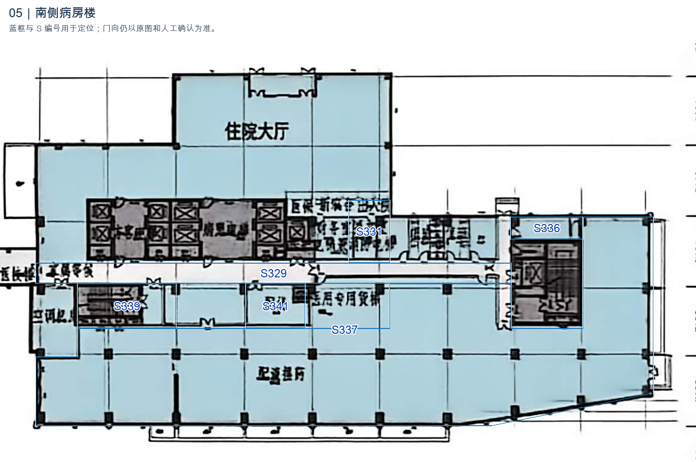

财务室 S331 有门通 S329。医疗超市 S337 经缓冲间／中间走道 S340 到交通核 S339；删除跳过中间节点的 R339，保留分段路径。

[无编号原图细节](核对图/05_原图细节.png)

## 06｜普放北侧出片及更衣

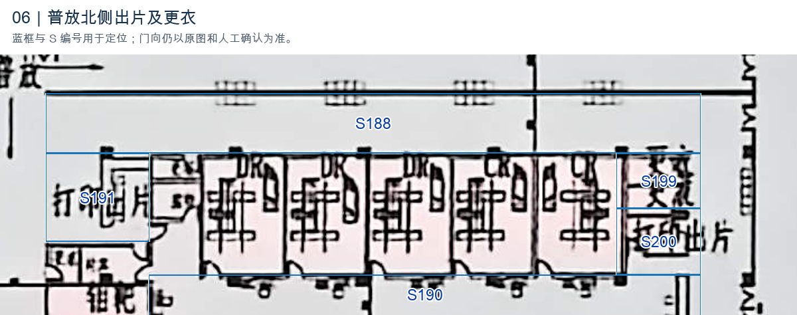

打印出片 S191 与 S188 相通。更衣 S199 的右侧门接东侧 S189，再到 S188；R206 按实际右侧门对应空间修正，避免红点指向北侧走廊。

[无编号原图细节](核对图/06_原图细节.png)

## 07｜普放南侧小房间

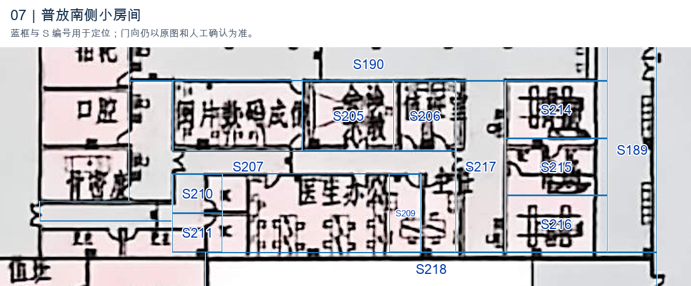

S215 改为设备间，分别连 S214、S216。两间胃肠经内侧 S217 接 S207，删除东侧 S189 的三条旧边。S205、S206 经 S207 进入；S209 上侧门、S210／S211 左侧门与 S207 对应。S218 按用户指定改为庭院，取消人员连接。

[无编号原图细节](核对图/07_原图细节.png)

## 08｜医技南端支持房

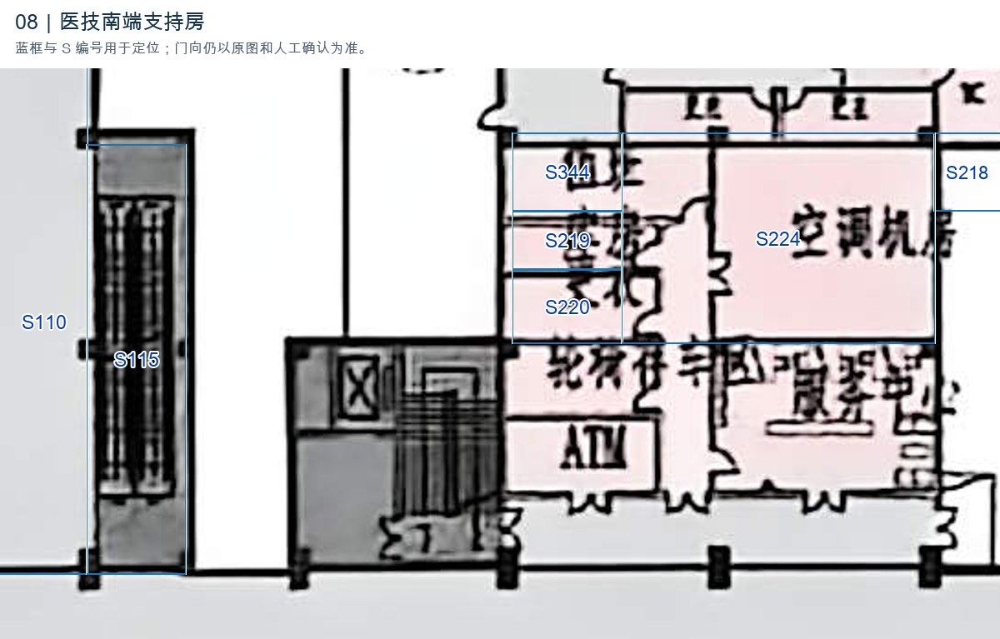

S115 主入口改接下方门诊大厅 S107。S218 为庭院，不接机房及其他房间。值班、机房和库房沿已有 S344—S219—S224—S220 组织，不跨房另造直达边。

[无编号原图细节](核对图/08_原图细节.png)

## 09｜门诊手术及西侧交通核

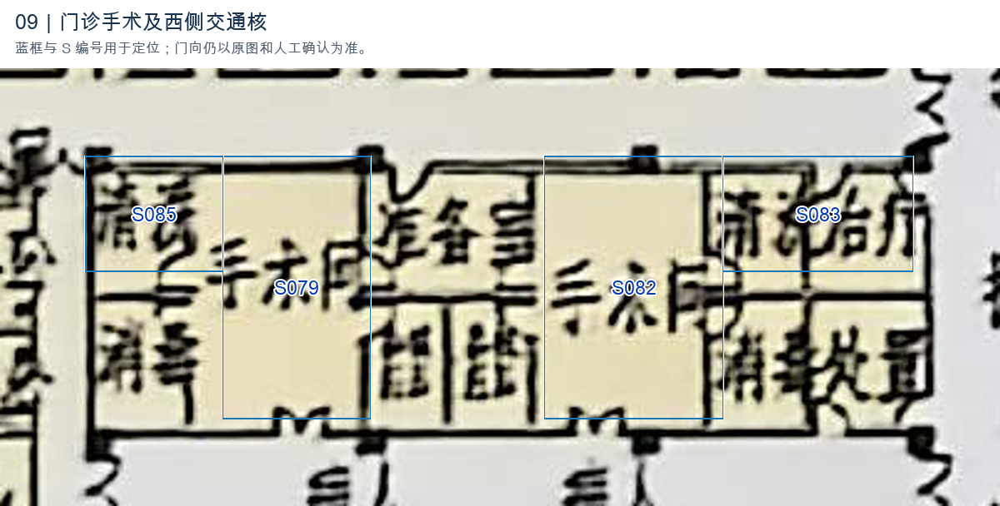

删除 S029、S076 两个交通核。保留 S079—S085；S083 改名清创室，归入处置治疗，并保留与手术间 S082 的概念连接，不补虚构门位。

[无编号原图细节](核对图/09_原图细节.png)

## 10｜急诊西侧卫生及收费

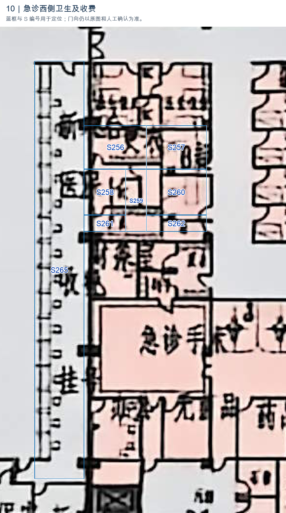

S265、S266、S267 合并为 S265“挂号收费医保新农合”，清除废弃编号和重复关系。S256、S258、S259、S261 作为该工作区的更衣／盥洗／卫生支持，保留原可辨名称；S257 保留 B超，S260、S262 采用用户接受的概念名“操作间”，服务右侧 S235，分别组织路径。

[无编号原图细节](核对图/10_原图细节.png)

## 11｜急诊北侧及挂号

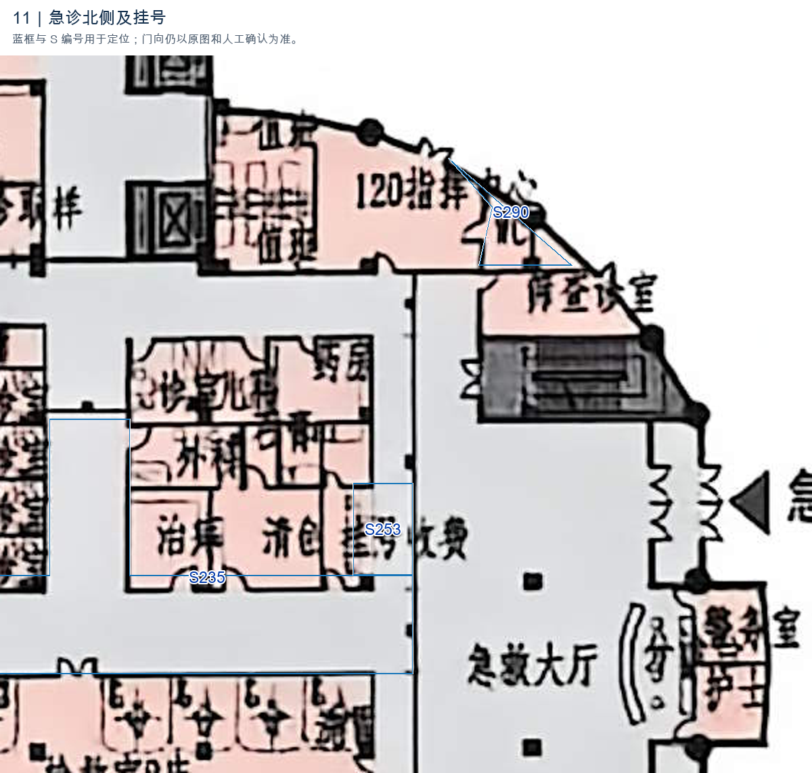

S290 的左侧门连接 S289“120指挥中心”。S253 保持半墙挂号收费区，与 S235 保留可达联系，同时区分面向大厅的服务界面。

[无编号原图细节](核对图/11_原图细节.png)

## 12｜急救南端及保安

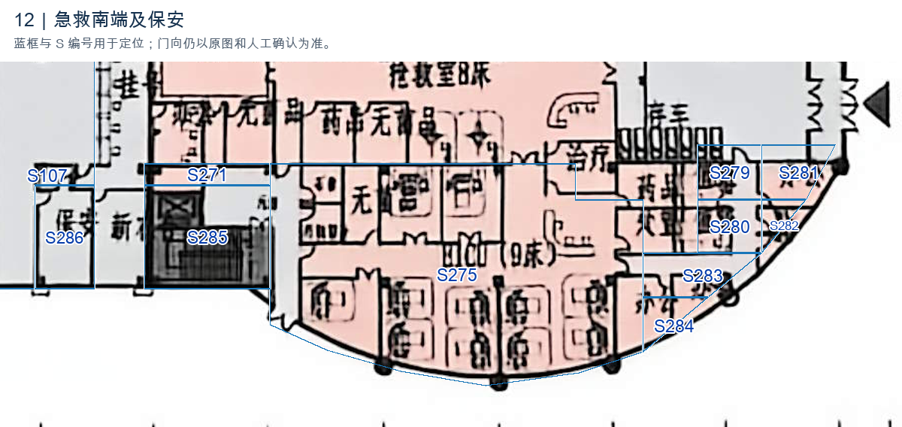

S283 小通道保留，并连接 S280、S284。S271 按合用前室记录，联系 S285；与 EICU S275 的连接按包含内部走廊的功能块处理。保留大厅 S107 与配套保安 S286 的概念可达关系。

[无编号原图细节](核对图/12_原图细节.png)

## 13｜药房南沿与交通核

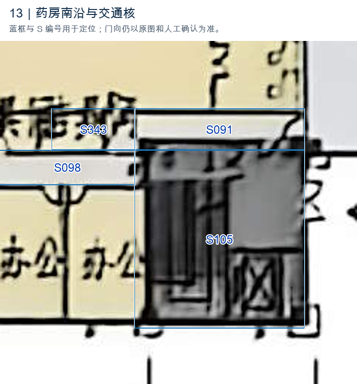

保留 S098—S105、S091—S105、S098—S343；其中 S091 右侧门的通行说明已采用。无法从原图清晰定位的概念连接不额外画红点。

[无编号原图细节](核对图/13_原图细节.png)

## 原始填写

[查看用户原始填写及旧核对图](用户原始填写.md)
