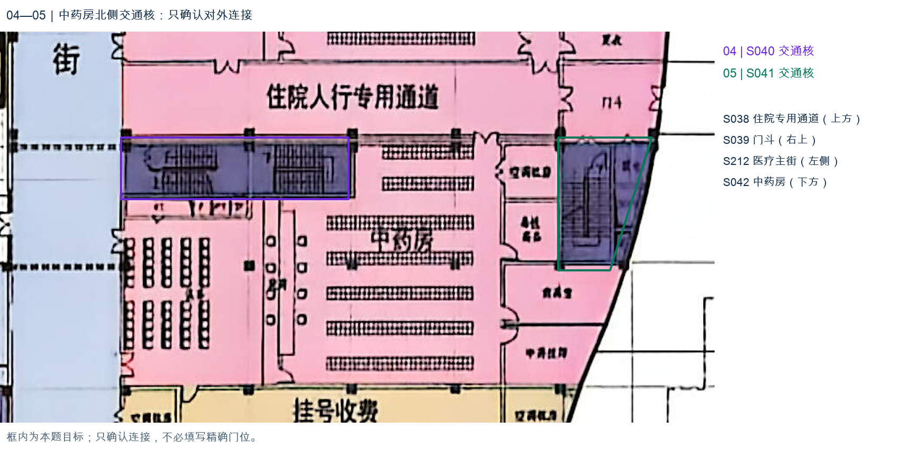
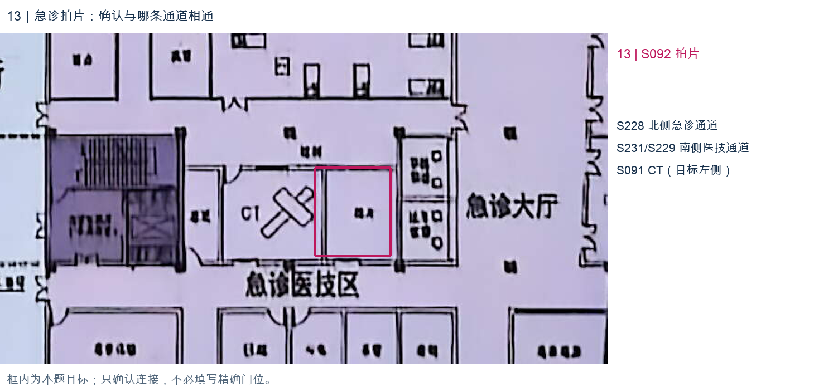
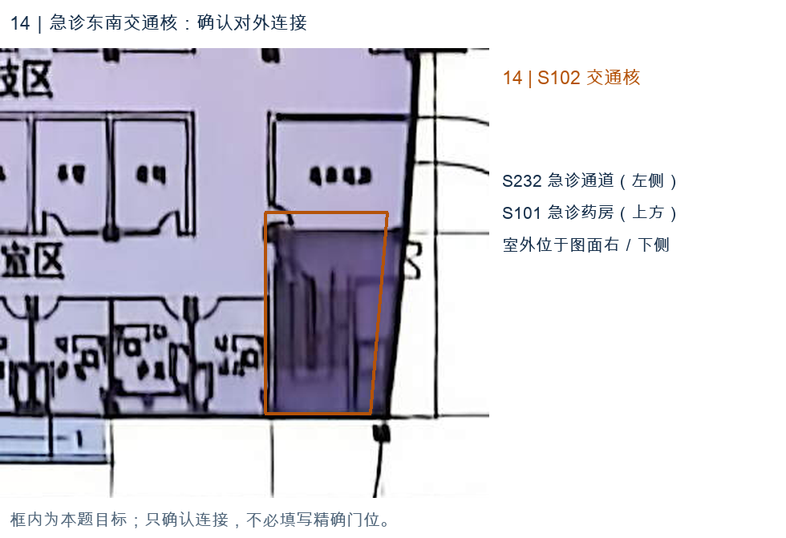

# 兰州市安宁新城｜一层平面标注概览

空间名称已齐；按概念级精度复核后，剩 **4 项关键连接**需要确认。请直接在下方局部图旁填写，整图尚未完成。

**范围：**儿科中心、门诊大厅、西药房与中药房、放射科、输液区、急诊急救、住院大厅及医疗主街。儿科急诊、普通门诊输液、急诊输液及急诊诊疗按功能范围分别保存；住院大厅保留住院支持范围。

**标注规模：**246 个空间／区域，交通核 21 个、功能块 18 个、房间级单元 154 个、开放空间 43 个、半墙服务区 10 个。

**类型与数量：**交通核 21 个、卫生间 11 个、诊室 8 个、隔离用房 1 个、建筑设备用房 24 个、处置治疗 17 个、留观 2 个、检验 2 个、药房 4 个、分诊 2 个、门斗 7 个、挂号收费 5 个、工作人员支持用房 17 个、护士站 5 个、抢救 2 个、取药服务区 2 个、库房 3 个、前室 1 个、服务工作区 9 个、办公 11 个、会议教学 1 个、通道 20 个、配药用房 5 个、服务区 5 个、大厅 19 个、器械用房 5 个、患者准备 5 个、影像检查 23 个、检查 1 个、商业服务 6 个、污物处理 1 个、露天／挑空中庭 1 个。

**连接关系：**262 条，服务联系 8 条、人员可达 242 条、共墙 2 条、入口连接 10 条。

**入口：**儿科入口、北侧住院人行入口、门诊入口、南侧住院人行入口、急救入口、急诊入口、综合住院楼入口、专科住院楼入口、医疗主街北端入口、医疗主街南端入口。

**相对规模：**室内非重叠标注区域的 `area_ratio` 合计为 1；已确认的下沉庭院不参与。具体物理尺寸由生成环节按任务确定。施工级门构造及内部精确路线不纳入数据。

**精度与名称：**边界为概念级近似，复杂开放空间可拆成连续片段，拆分线不代表隔墙。下沉庭院保留轮廓且不参与室内面积归一化。服务窗口、共墙与人员可达分别保存；未列出的关系保持未知。名称沿用原图及用户用词，KT、F、PY、SF、EPS 等代号保留原文，不展开含义。

## 本轮精度与处理

主要功能空间、交通核与通道的可达关系是本轮重点，不逐项追问管井、设备间或辅助小间内部的开门细节。246 个 S 编号、名称和轮廓沿用。

**开口：**233 个红点（225 个门洞、8 个无门开口），对应 211 条可达关系；另有 31 条无定位红点的概念连接。没有可辨门位时不增加红点。

**本次布局推断：**S134“更衣”与 S136“出入院结算”按同组小间面向结算工作区的组织关系，补入概念可达 R281；相邻的 S133、S135 已分别连接该工作区。S134 的具体门位不确定，未增加红点，此项不是用户已确认。

**退出逐项提问的旧号：**01 收费人员入口、02 药房边界窄分片、03／06／09／11／12 设备及检修小间、07／08 放射辅助小间，均按本轮不细究的内部细节保留，证据不足的连接继续留空；07 已有的两石膏单元内门保留。10 更衣按上述布局推断处理。退出提问不表示已确认或不相通。

[原图](../../../标注试样/04_兰州市安宁新城医院新建项目/04_兰州市安宁新城医院新建项目_原图.jpg) · [具名标注 SVG](../../../标注试样/04_兰州市安宁新城医院新建项目/标注.svg) · [原14项核对材料备份](../2026-11-01_精简局部核对/修改前备份/标注说明.md)

## 只需填写以下 4 项

沿用旧核对号 **04、05、13、14**，避免与此前总图错配。每处可填写“同意”、实际相连的空间名称／S 编号，或“待确认”。不必补具体门位和内部路线；以下“我的判断”是助手建议，空白或未作答不代表你同意。

### 04—05｜中药房北侧两处交通核

**04 问题：S040 交通核是否从北侧 S038“住院人行专用通道”进入？**

我的判断：倾向连接北侧通道；南侧为设备带和药房支持空间，主街侧也未见明确入口。图上不能排除其他接入方式，因此只确认整体连接。

**我的确认／备注（04）：同意**

**05 问题：S041 交通核是否从北侧 S039“门斗”进入？**

我的判断：倾向从北侧门斗衔接；西侧隔着药房支持小间，不能据此直接连中药房。北侧分界仍不清楚。

**我的确认／备注（05）：** 同意

### 13｜急诊拍片 S092

**问题：S092“拍片”连接南侧医技通道，还是北侧急诊通道？**

我的判断：倾向南侧 S231／S229 医技通道；南侧是该排检查用房的公共通行带，但拍片室门线不足以确定。北侧通道为 S228，左侧 CT 为 S091。

**我的确认／备注（13）：**南侧

### 14｜急诊东南交通核 S102

**问题：S102 交通核是否直接连接西侧 S232“急诊通道”？**

我的判断：倾向服务西侧急诊诊疗区；但该侧未见清晰开口，仍可能经北侧药房或室外独立进入。这会改变交通核对外连接，需要你判断。

**我的确认／备注（14）：** 同意

**完成边界：**上述 4 项仍待确认；其余未记录连接不作为不可通行负例。你填写并保存后，再同步明确答案并完成校验与目检。

## 同步结果（2026-11-01）

四项用户答案均已同步；上文问题与“待确认”状态是填写时的原始上下文。

- 04：原答“同意”，补入 S040—S038，R282。
- 05：原答“同意”，补入 S041—S039，R283。
- 13：原答“南侧”，补入 S092—S229，R284。S229 与 S231 已由 R007 连通；使用 S229 表达南侧连续通道，不据此确定门的位置或数量。
- 14：原答“同意”，补入 S102—S232，R285。

以上均为无定位门点的概念连接；没有把用户确认的通行关系转换为虚构门位。
