# 定稿前填写与连通复核归档

以下为删除两项未知空间前的历史快照。S137、S138已按用户2026-11-03的明确指令从正式标注排除；当前结果以[正式标注说明](../../../标注试样/13_天津市中心妇产科医院迁址新建工程/标注说明.md)为准。原66项填写、编号与备注完整留存。

# 13_天津市中心妇产科医院迁址新建工程：标注草稿

本轮已同步用户明确填写的19项名称；仅32／S137、33／S138按用户“不管了”的备注暂缓，继续保留名称未确认及unknown。本轮已完成概念层级的主要连通复核并恢复清晰门洞红点；两项暂缓名称仍使整图保持草稿。

**标注规模：**&#x32;02 个空间／区域，房间级单元 153 个、交通核 13 个、开放空间 21 个、功能块 7 个、半墙服务区 4 个、绿化 4 个。

## 用户补充同步（2026-11-03）

本次从原“我的确认／备注”栏同步19项名称，unknown由21项减至2项；办公（10／S027）和值班室（17／S048）与现有名称一致，保留用户填写。12／S032原填“弱点”，用户在聊天中明确更正为“弱电”，本表保留原填记录并注明更正。

**暂缓项：**32／S137、33／S138原填“不管了”。按用户意愿暂停名称追问，名称及类型仍为未确认／unknown，不把该备注当作功能名称，不删除空间。名称同步时保留原01—66核对号、S编号、轮廓、面积、层级及scope；本次连通续作的局部轮廓修订另见下节。

**名称同步阶段边界：**前轮已完成19项明确名称同步；当时为202个空间、164条关系、0个开口定位点。以下“门洞与主要连通复核”记录本次续作后的实际状态；历史填写和名称同步记录继续保留。

**类别处理：**复合名称继续作为一个既有空间，不据名称拆分轮廓。更衣/财务按办公归类，阅览室按工作人员支持用房、阅览室/病案接待按服务工作区归类，清单医保按挂号收费、贵宾室按服务区归类；保留用户原名，不展开未经确认的业务用途。上述单类别用于概念级编码，不代替完整复合功能。

[本次同步前备份（含用户原始填写）](../用户填写同步_20261103_105752/修改前备份/标注说明.md)

**名称同步阶段校验：**前轮名称同步的结构检查无错误，仍有S137、S138两项暂缓名称；当时只核对名称显示。本次连通关系、局部轮廓和门洞显示的校验结果见下节。

### 前轮照片补名记录

此前依据6张近照补齐45项名称；本次再采用用户明确补充的19项，原66项中64项名称已同步、2项暂缓。照片判读与用户填写来源分别保留在原表中。照片材料和历史固定核对图继续沿用。

## 门洞与主要连通复核（2026-11-03 续作）

**本轮结果：**逐片核对放射科、药房支持、急诊、门诊各段、医院街、大厅、交通核与7个入口。当前为202个空间、210条关系：200条人员可达、3条服务联系、7条入口连接。定位181个红点（180个门洞、1个无门开口），对应178条人员可达关系；另22条为无门位定位的概念连通。P编号仅用于门洞／开口，E编号继续用于建筑入口。

**变更范围：**新增49条有图面依据的人员可达关系，修正9条既有关系的直接相连空间，撤除R035、R048、R140三条重复或跨过中间空间／实墙的关系。既有R、S编号不重排，新增关系从R158续编。E001污物出口的直接相连空间改为S004交通核，经R017进入主走道；其余入口保留。为使通道支段和门口所在单元对应，修订12个既有空间的局部轮廓并重新归一化室内相对面积；未新增房间、未修改名称／类别／层级／scope。

**关键修正及依据：**

| 片区 | 同步到annotation.json的实际连接 | 图面依据 |
| --- | --- | --- |
| 放射科 | CT前区—S006—S011；补控制室、暗室、设备间与横走道的门；值班室S030改接S034 | 可辨门扇及连续横通道；CT前区连续连接作为布局推断，不虚构门位 |
| 药房北侧 | 输液药房S055、空调机房S054、门诊接待S063直接接医院街S042；S045经S047接S046 | 三处门分别开向医院街；病案存放东门开向阅览室，而非北侧走道 |
| 药房内部 | 补S046—S061、S046—S068；S060、S065接S061内通道；保留取药服务联系 | 中药房北侧双扇门清楚；西药房与西侧内部通道连续；服务窗口不产生通行点 |
| 急诊 | S129抢救厅—S139—S140—S131；补S125电梯厅—医院街与注射室南门 | 三段通道之间及抢救厅南门均有可辨开口；不跨中间过道直连 |
| 门诊西段 | VIP诊室经VIP服务厅接候诊厅；留观／更衣／脱衣接S096；绒毛取材室经留观进出 | 图面门扇与局部走道组织；PCR前区归入既有候诊通道，不扩展为各检验室互通 |
| 门诊中东段 | 中部楼梯S171接医院街；产前教育S189保留医院街出入口，取消穿过南墙直达S195的关系 | 楼梯西侧有开口；产前教育与新生儿候诊厅之间为连续墙线 |

**概念连通与布局推断：**大厅／医院街／候诊厅的连续片区、药房西侧内部通道、CT南侧前区及整体交通核按图面连续组织保留可达关系；不能定位独立门洞的地方不画红点。S165与S164只表示卫生间组前室和内部单元的概念连接，S077只记录电梯组整体朝向医院街，不逐个虚构电梯门位。这些判断由本轮图面复核得出，不写成用户已确认。

**本轮不细究的内部细节：**S069、S071、S073、S074、S092、S110、S161的精确进出路径，以及暂缓名称的S137、S138，未补证据不足的通行关系；不以共墙、柜台、家具或服务窗推导人员可达。它们未进入当前主可达分量不表示物理上不能通行，也不能作为负样本。局部卫生间、设备小间和检验支持小间内部路线不逐项提问。

**主要连通结论：**所有既有大厅／通道、交通核、半墙服务区和功能块均能沿已记录的人员可达关系接入医院街所在主分量；这只是漏连检查，语义判断仍以逐片原图复核为依据。本轮目标层级无新增关键连通待确认问题。S137、S138继续按用户备注暂缓名称，整图不宣称名称齐全或最终打标完成。

**核验：**正式`validate --check-dir`检查结构、非重叠轮廓、面积归一化及SVG红点与JSON的编号／坐标／空间对对应；`valid=true`、`errors=[]`，`names_complete=false`仍仅为S137、S138（退出码2）。已检查最新SVG全图及七片密集局部，P标签采用红字白底显示；原图哈希、200个既定名称及原66项填写保持一致。

[本轮修改前备份](../连通续作_20261103_112731/修改前备份/标注说明.md) · [连通修订依据](../连通续作_20261103_112731/连通修订依据.json) · [打开更新后全图](../连通续作_20261103_112731/连通更新_全图.png)

### 放射科：门洞与横向走道

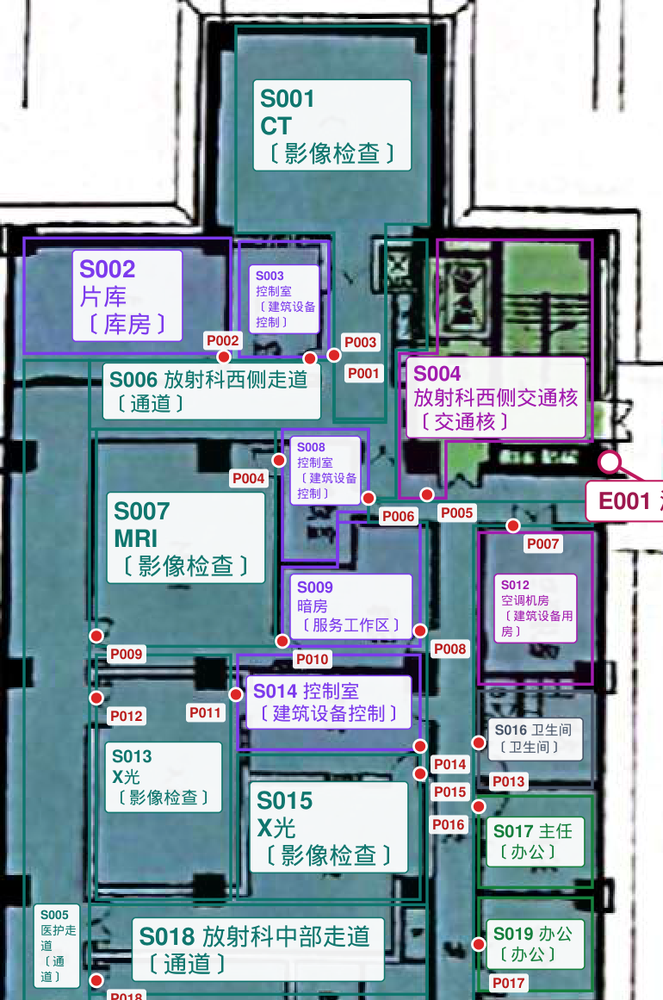

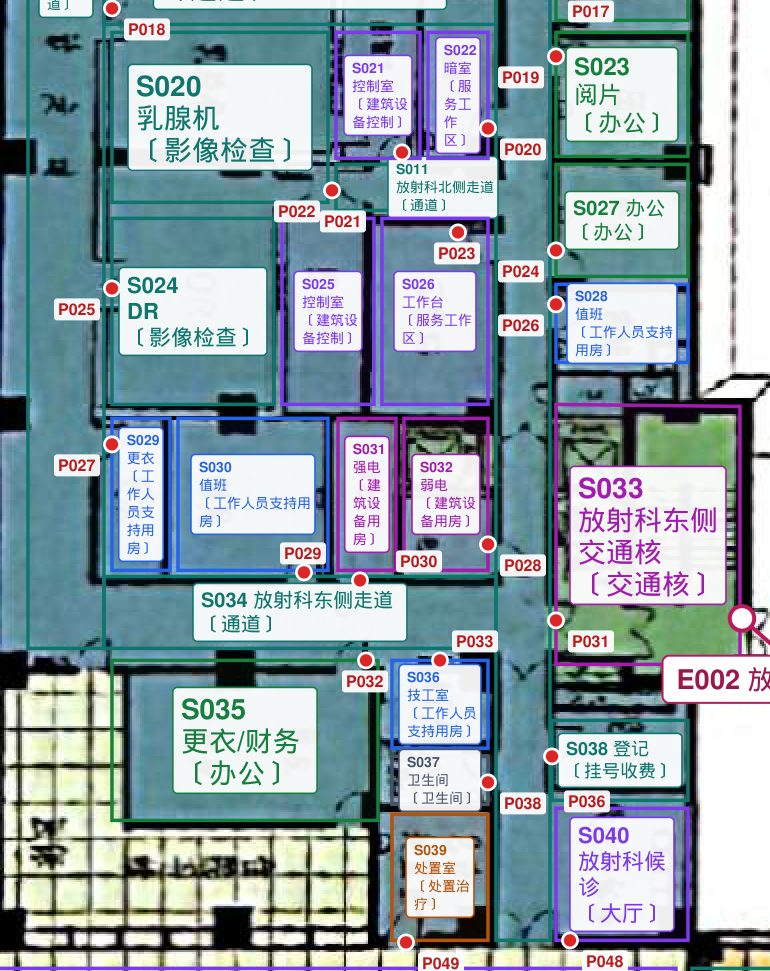

### 药房支持与急诊：真实进出方向

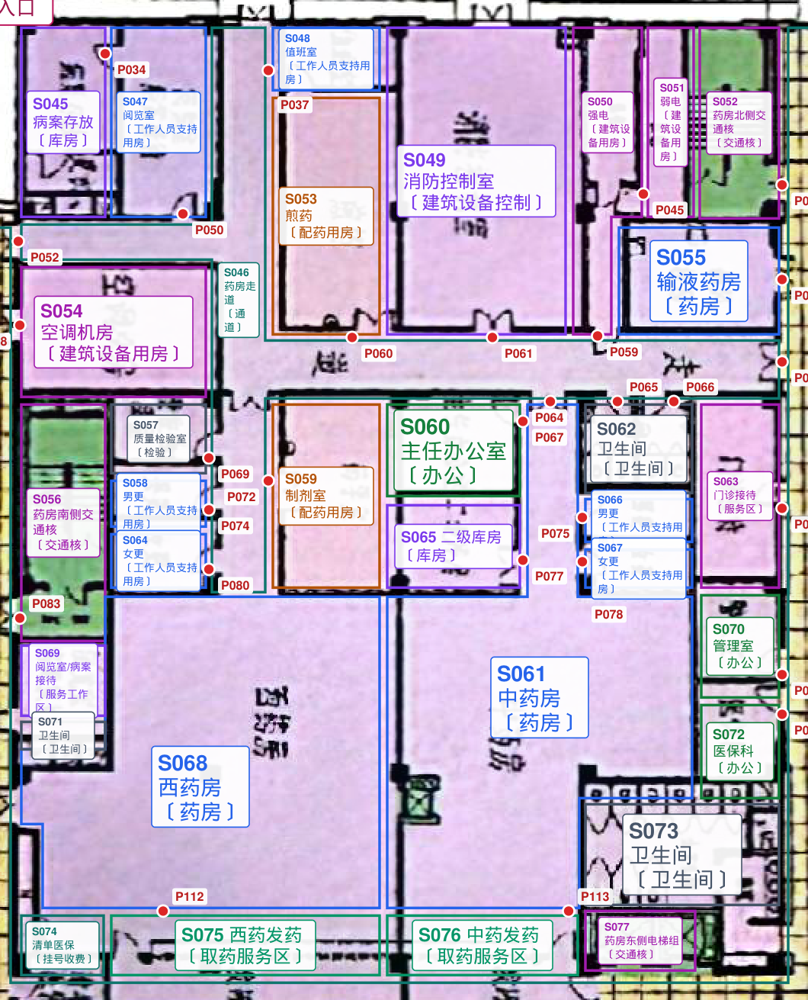

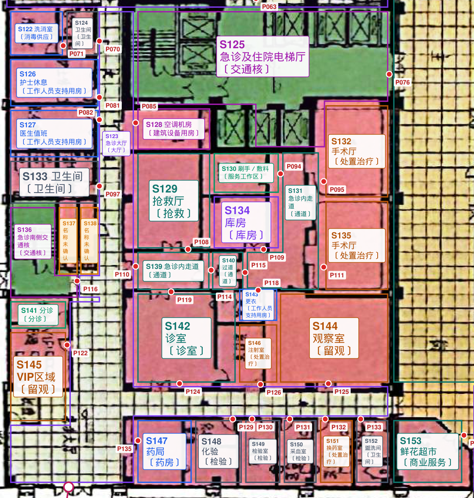

### 门诊西段、中段及东段

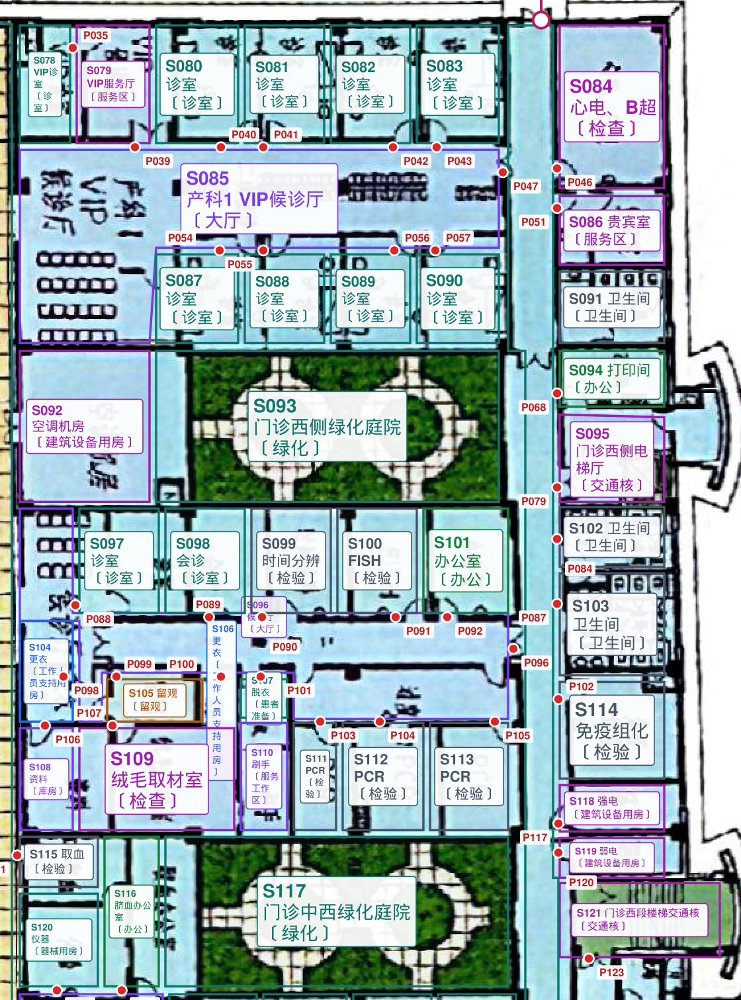

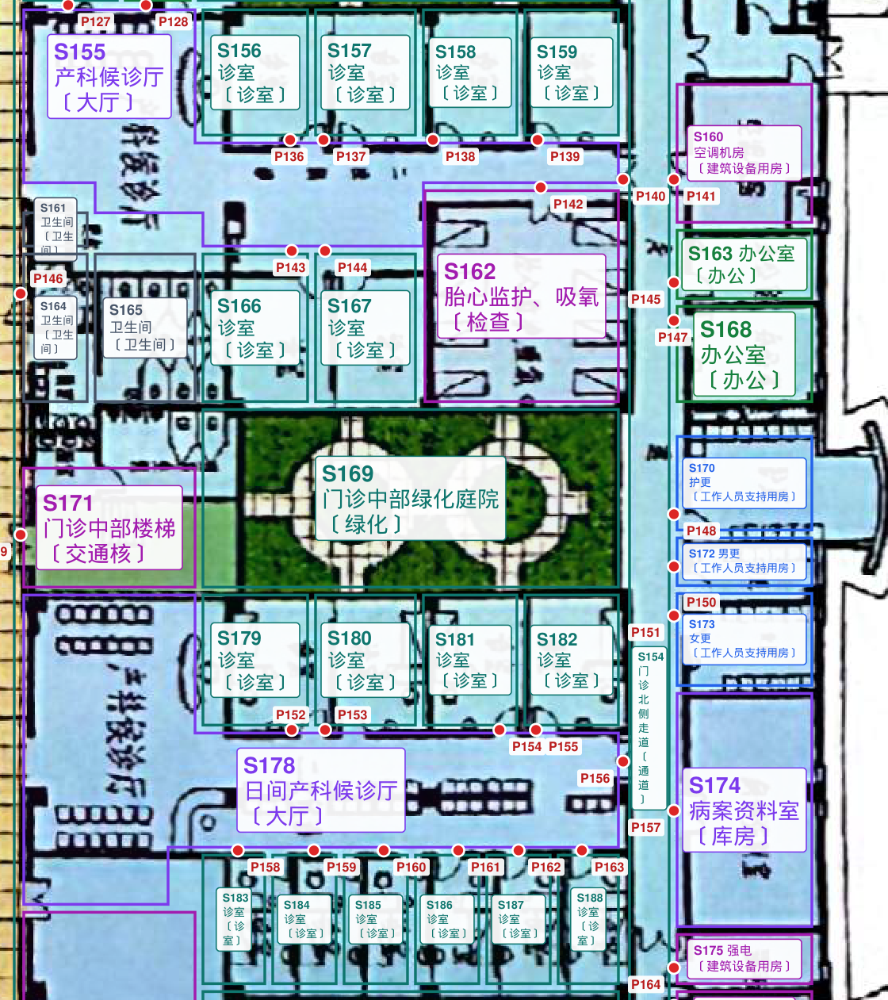

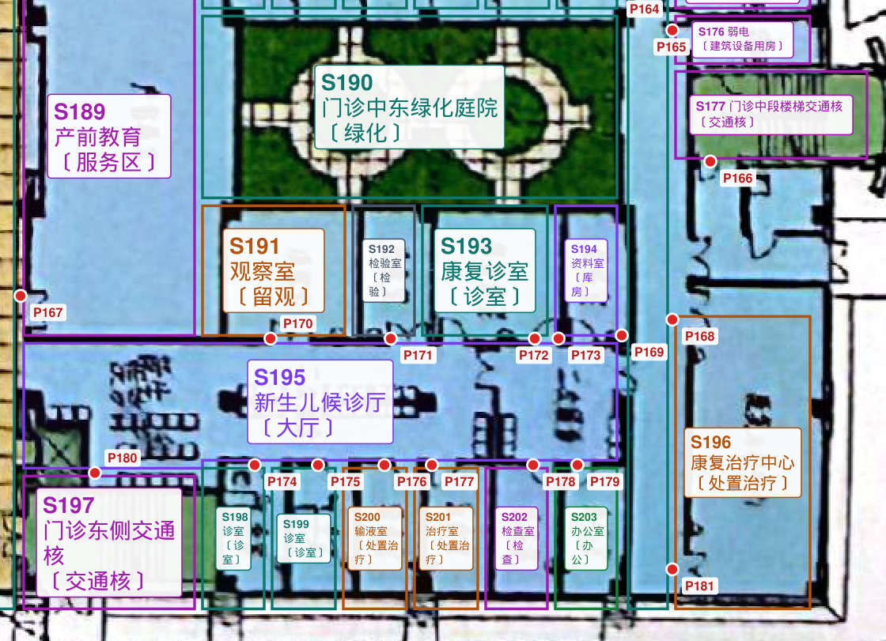

## 原66项固定核对表：64项名称已同步，2项按用户备注暂缓

下表保留原01—66核对号及S编号映射、历史候选与证据及用户填写。45项来自前轮照片判读，19项采用本轮用户明确名称，32、33项按备注暂缓。当前实际名称以JSON及SVG为准，历史“预估名称”不覆盖用户答案。照片判读不冒称用户逐项确认。

原核对项分区及编号保留如下；仅急诊32、33两项仍为unknown，用户已明确暂缓。

可直接修改“预估名称（可改）”，再将“我的确认／备注”改为“已确认”；也可直接在确认栏填写实际名称。不确定的项继续保留“待确认”。你也可以在聊天中回复 `01=名称，02=名称`，支持分批确认。两端的核对号表示同一项，原有 01—66 与 S 编号的对应保持不变。

### 核对总图及局部放大图

先读总图左栏 **01—41**，再读右栏 **42—66**，每栏从上到下。下方按原核对号顺序分组，在填写表旁直接显示局部图；跨片区的小组同时显示两张图。局部放大图为方便阅读而临时转正，编号与总图一致。

[原图](../../../标注试样/13_天津市中心妇产科医院迁址新建工程/13_天津市中心妇产科医院迁址新建工程_原图.jpg) · [现有具名 SVG 草稿](../../../标注试样/13_天津市中心妇产科医院迁址新建工程/标注.svg) · [打开高清核对总图](../13_名称核对总图.png)

| 片区      | 原核对项／当前待确认 | 局部放大图                                                    |
| ------- | ---------- | -------------------------------------------------------- |
| 放射科     | 原15项；名称已同步 | [打开局部图](../核对放大_放射科.png)     |
| 药房及消毒支持 | 原14项；名称已同步 | [打开局部图](../核对放大_药房及消毒支持.png) |
| 急诊      | 原12项；暂缓2项 | [打开局部图](../核对放大_急诊.png)      |
| 门诊西段    | 原12项；名称已同步 | [打开局部图](../核对放大_门诊西段.png)    |
| 门诊中段    | 原5项；名称已同步 | [打开局部图](../核对放大_门诊中段.png)    |
| 门诊东段    | 原8项；名称已同步 | [打开局部图](../核对放大_门诊东段.png)    |

旧核对总图及旧局部图用于固定编号定位，黄色状态为此前快照；当前完成状态以本表和最新SVG为准。

候选较多时，本行“依据与把握”说明候选共用的线索及无法区分之处。仅凭相邻关系、片区或家具不能确定具体科别；单一候选同样不代表已确认。没有可靠线索的项已明确写为“暂无可靠候选”。

### 放射科：01—14

**本轮近照（与下方原核对号对应）：**

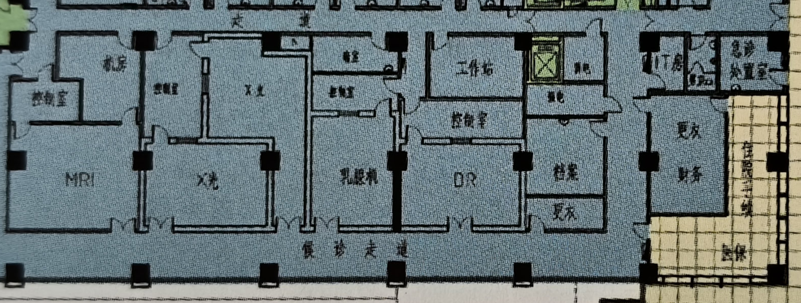

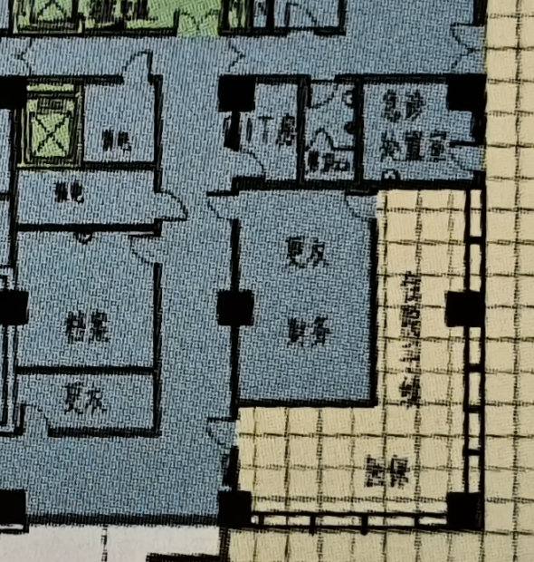

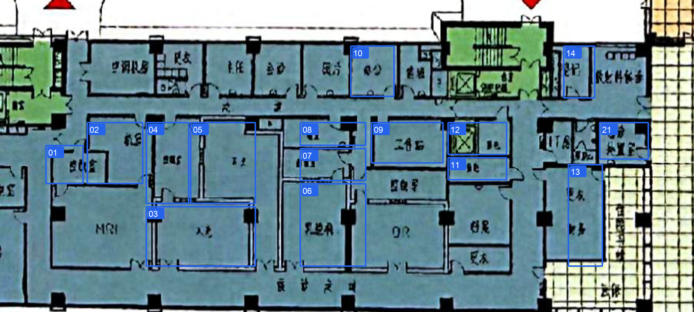

| 核对号 | S编号  | 片区  | 预估名称（可改） | 备选名称     | 依据与把握                                    | 我的确认／备注         | 核对号（重复） |
| --- | ---- | --- | -------- | -------- | ---------------------------------------- | --------------- | ------- |
| 01 | S008 | 放射科 | 控制室 | — | 照片05、06：MRI旁的小间可读为控制室。 把握：高。 | 照片判读已同步；非用户逐项确认 | 01 |
| 02 | S009 | 放射科 | 暗房 | — | 照片05、06：MRI上方房间可读为暗房。 把握：高。 | 照片判读已同步；非用户逐项确认 | 02 |
| 03 | S013 | 放射科 | X光 | — | 照片05、06：下侧检查间标注X光，保留原字，不补写室。 把握：高。 | 照片判读已同步；非用户逐项确认 | 03 |
| 04 | S014 | 放射科 | 控制室 | — | 照片05、06：两间X光用房旁的狭长房间标注控制室。 把握：高。 | 照片判读已同步；非用户逐项确认 | 04 |
| 05 | S015 | 放射科 | X光 | — | 照片05、06：上侧独立检查间同样标注X光，并非原候选控制室。 把握：高。 | 照片判读已同步；非用户逐项确认 | 05 |
| 06 | S020 | 放射科 | 乳腺机 | — | 照片05、06：可读为乳腺机；保留原标注，不补设备型号。 把握：高。 | 照片判读已同步；非用户逐项确认 | 06 |
| 07 | S021 | 放射科 | 控制室 | — | 照片05、06：乳腺机上侧对应房间标注控制室。 把握：高。 | 照片判读已同步；非用户逐项确认 | 07 |
| 08 | S022 | 放射科 | 暗室 | 辅房 | 照片05、06：位于乳腺机控制室上方，两字仍不能可靠区分。把握：低。 | 暗室；已同步 | 08 |
| 09 | S026 | 放射科 | 二合一 | 二合区 | 照片05、06：前两字似二合，末字受印刷纹理干扰；不按常见设备名补全。把握：中。 | 工作台；已同步 | 09 |
| 10 | S027 | 放射科 | 办公 | — | 照片05、06：北排、阅片与值班之间的房间标注办公。 把握：高。 | 办公；用户已确认，与现有名称一致 | 10 |
| 11 | S031 | 放射科 | 强电 | 配电 | 照片05：交通核下方小间似电气用房，首字仍模糊。把握：低。 | 强电；已同步 | 11 |
| 12 | S032 | 放射科 | 辅房 | 片库 | 照片05：紧贴竖井的小间两字仍不清楚，不据相邻关系定名。把握：低。 | 弱电（原填“弱点”，聊天已更正）；已同步 | 12 |
| 13 | S035 | 放射科 | 更衣／候诊 | 暂无其他可靠候选 | 照片05、06：上行似更衣，下行仍不清楚；组合房名尚不能确定。把握：低。 | 更衣/财务；已同步 | 13 |
| 14 | S038 | 放射科 | 登记 | — | 照片05：放射科候诊端、交通核右侧狭长房间标注登记。 把握：高。x | 照片判读已同步；非用户逐项确认 | 14 |

### 药房支持及放射科末端：15—24

**本轮近照（与下方原核对号对应）：**

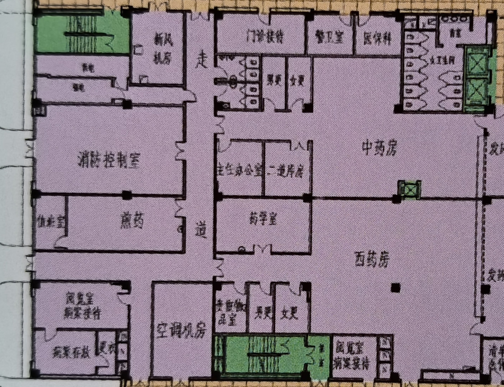

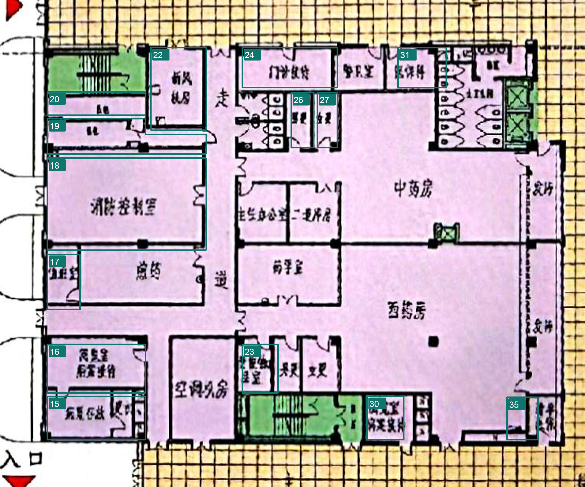

| 核对号 | S编号  | 片区      | 预估名称（可改） | 备选名称        | 依据与把握                                             | 我的确认／备注         | 核对号（重复） |
| --- | ---- | ------- | -------- | ----------- | ------------------------------------------------- | --------------- | ------- |
| 15 | S045 | 药房及消毒支持 | 无菌存放 | 病案存放 | 照片03、04：末两字存放较清楚，前两字仍不能可靠区分；原无菌供应仅为历史候选。把握：低。 | 病案存放；已同步 | 15 |
| 16 | S047 | 药房及消毒支持 | 高压室／无菌存储 | 无菌室／无菌存储 | 照片03：下行似无菌存储，上行首两字仍有不同解释。把握：中。 | 阅览室；已同步 | 16 |
| 17 | S048 | 药房及消毒支持 | 值班室 | — | 照片03：煎药房西侧窄间可读为值班室。 把握：高。 | 值班室；用户已确认，与现有名称一致 | 17 |
| 18 | S049 | 药房及消毒支持 | 消毒器材室 | 消毒敷料室／消毒控制室 | 照片03：消毒及末字室可辨，中部字受印刷网纹影响；这些候选共用相同文字线索，仍不能区分。把握：中。 | 消防控制室；已同步 | 18 |
| 19 | S050 | 药房及消毒支持 | 强电 | — | 照片03：西北交通核下侧两间狭长用房中，下间标注强电。 把握：高。 | 照片判读已同步；非用户逐项确认 | 19 |
| 20 | S051 | 药房及消毒支持 | 弱电 | — | 照片03：紧贴西北交通核下侧的上间标注弱电。 把握：高。 | 照片判读已同步；非用户逐项确认 | 20 |
| 21 | S039 | 放射科 | 导管放置室 | 导诊／处置室 | 照片05：两行房名可见导字及室字，中部仍有不同解释。把握：低。 | 处置室；已同步 | 21 |
| 22 | S055 | 药房及消毒支持 | 输液药房 | — | 照片03：西北交通核右侧两行字可读为输液、药房。 把握：高。 | 照片判读已同步；非用户逐项确认 | 22 |
| 23 | S057 | 药房及消毒支持 | 质量检验室 | — | 照片03：男更旁小间两行字可读为质量检、验室。 把握：高。 | 照片判读已同步；非用户逐项确认 | 23 |
| 24 | S063 | 药房及消毒支持 | 门诊接待 | — | 照片03：药房支持区北排可读为门诊接待。 把握：高。 | 照片判读已同步；非用户逐项确认 | 24 |

### 药房支持与急诊交界：25—35

**本轮近照（与下方原核对号对应）：**

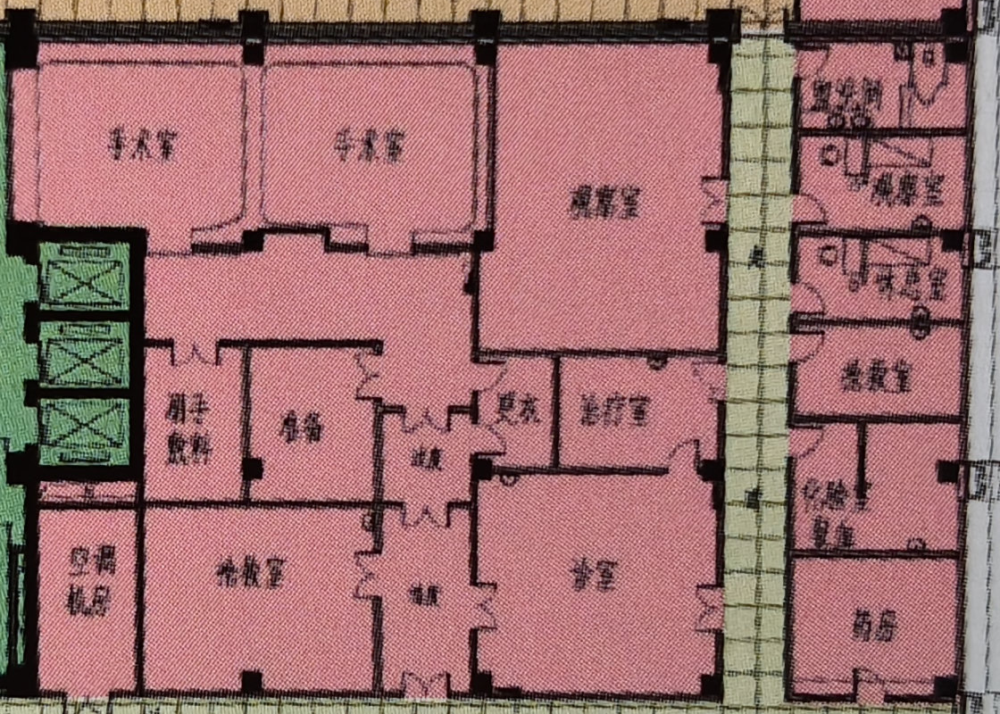

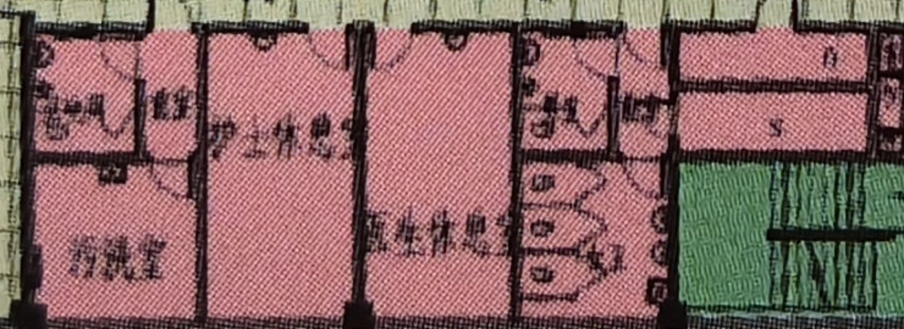

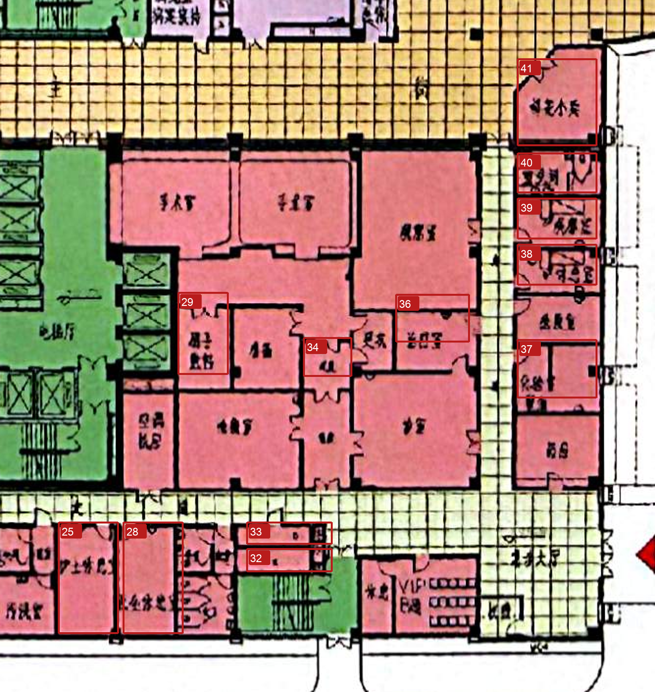

| 核对号 | S编号  | 片区      | 预估名称（可改） | 备选名称     | 依据与把握                                         | 我的确认／备注         | 核对号（重复） |
| --- | ---- | ------- | -------- | -------- | --------------------------------------------- | --------------- | ------- |
| 25 | S126 | 急诊 | 护士休息 | — | 照片04：急诊南排长间标注护士休息。 把握：高。 | 照片判读已同步；非用户逐项确认 | 25 |
| 26 | S066 | 药房及消毒支持 | 男更 | — | 照片03：卫生间旁成对更衣小间左间标注男更。 把握：高。 | 照片判读已同步；非用户逐项确认 | 26 |
| 27 | S067 | 药房及消毒支持 | 女更 | — | 照片03：成对更衣小间右间标注女更。 把握：高。 | 照片判读已同步；非用户逐项确认 | 27 |
| 28 | S127 | 急诊 | 医生值班 | — | 照片04：护士休息右侧长间两行字标注医生值班。 把握：高。 | 照片判读已同步；非用户逐项确认 | 28 |
| 29 | S130 | 急诊 | 刷手／敷料 | — | 照片04：手术支持位置两行文字可读为刷手、敷料；沿用现有空间层级。 把握：高。 | 照片判读已同步；非用户逐项确认 | 29 |
| 30 | S069 | 药房及消毒支持 | 敷料室／消毒器材 | 暂无其他可靠候选 | 照片03：两行字末部似消毒器材，上行及完整用途仍不清楚。把握：低。 | 阅览室/病案接待；已同步 | 30 |
| 31 | S072 | 药房及消毒支持 | 医保科 | — | 照片03：管理室右侧北排小间可读为医保科。 把握：高。 | 照片判读已同步；非用户逐项确认 | 31 |
| 32 | S137 | 急诊 | 暂无可靠候选 | — | 照片04：急诊南侧交通核上方横向小间只有模糊单字母样标注，不能据此赋予用途。把握：低。 | 不管了；按用户备注暂缓，保留unknown | 32 |
| 33 | S138 | 急诊 | 暂无可靠候选 | — | 照片04：与S137成对的小间同样只有单字母样标注，不把字母当成房名或推断用途。把握：低。 | 不管了；按用户备注暂缓，保留unknown | 33 |
| 34 | S140 | 急诊 | 过道 | — | 照片04：更衣、抢救与诊室之间的小型交通空间标注过道。 把握：高。 | 照片判读已同步；非用户逐项确认 | 34 |
| 35 | S074 | 药房及消毒支持 | 清单发药 | 清算发药 | 照片03：医院街一侧的狭长服务位置，下行发药较清楚，上行第二字待核。把握：低。 | 清单医保；已同步 | 35 |

### 急诊：36—41

**本轮近照（与下方原核对号对应）：**

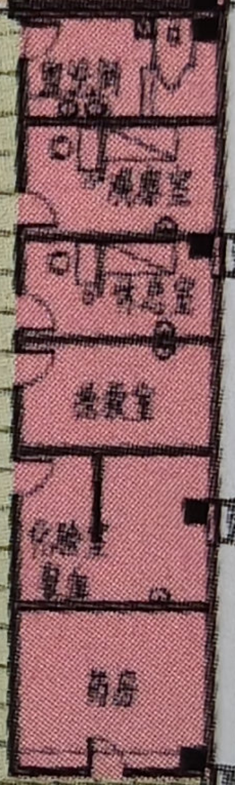

| 核对号 | S编号  | 片区 | 预估名称（可改） | 备选名称  | 依据与把握                                    | 我的确认／备注         | 核对号（重复） |
| --- | ---- | -- | -------- | ----- | ---------------------------------------- | --------------- | ------- |
| 36 | S146 | 急诊 | 注射室 | — | 照片04：更衣旁横向小间标注注射室。 把握：高。 | 照片判读已同步；非用户逐项确认 | 36 |
| 37 | S148 | 急诊 | 化验／量血压 | 化验／测量 | 照片04：东侧药局上方两行字，首行似化验，下行未能可靠读全。把握：低。 | 化验；已同步 | 37 |
| 38 | S150 | 急诊 | 采血室 | — | 照片04：东侧竖排房间、换药室下方可读为采血室。 把握：高。 | 照片判读已同步；非用户逐项确认 | 38 |
| 39 | S151 | 急诊 | 换药室 | — | 照片04：东侧竖排房间、采血室上方可读为换药室。 把握：高。 | 照片判读已同步；非用户逐项确认 | 39 |
| 40 | S152 | 急诊 | 妇产科诊室 | 妇产科门诊 | 照片04：东侧竖排最上间可辨妇产科，下一行仍未可靠读全，具体名称待核。把握：中。 | 盥洗间；已同步 | 40 |
| 41 | S153 | 急诊 | 妇科小手术 | 小手术室 | 照片04：医院街与急诊接口处可辨妇科小手字样，末字未清，不自动补全。把握：中。 | 鲜花超市；已同步 | 41 |

### 门诊西段：42—53

**本轮近照（与下方原核对号对应）：**

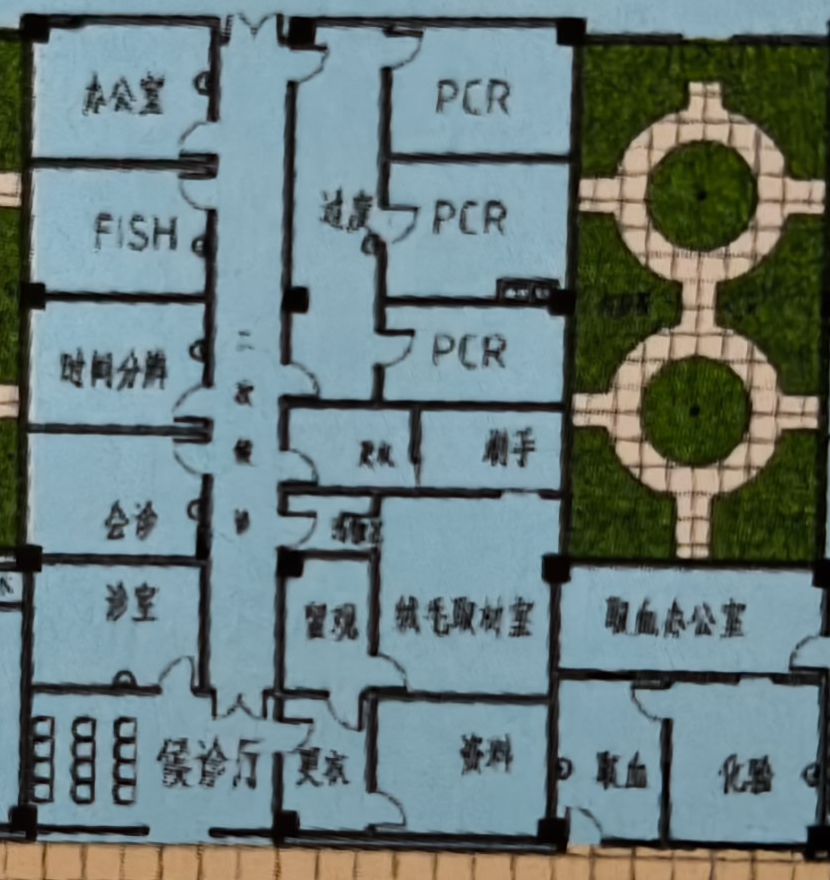

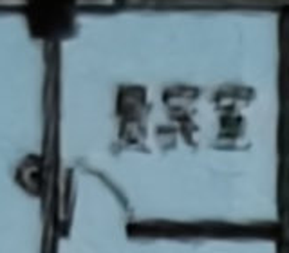

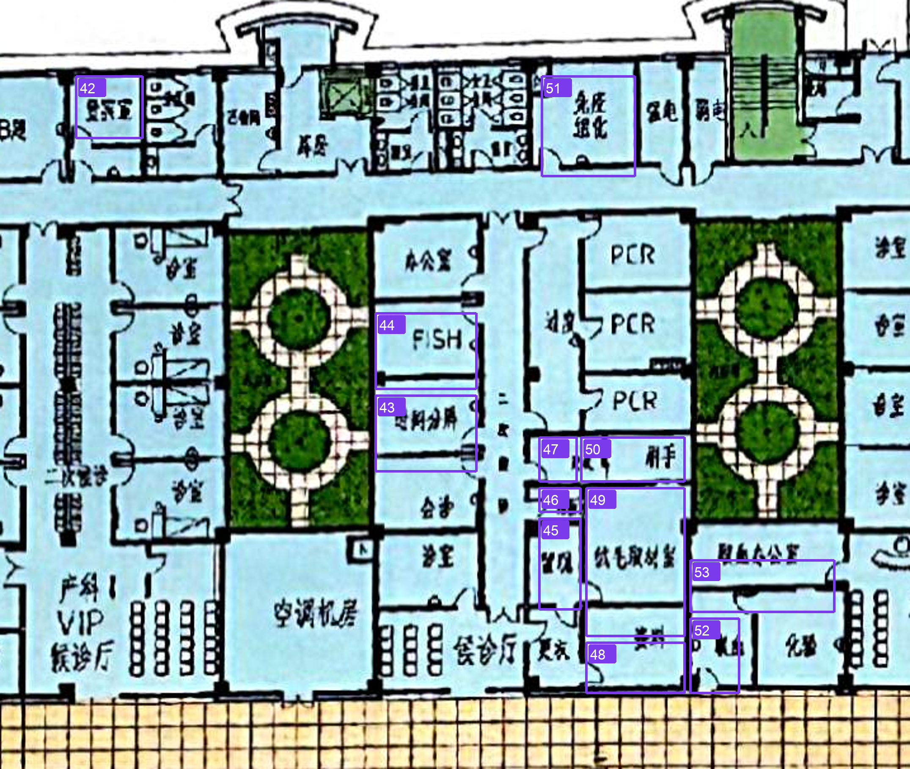

| 核对号 | S编号  | 片区   | 预估名称（可改） | 备选名称 | 依据与把握                                        | 我的确认／备注         | 核对号（重复） |
| --- | ---- | ---- | -------- | ---- | -------------------------------------------- | --------------- | ------- |
| 42 | S086 | 门诊西段 | 尿采室 | 采样室 | 照片01：心电、B超右侧小间末字室清楚，前两字仍有不同解释，候选仅供看图核对。把握：低。 | 贵宾室；已同步 | 42 |
| 43 | S099 | 门诊西段 | 时间分辨 | — | 照片01：FISH下方房间可读为时间分辨；不展开为其他检验项目名。 把握：高。 | 照片判读已同步；非用户逐项确认 | 43 |
| 44 | S100 | 门诊西段 | FISH | — | 照片01：字母F、I、S、H均清楚，修正原候选FSH。 把握：高。 | 照片判读已同步；非用户逐项确认 | 44 |
| 45 | S105 | 门诊西段 | 留观 | — | 照片01：绒毛取材室左侧小间明确标注留观。 把握：高。 | 照片判读已同步；非用户逐项确认 | 45 |
| 46 | S106 | 门诊西段 | 缓冲 | 污物 | 照片01：留观上方狭窄隔间的两个短字仍模糊；不能按取材流程猜定用途。把握：低。 | 更衣；已同步 | 46 |
| 47 | S107 | 门诊西段 | 脱衣 | — | 照片01：PCR下方、刷手左侧小间标注脱衣。 把握：高。 | 照片判读已同步；非用户逐项确认 | 47 |
| 48 | S108 | 门诊西段 | 资料 | — | 照片01：绒毛取材室下方横向房间标注资料。 把握：高。 | 照片判读已同步；非用户逐项确认 | 48 |
| 49 | S109 | 门诊西段 | 绒毛取材室 | — | 照片01：完整房名可读为绒毛取材室。 把握：高。 | 照片判读已同步；非用户逐项确认 | 49 |
| 50 | S110 | 门诊西段 | 刷手 | — | 照片01：PCR下方右侧小间明确标注刷手，保留原字。 把握：高。 | 照片判读已同步；非用户逐项确认 | 50 |
| 51 | S114 | 门诊西段 | 免疫组化 | — | 照片01：门诊北排两行字可读为免疫、组化。 把握：高。 | 照片判读已同步；非用户逐项确认 | 51 |
| 52 | S115 | 门诊西段 | 取血 | — | 照片01：资料右侧、化验左侧小间可读为取血。 把握：高。 | 照片判读已同步；非用户逐项确认 | 52 |
| 53 | S116 | 门诊西段 | 脐血办公室 | — | 照片01：绒毛取材室右侧横向房间可读为脐血办公室。 把握：高。 | 照片判读已同步；非用户逐项确认 | 53 |

### 门诊中段：54—58

**本轮近照（与下方原核对号对应）：**

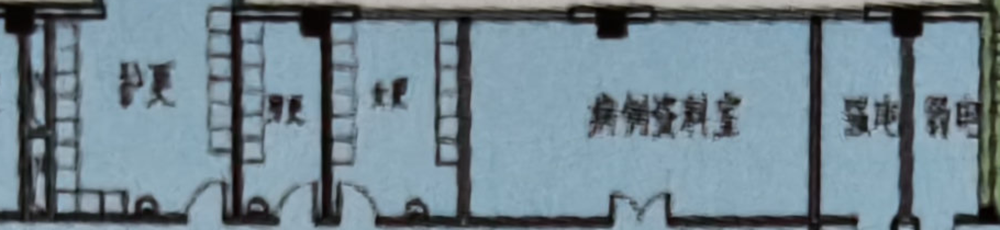

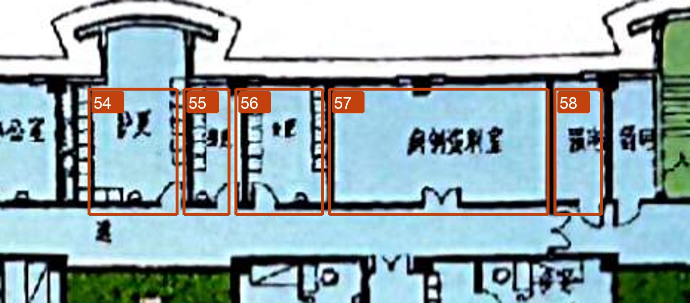

| 核对号 | S编号  | 片区   | 预估名称（可改） | 备选名称  | 依据与把握                                    | 我的确认／备注         | 核对号（重复） |
| --- | ---- | ---- | -------- | ----- | ---------------------------------------- | --------------- | ------- |
| 54 | S170 | 门诊中段 | 护更 | — | 照片02：北排更衣组左间原字为护更，不展开缩写。 把握：高。 | 照片判读已同步；非用户逐项确认 | 54 |
| 55 | S172 | 门诊中段 | 男更 | — | 照片02：护更右侧狭长小间标注男更。 把握：高。 | 照片判读已同步；非用户逐项确认 | 55 |
| 56 | S173 | 门诊中段 | 女更 | — | 照片02：男更右侧小间标注女更。 把握：高。 | 照片判读已同步；非用户逐项确认 | 56 |
| 57 | S174 | 门诊中段 | 病档资料室 | 病案资料室 | 照片02：可辨病及资料室，中间字仍不能可靠区分；不擅自规范成常用房名。把握：中。 | 病案资料室；已同步 | 57 |
| 58 | S175 | 门诊中段 | 强电 | — | 照片02：资料用房与楼梯之间、弱电左侧小间标注强电。 把握：高。 | 照片判读已同步；非用户逐项确认 | 58 |

### 门诊东段：59—66

**本轮近照（与下方原核对号对应）：**

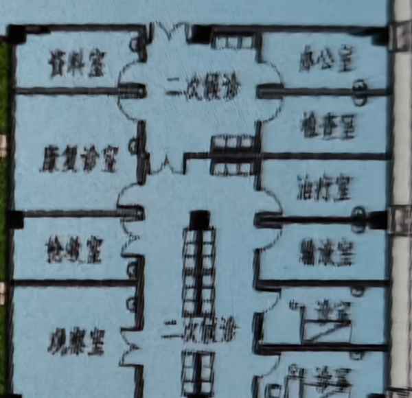

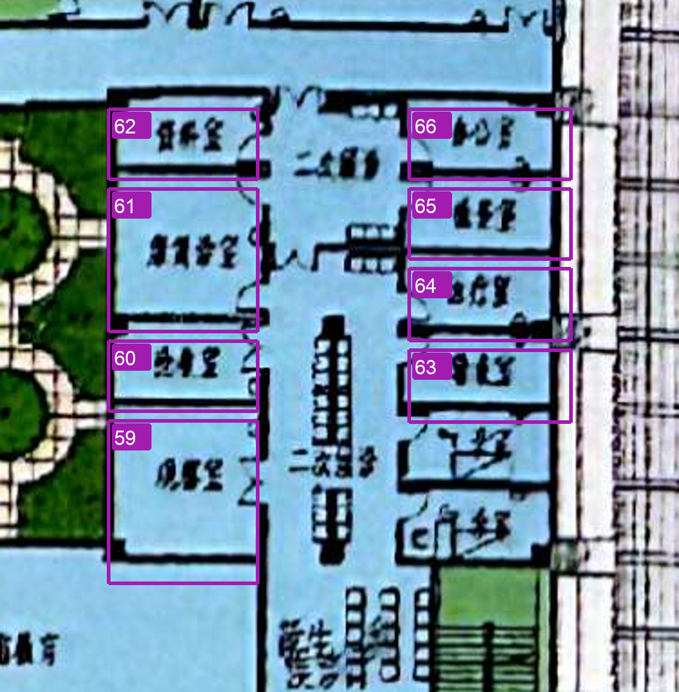

| 核对号 | S编号  | 片区   | 预估名称（可改） | 备选名称     | 依据与把握                                            | 我的确认／备注         | 核对号（重复） |
| --- | ---- | ---- | -------- | -------- | ------------------------------------------------ | --------------- | ------- |
| 59 | S191 | 门诊东段 | 阴道镜室 | 暂无其他可靠候选 | 照片02：东端西列最下间首字似阴、末字室清楚，中部仍不清楚；不按妇产医院常见配置确定。把握：低。 | 观察室；已同步 | 59 |
| 60 | S192 | 门诊东段 | 检验室 | — | 照片02：康复诊室下方的独立房间标注检验室。 把握：高。 | 照片判读已同步；非用户逐项确认 | 60 |
| 61 | S193 | 门诊东段 | 康复诊室 | — | 照片02：东端西列第二间标注康复诊室。 把握：高。 | 照片判读已同步；非用户逐项确认 | 61 |
| 62 | S194 | 门诊东段 | 资料室 | — | 照片02：东端西列最上方房间标注资料室。 把握：高。 | 照片判读已同步；非用户逐项确认 | 62 |
| 63 | S200 | 门诊东段 | 输液室 | 蜡疗室 | 照片02：东端东列、治疗室下方三字房名仍有不同解释；不以所属片区区分这两个候选。把握：低。 | 输液室；已同步 | 63 |
| 64 | S201 | 门诊东段 | 治疗室 | — | 照片02：东端东列办公室、检查室下方房间标注治疗室。 把握：高。 | 照片判读已同步；非用户逐项确认 | 64 |
| 65 | S202 | 门诊东段 | 检查室 | — | 照片02：东端东列办公室下方房间标注检查室。 把握：高。 | 照片判读已同步；非用户逐项确认 | 65 |
| 66 | S203 | 门诊东段 | 办公室 | — | 照片02：东端东列最上方房间标注办公室。 把握：高。 | 照片判读已同步；非用户逐项确认 | 66 |

前轮45项照片名称与本轮19项用户补充已同步JSON和SVG；仅32／S137、33／S138按用户备注暂缓并保留unknown。整张图因两项暂缓名称仍为标注草稿；本轮门洞定位及主要连通复核结果见前节。

---

**类型与数量：**影像检查 6 个、库房 7 个、建筑设备控制 6 个、交通核 13 个、通道 11 个、服务工作区 6 个、建筑设备用房 13 个、卫生间 14 个、办公 14 个、工作人员支持用房 18 个、挂号收费 2 个、处置治疗 8 个、大厅 9 个、配药用房 2 个、药房 4 个、检验 12 个、服务区 4 个、取药服务区 2 个、诊室 31 个、检查 4 个、绿化 4 个、留观 4 个、患者准备 1 个、器械用房 1 个、消毒供应 1 个、抢救 1 个、未确认功能 2 个、分诊 1 个、商业服务 1 个。

**连接关系：**210条，人员可达200条、服务联系3条、入口连接7条；181个已定位开口对应178条人员可达关系，22条概念连通无定位红点。

**入口：**&#x6C61;物出口、放射科医生入口、急诊入口、门诊医生入口、门诊入口、住院入口、后勤入口。

**相对规模：**&#x5BA4;内非重叠标注区域的 `area_ratio` 合计为 1；绿化不参与。具体物理尺寸由生成环节按任务确定。施工级门构造及内部精确路线不纳入数据。

**名称待确认：**仅32／S137、33／S138仍为unknown；原填“不管了”，按用户备注暂缓，不再列入本轮名称追问。本轮主要连通及清晰门洞已复核，名称仍按用户备注暂缓。

**图纸范围：**&#x4EC5;当前原图中的整张一层概念平面；覆盖门诊、药房及消毒支持、急诊、放射科、住院支持交通和公共大厅／医院街，分别使用 scope 区分，不代表整院其他楼层已标注。原图右侧图例、尺寸线、室外道路和水池不纳入室内空间。

**判读精度：**&#x8F6E;廓按可见墙线及色块记录概念范围，照片透视、墙厚与模糊小字会影响边界。相对面积按已标注室内净区域归一化，未计墙体、零散小竖井及无可靠边界的缝隙，不是建筑面积。四个绿色庭院按图示绿化块保留，包含示意铺地，不推断其室内可达性或上盖。

**关系边界：**&#x4EC5;保存图面可辨的概念人员可达与发药服务联系；相邻及共墙不等于可达，未记录关系不作负例。本轮已从原图定位181个清晰门洞／开口并同步SVG红点；概念连接和服务窗口不虚构门位。门宽、施工构造及流线权限不纳入本数据。入口位置为图面箭头附近的近似接口。

**名称与编号：**保留原66项核对号及用户填写，当前2项unknown为S137、S138，名称已确定200个。S010在首版几何复核中被识别为误分窄条，已并入S008，不再使用；其余S编号保留。SVG直接显示S编号、具体名称与标准类别，暂缓空间显示“名称未确认”。本轮续作已同步主要连通关系和清晰门洞并完成结构与视觉检查；两项暂缓名称仍保留unknown，整图维持草稿状态。
