# 20号｜哈尔滨医科大学附属第一医院门诊保健大楼｜标注草稿

**未完成：26 个空间名称／用途仍未确认；空间范围核对尚未收尾，连通性尚未开始全面复核。**

本轮依据2026-11-03提供的四张局部照片与本图原图对照，新增同步62项图面可辨名称及类别。保留113个稳定S编号、88个固定核对号和原确认栏。

**范围：**&#x4EC5;当前原图内可辨室内主体。左上翼可辨生活水箱间、消控及机房和部分诊室，不能将整翼直接认作急诊；右下翼已辨急诊药局和急诊急救门厅，中央北侧为住院部门厅及出入院办公。未从其他医院借用名称或范围。图外楼层不在本次范围，未依据照片推定楼层；外部台阶、坡道、雨篷和尺寸轴网不计室内面积。

**规模：**&#x31;13个草稿空间／区域；诊室 22个、未确认功能 26个、通道 3个、前室 1个、交通核 10个、建筑设备用房 10个、挂号收费 2个、建筑设备控制 1个、大厅 8个、卫生间 5个、辅助用房 1个、工作人员支持用房 4个、办公 3个、门斗 4个、检查 1个、处置治疗 2个、抢救 1个、消毒供应 1个、库房 2个、检验 1个、分诊 2个、药房 3个。

**范围状态：**&#x672C;轮保留全部原多边形；S107与S109疑为同一急诊药局的两个草稿分片，暂分别保存同名，不能据分片数理解为两个独立药局。S100药房与候药大厅间狭长带、S040等细小范围仍待核。

**连接状态：**&#x539F;有110条关系（102条人员可达、8条入口）原样保留；已定位室内开口0个。本轮只核房名、功能类别和范围，不将现有关系视为已复核，不新增门洞坐标或红点。

**坐标与面积：**&#x4A;SON保持原图2444×3260像素坐标；SVG完整底图逆时针转正，显示变换为`(x转正,y转正)=(y原,2444-x原)`。原图未改，空间相对面积归一化合计为1；概念轮廓不代表实测面积，也不把轴网线当隔墙。

## 名称核对填写表

固定核对号01—88不重排，本表保留本轮已同步行供修正；优先填写标有“【未确认】”的26行。绿色数字表示图面已同步，橙色表示未确认。数字直接放在房间内部，无外侧标签或长引线。每组照片与填写表相邻，可打开无标记照片看原字。

可改“预估名称（可改）”，并在“我的确认／备注”填写“已确认”或实际名称；也可直接补范围修正、合并、排除意见。确认栏沿用原内容，本轮未将自动识字写作用户已确认。聊天可回复`20号：02=名称，05=名称`。

【图面已同步】仅表示原注或构造足够清楚，已同步JSON和SVG；【未确认】的候选、依据和把握只保存在本MD，JSON名称继续为“名称未确认”、type为unknown。原候选与旧依据保存在修改前备份。

[查看原图](20_哈尔滨医科大学附属第一医院门诊保健大楼_原图.jpg)｜[查看标注](标注.svg)｜[打开内部数字总图](../../临时核对/20_哈尔滨医科大学附属第一医院门诊保健大楼_照片补充_20261103/20号_房间内部数字总图.jpg)

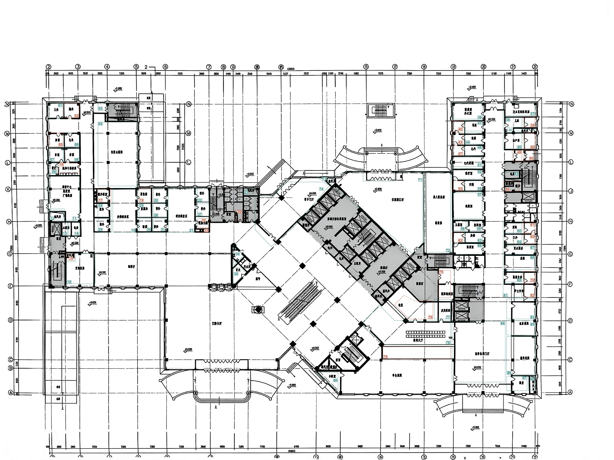

### 01—06｜A 左上功能翼

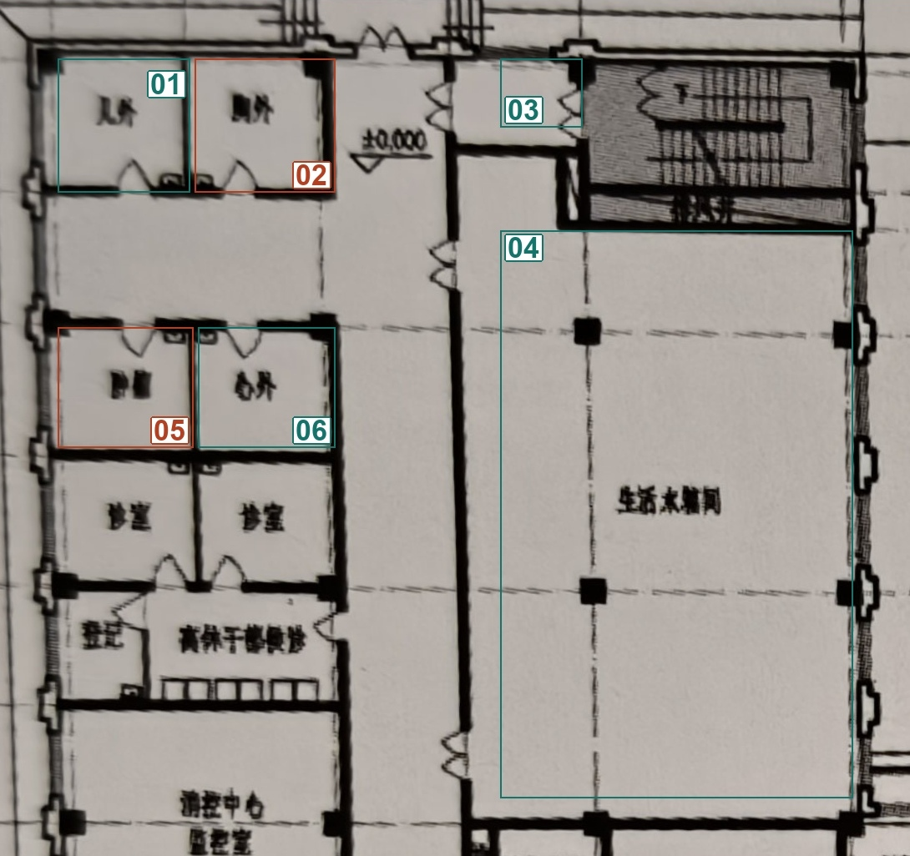

[查看同范围无标记照片](../../临时核对/20_哈尔滨医科大学附属第一医院门诊保健大楼_照片补充_20261103/01_核对01-06_无标记照片.jpg)

| 核对号 | S编号  | 预估名称（可改） | 备选名称     | 依据与把握                                                     | 我的确认／备注 | 核对号（重复） |
| --- | ---- | -------- | -------- | --------------------------------------------------------- | ------- | ------- |
| 01  | S001 | 儿外       | —        | 【图面已同步】照片01：照片左上第一间原注为“儿外”，保留缩写，不扩写为儿科。 把握：高。             | 儿外      | 01      |
| 02  | S002 | 脑外       | 胸外       | 【未确认】照片上排右间可见两字缩写；首字仍不够清楚，两个候选共用字形依据。 把握：中。JSON继续unknown。 | 脑外      | 02      |
| 03  | S004 | 楼梯前室     | —        | 【图面已同步】照片01：楼梯西侧由两道门分隔的独立前室；采用可识别构造名称。 把握：高。              | 楼梯前室    | 03      |
| 04  | S006 | 生活水箱间    | —        | 【图面已同步】照片01：大开间中央原注清楚为“生活水箱间”，撤回急诊观察室候选。 把握：高。            | 生活水箱间   | 04      |
| 05  | S007 | 肿瘤       | 暂无其他可靠候选 | 【未确认】照片上排下方左间疑似“肿瘤”；字迹糊合，不能仅凭科室邻接确定。 把握：中。JSON继续unknown。  | 肿瘤      | 05      |
| 06  | S008 | 心外       | —        | 【图面已同步】照片01：左上翼第二排右间原注“心外”，保留原图缩写。 把握：高。                  | 心外      | 06      |

### 07—12｜A 左上功能翼

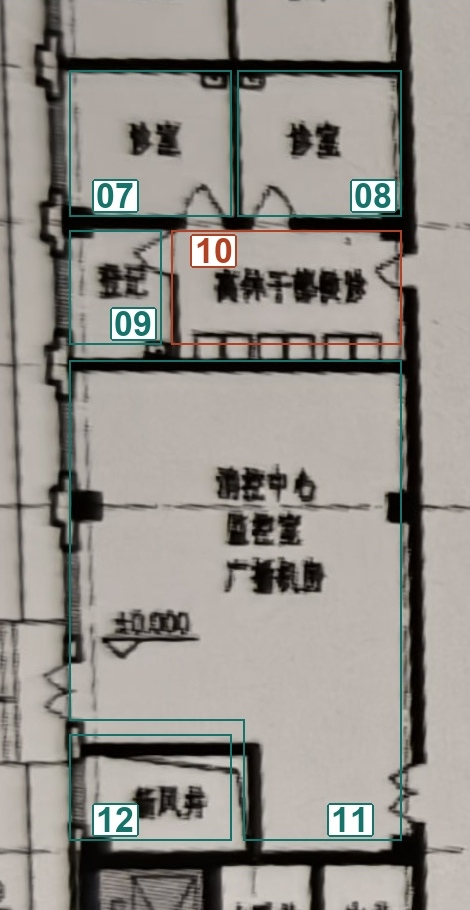

[查看同范围无标记照片](../../临时核对/20_哈尔滨医科大学附属第一医院门诊保健大楼_照片补充_20261103/02_核对07-12_无标记照片.jpg)

| 核对号 | S编号  | 预估名称（可改）      | 备选名称   | 依据与把握                                                         | 我的确认／备注 | 核对号（重复） |
| --- | ---- | ------------- | ------ | ------------------------------------------------------------- | ------- | ------- |
| 07  | S009 | 诊室            | —      | 【图面已同步】照片01：左上翼第三排左间原注“诊室”。 把握：高。                             | 待确认     | 07      |
| 08  | S010 | 诊室            | —      | 【图面已同步】照片01：左上翼第三排右间原注“诊室”。 把握：高。                             | 待确认     | 08      |
| 09  | S011 | 登记            | —      | 【图面已同步】照片01：左上翼服务带左侧独立小间原注“登记”。 把握：高。                         | 待确认     | 09      |
| 10  | S012 | 离休干部保健诊       | 干部保健候诊 | 【未确认】服务带可见干部、保健等字及连续座位；前后字仍不够可靠，两候选共用该线索。 把握：中。JSON继续unknown。 | 离休干部保健诊 | 10      |
| 11  | S013 | 消控中心、监控室、广播机房 | —      | 【图面已同步】照片01：同一较大空间内三行原注依次为消控中心、监控室、广播机房，保留现有整体功能块。 把握：高。      | 待确认     | 11      |
| 12  | S014 | 新风井           | —      | 【图面已同步】照片01：消控区域西南角小围合原注“新风井”。 把握：高。                          | 待确认     | 12      |

### 13—16｜A 左上功能翼

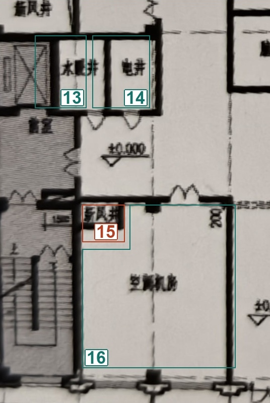

[查看同范围无标记照片](../../临时核对/20_哈尔滨医科大学附属第一医院门诊保健大楼_照片补充_20261103/03_核对13-16_无标记照片.jpg)

| 核对号 | S编号  | 预估名称（可改） | 备选名称 | 依据与把握                                                   | 我的确认／备注 | 核对号（重复） |
| --- | ---- | -------- | ---- | ------------------------------------------------------- | ------- | ------- |
| 13  | S016 | 水暖井      | —    | 【图面已同步】照片01：电梯旁小间原注“水暖井”。 把握：高。                         | 待确认     | 13      |
| 14  | S017 | 电井       | —    | 【图面已同步】照片01：水暖井右侧小间原注“电井”。 把握：高。                        | 待确认     | 14      |
| 15  | S019 | 排风井      | 新风井  | 【未确认】楼梯旁极小井道原注末两字似风井；首字难辨，两个候选不能区分。 把握：低。JSON继续unknown。 | 新风井     | 15      |
| 16  | S020 | 空调机房     | —    | 【图面已同步】照片01：左上翼南端大房间原注“空调机房”。 把握：高。                     | 待确认     | 16      |

### 17—22｜B 左中诊疗与候诊片区

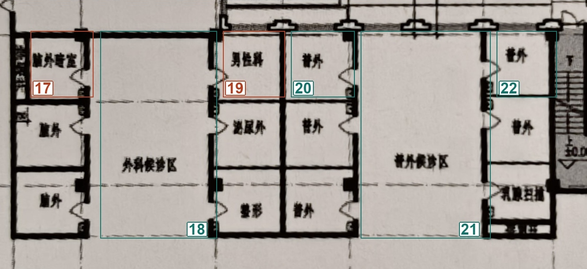

[查看同范围无标记照片](../../临时核对/20_哈尔滨医科大学附属第一医院门诊保健大楼_照片补充_20261103/04_核对17-22_无标记照片.jpg)

| 核对号 | S编号  | 预估名称（可改） | 备选名称     | 依据与把握                                                    | 我的确认／备注    | 核对号（重复） |
| --- | ---- | -------- | -------- | -------------------------------------------------------- | ---------- | ------- |
| 17  | S021 | 输液管理室    | 暂无其他可靠候选 | 【未确认】照片原注为较长室名，部分字形似输液管理；目前无法逐字可靠辨认。 把握：低。JSON继续unknown。 | 脑外暗室  | 17      |
| 18  | S022 | 外科候诊区    | —        | 【图面已同步】照片01：左中第一组开放区原注“外科候诊区”。 把握：高。                     | 待确认        | 18      |
| 19  | S023 | 男性科      | 暂无其他可靠候选 | 【未确认】外科候诊区东北侧房间原注似“男性科”；中间字仍需核实。 把握：中。JSON继续unknown。     | 男性科        | 19      |
| 20  | S024 | 普外       | —        | 【图面已同步】照片01：两候诊带之间上排右间原注“普外”。 把握：高。                      | 待确认        | 20      |
| 21  | S025 | 普外候诊区    | —        | 【图面已同步】照片01：右侧开放候诊带原注“普外候诊区”，不再采用各科候诊区。 把握：高。            | 待确认        | 21      |
| 22  | S026 | 普外       | —        | 【图面已同步】照片01：普外候诊区北排独立间原注“普外”。 把握：高。                      | 待确认        | 22      |

### 23—23｜B 左中诊疗与候诊片区

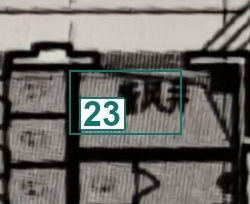

[查看同范围无标记照片](../../临时核对/20_哈尔滨医科大学附属第一医院门诊保健大楼_照片补充_20261103/05_核对23-23_无标记照片.jpg)

| 核对号 | S编号  | 预估名称（可改） | 备选名称 | 依据与把握                                   | 我的确认／备注 | 核对号（重复） |
| --- | ---- | -------- | ---- | --------------------------------------- | ------- | ------- |
| 23  | S029 | 排风井      | —    | 【图面已同步】照片02：左中片区卫生间北侧狭长小间原注“排风井”。 把握：高。 | 管井      | 23      |

### 24—28｜B 左中诊疗与候诊片区

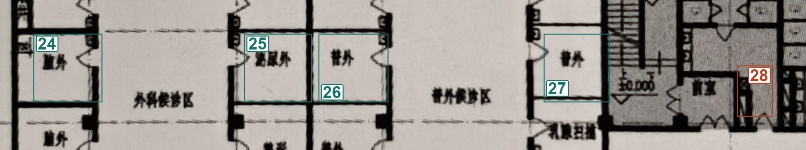

[查看同范围无标记照片](../../临时核对/20_哈尔滨医科大学附属第一医院门诊保健大楼_照片补充_20261103/06_核对24-28_无标记照片.jpg)

| 核对号 | S编号  | 预估名称（可改） | 备选名称 | 依据与把握                                                         | 我的确认／备注 | 核对号（重复） |
| --- | ---- | -------- | ---- | ------------------------------------------------------------- | ------- | ------- |
| 24  | S031 | 腹外       | —    | 【图面已同步】照片01：外科候诊区西侧中排原注“腹外”，按图保留原缩写。 把握：高。                    | 待确认     | 24      |
| 25  | S032 | 泌尿外      | —    | 【图面已同步】照片01：两候诊带之间中排左间原注“泌尿外”。 把握：高。                          | 待确认     | 25      |
| 26  | S033 | 普外       | —    | 【图面已同步】照片01：两候诊带之间中排右间原注“普外”。 把握：高。                           | 待确认     | 26      |
| 27  | S034 | 普外       | —    | 【图面已同步】照片01：普外候诊区东侧中排原注“普外”。 把握：高。                            | 待确认     | 27      |
| 28  | S035 | 暂无可靠候选   | —    | 【未确认】卫生间与楼梯前室之间的小围合，照片仍未给出可靠室名；不能由邻接推定功能。 把握：低。JSON继续unknown。 | 厕所前室    | 28      |

### 29—34｜B 左中诊疗与候诊片区

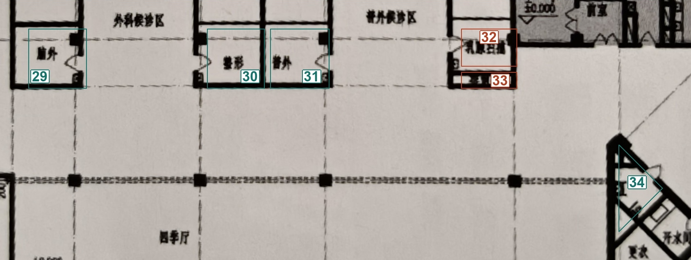

[查看同范围无标记照片](../../临时核对/20_哈尔滨医科大学附属第一医院门诊保健大楼_照片补充_20261103/07_核对29-34_无标记照片.jpg)

| 核对号 | S编号  | 预估名称（可改） | 备选名称 | 依据与把握                                                          | 我的确认／备注 | 核对号（重复） |
| --- | ---- | -------- | ---- | -------------------------------------------------------------- | ------- | ------- |
| 29  | S036 | 脑外       | —    | 【图面已同步】照片01：外科候诊区西侧下排原注“脑外”。 把握：高。                             | 待确认     | 29      |
| 30  | S037 | 整形       | —    | 【图面已同步】照片01：两候诊带之间下排左间原注“整形”。 把握：高。                            | 待确认     | 30      |
| 31  | S038 | 普外       | —    | 【图面已同步】照片01：两候诊带之间下排右间原注“普外”，撤回骨科候选。 把握：高。                     | 待确认     | 31      |
| 32  | S039 | 清洁用房     | 清扫用房 | 【未确认】南端短房间原字仍不可靠；两候选仅依清字形和辅助用房位置，现有证据不能区分。 把握：低。JSON继续unknown。 | 乳腺扫描    | 32      |
| 33  | S040 | 暂无可靠候选   | —    | 【未确认】紧邻S039的窄条空间，未见可判读文字，范围是否需并入相邻房间也待核。 把握：低。JSON继续unknown。   | 管井      | 33      |
| 34  | S042 | 开水间      | —    | 【图面已同步】照片02：中央三角组东侧小间原注“开水间”。 把握：高。                            | 待确认     | 34      |

### 35—35｜B 左中诊疗与候诊片区

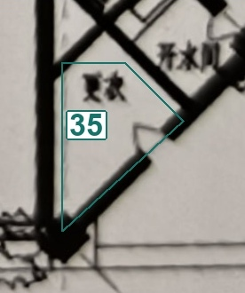

[查看同范围无标记照片](../../临时核对/20_哈尔滨医科大学附属第一医院门诊保健大楼_照片补充_20261103/08_核对35-35_无标记照片.jpg)

| 核对号 | S编号  | 预估名称（可改） | 备选名称 | 依据与把握                                            | 我的确认／备注 | 核对号（重复） |
| --- | ---- | -------- | ---- | ------------------------------------------------ | ------- | ------- |
| 35  | S044 | 更衣       | —    | 【图面已同步】照片02：中央三角组西南小间原注“更衣”，不据相邻卫生器具归为卫生间。 把握：高。 | 待确认     | 35      |

### 36—41｜C 右上诊疗翼

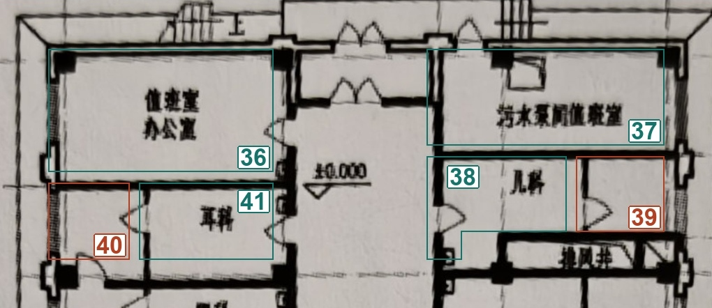

[查看同范围无标记照片](../../临时核对/20_哈尔滨医科大学附属第一医院门诊保健大楼_照片补充_20261103/09_核对36-41_无标记照片.jpg)

| 核对号 | S编号  | 预估名称（可改） | 备选名称 | 依据与把握                                                  | 我的确认／备注  | 核对号（重复） |
| --- | ---- | -------- | ---- | ------------------------------------------------------ | -------- | ------- |
| 36  | S045 | 值班室、办公室  | —    | 【图面已同步】照片03：右上翼北端西侧房间内两行原注为值班室、办公室。 把握：高。              | 待确认      | 36      |
| 37  | S047 | 污水泵间值班室  | —    | 【图面已同步】照片03：右上翼北端东侧长房间原注“污水泵间值班室”。 把握：高。               | 待确认      | 37      |
| 38  | S049 | 儿科       | —    | 【图面已同步】照片03：右上翼东侧第一间原注“儿科”。 把握：高。                      | 待确认      | 38      |
| 39  | S050 | 暂无可靠候选   | —    | 【未确认】儿科内门相连附间无独立室名；仅凭所属科室不能确定房间用途。 把握：低。JSON继续unknown。 | 儿科 和38合并 | 39      |
| 40  | S051 | 暂无可靠候选   | —    | 【未确认】耳科旁经内门连接的小间无独立室名，不从主间反推用途。 把握：低。JSON继续unknown。    | 耳科和41合并  | 40      |
| 41  | S052 | 耳科       | —    | 【图面已同步】照片03：右上翼西侧第一组主间原注“耳科”，不扩写为耳鼻喉。 把握：高。            | 待确认      | 41      |

### 42—47｜C 右上诊疗翼

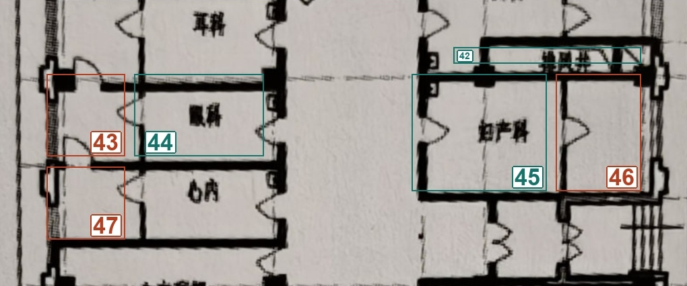

[查看同范围无标记照片](../../临时核对/20_哈尔滨医科大学附属第一医院门诊保健大楼_照片补充_20261103/10_核对42-47_无标记照片.jpg)

| 核对号 | S编号  | 预估名称（可改） | 备选名称 | 依据与把握                                               | 我的确认／备注  | 核对号（重复） |
| --- | ---- | -------- | ---- | --------------------------------------------------- | -------- | ------- |
| 42  | S053 | 排风井      | —    | 【图面已同步】照片03：儿科南侧狭长围合原注“排风井”。 把握：高。                  | 待确认      | 42      |
| 43  | S054 | 暂无可靠候选   | —    | 【未确认】眼科旁经内门连接的小间无独立室名，不从主间反推用途。 把握：低。JSON继续unknown。 | 眼科和44合并  | 43      |
| 44  | S055 | 眼科       | —    | 【图面已同步】照片03：右上翼西侧第二组主间原注“眼科”。 把握：高。                 | 待确认      | 44      |
| 45  | S056 | 妇产科      | —    | 【图面已同步】照片03：右上翼东侧第二组主间原注“妇产科”。 把握：高。                | 待确认      | 45      |
| 46  | S057 | 暂无可靠候选   | —    | 【未确认】妇产科附间无独立室名，保留现有范围与unknown。 把握：低。JSON继续unknown。 | 妇产科和46合并 | 46      |
| 47  | S058 | 暂无可靠候选   | —    | 【未确认】心内旁经内门连接的小间无独立室名，不使用原口腔候选。 把握：低。JSON继续unknown。 | 和心内合并    | 47      |

### 48—53｜C 右上诊疗翼

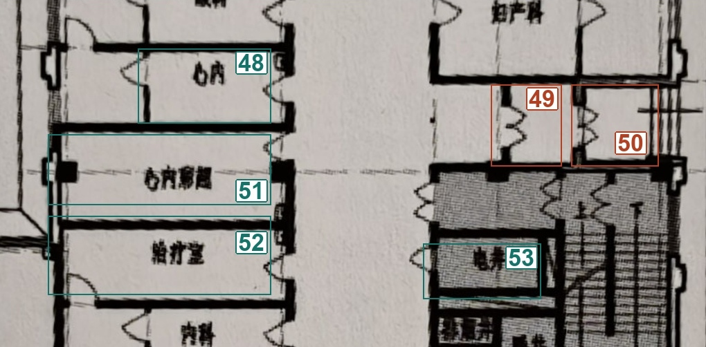

[查看同范围无标记照片](../../临时核对/20_哈尔滨医科大学附属第一医院门诊保健大楼_照片补充_20261103/11_核对48-53_无标记照片.jpg)

| 核对号 | S编号  | 预估名称（可改） | 备选名称   | 依据与把握                                                          | 我的确认／备注 | 核对号（重复） |
| --- | ---- | -------- | ------ | -------------------------------------------------------------- | ------- | ------- |
| 48  | S059 | 心内       | —      | 【图面已同步】照片03：右上翼西侧第三组原注“心内”，撤回口腔候选。 把握：高。                       | 待确认     | 48      |
| 49  | S060 | 前室       | 交通过渡空间 | 【未确认】图面为双门分隔的过渡小间；未见具体名称，两候选共用门分隔布局依据。 把握：中。JSON继续unknown。     | 前室      | 49      |
| 50  | S061 | 楼梯前室     | 外门过渡空间 | 【未确认】外墙邻台阶且有门分隔；构造用途尚需与S060一起核对，两候选共用布局依据。 把握：中。JSON继续unknown。 | 前室      | 50      |
| 51  | S062 | 心内彩超     | —      | 【图面已同步】照片03：心内南侧长条检查间原注“心内彩超”，撤回心电图室候选。 把握：高。                  | 待确认     | 51      |
| 52  | S064 | 治疗室      | —      | 【图面已同步】照片03：心内彩超南侧房间原注“治疗室”。 把握：高。                             | 待确认     | 52      |
| 53  | S065 | 电井       | —      | 【图面已同步】照片03：右上翼楼梯西侧上方小间原注“电井”。 把握：高。                           | 待确认     | 53      |

### 54—59｜C 右上诊疗翼

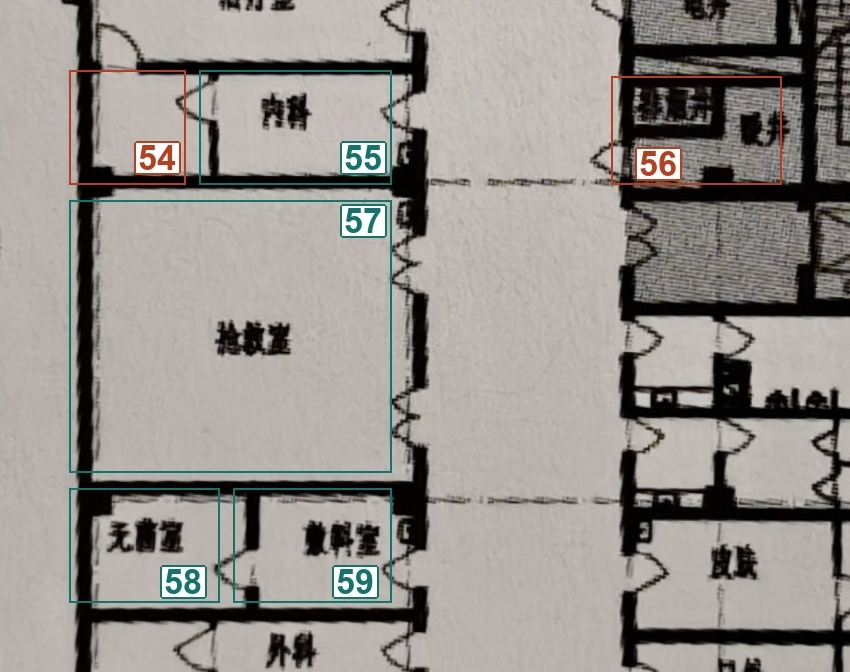

[查看同范围无标记照片](../../临时核对/20_哈尔滨医科大学附属第一医院门诊保健大楼_照片补充_20261103/12_核对54-59_无标记照片.jpg)

| 核对号 | S编号  | 预估名称（可改） | 备选名称 | 依据与把握                                                      | 我的确认／备注 | 核对号（重复） |
| --- | ---- | -------- | ---- | ---------------------------------------------------------- | ------- | ------- |
| 54  | S066 | 暂无可靠候选   | —    | 【未确认】内科旁附间没有独立室名，不根据内门补出检查用途。 把握：低。JSON继续unknown。          | 和内科合并   | 54      |
| 55  | S067 | 内科       | —    | 【图面已同步】照片03：治疗室南侧带附间的主间原注“内科”。 把握：高。                       | 待确认     | 55      |
| 56  | S068 | 暖井       | 水暖井  | 【未确认】楼梯旁下方井道原注末字为井，前字不够清楚；两个候选共用该字形证据。 把握：中。JSON继续unknown。 | 管井      | 56      |
| 57  | S069 | 抢救室      | —    | 【图面已同步】照片03：右上翼西侧较大双门房间原注“抢救室”，撤回检验室候选。 把握：高。              | 待确认     | 57      |
| 58  | S072 | 无菌室      | —    | 【图面已同步】照片03：抢救室南侧小间原注“无菌室”。 把握：高。                          | 待确认     | 58      |
| 59  | S073 | 敷料室      | —    | 【图面已同步】照片03：无菌室东侧小间原注“敷料室”，不改写为换药室。 把握：高。                  | 待确认     | 59      |

### 60—65｜C 右上诊疗翼

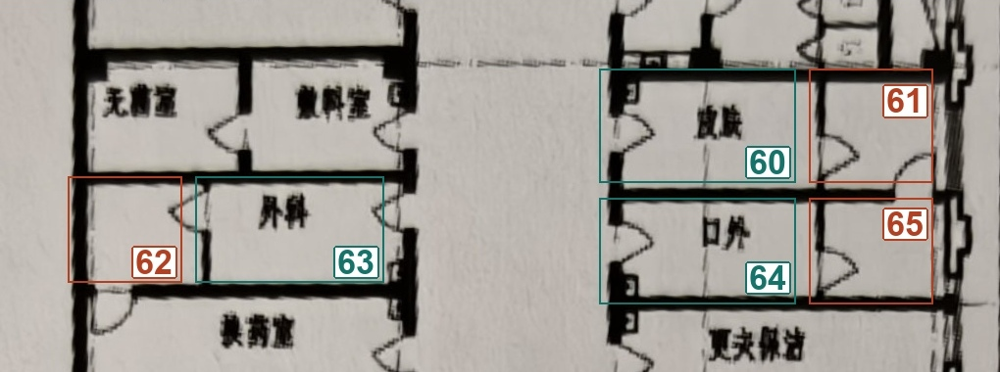

[查看同范围无标记照片](../../临时核对/20_哈尔滨医科大学附属第一医院门诊保健大楼_照片补充_20261103/13_核对60-65_无标记照片.jpg)

| 核对号 | S编号  | 预估名称（可改） | 备选名称 | 依据与把握                                             | 我的确认／备注 | 核对号（重复） |
| --- | ---- | -------- | ---- | ------------------------------------------------- | ------- | ------- |
| 60  | S074 | 皮肤       | —    | 【图面已同步】照片03：右上翼东侧靠卫生间的主间原注“皮肤”，保留原文。 把握：高。        | 待确认     | 60      |
| 61  | S075 | 暂无可靠候选   | —    | 【未确认】皮肤房间附间没有独立室名；无房间级用途证据。 把握：低。JSON继续unknown。   | 皮肤和60合并 | 61      |
| 62  | S076 | 暂无可靠候选   | —    | 【未确认】外科房间西侧附间没有独立室名；无房间级用途证据。 把握：低。JSON继续unknown。 | 男科和63合并 | 62      |
| 63  | S077 | 外科       | —    | 【图面已同步】照片03：敷料室南侧主间原注“外科”。 把握：高。                  | 待确认     | 63      |
| 64  | S078 | 口外       | —    | 【图面已同步】照片03：皮肤南侧主间原注“口外”，不改写为口腔。 把握：高。            | 待确认     | 64      |
| 65  | S079 | 暂无可靠候选   | —    | 【未确认】口外房间东侧附间没有独立室名；无房间级用途证据。 把握：低。JSON继续unknown。 | 口外和64合并 | 65      |

### 66—70｜C 右上诊疗翼

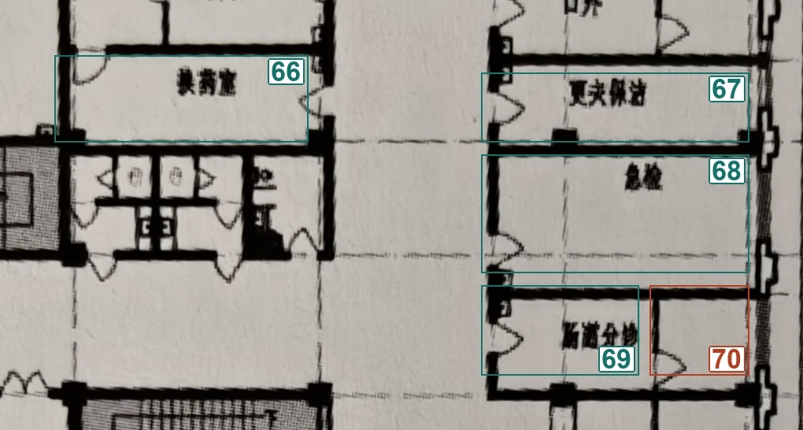

[查看同范围无标记照片](../../临时核对/20_哈尔滨医科大学附属第一医院门诊保健大楼_照片补充_20261103/14_核对66-70_无标记照片.jpg)

| 核对号 | S编号  | 预估名称（可改） | 备选名称 | 依据与把握                                              | 我的确认／备注   | 核对号（重复） |
| --- | ---- | -------- | ---- | -------------------------------------------------- | --------- | ------- |
| 66  | S080 | 换药室      | —    | 【图面已同步】照片03：外科南侧独立房间原注“换药室”。 把握：高。                 | 待确认       | 66      |
| 67  | S081 | 更衣保洁     | —    | 【图面已同步】照片03：口外南侧长间原注“更衣保洁”。 把握：高。                  | 待确认       | 67      |
| 68  | S083 | 急检       | —    | 【图面已同步】照片03：更衣保洁南侧大单间原注“急检”，保留原图缩写。 把握：高。          | 待确认       | 68      |
| 69  | S084 | 肠道分诊     | —    | 【图面已同步】照片03：急检南侧主间原注“肠道分诊”。 把握：高。                  | 待确认       | 69      |
| 70  | S085 | 暂无可靠候选   | —    | 【未确认】肠道分诊旁附间没有独立室名，不能直接赋予分诊用途。 把握：低。JSON继续unknown。 | 69和肠道分诊合并 | 70      |

### 71—74｜D 中央斜向交通与北门厅

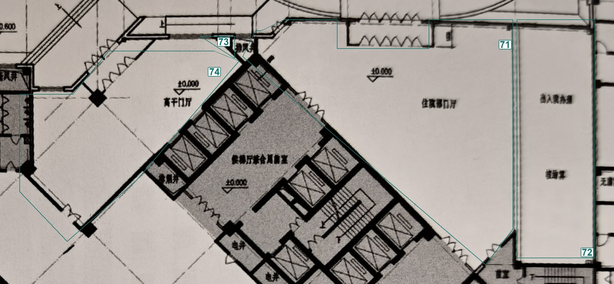

[查看同范围无标记照片](../../临时核对/20_哈尔滨医科大学附属第一医院门诊保健大楼_照片补充_20261103/15_核对71-74_无标记照片.jpg)

| 核对号 | S编号  | 预估名称（可改）  | 备选名称 | 依据与把握                                                  | 我的确认／备注 | 核对号（重复） |
| --- | ---- | --------- | ---- | ------------------------------------------------------ | ------- | ------- |
| 71  | S086 | 住院部门厅     | —    | 【图面已同步】照片02：中央北侧开敞大厅原注“住院部门厅”，撤回急诊门厅候选。 把握：高。          | 待确认     | 71      |
| 72  | S088 | 出入院办公、核算室 | —    | 【图面已同步】照片02：住院部门厅东侧功能带有“出入院办公”“核算室”两处原注，沿用整体功能块。 把握：高。 | 待确认     | 72      |
| 73  | S089 | 排风井       | —    | 【图面已同步】照片02：高干门厅东北角三角围合原注“排风井”。 把握：高。                  | 待确认     | 73      |
| 74  | S090 | 高干门厅      | —    | 【图面已同步】照片02：中央斜向交通核西北侧原注“高干门厅”。 把握：高。                  | 待确认     | 74      |

### 75—77｜D 中央斜向交通与北门厅

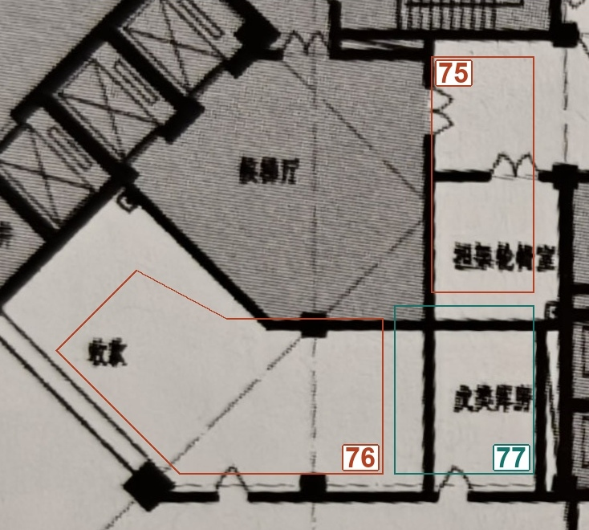

[查看同范围无标记照片](../../临时核对/20_哈尔滨医科大学附属第一医院门诊保健大楼_照片补充_20261103/16_核对75-77_无标记照片.jpg)

| 核对号 | S编号  | 预估名称（可改） | 备选名称     | 依据与把握                                                          | 我的确认／备注 | 核对号（重复） |
| --- | ---- | -------- | -------- | -------------------------------------------------------------- | ------- | ------- |
| 75  | S093 | 抢救相关用房   | 暂无其他可靠候选 | 【未确认】长原注后部似抢救室，前部文字仍不可靠；候选只表示待核方向，未写入JSON。 把握：中。JSON继续unknown。 | 担架轮椅室   | 75      |
| 76  | S095 | 收费       | 暂无其他可靠候选 | 【未确认】斜向房间原注两字，疑似收费但第二字仍难辨，不凭常见医院配置确认。 把握：中。JSON继续unknown。      | 收费      | 76      |
| 77  | S096 | 武装保卫     | —        | 【图面已同步】照片02：中央交通核东南侧下方独立房间原注“武装保卫”。 把握：高。                      | 库房      | 77      |

### 78—80｜E 南部大厅与药房

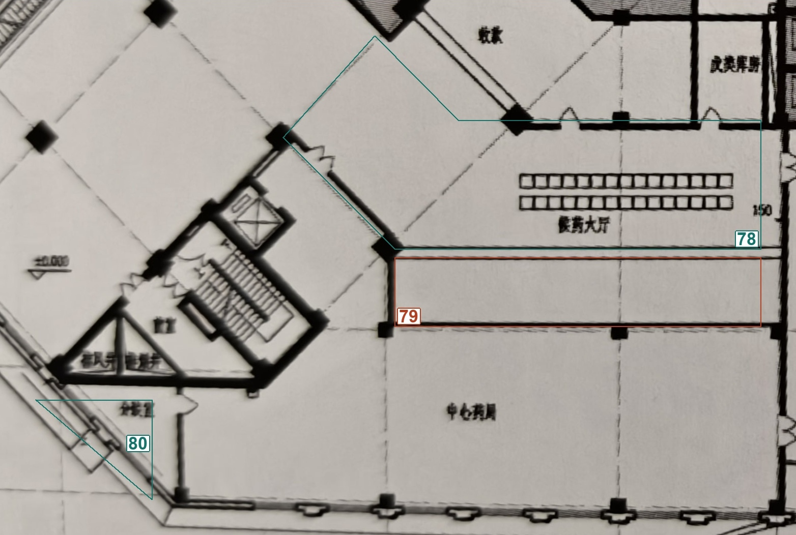

[查看同范围无标记照片](../../临时核对/20_哈尔滨医科大学附属第一医院门诊保健大楼_照片补充_20261103/17_核对78-80_无标记照片.jpg)

| 核对号 | S编号  | 预估名称（可改） | 备选名称  | 依据与把握                                                             | 我的确认／备注      | 核对号（重复） |
| --- | ---- | -------- | ----- | ----------------------------------------------------------------- | ------------ | ------- |
| 78  | S098 | 候药大厅     | —     | 【图面已同步】照片04：中心药房北侧座椅区域原注“候药大厅”。 把握：高。                             | 待确认          | 78      |
| 79  | S100 | 药房工作带    | 取药服务区 | 【未确认】位于中心药房与候药大厅之间；照片未明确这条分带的功能界面，两候选仅共用位置证据。 把握：低。JSON继续unknown。 | 和78合并叫做后候药大厅 | 79      |
| 80  | S103 | 冷藏室      | —     | 【图面已同步】照片02：中心药房西侧三角房间原注“冷藏室”，撤回消毒室、治疗室候选。 把握：高。                  | 分发室          | 80      |

### 81—86｜F 右下公共服务片区

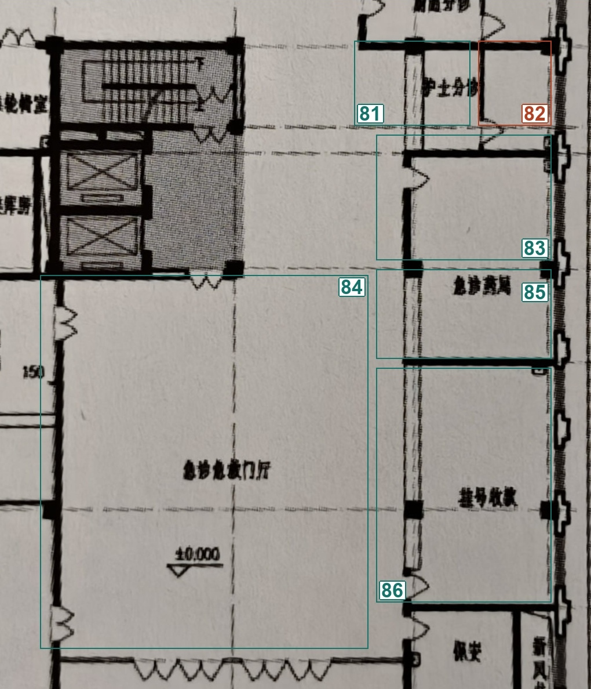

[查看同范围无标记照片](../../临时核对/20_哈尔滨医科大学附属第一医院门诊保健大楼_照片补充_20261103/18_核对81-86_无标记照片.jpg)

| 核对号 | S编号  | 预估名称（可改） | 备选名称 | 依据与把握                                                              | 我的确认／备注 | 核对号（重复） |
| --- | ---- | -------- | ---- | ------------------------------------------------------------------ | ------- | ------- |
| 81  | S105 | 护士分诊     | —    | 【图面已同步】照片04：右下服务翼北端主间原注“护士分诊”。 把握：高。                               | 待确认     | 81      |
| 82  | S106 | 暂无可靠候选   | —    | 【未确认】护士分诊旁附间没有独立室名，不能由主间用途确定。 把握：低。JSON继续unknown。                  | 和护士分诊合并 | 82      |
| 83  | S107 | 急诊药局     | —    | 【图面已同步】照片04：与S109之间只见轴网线和柱，未见隔墙；暂保留两片，名称按同一急诊药局登记，范围合并建议见MD。 把握：高。 | 待确认     | 83      |
| 84  | S108 | 急诊急救门厅   | —    | 【图面已同步】照片04：右下大门厅原注“急诊急救门厅”，撤回出入院门厅候选。 把握：高。                       | 待确认     | 84      |
| 85  | S109 | 急诊药局     | —    | 【图面已同步】照片04：同一连续房间中原注“急诊药局”；与S107暂保留草稿分片，待房间核对收尾落实合并。 把握：高。        | 待确认     | 85      |
| 86  | S110 | 挂号收费     | —    | 【图面已同步】照片04：急诊药局南侧长房间原注“挂号收费”。 把握：高。                               | 待确认     | 86      |

**范围核对F01（不另分配房名核对号）：**&#x38;3／S107与85／S109之间只见轴网线、柱，照片未见隔墙；判断为同一急诊药局的可能性高。建议房间核对收尾时保留S107、将S109并入；原83和85两条记录及填写均保留映射。当前仅同步同名，尚未合并，也未改关系。

**我的确认／备注：**&#x5F85;填写（同意合并，或说明实际分隔）

### 87—88｜F 右下公共服务片区

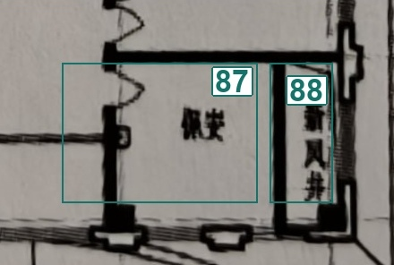

[查看同范围无标记照片](../../临时核对/20_哈尔滨医科大学附属第一医院门诊保健大楼_照片补充_20261103/19_核对87-88_无标记照片.jpg)

| 核对号 | S编号  | 预估名称（可改） | 备选名称 | 依据与把握                              | 我的确认／备注 | 核对号（重复） |
| --- | ---- | -------- | ---- | ---------------------------------- | ------- | ------- |
| 87  | S111 | 保安       | —    | 【图面已同步】照片04：右下翼南端小间原注“保安”。 把握：高。   | 待确认     | 87      |
| 88  | S112 | 新风井      | —    | 【图面已同步】照片04：保安东侧狭长井道竖注“新风井”。 把握：高。 | 待确认     | 88      |

## 本轮状态与后续顺序

- 房名及类别：62项已据图面同步，26项仍unknown；所有88个核对号保留。
- 范围：原多边形保留，急诊药局合并建议及狭长分带仍待核；本轮不宣称范围完成。
- 连通性：尚未全面复核，原关系仅为草稿；待你说“房间标注完毕”后读取本MD最新填写，落实明确名称、范围、合并或排除，再自主复核主要通路和清晰开口。
- 正式校验：`validate --check-dir`返回`valid=true、errors=[]、names_complete=false`（退出码2，26项名称仍未确认）。已目检SVG全图及密集局部、19组内部编号照片，并在浏览器检查由本MD渲染的图表相邻阅读效果；门洞与主要连通仍待后续专门复核。
