# 20号｜哈尔滨医科大学附属第一医院门诊保健大楼

**已按本图概念精度完成房名、范围和主要连通性复核。名称待确认0项；影响主要通路的待确认项0项。**

本轮已读取最新回填（包括32／S039乳腺扫描、33／S040管井、54／S066并入内科、82／S106并入护士分诊）。只依据20号原图、四张局部照片及本MD回填；19号未修改。保留原S编号和01—88核对号，合并后退役编号不复用，原填写继续保存在本文末段。

[查看原图](20_哈尔滨医科大学附属第一医院门诊保健大楼_原图.jpg)｜[查看最终标注](标注.svg)

## 房名、范围与规模

现有100个空间／区域，均有明确名称和标准功能类别：诊室26个、通道3个、前室4个、交通核10个、建筑设备用房13个、挂号收费3个、建筑设备控制1个、检查3个、大厅8个、卫生间5个、辅助用房1个、工作人员支持用房4个、办公2个、门斗4个、处置治疗2个、抢救1个、消毒供应1个、库房2个、检验1个、分诊2个、器械用房1个、药房2个、取药服务区1个。原113片落实13项合并后为100片；没有通过重新编号改变既有空间身份。

已同步用户明确修正：S012离休干部保健诊、S021脑外暗室、S035厕所前室、S039乳腺扫描、S040管井、S077男科、S093担架轮椅室、S096库房、S103分发室等。S098按回填原文保存“后候药大厅”，未擅自删除“后”字。

范围保留本图室内主体；生活水箱间、消控及机房等不混作急诊。S028卫生间与S035厕所前室按真实隔墙和门位对齐；S093从原错含公共支廊的范围收窄，支廊归入S048；补齐S048横廊、S086南端门前厅区，并校正S090/S097之间实际门墙位置。外部台阶、坡道、雨篷、尺寸轴网不计入室内面积；未推定图外楼层。

JSON保留原图2444×3260像素坐标；SVG完整底图逆时针转正，显示变换为`(x转正,y转正)=(y原,2444-x原)`。原图未改动。室内相对面积已重新归一化，合计1；概念轮廓不代表实测面积。

### 合并落实与稳定编号

| 原核对号 | 退役S编号 | 保留S编号及最终名称 | 落实依据 |
| --- | --- | --- | --- |
| 54 | S066 | S067 内科 | 用户明确填写 |
| 82 | S106 | S105 护士分诊 | 用户明确填写 |
| 39 | S050 | S049 儿科 | 用户明确填写 |
| 40 | S051 | S052 耳科 | 用户明确填写 |
| 43 | S054 | S055 眼科 | 用户明确填写 |
| 46 | S057 | S056 妇产科 | 用户填写合并；S057自指46按同名相邻主间45/S056落实 |
| 47 | S058 | S059 心内 | 用户明确填写 |
| 61 | S075 | S074 皮肤 | 用户明确填写 |
| 62 | S076 | S077 男科 | 用户明确填写 |
| 65 | S079 | S078 口外 | 用户明确填写 |
| 70 | S085 | S084 肠道分诊 | 用户明确填写 |
| 79 | S100 | S098 后候药大厅 | 用户明确填写 |
| 85 | S109 | S107 急诊药局 | 图面连续区域修正 |

46／S057的回填原文“妇产科和46合并”为自指；按同名相邻主间45／S056落实，原文保留在后面的填写栏。S107/S109按清晰连续图面自主合并；其余合并依据用户明确填写。合并后的同一功能块内部自连接和重复关系已去除。

## 连通性复核结果

现有109条关系：98条人员可达（access）、2条柜台服务（service）、9条建筑入口（entrance）。87条人员可达关系包含92个清晰门洞，已在JSON记录P001—P092原图近似坐标，并在SVG对应位置画红点和P编号；另外11条为无门位的概念连接，依据如下。建筑入口使用E01—E09，未混用室内P编号。

主要大厅、通道、诊疗及整体交通核在人员可达图中形成91个空间的同一连通分量，各入口接入这一通路。该检查只核本图标注关系；不借助“通常医院如此”补门，也不把未记关系当作不相通的负例。

- 急诊药局S107面向S108门厅的界面按柜台服务记录，工作人员门由北段S104进入；未把取药窗口当作人员穿行口。
- 挂号收费S110与S108同时保留柜台服务关系和下端独立人员门，两者不混同。
- 重新核实机房、厕所前室、中央交通核及右翼支廊的实际连接；撤回S048至S094转角处无直接门洞证据的旧关系，改由S104衔接。
- 右翼合并诊室之间仍清晰存在的跨功能块门，以及中央交通核朝门诊大厅的两组门，均保留定位；合并并未删除这些对外门洞。

### 无定位红点的概念连接

“布局推断”只表示有本图通行组织依据，不表示用户已确认；没有据此编造门位。

| 关系 | 空间对 | 图面依据 |
| --- | --- | --- |
| R040 | S003—S041 | S003公共通道东侧下段向S041连续敞开，无实体隔墙；不与机房北侧独立门R009混淆。 |
| R016 | S003—S015 | S003与电梯及候梯区S015连续衔接；交通核按整体保存，不细分电梯厅内部路线。 |
| R031 | S022—S041 | 外科候诊区S022南端直接敞向公共通道S041，无实体分隔。 |
| R032 | S025—S041 | 普外候诊区S025南端直接敞向公共通道S041，无实体分隔。 |
| R082 | S090—S091 | 布局推断：S090面向中央电梯门组，S091包括电梯及相应交通核；按整体交通核可达，不表示其内部所有小间互通，未虚构普通门位。 |
| R088 | S041—S097 | S041与S097之间为连续开放大厅，原轴网不作隔墙。 |
| R092 | S104—S105 | 布局推断：护士分诊S105面向S104为服务界面，图面未形成完整封闭房间；按半开放功能区概念连接，不编造小门位置。 |
| R094 | S094—S104 | S094电梯候梯前区向S104连续敞开，交通核整体保存。 |
| R100 | S104—S108 | S104向南连续进入S108门厅，轴网线不视为实体隔墙。 |
| R101 | S048—S104 | S048向南直接延续为S104，两者为同一开放通行带的概念分区。 |
| R108 | S097—S098 | 门诊大厅与后候药大厅在交通核西南端连续，无实体分隔。 |

### 本轮不细究的内部细节

S014、S019、S029、S040、S053、S065、S089、S112为8处井道／检修空间，S047为污水泵间值班室。未见足够清晰且影响主要通路的人员入口，暂不补可达边、不编造门位；这9处不纳入上述91空间连通分量，也不要求逐项确认。这不表示其实际不相通。整体交通核与已合并功能块不再穷尽内部小间路线。

## 连通性局部图

局部图直接截自本轮SVG，红点为门洞、P号可回查JSON关系；S号和房名在对应空间内。以下均为已完成的复核展示，没有新增需重复填写的问题。原房名核对照片及确认栏继续保留在后文。

### 左上功能翼上段

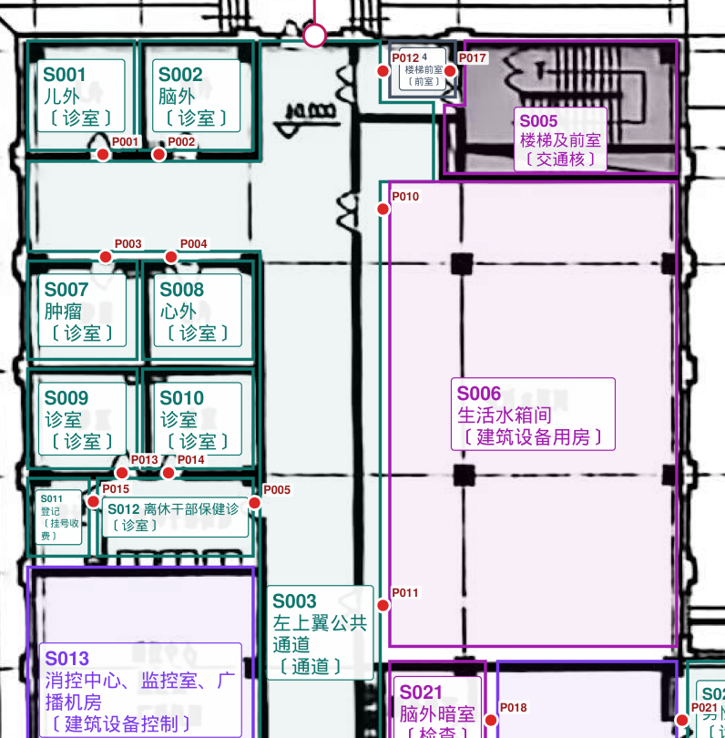

诊室、生活水箱间和楼梯前室；门洞按图保留，井道不凭共墙推断入口。

### 左上功能翼下段

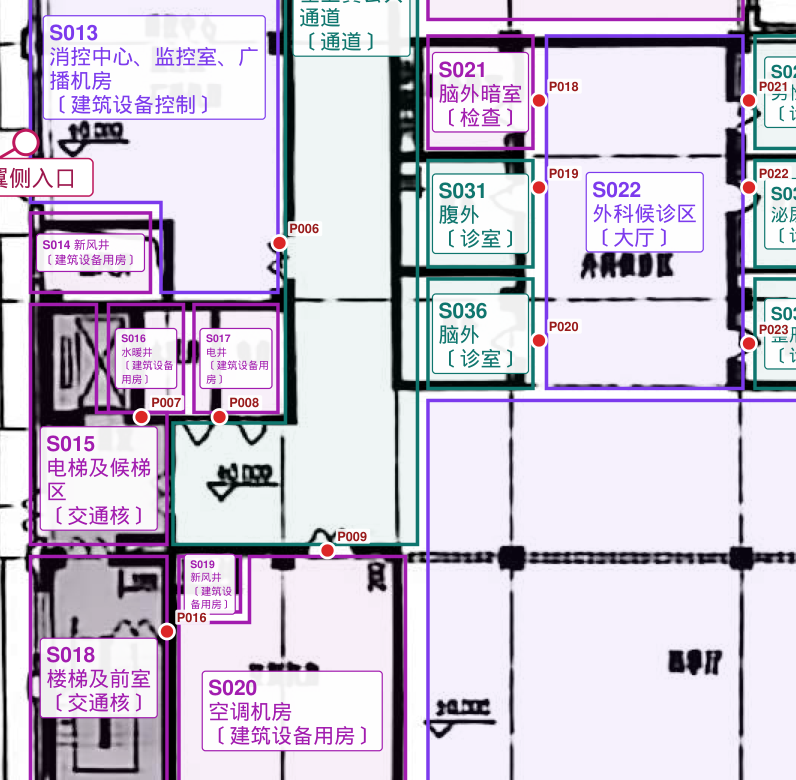

电梯候梯区、空调机房及其门洞；机房与楼梯、公共通道的门分别记录。

### 左中诊疗与厕所前室

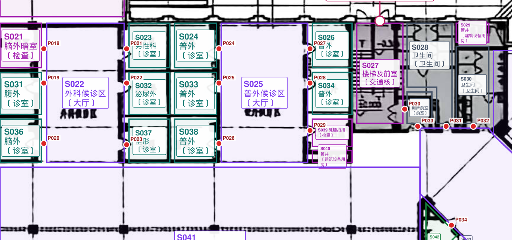

乳腺扫描、管井及修正后的厕所前室范围；候诊带向大厅连续开放。

### 右上诊疗翼上段

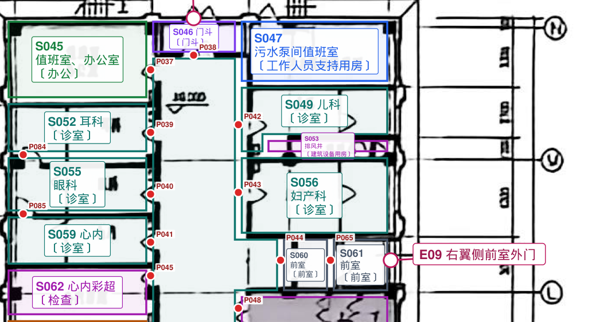

合并后的儿科、耳科、眼科、妇产科和心内；附间之间仍存在的门按功能块外连接保存。

### 右侧诊疗翼中段

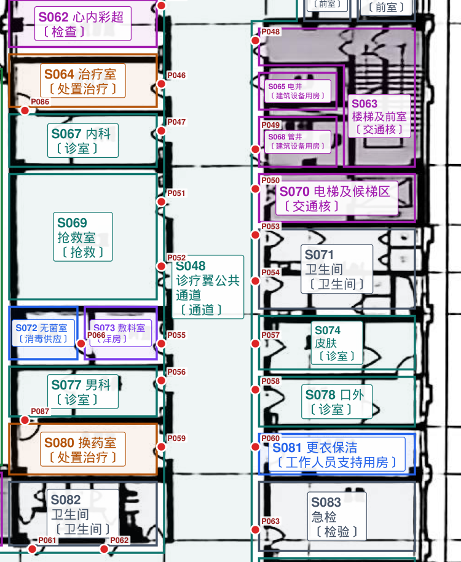

抢救、治疗、检验、合并诊室及交通核；柜台界面不代替人员入口。

### 中央交通核与北门厅

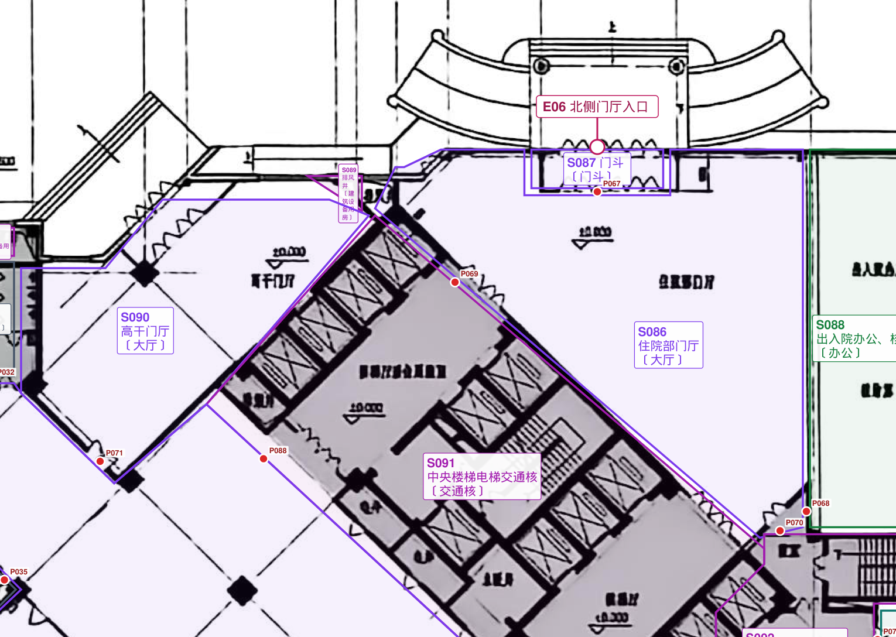

北门厅、高干门厅、出入院办公及中央交通核；交通核按整体保存，未细分内部路线。

### 中央大厅、候药与中心药房

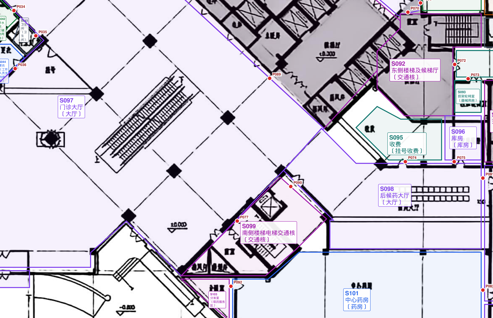

门诊大厅、后候药大厅及南侧交通核；分发室经清晰单门连向中心药房。

### 右下急诊与公共服务

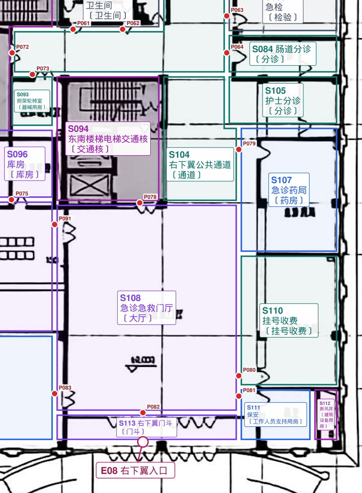

担架轮椅室、护士分诊、急诊药局、挂号收费及急诊门厅；已分开柜台服务与人员通行。

## 校验与交付状态

正式校验待最后运行。全图及8组局部已逐处查看房名、范围、红点和入口；92个开口均已检查所属空间对，未发现距离任一端概念轮廓超过15像素的点。该距离只辅助发现错配，不代替门洞目检。

修改前四文件、最新原始回填、合并映射、逐关系判读及校验记录均保存在样本外的临时核对目录；样本目录保持原图、JSON、SVG、MD四文件。主要通路关键待确认项0项；名称待确认0项。下述辅助细节未穷尽，不影响本轮概念精度收尾。

## 原名称核对填写记录（保留）

以下01—88为原固定核对号，仍对应原S编号，用户“我的确认／备注”内容原样保留，包括尚未逐行改写的“待确认”。它们是历史填写原文，**不再表示当前尚未确认**；每行“依据与把握”开头已附本轮落实名称及合并去向。填写时预估和原判读仅供追溯，当前名称、范围与连通性以本文前段及现有JSON／SVG为准。

原内部核对数字图是合并前房名核对记录；现有合并范围见前述连通局部及最终SVG。

### 01—06｜A 左上功能翼

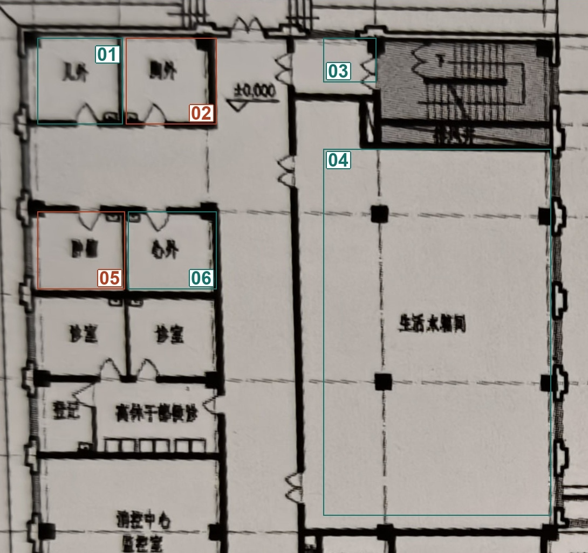

[查看同范围无标记照片](../../临时核对/20_哈尔滨医科大学附属第一医院门诊保健大楼_照片补充_20261103/01_核对01-06_无标记照片.jpg)

| 核对号 | S编号  | 填写时预估名称（保留） | 备选名称     | 依据与把握                                                     | 我的确认／备注 | 核对号（重复） |
| --- | ---- | -------- | -------- | --------------------------------------------------------- | ------- | ------- |
| 01 | S001 | 儿外 | — | 【本轮落实】S001 儿外〔诊室〕。原判读：【此前图面判断】照片01：照片左上第一间原注为“儿外”，保留缩写，不扩写为儿科。 把握：高。 | 儿外 | 01 |
| 02 | S002 | 脑外 | 胸外 | 【本轮落实】S002 脑外〔诊室〕。原判读：【历史候选】照片上排右间可见两字缩写；首字仍不够清楚，两个候选共用字形依据。 把握：中。当时保留unknown，现已落实。 | 脑外 | 02 |
| 03 | S004 | 楼梯前室 | — | 【本轮落实】S004 楼梯前室〔前室〕。原判读：【此前图面判断】照片01：楼梯西侧由两道门分隔的独立前室；采用可识别构造名称。 把握：高。 | 楼梯前室 | 03 |
| 04 | S006 | 生活水箱间 | — | 【本轮落实】S006 生活水箱间〔建筑设备用房〕。原判读：【此前图面判断】照片01：大开间中央原注清楚为“生活水箱间”，撤回急诊观察室候选。 把握：高。 | 生活水箱间 | 04 |
| 05 | S007 | 肿瘤 | 暂无其他可靠候选 | 【本轮落实】S007 肿瘤〔诊室〕。原判读：【历史候选】照片上排下方左间疑似“肿瘤”；字迹糊合，不能仅凭科室邻接确定。 把握：中。当时保留unknown，现已落实。 | 肿瘤 | 05 |
| 06 | S008 | 心外 | — | 【本轮落实】S008 心外〔诊室〕。原判读：【此前图面判断】照片01：左上翼第二排右间原注“心外”，保留原图缩写。 把握：高。 | 心外 | 06 |

### 07—12｜A 左上功能翼

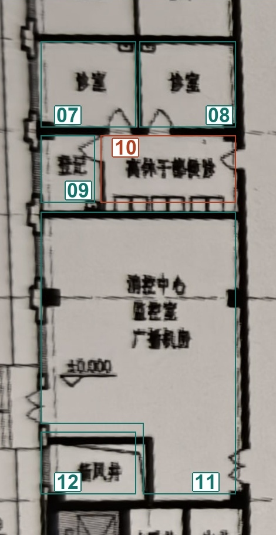

[查看同范围无标记照片](../../临时核对/20_哈尔滨医科大学附属第一医院门诊保健大楼_照片补充_20261103/02_核对07-12_无标记照片.jpg)

| 核对号 | S编号  | 填写时预估名称（保留）      | 备选名称   | 依据与把握                                                         | 我的确认／备注 | 核对号（重复） |
| --- | ---- | ------------- | ------ | ------------------------------------------------------------- | ------- | ------- |
| 07 | S009 | 诊室 | — | 【本轮落实】S009 诊室〔诊室〕。原判读：【此前图面判断】照片01：左上翼第三排左间原注“诊室”。 把握：高。 | 待确认 | 07 |
| 08 | S010 | 诊室 | — | 【本轮落实】S010 诊室〔诊室〕。原判读：【此前图面判断】照片01：左上翼第三排右间原注“诊室”。 把握：高。 | 待确认 | 08 |
| 09 | S011 | 登记 | — | 【本轮落实】S011 登记〔挂号收费〕。原判读：【此前图面判断】照片01：左上翼服务带左侧独立小间原注“登记”。 把握：高。 | 待确认 | 09 |
| 10 | S012 | 离休干部保健诊 | 干部保健候诊 | 【本轮落实】S012 离休干部保健诊〔诊室〕。原判读：【历史候选】服务带可见干部、保健等字及连续座位；前后字仍不够可靠，两候选共用该线索。 把握：中。当时保留unknown，现已落实。 | 离休干部保健诊 | 10 |
| 11 | S013 | 消控中心、监控室、广播机房 | — | 【本轮落实】S013 消控中心、监控室、广播机房〔建筑设备控制〕。原判读：【此前图面判断】照片01：同一较大空间内三行原注依次为消控中心、监控室、广播机房，保留现有整体功能块。 把握：高。 | 待确认 | 11 |
| 12 | S014 | 新风井 | — | 【本轮落实】S014 新风井〔建筑设备用房〕。原判读：【此前图面判断】照片01：消控区域西南角小围合原注“新风井”。 把握：高。 | 待确认 | 12 |

### 13—16｜A 左上功能翼

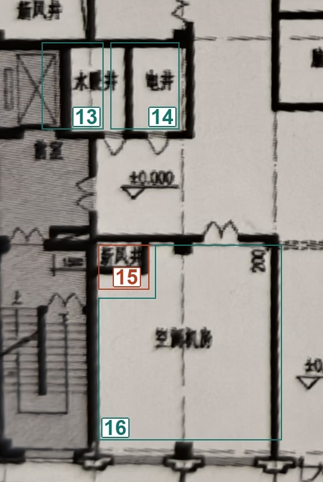

[查看同范围无标记照片](../../临时核对/20_哈尔滨医科大学附属第一医院门诊保健大楼_照片补充_20261103/03_核对13-16_无标记照片.jpg)

| 核对号 | S编号  | 填写时预估名称（保留） | 备选名称 | 依据与把握                                                   | 我的确认／备注 | 核对号（重复） |
| --- | ---- | -------- | ---- | ------------------------------------------------------- | ------- | ------- |
| 13 | S016 | 水暖井 | — | 【本轮落实】S016 水暖井〔建筑设备用房〕。原判读：【此前图面判断】照片01：电梯旁小间原注“水暖井”。 把握：高。 | 待确认 | 13 |
| 14 | S017 | 电井 | — | 【本轮落实】S017 电井〔建筑设备用房〕。原判读：【此前图面判断】照片01：水暖井右侧小间原注“电井”。 把握：高。 | 待确认 | 14 |
| 15 | S019 | 排风井 | 新风井 | 【本轮落实】S019 新风井〔建筑设备用房〕。原判读：【历史候选】楼梯旁极小井道原注末两字似风井；首字难辨，两个候选不能区分。 把握：低。当时保留unknown，现已落实。 | 新风井 | 15 |
| 16 | S020 | 空调机房 | — | 【本轮落实】S020 空调机房〔建筑设备用房〕。原判读：【此前图面判断】照片01：左上翼南端大房间原注“空调机房”。 把握：高。 | 待确认 | 16 |

### 17—22｜B 左中诊疗与候诊片区

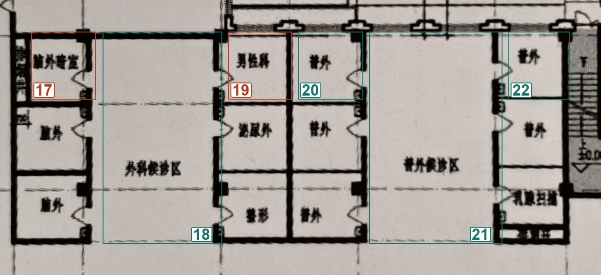

[查看同范围无标记照片](../../临时核对/20_哈尔滨医科大学附属第一医院门诊保健大楼_照片补充_20261103/04_核对17-22_无标记照片.jpg)

| 核对号 | S编号  | 填写时预估名称（保留） | 备选名称     | 依据与把握                                                    | 我的确认／备注    | 核对号（重复） |
| --- | ---- | -------- | -------- | -------------------------------------------------------- | ---------- | ------- |
| 17 | S021 | 输液管理室 | 暂无其他可靠候选 | 【本轮落实】S021 脑外暗室〔检查〕。原判读：【历史候选】照片原注为较长室名，部分字形似输液管理；目前无法逐字可靠辨认。 把握：低。当时保留unknown，现已落实。 | 脑外暗室  | 17 |
| 18 | S022 | 外科候诊区 | — | 【本轮落实】S022 外科候诊区〔大厅〕。原判读：【此前图面判断】照片01：左中第一组开放区原注“外科候诊区”。 把握：高。 | 待确认 | 18 |
| 19 | S023 | 男性科 | 暂无其他可靠候选 | 【本轮落实】S023 男性科〔诊室〕。原判读：【历史候选】外科候诊区东北侧房间原注似“男性科”；中间字仍需核实。 把握：中。当时保留unknown，现已落实。 | 男性科 | 19 |
| 20 | S024 | 普外 | — | 【本轮落实】S024 普外〔诊室〕。原判读：【此前图面判断】照片01：两候诊带之间上排右间原注“普外”。 把握：高。 | 待确认 | 20 |
| 21 | S025 | 普外候诊区 | — | 【本轮落实】S025 普外候诊区〔大厅〕。原判读：【此前图面判断】照片01：右侧开放候诊带原注“普外候诊区”，不再采用各科候诊区。 把握：高。 | 待确认 | 21 |
| 22 | S026 | 普外 | — | 【本轮落实】S026 普外〔诊室〕。原判读：【此前图面判断】照片01：普外候诊区北排独立间原注“普外”。 把握：高。 | 待确认 | 22 |

### 23—23｜B 左中诊疗与候诊片区

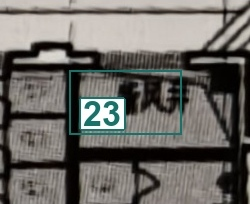

[查看同范围无标记照片](../../临时核对/20_哈尔滨医科大学附属第一医院门诊保健大楼_照片补充_20261103/05_核对23-23_无标记照片.jpg)

| 核对号 | S编号  | 填写时预估名称（保留） | 备选名称 | 依据与把握                                   | 我的确认／备注 | 核对号（重复） |
| --- | ---- | -------- | ---- | --------------------------------------- | ------- | ------- |
| 23 | S029 | 排风井 | — | 【本轮落实】S029 管井〔建筑设备用房〕。原判读：【此前图面判断】照片02：左中片区卫生间北侧狭长小间原注“排风井”。 把握：高。 | 管井 | 23 |

### 24—28｜B 左中诊疗与候诊片区

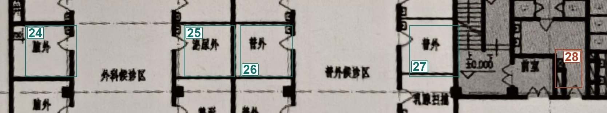

[查看同范围无标记照片](../../临时核对/20_哈尔滨医科大学附属第一医院门诊保健大楼_照片补充_20261103/06_核对24-28_无标记照片.jpg)

| 核对号 | S编号  | 填写时预估名称（保留） | 备选名称 | 依据与把握                                                         | 我的确认／备注 | 核对号（重复） |
| --- | ---- | -------- | ---- | ------------------------------------------------------------- | ------- | ------- |
| 24 | S031 | 腹外 | — | 【本轮落实】S031 腹外〔诊室〕。原判读：【此前图面判断】照片01：外科候诊区西侧中排原注“腹外”，按图保留原缩写。 把握：高。 | 待确认 | 24 |
| 25 | S032 | 泌尿外 | — | 【本轮落实】S032 泌尿外〔诊室〕。原判读：【此前图面判断】照片01：两候诊带之间中排左间原注“泌尿外”。 把握：高。 | 待确认 | 25 |
| 26 | S033 | 普外 | — | 【本轮落实】S033 普外〔诊室〕。原判读：【此前图面判断】照片01：两候诊带之间中排右间原注“普外”。 把握：高。 | 待确认 | 26 |
| 27 | S034 | 普外 | — | 【本轮落实】S034 普外〔诊室〕。原判读：【此前图面判断】照片01：普外候诊区东侧中排原注“普外”。 把握：高。 | 待确认 | 27 |
| 28 | S035 | 暂无可靠候选 | — | 【本轮落实】S035 厕所前室〔前室〕。原判读：【历史候选】卫生间与楼梯前室之间的小围合，照片仍未给出可靠室名；不能由邻接推定功能。 把握：低。当时保留unknown，现已落实。 | 厕所前室 | 28 |

### 29—34｜B 左中诊疗与候诊片区

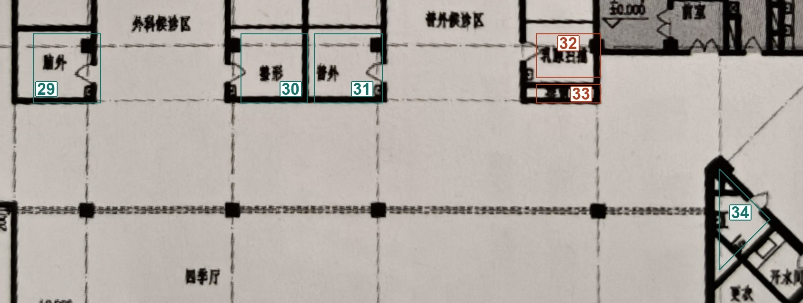

[查看同范围无标记照片](../../临时核对/20_哈尔滨医科大学附属第一医院门诊保健大楼_照片补充_20261103/07_核对29-34_无标记照片.jpg)

| 核对号 | S编号  | 填写时预估名称（保留） | 备选名称 | 依据与把握                                                          | 我的确认／备注 | 核对号（重复） |
| --- | ---- | -------- | ---- | -------------------------------------------------------------- | ------- | ------- |
| 29 | S036 | 脑外 | — | 【本轮落实】S036 脑外〔诊室〕。原判读：【此前图面判断】照片01：外科候诊区西侧下排原注“脑外”。 把握：高。 | 待确认 | 29 |
| 30 | S037 | 整形 | — | 【本轮落实】S037 整形〔诊室〕。原判读：【此前图面判断】照片01：两候诊带之间下排左间原注“整形”。 把握：高。 | 待确认 | 30 |
| 31 | S038 | 普外 | — | 【本轮落实】S038 普外〔诊室〕。原判读：【此前图面判断】照片01：两候诊带之间下排右间原注“普外”，撤回骨科候选。 把握：高。 | 待确认 | 31 |
| 32 | S039 | 清洁用房 | 清扫用房 | 【本轮落实】S039 乳腺扫描〔检查〕。原判读：【历史候选】南端短房间原字仍不可靠；两候选仅依清字形和辅助用房位置，现有证据不能区分。 把握：低。当时保留unknown，现已落实。 | 乳腺扫描 | 32 |
| 33 | S040 | 暂无可靠候选 | — | 【本轮落实】S040 管井〔建筑设备用房〕。原判读：【历史候选】紧邻S039的窄条空间，未见可判读文字，范围是否需并入相邻房间也待核。 把握：低。当时保留unknown，现已落实。 | 管井 | 33 |
| 34 | S042 | 开水间 | — | 【本轮落实】S042 开水间〔辅助用房〕。原判读：【此前图面判断】照片02：中央三角组东侧小间原注“开水间”。 把握：高。 | 待确认 | 34 |

### 35—35｜B 左中诊疗与候诊片区

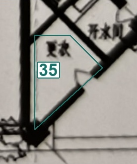

[查看同范围无标记照片](../../临时核对/20_哈尔滨医科大学附属第一医院门诊保健大楼_照片补充_20261103/08_核对35-35_无标记照片.jpg)

| 核对号 | S编号  | 填写时预估名称（保留） | 备选名称 | 依据与把握                                            | 我的确认／备注 | 核对号（重复） |
| --- | ---- | -------- | ---- | ------------------------------------------------ | ------- | ------- |
| 35 | S044 | 更衣 | — | 【本轮落实】S044 更衣〔工作人员支持用房〕。原判读：【此前图面判断】照片02：中央三角组西南小间原注“更衣”，不据相邻卫生器具归为卫生间。 把握：高。 | 待确认 | 35 |

### 36—41｜C 右上诊疗翼

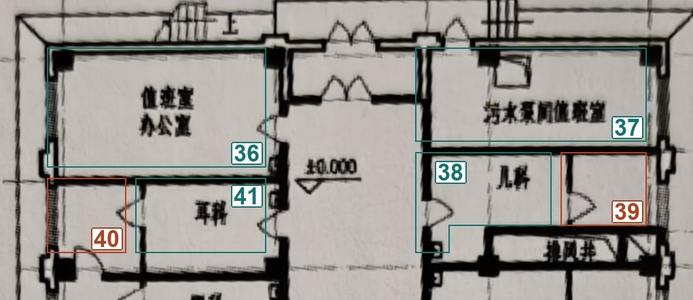

[查看同范围无标记照片](../../临时核对/20_哈尔滨医科大学附属第一医院门诊保健大楼_照片补充_20261103/09_核对36-41_无标记照片.jpg)

| 核对号 | S编号  | 填写时预估名称（保留） | 备选名称 | 依据与把握                                                  | 我的确认／备注  | 核对号（重复） |
| --- | ---- | -------- | ---- | ------------------------------------------------------ | -------- | ------- |
| 36 | S045 | 值班室、办公室 | — | 【本轮落实】S045 值班室、办公室〔办公〕。原判读：【此前图面判断】照片03：右上翼北端西侧房间内两行原注为值班室、办公室。 把握：高。 | 待确认 | 36 |
| 37 | S047 | 污水泵间值班室 | — | 【本轮落实】S047 污水泵间值班室〔工作人员支持用房〕。原判读：【此前图面判断】照片03：右上翼北端东侧长房间原注“污水泵间值班室”。 把握：高。 | 待确认 | 37 |
| 38 | S049 | 儿科 | — | 【本轮落实】S049 儿科〔诊室〕。原判读：【此前图面判断】照片03：右上翼东侧第一间原注“儿科”。 把握：高。 | 待确认 | 38 |
| 39 | S050 | 暂无可靠候选 | — | 【本轮落实】S050已并入S049 儿科〔诊室〕。原判读：【历史候选】儿科内门相连附间无独立室名；仅凭所属科室不能确定房间用途。 把握：低。当时保留unknown，现已落实。 | 儿科 和38合并 | 39 |
| 40 | S051 | 暂无可靠候选 | — | 【本轮落实】S051已并入S052 耳科〔诊室〕。原判读：【历史候选】耳科旁经内门连接的小间无独立室名，不从主间反推用途。 把握：低。当时保留unknown，现已落实。 | 耳科和41合并 | 40 |
| 41 | S052 | 耳科 | — | 【本轮落实】S052 耳科〔诊室〕。原判读：【此前图面判断】照片03：右上翼西侧第一组主间原注“耳科”，不扩写为耳鼻喉。 把握：高。 | 待确认 | 41 |

### 42—47｜C 右上诊疗翼

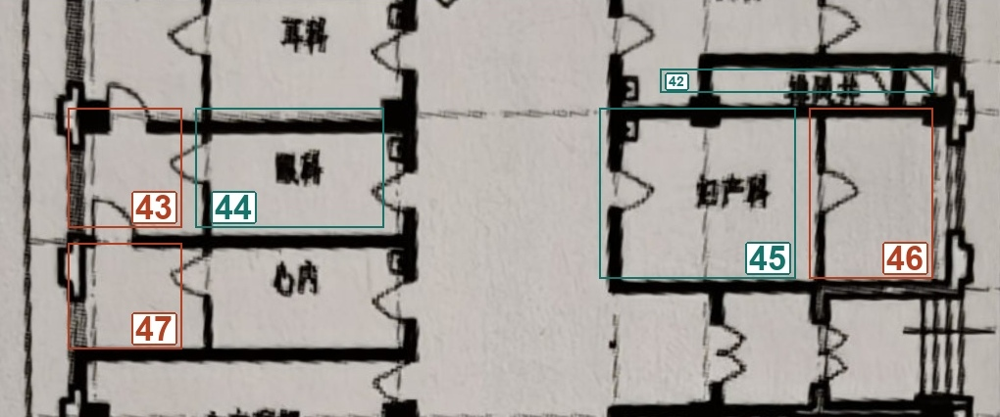

[查看同范围无标记照片](../../临时核对/20_哈尔滨医科大学附属第一医院门诊保健大楼_照片补充_20261103/10_核对42-47_无标记照片.jpg)

| 核对号 | S编号  | 填写时预估名称（保留） | 备选名称 | 依据与把握                                               | 我的确认／备注  | 核对号（重复） |
| --- | ---- | -------- | ---- | --------------------------------------------------- | -------- | ------- |
| 42 | S053 | 排风井 | — | 【本轮落实】S053 排风井〔建筑设备用房〕。原判读：【此前图面判断】照片03：儿科南侧狭长围合原注“排风井”。 把握：高。 | 待确认 | 42 |
| 43 | S054 | 暂无可靠候选 | — | 【本轮落实】S054已并入S055 眼科〔诊室〕。原判读：【历史候选】眼科旁经内门连接的小间无独立室名，不从主间反推用途。 把握：低。当时保留unknown，现已落实。 | 眼科和44合并 | 43 |
| 44 | S055 | 眼科 | — | 【本轮落实】S055 眼科〔诊室〕。原判读：【此前图面判断】照片03：右上翼西侧第二组主间原注“眼科”。 把握：高。 | 待确认 | 44 |
| 45 | S056 | 妇产科 | — | 【本轮落实】S056 妇产科〔诊室〕。原判读：【此前图面判断】照片03：右上翼东侧第二组主间原注“妇产科”。 把握：高。 | 待确认 | 45 |
| 46 | S057 | 暂无可靠候选 | — | 【本轮落实】S057已并入S056 妇产科〔诊室〕。原判读：【历史候选】妇产科附间无独立室名，保留现有范围与unknown。 把握：低。当时保留unknown，现已落实。 | 妇产科和46合并 | 46 |
| 47 | S058 | 暂无可靠候选 | — | 【本轮落实】S058已并入S059 心内〔诊室〕。原判读：【历史候选】心内旁经内门连接的小间无独立室名，不使用原口腔候选。 把握：低。当时保留unknown，现已落实。 | 和心内合并 | 47 |

### 48—53｜C 右上诊疗翼

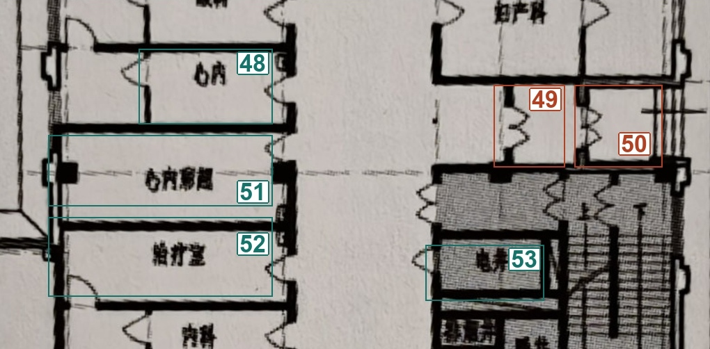

[查看同范围无标记照片](../../临时核对/20_哈尔滨医科大学附属第一医院门诊保健大楼_照片补充_20261103/11_核对48-53_无标记照片.jpg)

| 核对号 | S编号  | 填写时预估名称（保留） | 备选名称   | 依据与把握                                                          | 我的确认／备注 | 核对号（重复） |
| --- | ---- | -------- | ------ | -------------------------------------------------------------- | ------- | ------- |
| 48 | S059 | 心内 | — | 【本轮落实】S059 心内〔诊室〕。原判读：【此前图面判断】照片03：右上翼西侧第三组原注“心内”，撤回口腔候选。 把握：高。 | 待确认 | 48 |
| 49 | S060 | 前室 | 交通过渡空间 | 【本轮落实】S060 前室〔前室〕。原判读：【历史候选】图面为双门分隔的过渡小间；未见具体名称，两候选共用门分隔布局依据。 把握：中。当时保留unknown，现已落实。 | 前室 | 49 |
| 50 | S061 | 楼梯前室 | 外门过渡空间 | 【本轮落实】S061 前室〔前室〕。原判读：【历史候选】外墙邻台阶且有门分隔；构造用途尚需与S060一起核对，两候选共用布局依据。 把握：中。当时保留unknown，现已落实。 | 前室 | 50 |
| 51 | S062 | 心内彩超 | — | 【本轮落实】S062 心内彩超〔检查〕。原判读：【此前图面判断】照片03：心内南侧长条检查间原注“心内彩超”，撤回心电图室候选。 把握：高。 | 待确认 | 51 |
| 52 | S064 | 治疗室 | — | 【本轮落实】S064 治疗室〔处置治疗〕。原判读：【此前图面判断】照片03：心内彩超南侧房间原注“治疗室”。 把握：高。 | 待确认 | 52 |
| 53 | S065 | 电井 | — | 【本轮落实】S065 电井〔建筑设备用房〕。原判读：【此前图面判断】照片03：右上翼楼梯西侧上方小间原注“电井”。 把握：高。 | 待确认 | 53 |

### 54—59｜C 右上诊疗翼

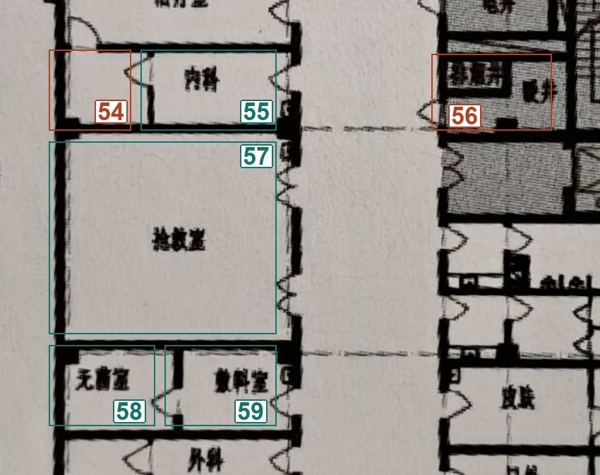

[查看同范围无标记照片](../../临时核对/20_哈尔滨医科大学附属第一医院门诊保健大楼_照片补充_20261103/12_核对54-59_无标记照片.jpg)

| 核对号 | S编号  | 填写时预估名称（保留） | 备选名称 | 依据与把握                                                      | 我的确认／备注 | 核对号（重复） |
| --- | ---- | -------- | ---- | ---------------------------------------------------------- | ------- | ------- |
| 54 | S066 | 暂无可靠候选 | — | 【本轮落实】S066已并入S067 内科〔诊室〕。原判读：【历史候选】内科旁附间没有独立室名，不根据内门补出检查用途。 把握：低。当时保留unknown，现已落实。 | 和内科合并 | 54 |
| 55 | S067 | 内科 | — | 【本轮落实】S067 内科〔诊室〕。原判读：【此前图面判断】照片03：治疗室南侧带附间的主间原注“内科”。 把握：高。 | 待确认 | 55 |
| 56 | S068 | 暖井 | 水暖井 | 【本轮落实】S068 管井〔建筑设备用房〕。原判读：【历史候选】楼梯旁下方井道原注末字为井，前字不够清楚；两个候选共用该字形证据。 把握：中。当时保留unknown，现已落实。 | 管井 | 56 |
| 57 | S069 | 抢救室 | — | 【本轮落实】S069 抢救室〔抢救〕。原判读：【此前图面判断】照片03：右上翼西侧较大双门房间原注“抢救室”，撤回检验室候选。 把握：高。 | 待确认 | 57 |
| 58 | S072 | 无菌室 | — | 【本轮落实】S072 无菌室〔消毒供应〕。原判读：【此前图面判断】照片03：抢救室南侧小间原注“无菌室”。 把握：高。 | 待确认 | 58 |
| 59 | S073 | 敷料室 | — | 【本轮落实】S073 敷料室〔库房〕。原判读：【此前图面判断】照片03：无菌室东侧小间原注“敷料室”，不改写为换药室。 把握：高。 | 待确认 | 59 |

### 60—65｜C 右上诊疗翼

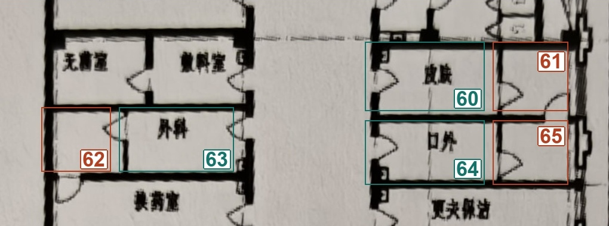

[查看同范围无标记照片](../../临时核对/20_哈尔滨医科大学附属第一医院门诊保健大楼_照片补充_20261103/13_核对60-65_无标记照片.jpg)

| 核对号 | S编号  | 填写时预估名称（保留） | 备选名称 | 依据与把握                                             | 我的确认／备注 | 核对号（重复） |
| --- | ---- | -------- | ---- | ------------------------------------------------- | ------- | ------- |
| 60 | S074 | 皮肤 | — | 【本轮落实】S074 皮肤〔诊室〕。原判读：【此前图面判断】照片03：右上翼东侧靠卫生间的主间原注“皮肤”，保留原文。 把握：高。 | 待确认 | 60 |
| 61 | S075 | 暂无可靠候选 | — | 【本轮落实】S075已并入S074 皮肤〔诊室〕。原判读：【历史候选】皮肤房间附间没有独立室名；无房间级用途证据。 把握：低。当时保留unknown，现已落实。 | 皮肤和60合并 | 61 |
| 62 | S076 | 暂无可靠候选 | — | 【本轮落实】S076已并入S077 男科〔诊室〕。原判读：【历史候选】外科房间西侧附间没有独立室名；无房间级用途证据。 把握：低。当时保留unknown，现已落实。 | 男科和63合并 | 62 |
| 63 | S077 | 外科 | — | 【本轮落实】S077 男科〔诊室〕。原判读：【此前图面判断】照片03：敷料室南侧主间原注“外科”。 把握：高。 | 待确认 | 63 |
| 64 | S078 | 口外 | — | 【本轮落实】S078 口外〔诊室〕。原判读：【此前图面判断】照片03：皮肤南侧主间原注“口外”，不改写为口腔。 把握：高。 | 待确认 | 64 |
| 65 | S079 | 暂无可靠候选 | — | 【本轮落实】S079已并入S078 口外〔诊室〕。原判读：【历史候选】口外房间东侧附间没有独立室名；无房间级用途证据。 把握：低。当时保留unknown，现已落实。 | 口外和64合并 | 65 |

### 66—70｜C 右上诊疗翼

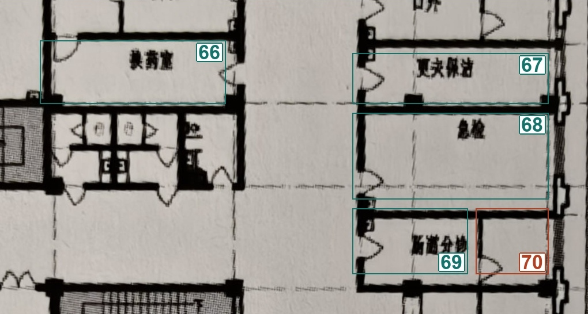

[查看同范围无标记照片](../../临时核对/20_哈尔滨医科大学附属第一医院门诊保健大楼_照片补充_20261103/14_核对66-70_无标记照片.jpg)

| 核对号 | S编号  | 填写时预估名称（保留） | 备选名称 | 依据与把握                                              | 我的确认／备注   | 核对号（重复） |
| --- | ---- | -------- | ---- | -------------------------------------------------- | --------- | ------- |
| 66 | S080 | 换药室 | — | 【本轮落实】S080 换药室〔处置治疗〕。原判读：【此前图面判断】照片03：外科南侧独立房间原注“换药室”。 把握：高。 | 待确认 | 66 |
| 67 | S081 | 更衣保洁 | — | 【本轮落实】S081 更衣保洁〔工作人员支持用房〕。原判读：【此前图面判断】照片03：口外南侧长间原注“更衣保洁”。 把握：高。 | 待确认 | 67 |
| 68 | S083 | 急检 | — | 【本轮落实】S083 急检〔检验〕。原判读：【此前图面判断】照片03：更衣保洁南侧大单间原注“急检”，保留原图缩写。 把握：高。 | 待确认 | 68 |
| 69 | S084 | 肠道分诊 | — | 【本轮落实】S084 肠道分诊〔分诊〕。原判读：【此前图面判断】照片03：急检南侧主间原注“肠道分诊”。 把握：高。 | 待确认 | 69 |
| 70 | S085 | 暂无可靠候选 | — | 【本轮落实】S085已并入S084 肠道分诊〔分诊〕。原判读：【历史候选】肠道分诊旁附间没有独立室名，不能直接赋予分诊用途。 把握：低。当时保留unknown，现已落实。 | 69和肠道分诊合并 | 70 |

### 71—74｜D 中央斜向交通与北门厅

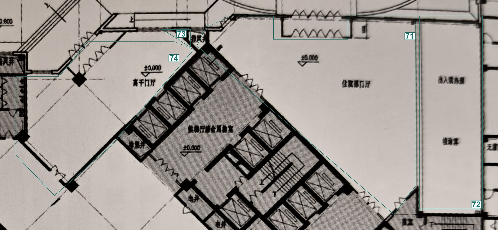

[查看同范围无标记照片](../../临时核对/20_哈尔滨医科大学附属第一医院门诊保健大楼_照片补充_20261103/15_核对71-74_无标记照片.jpg)

| 核对号 | S编号  | 填写时预估名称（保留）  | 备选名称 | 依据与把握                                                  | 我的确认／备注 | 核对号（重复） |
| --- | ---- | --------- | ---- | ------------------------------------------------------ | ------- | ------- |
| 71 | S086 | 住院部门厅 | — | 【本轮落实】S086 住院部门厅〔大厅〕。原判读：【此前图面判断】照片02：中央北侧开敞大厅原注“住院部门厅”，撤回急诊门厅候选。 把握：高。 | 待确认 | 71 |
| 72 | S088 | 出入院办公、核算室 | — | 【本轮落实】S088 出入院办公、核算室〔办公〕。原判读：【此前图面判断】照片02：住院部门厅东侧功能带有“出入院办公”“核算室”两处原注，沿用整体功能块。 把握：高。 | 待确认 | 72 |
| 73 | S089 | 排风井 | — | 【本轮落实】S089 排风井〔建筑设备用房〕。原判读：【此前图面判断】照片02：高干门厅东北角三角围合原注“排风井”。 把握：高。 | 待确认 | 73 |
| 74 | S090 | 高干门厅 | — | 【本轮落实】S090 高干门厅〔大厅〕。原判读：【此前图面判断】照片02：中央斜向交通核西北侧原注“高干门厅”。 把握：高。 | 待确认 | 74 |

### 75—77｜D 中央斜向交通与北门厅

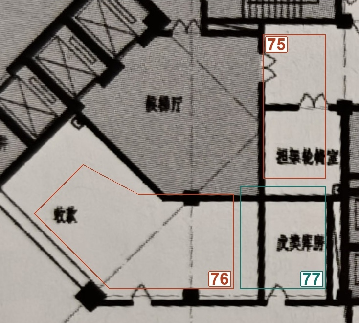

[查看同范围无标记照片](../../临时核对/20_哈尔滨医科大学附属第一医院门诊保健大楼_照片补充_20261103/16_核对75-77_无标记照片.jpg)

| 核对号 | S编号  | 填写时预估名称（保留） | 备选名称     | 依据与把握                                                          | 我的确认／备注 | 核对号（重复） |
| --- | ---- | -------- | -------- | -------------------------------------------------------------- | ------- | ------- |
| 75 | S093 | 抢救相关用房 | 暂无其他可靠候选 | 【本轮落实】S093 担架轮椅室〔器械用房〕。原判读：【历史候选】长原注后部似抢救室，前部文字仍不可靠；候选只表示待核方向，未写入JSON。 把握：中。当时保留unknown，现已落实。 | 担架轮椅室 | 75 |
| 76 | S095 | 收费 | 暂无其他可靠候选 | 【本轮落实】S095 收费〔挂号收费〕。原判读：【历史候选】斜向房间原注两字，疑似收费但第二字仍难辨，不凭常见医院配置确认。 把握：中。当时保留unknown，现已落实。 | 收费 | 76 |
| 77 | S096 | 武装保卫 | — | 【本轮落实】S096 库房〔库房〕。原判读：【此前图面判断】照片02：中央交通核东南侧下方独立房间原注“武装保卫”。 把握：高。 | 库房 | 77 |

### 78—80｜E 南部大厅与药房

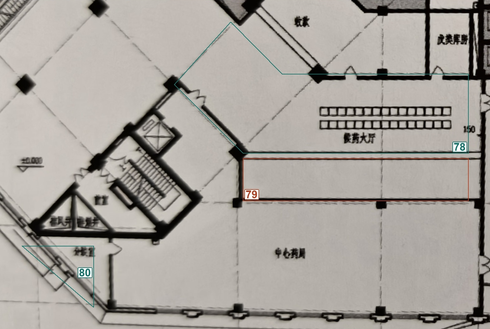

[查看同范围无标记照片](../../临时核对/20_哈尔滨医科大学附属第一医院门诊保健大楼_照片补充_20261103/17_核对78-80_无标记照片.jpg)

| 核对号 | S编号  | 填写时预估名称（保留） | 备选名称  | 依据与把握                                                             | 我的确认／备注      | 核对号（重复） |
| --- | ---- | -------- | ----- | ----------------------------------------------------------------- | ------------ | ------- |
| 78 | S098 | 候药大厅 | — | 【本轮落实】S098 后候药大厅〔大厅〕。原判读：【此前图面判断】照片04：中心药房北侧座椅区域原注“候药大厅”。 把握：高。 | 待确认 | 78 |
| 79 | S100 | 药房工作带 | 取药服务区 | 【本轮落实】S100已并入S098 后候药大厅〔大厅〕。原判读：【历史候选】位于中心药房与候药大厅之间；照片未明确这条分带的功能界面，两候选仅共用位置证据。 把握：低。当时保留unknown，现已落实。 | 和78合并叫做后候药大厅 | 79 |
| 80 | S103 | 冷藏室 | — | 【本轮落实】S103 分发室〔取药服务区〕。原判读：【此前图面判断】照片02：中心药房西侧三角房间原注“冷藏室”，撤回消毒室、治疗室候选。 把握：高。 | 分发室 | 80 |

### 81—86｜F 右下公共服务片区

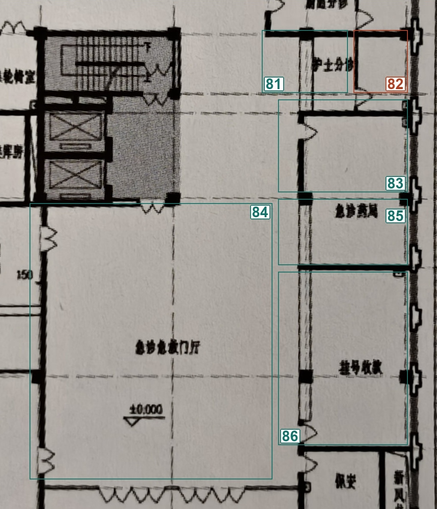

[查看同范围无标记照片](../../临时核对/20_哈尔滨医科大学附属第一医院门诊保健大楼_照片补充_20261103/18_核对81-86_无标记照片.jpg)

| 核对号 | S编号  | 填写时预估名称（保留） | 备选名称 | 依据与把握                                                              | 我的确认／备注 | 核对号（重复） |
| --- | ---- | -------- | ---- | ------------------------------------------------------------------ | ------- | ------- |
| 81 | S105 | 护士分诊 | — | 【本轮落实】S105 护士分诊〔分诊〕。原判读：【此前图面判断】照片04：右下服务翼北端主间原注“护士分诊”。 把握：高。 | 待确认 | 81 |
| 82 | S106 | 暂无可靠候选 | — | 【本轮落实】S106已并入S105 护士分诊〔分诊〕。原判读：【历史候选】护士分诊旁附间没有独立室名，不能由主间用途确定。 把握：低。当时保留unknown，现已落实。 | 和护士分诊合并 | 82 |
| 83 | S107 | 急诊药局 | — | 【本轮落实】S107 急诊药局〔药房〕。原判读：【此前图面判断】照片04：与S109之间只见轴网线和柱，未见隔墙；暂保留两片，名称按同一急诊药局登记，范围合并建议见MD。 把握：高。 | 待确认 | 83 |
| 84 | S108 | 急诊急救门厅 | — | 【本轮落实】S108 急诊急救门厅〔大厅〕。原判读：【此前图面判断】照片04：右下大门厅原注“急诊急救门厅”，撤回出入院门厅候选。 把握：高。 | 待确认 | 84 |
| 85 | S109 | 急诊药局 | — | 【本轮落实】S109已并入S107 急诊药局〔药房〕。原判读：【此前图面判断】照片04：同一连续房间中原注“急诊药局”；与S107暂保留草稿分片，待房间核对收尾落实合并。 把握：高。 | 待确认 | 85 |
| 86 | S110 | 挂号收费 | — | 【本轮落实】S110 挂号收费〔挂号收费〕。原判读：【此前图面判断】照片04：急诊药局南侧长房间原注“挂号收费”。 把握：高。 | 待确认 | 86 |

**范围核对F01落实结果：**按本图清晰连续范围，将S109并入S107急诊药局；两片间为轴网线和柱，未见实体隔墙。原83、85核对号及填写仍保留。这是图面自主修正，不记作用户已确认合并。

**F01原填写（历史记录，原文保留）：**&#x5F85;填写（同意合并，或说明实际分隔）

### 87—88｜F 右下公共服务片区

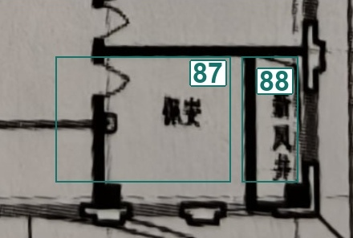

[查看同范围无标记照片](../../临时核对/20_哈尔滨医科大学附属第一医院门诊保健大楼_照片补充_20261103/19_核对87-88_无标记照片.jpg)

| 核对号 | S编号  | 填写时预估名称（保留） | 备选名称 | 依据与把握                              | 我的确认／备注 | 核对号（重复） |
| --- | ---- | -------- | ---- | ---------------------------------- | ------- | ------- |
| 87 | S111 | 保安 | — | 【本轮落实】S111 保安〔工作人员支持用房〕。原判读：【此前图面判断】照片04：右下翼南端小间原注“保安”。 把握：高。 | 待确认 | 87 |
| 88 | S112 | 新风井 | — | 【本轮落实】S112 新风井〔建筑设备用房〕。原判读：【此前图面判断】照片04：保安东侧狭长井道竖注“新风井”。 把握：高。 | 待确认 | 88 |
