# 21_海军总医院外科医疗大楼｜连通复核

**房名已齐；连通复核进行中，尚有4组、6处关键判断待填写。整图暂未完成。**

**标注规模：**&#x31;58 个空间／区域，房间级单元 113 个、开放空间 31 个、交通核 9 个、半墙服务区 5 个。

**类型与数量：**&#x7559;观 7 个、建筑设备用房 5 个、器械用房 2 个、抢救 1 个、处置治疗 15 个、患者准备 2 个、门斗 3 个、大厅 8 个、库房 5 个、交通核 9 个、消毒供应 2 个、挂号收费 1 个、药房 1 个、通道 16 个、工作人员支持用房 13 个、检验 2 个、分诊 2 个、诊室 20 个、检查 7 个、卫生间 9 个、护士站 1 个、污物处理 2 个、办公 13 个、服务区 8 个、商业服务 3 个、建筑设备控制 1 个。

**连接关系：**&#x31;86 条，人员可达 158 条、服务联系 7 条、共墙 15 条、入口连接 6 条。

**入口：**&#x6025;诊入口、北入口、南入口、整形入口、行政入口、首长入口。

**相对规模：**&#x5BA4;内非重叠标注区域的 `area_ratio` 合计为 1；绿化不参与。具体物理尺寸由生成环节按任务确定。施工级门构造及内部精确路线不纳入数据。

**门洞与开口：**&#x31;35 个红点，对应 123 条人员可达关系；其中门洞 130 个、无门开口 5 个。同一空间对可有多个开口，关系仍按空间对归并。其余 35 条人员可达关系无定位红点；区域连续及半墙等概念连通不编造门位，服务窗口及共墙不作为通行红点。

**本图范围：**&#x539F;图所示整层，包括急诊、住院大厅及公共服务、体检、整形、行政及首长专用服务空间；各空间由scope区分。外围道路、绿化和尺寸线不纳入室内空间。大厅内树状图案不据此判断为露天中庭。

## 连通性确认（2026-11-05）

原有房间S编号、已确认名称及19行用户填写保持不变。图中红点P仅表示已辨认并定位的门洞／无门开口；没有红点的概念连接不等于不相通。

本轮保存158条人员可达关系，其中123条带定位点、35条保留为无定位的概念连接；共135个开口。服务联系7条、共墙15条、建筑入口6条分别记录。

**范围补齐：**&#x539F;稿漏画了部分连续交通区域，本轮续编S155急诊北侧后勤通道、S156中央西侧交通厅、S157体检西侧过道、S158整形北侧后勤通道；补齐S068门厅西端、S075东侧开放通行带、S112通道西端。已重新归一化相对面积；其余既有房间轮廓不变。

**已自主修正的主要路径：**&#x9AA8;科S034北门接急诊大厅S014，向中部通道的路径经外科S033；第五间观察室S005接办公前通道S057；点痣S131和激光S130的可见西门接皮护S125；医办S141接整形主通道S117。体检候诊廊与内部通道之间按S083—S157—S084分步记录。窗口和共墙未替代人员通行。

**概念连接与布局推断：**&#x5927;厅、候诊区与通道间的连续开放边界、半开放柜台的可达边界不编造门位。护士站S039南侧工作入口接S025为布局推断；主任S058、护士长S064与会议S061保留其转角入口的概念联系，不强行定位。交通核整体记录，内部前室、楼梯及电梯不展开内部路线。

**S076范围说明：**&#x6CBF;用原稿整体节点；其范围含图上导医台及楼梯前室外侧通行区。本轮仅定位真实外边界上的门，不把柜台隔线当作人员门，也不将该块内部的每处家具分隔另建节点。

**本轮不细究的内部细节：**&#x53;015库房、S059值班、S111煤表间、S122更衣、S140开水的入口证据不足；S143咨询已保留窗口服务关系，操作区内部入口不展开。本轮未补其不清楚的access，不表示不可达，也不作为已确认负例。

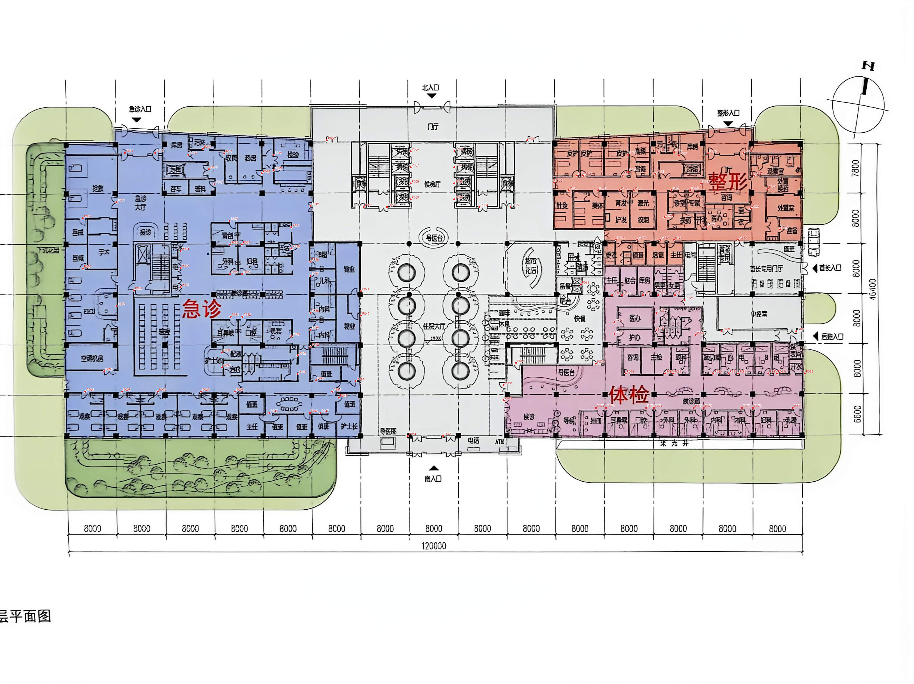

### 需要填写的关键判断

以下4组共6处填写栏。图片内直接标有01、02、03A、03B、04A、04B及对应S编号。只需确认直接相连的空间或通行顺序，无须指定精确门位；可分批填写。

### K01｜急诊手术与准备区的主要入口

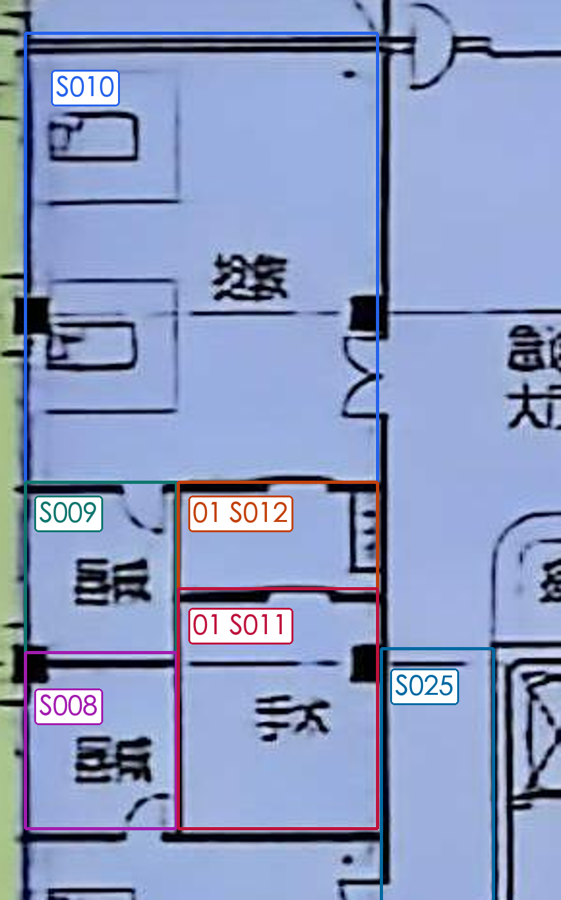

[查看同范围无标记原图](../20261105_连通复核_004455/K01_无标记原图.png)

**问题：**&#x53;011手术、S012手术准备间，实际从哪个空间进入，先后经过哪些空间？

**我的判断：**&#x53F3;侧是急诊西侧通道S025，但手术及准备间朝该侧的门不清楚；也不能仅因邻接器械、抢救空间就认定内部相通。暂未补这两间的access。

**我的确认／备注：s10进入**

### K02｜首长电梯及前室的对外连接

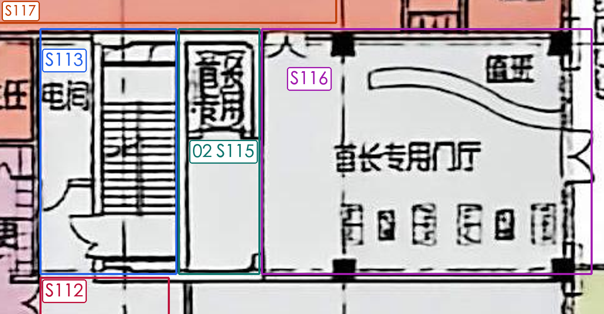

[查看同范围无标记原图](../20261105_连通复核_004455/K02_无标记原图.png)

**问题：**&#x53;115首长电梯以及前室，直接从哪个空间进入：首长门厅S116、公共楼梯核S113，还是其他空间？

**我的判断：**&#x5DF2;移除原稿跨过S115的“S116直接到S113”。S115右侧边界的通行口不够清楚，暂不把隔墙或同色区域直接当作相通。

**我的确认／备注：S116进入**

### K03-A｜护发室S123的直接入口

[查看同范围无标记原图](../20261105_连通复核_004455/K03-A_无标记原图.png)

**问题：**&#x53;123护发室是直接开向主通道S117，还是先经过育发S124进入？

**我的判断：**&#x5317;侧育发S124朝主通道的门可辨；下侧护发S123与通道、育发之间的门线仍不清，原直接连接暂移出。

**我的确认／备注：**&#x7ECF;过育发S124进入

### K03-B｜纹眉室S128的直接入口

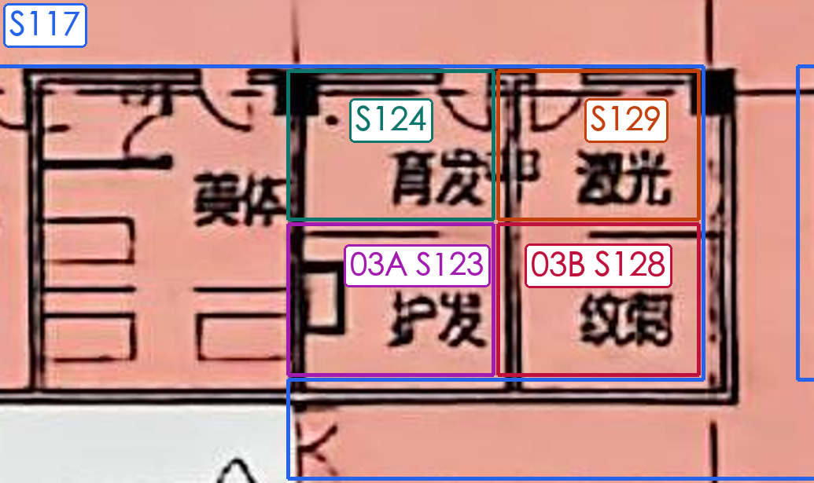

[查看同范围无标记原图](../20261105_连通复核_004455/K03-B_无标记原图.png)

**问题：**&#x53;128纹眉室是直接开向主通道S117，还是先经过激光S129进入？

**我的判断：**&#x5317;侧激光S129朝主通道的门可辨；下侧纹眉S128的门线仍不清，不能仅由共墙确定上下相通。

**我的确认／备注：**&#x7ECF;过激光S129进入

### K04-A｜整形主通道与东侧处置通道

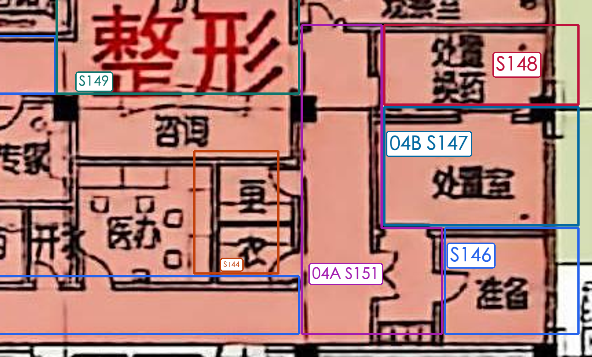

[查看同范围无标记原图](../20261105_连通复核_004455/K04-A_无标记原图.png)

**问题：**&#x6574;形主通道S117与东侧处置通道S151是否直接相通？若不直接相通，S151的入口在哪个空间？

**我的判断：**&#x4E24;段通道在东南角衔接，但双扇门线与卫生间入口混在一起，不能确定门归属；原S117—S151直接关系暂移出。整形厅S149东侧的连续墙线不作为捷径。

**我的确认／备注：**&#x76F4;接相通

### K04-B｜处理室S147的直接入口

[查看同范围无标记原图](../20261105_连通复核_004455/K04-B_无标记原图.png)

**问题：**&#x5904;理室S147是否直接开向通道S151，还是经准备S146或其他房间进入？

**我的判断：**&#x6362;药S148及准备S146朝东侧通道的门可辨；处理室S147西侧入口未能辨清，暂不据功能关系补连。

**我的确认／备注：**&#x5F85;接开向通道S151

**核验边界：**&#x6B63;式结构校验通过不等于上述6处已经确认；收到填写后再同步关系及红点，保留本轮P编号。

## 房名与范围核对（2026-11-05）

本轮19项已按“我的确认／备注”栏全部同步。核对号与S编号保持不变；预估名称及旧稿依据保留作历史记录，以填写栏的实际名称为准。

可直接修改“预估名称（可改）”，再把“我的确认／备注”改成“已确认”；也可直接在确认栏填写实际名称，或在聊天中按 `21号 01=名称` 回复。未回答项保留 unknown。

房名同步阶段记录：当时仅同步名称与类别，保留原146条关系，尚无门洞定位；最新关系和红点数量以上方连通复核概览为准。

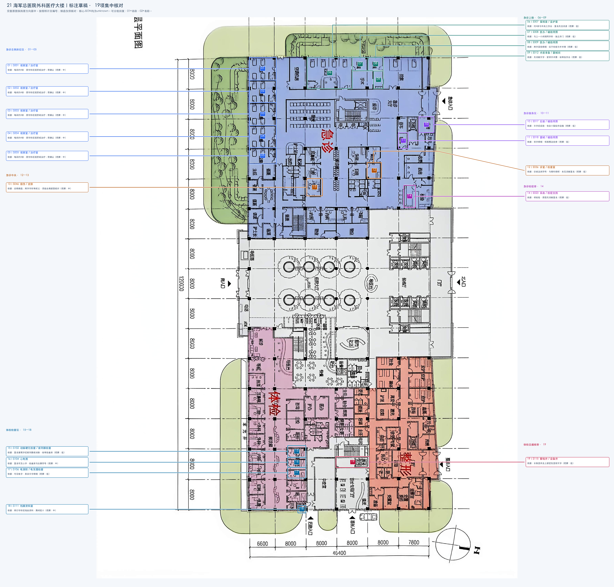

[原图](../../../标注试样/21_海军总医院外科医疗大楼/21_海军总医院外科医疗大楼_原图.jpg) · [现有标注 SVG](../../../标注试样/21_海军总医院外科医疗大楼/标注.svg)

### 01—05｜S001、S002、S003、S004、S005

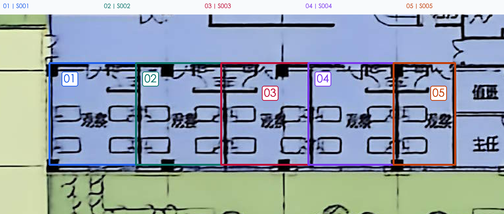

[查看同范围无标记原图](../../21-25_名称核对_20261105/21_海军总医院外科医疗大楼/局部_01_无标记原图.png)

| 核对号 | S编号  | 预估名称（可改） | 备选名称 | 依据与把握                                                            | 我的确认／备注 | 核对号（重复） |
| --- | ---- | -------- | ---- | ---------------------------------------------------------------- | ------- | ------- |
| 01  | S001 | 观察室      | 治疗室  | 各候选共用依据：可见床位；原字形模糊，单凭床位不能区分观察或治疗用途；现有证据不能可靠区分。 把握：中（旧稿预估，待本轮核对）。 | 观察室     | 01      |
| 02  | S002 | 观察室      | 治疗室  | 各候选共用依据：可见床位；原字形模糊，单凭床位不能区分观察或治疗用途；现有证据不能可靠区分。 把握：中（旧稿预估，待本轮核对）。 | 观察室     | 02      |
| 03  | S003 | 观察室      | 治疗室  | 各候选共用依据：可见床位；原字形模糊，单凭床位不能区分观察或治疗用途；现有证据不能可靠区分。 把握：中（旧稿预估，待本轮核对）。 | 观察室     | 03      |
| 04  | S004 | 观察室      | 治疗室  | 各候选共用依据：可见床位；原字形模糊，单凭床位不能区分观察或治疗用途；现有证据不能可靠区分。 把握：中（旧稿预估，待本轮核对）。 | 观察室     | 04      |
| 05  | S005 | 观察室      | 治疗室  | 各候选共用依据：可见床位；原字形模糊，单凭床位不能区分观察或治疗用途；现有证据不能可靠区分。 把握：中（旧稿预估，待本轮核对）。 | 观察室     | 05      |

### 06—09｜S007、S008、S009、S012

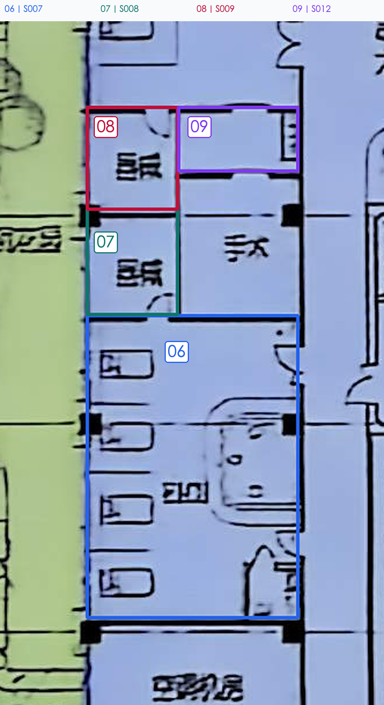

[查看同范围无标记原图](../../21-25_名称核对_20261105/21_海军总医院外科医疗大楼/局部_02_无标记原图.png)

| 核对号 | S编号  | 预估名称（可改） | 备选名称 | 依据与把握                                                   | 我的确认／备注 | 核对号（重复） |
| --- | ---- | -------- | ---- | ------------------------------------------------------- | ------- | ------- |
| 06  | S007 | 留观室      | 监护室  | 各候选共用依据：约4床与中央工作台，室名无法清读；现有证据不能可靠区分。 把握：低（旧稿预估，待本轮核对）。  | EICU    | 06      |
| 07  | S008 | 医办       | 辅助用房 | 各候选共用依据：与上一小间相同字形，独立开门；现有证据不能可靠区分。 把握：低（旧稿预估，待本轮核对）。    | 器械      | 07      |
| 08  | S009 | 医办       | 辅助用房 | 各候选共用依据：两字竖排模糊，位于抢救与手术旁；现有证据不能可靠区分。 把握：低（旧稿预估，待本轮核对）。   | 器械      | 08      |
| 09  | S012 | 术前准备     | 器械间  | 各候选共用依据：无清晰文字，紧邻手术房、绘有操作台；现有证据不能可靠区分。 把握：低（旧稿预估，待本轮核对）。 | 手术准备间   | 09      |

### 10—11｜S017、S018

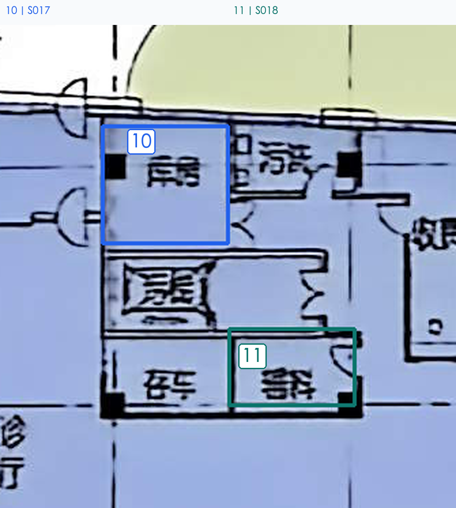

[查看同范围无标记原图](../../21-25_名称核对_20261105/21_海军总医院外科医疗大楼/局部_03_无标记原图.png)

| 核对号 | S编号  | 预估名称（可改） | 备选名称 | 依据与把握                                                | 我的确认／备注 | 核对号（重复） |
| --- | ---- | -------- | ---- | ---------------------------------------------------- | ------- | ------- |
| 10  | S017 | 后勤       | 辅助用房 | 各候选共用依据：文字近后勤，包含小型操作设施；现有证据不能可靠区分。 把握：低（旧稿预估，待本轮核对）。 | 库房      | 10      |
| 11  | S018 | 器械       | 辅助用房 | 各候选共用依据：双字模糊，邻库房及收费；现有证据不能可靠区分。 把握：低（旧稿预估，待本轮核对）。    | 辅料      | 11      |

### 12｜S036

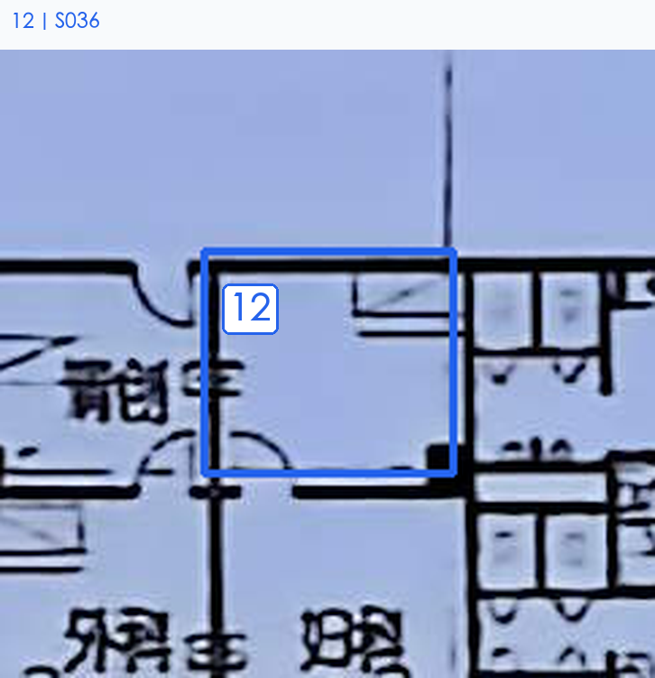

[查看同范围无标记原图](../../21-25_名称核对_20261105/21_海军总医院外科医疗大楼/局部_04_无标记原图.png)

| 核对号 | S编号  | 预估名称（可改） | 备选名称 | 依据与把握                                                     | 我的确认／备注 | 核对号（重复） |
| --- | ---- | -------- | ---- | --------------------------------------------------------- | ------- | ------- |
| 12  | S036 | 诊室       | 检查室  | 各候选共用依据：诊桌及床符号，与骨科相邻，未见清晰室名；现有证据不能可靠区分。 把握：低（旧稿预估，待本轮核对）。 | 检查室     | 12      |

### 13｜S046

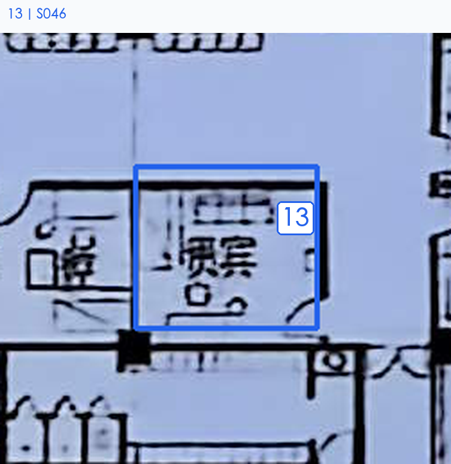

[查看同范围无标记原图](../../21-25_名称核对_20261105/21_海军总医院外科医疗大楼/局部_05_无标记原图.png)

| 核对号 | S编号  | 预估名称（可改） | 备选名称 | 依据与把握                                                       | 我的确认／备注 | 核对号（重复） |
| --- | ---- | -------- | ---- | ----------------------------------------------------------- | ------- | ------- |
| 13  | S046 | 烧伤       | 皮肤   | 各候选共用依据：旧稿候选；两字字形有歧义，须结合局部图核对；现有证据不能可靠区分。 把握：中（旧稿预估，待本轮核对）。 | 贵宾      | 13      |

### 14｜S023

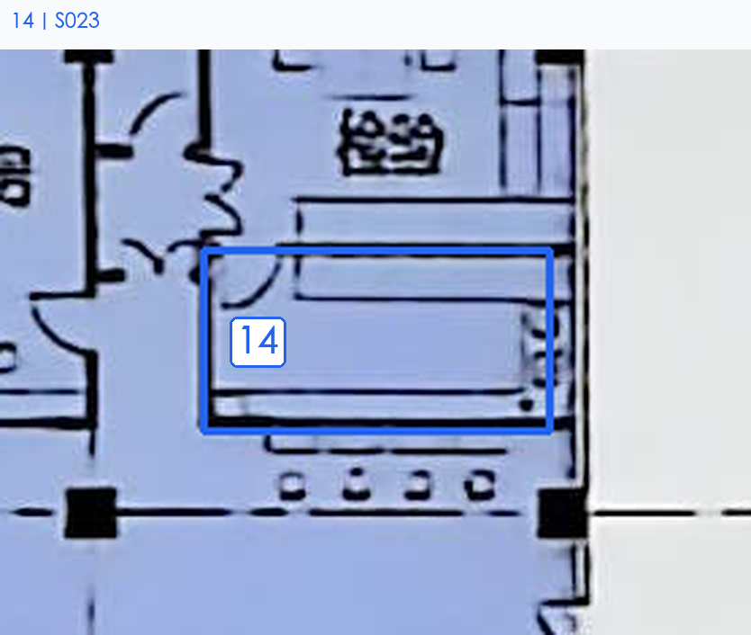

[查看同范围无标记原图](../../21-25_名称核对_20261105/21_海军总医院外科医疗大楼/局部_06_无标记原图.png)

| 核对号 | S编号  | 预估名称（可改） | 备选名称 | 依据与把握                                             | 我的确认／备注 | 核对号（重复） |
| --- | ---- | -------- | ---- | ------------------------------------------------- | ------- | ------- |
| 14  | S023 | 采血       | 检验支持 | 各候选共用依据：邻检验，原图无清晰室名；现有证据不能可靠区分。 把握：低（旧稿预估，待本轮核对）。 | 茶水间     | 14      |

### 15—18｜S102、S104、S106、S111

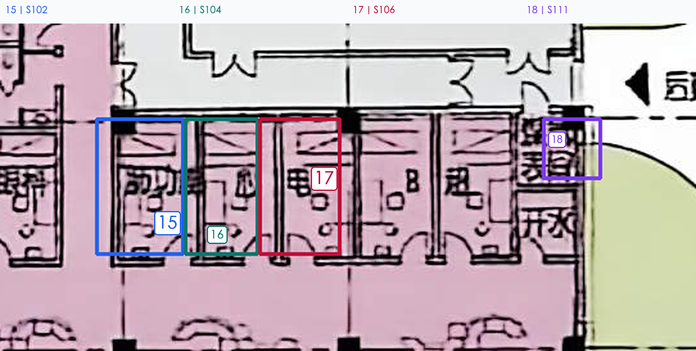

[查看同范围无标记原图](../../21-25_名称核对_20261105/21_海军总医院外科医疗大楼/局部_07_无标记原图.png)

| 核对号 | S编号  | 预估名称（可改） | 备选名称  | 依据与把握                                                    | 我的确认／备注 | 核对号（重复） |
| --- | ---- | -------- | ----- | -------------------------------------------------------- | ------- | ------- |
| 15  | S102 | 动脉硬化检查   | 前列腺检查 | 各候选共用依据：室名首尾字近前列腺或动脉，绘有检查床；现有证据不能可靠区分。 把握：低（旧稿预估，待本轮核对）。 | 肺功能     | 15      |
| 16  | S104 | 心电图      | —     | 室名可见心字，检查床与仪器符号 把握：中（旧稿预估，待本轮核对）。                        | 心电      | 16      |
| 17  | S106 | 电测听      | 电生理检查 | 各候选共用依据：可见电字，其余文字模糊；现有证据不能可靠区分。 把握：低（旧稿预估，待本轮核对）。        | 心电      | 17      |
| 18  | S111 | 档案资料室    | —     | 两行字形近档案资料，房间较小 把握：中（旧稿预估，待本轮核对）。                         | 煤表间     | 18      |

### 19｜S115

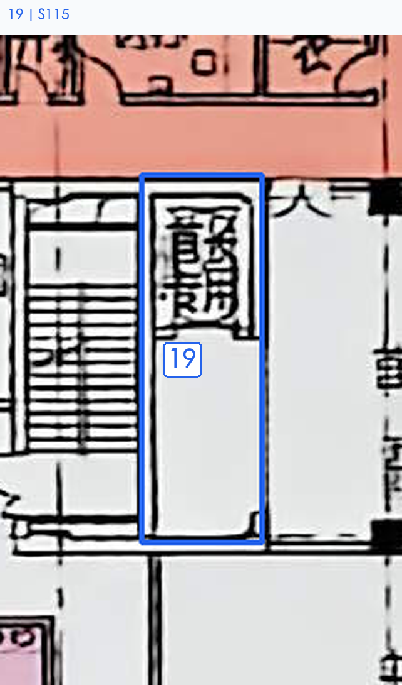

[查看同范围无标记原图](../../21-25_名称核对_20261105/21_海军总医院外科医疗大楼/局部_08_无标记原图.png)

| 核对号 | S编号  | 预估名称（可改） | 备选名称 | 依据与把握                                               | 我的确认／备注  | 核对号（重复） |
| --- | ---- | -------- | ---- | --------------------------------------------------- | -------- | ------- |
| 19  | S115 | 管线井      | 设备井  | 各候选共用依据：长条竖井及上部密集竖排文字；现有证据不能可靠区分。 把握：低（旧稿预估，待本轮核对）。 | 首长电梯以及前室 | 19      |
