> 本文件保留24号最终同步前的完整用户填写；旧草稿统计和判断只作历史追溯。当前结果见正式样本目录。

# 24_成都市第三人民医院住院综合楼｜连通复核草稿

名称已全部同步（0项unknown）。连通复核已补录可见门洞；仍有2项主要连接疑点待确认，二更合并已落实，尚未宣布整体打标完成。

**本图范围：**&#x4EC5;处理本目录的单张平面。图内包含介入中心医技及医护／患者支持、静脉配液中心、住院入口与电梯交通、社保／住院缴费、医院街和综合教学区。按入口、公共服务及教学布局暂按首层功能平面理解，原图未给出清晰楼层标题。未见住院病房；门诊入口为公共大厅接口，不能据此把本图全部归为普通门诊。院外坡道、室外楼梯及其他楼层不计入室内空间。

**标注规模：**&#x39;1个空间／区域。**类型与数量：**&#x536B;生间9个、交通核10个、教学培训2个、通道7个、办公7个、库房4个、影像检查6个、服务工作区5个、建筑设备用房3个、工作人员支持用房9个、前室2个、会议教学6个、服务区2个、留观1个、患者准备3个、护士站1个、大厅7个、配药用房6个、挂号收费1个。

**关系与门洞：**&#x5171;117条关系，其中人员可达93条、服务联系4条、共墙13条、入口7条。已定位87个门洞／开口红点，对应77条access；另有16条无定位点的概念连接。E编号入口独立保留，不计入P红点。

**修改依据：**&#x6309;用户填写保留“培训会议室、DR、X光、抢救苏醒、营养药品配置操作间、审方打单室”等原名；共享英文类别用于分类，不改写用户用词。已归档本轮修改前四文件及完整填写表。

**相对规模：**&#x5BA4;内面积比例合计为1；已按用户确认将核对30（S063）与31（S064）合并为“二更”，保留S063、退役S064；轮廓取两者并集，原有外部门洞与关系全部转挂S063，面积重新归一化。其余空间编号与轮廓保持不变。

**连接修正：**&#x52;038由“等候区S050—介入中心公共区S057”修正为“等候区S050—电梯厅S054”，门位在二者共边；R024由“公共区S088—交通核S090”修正为“住院缴费S091—交通核S090”，并依据开放服务分区连续补充S088—S091。S052增加与S051／S055的电梯门面连接。S074经前室S079进入支通道S080，不直接跨过中间房间连接S080。

**图面连续与布局推断：**&#x533B;院街、大厅各功能分区、S042—S043、S066—S074、S074—S079按连续图面保留概念连接，不在轴线／人为功能边界编造门位。电梯核按整体节点连接其所朝厅道，不细分核内路线。S088—S091为开放服务分区连续判断，不表示公众可越柜台或具备门禁权限。服务窗口与共墙独立保留，不据此生成通行红点。

**连通性测试：**&#x4EC5;使用access与各入口的目标节点遍历，83/91个节点可从已标入口到达。未形成入口路径的8项为S025 X光、S036饮水、S044／S045更衣、S047护士站、S065药品调配、S086空调机房、S092社保。主要功能疑点仅S025和S065；其余属于服务节点或本轮不细究的内部小间，未记人员连接不作“不相通”的结论。

**本轮不细究的内部细节：**&#x4E24;处患者更衣小间、饮水／护士站／社保服务区内部进出、空调机房检修进出，以及更衣和辅助小间未能定位的内部细门。不为消除图孤立而补造关系。

**核验范围：**&#x6B63;式结构、面积、编号和SVG红点一致性检查；全部开口到双方多边形的距离审计；完整SVG及密集局部目检；名称表填写和图片引用保留。结构检查通过不等于下列语义疑点已解决。

[原图](../../标注试样/24_成都市第三人民医院住院综合楼/24_成都市第三人民医院住院综合楼_原图.jpg) · [当前标注SVG](../../标注试样/24_成都市第三人民医院住院综合楼/标注.svg)

## 连通与范围待确认（本轮）

可在对应“我的确认／备注”填写“同意”或实际连接的S编号。以下建议尚未作为已确认access写入JSON，也未添加猜测门位。

### K01｜X光S025的主要出入口

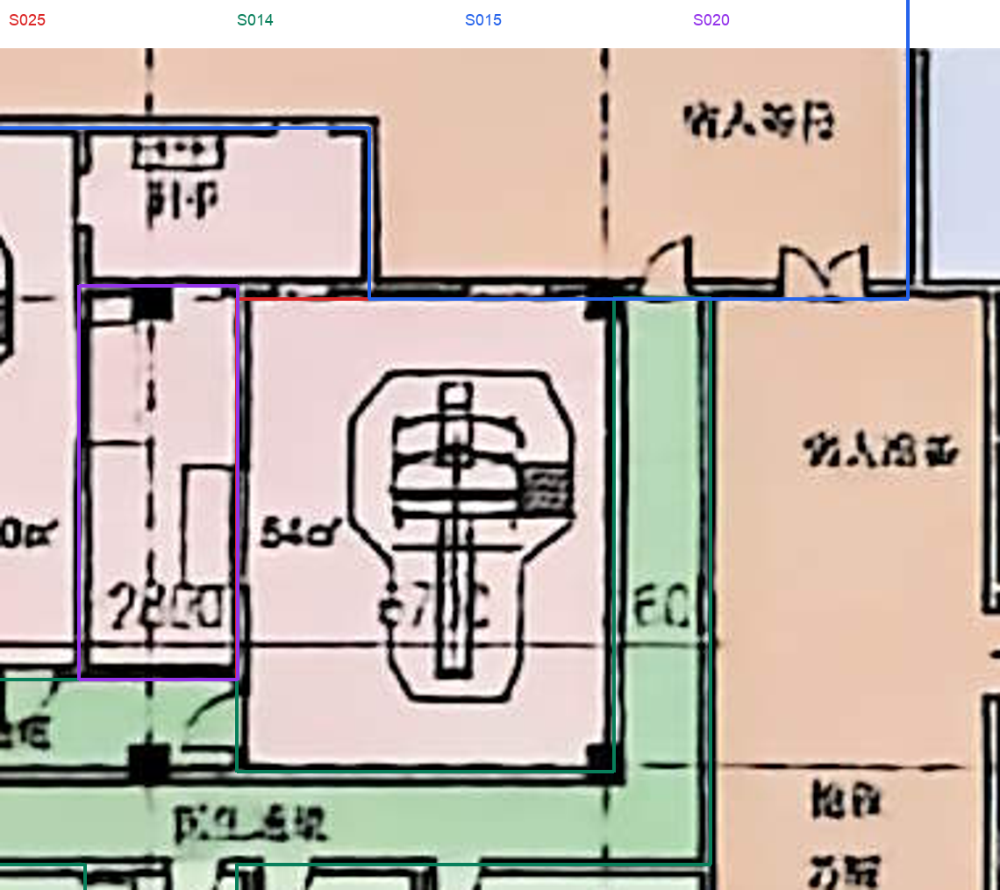

**问题：**&#x53;025是否直接连向医护通道S014？

**我的判断：**&#x503E;向S025—S014；X光房侧边紧接医护通道，但门扇／缺口不够清晰。目前未添加这条候选，S025在人员可达图中孤立。也可填写实际连接S015或其他空间。

**我的确认／备注：**&#x76F4;接连向医护通道S014

### K02｜药品调配S065的主要出入口

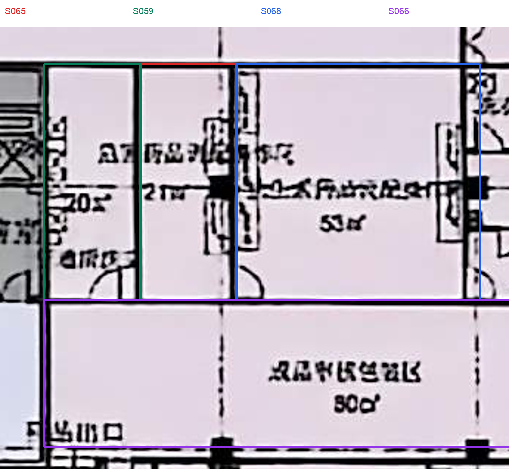

**问题：**&#x53;065是否直接连向成品审核包装区S066？

**我的判断：**&#x503E;向S065—S066；该房下侧紧邻审核包装区，但门位未辨清。目前未添加这条候选；如实际通过S059或S068进入，请写对应编号。

**我的确认／备注：**&#x4ECE;068进入

### 已处理 K03｜二更合并范围

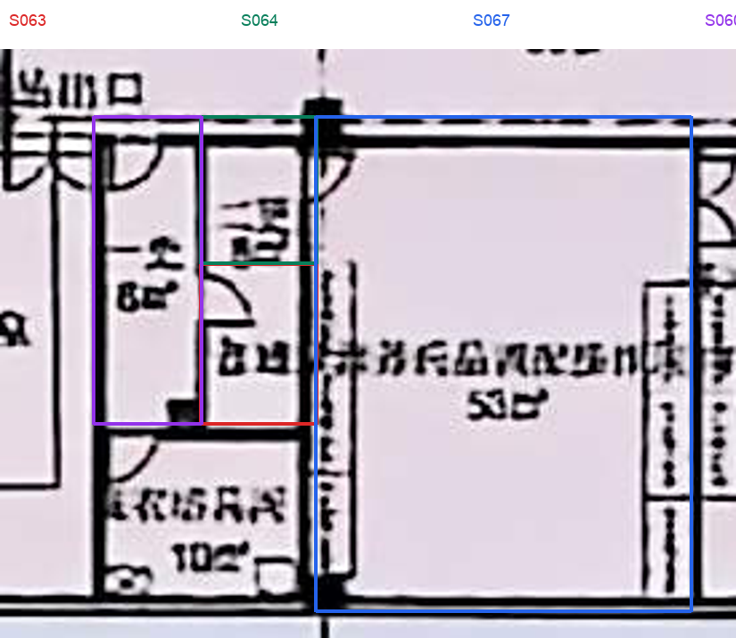

**问题：**&#x8868;中两行“31、32合并”具体指哪两个空间？

**我的判断：**&#x540C;一句合并指令填在核对30（S063）及31（S064）两行，倾向合并这两个相邻小间并保留S063；若按字面31、32，则涉及S064和营养药品配置操作间S067。本段保留合并前的判断上下文，现已按下方确认执行。

**我的确认／备注：**&#x7528;户在聊天中明确确认：“合并核对30、31（S063＋S064），名称为二更”。已执行，保留S063。

## 房名与范围核对（2026-11-05）

以下保留用户已填写的45行原表及固定映射，全部房名已按“我的确认／备注”同步；核对30、31已按聊天确认合并为S063“二更”；表内S064为历史核对编号，已不再作为独立空间存在。原预估与旧依据保留作追溯，不再代表当前名称。

后续如需更正可继续改本表确认栏，或在聊天中按原核对号／S编号说明；本轮不重排核对号。

本轮已进入连通复核；当前房名以JSON和确认栏为准。历史总图仍保留45个原核对号，不能据此把已确认项重新视为未知。

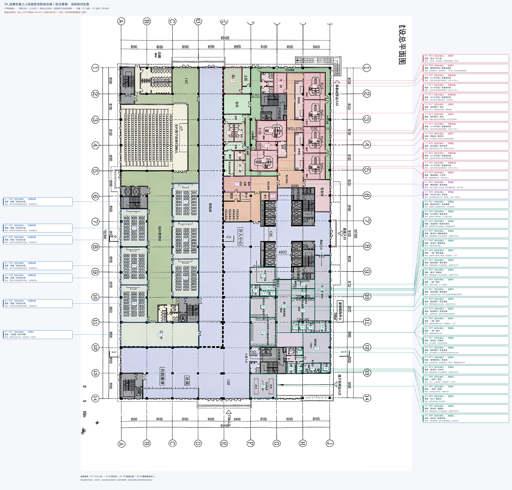

[原图](../../标注试样/24_成都市第三人民医院住院综合楼/24_成都市第三人民医院住院综合楼_原图.jpg) · [现有标注 SVG](../../标注试样/24_成都市第三人民医院住院综合楼/标注.svg)

### 01—03｜S030、S031、S032

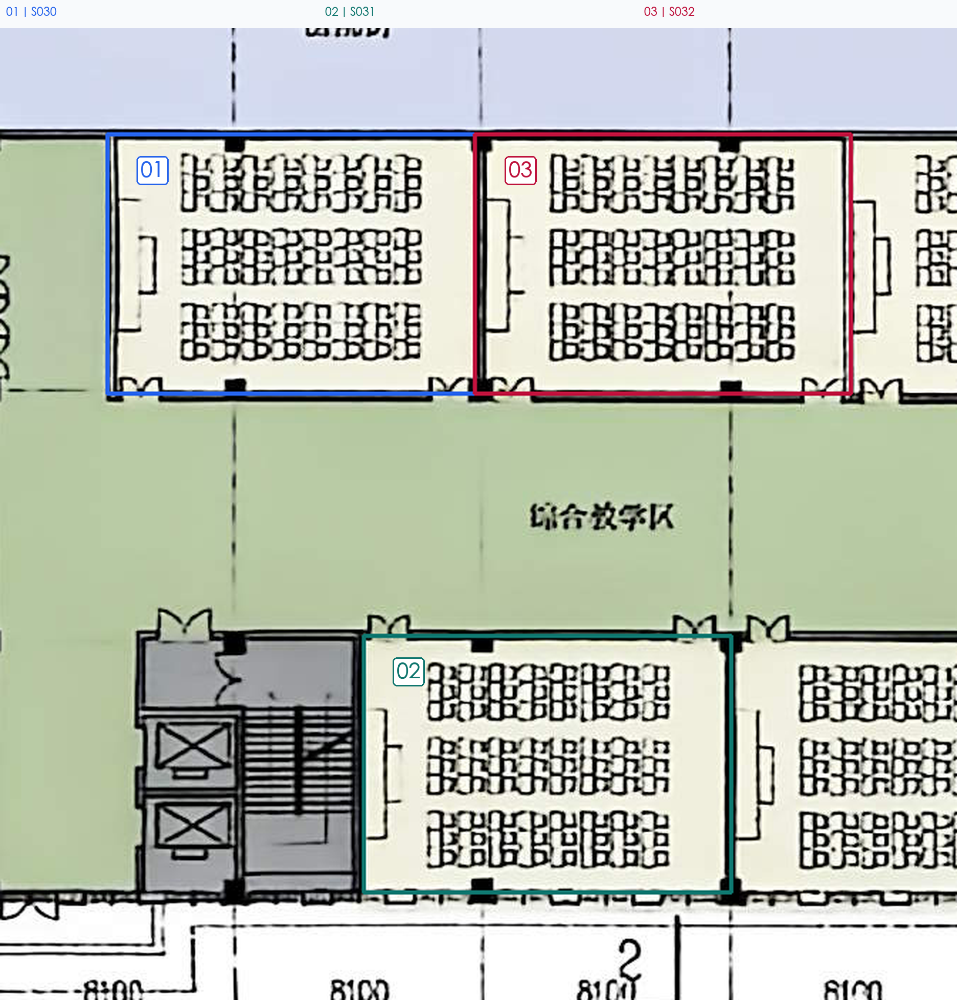

[查看同范围无标记原图](../21-25_名称核对_20261105/24_成都市第三人民医院住院综合楼/局部_01_无标记原图.png)

| 核对号 | S编号  | 预估名称（可改） | 备选名称  | 依据与把握                                                   | 我的确认／备注 | 核对号（重复） |
| --- | ---- | -------- | ----- | ------------------------------------------------------- | ------- | ------- |
| 01  | S030 | 教室       | 培训会议室 | 各候选共用依据：教学区内成排座椅与讲台；无清晰房名；现有证据不能可靠区分。 把握：中（旧稿预估，待本轮核对）。 | 培训会议室   | 01      |
| 02  | S031 | 教室       | 培训会议室 | 各候选共用依据：教学区内成排座椅与讲台；无清晰房名；现有证据不能可靠区分。 把握：中（旧稿预估，待本轮核对）。 | 培训会议室   | 02      |
| 03  | S032 | 教室       | 培训会议室 | 各候选共用依据：教学区内成排座椅与讲台；无清晰房名；现有证据不能可靠区分。 把握：中（旧稿预估，待本轮核对）。 | 培训会议室   | 03      |

### 04—06｜S034、S035、S037

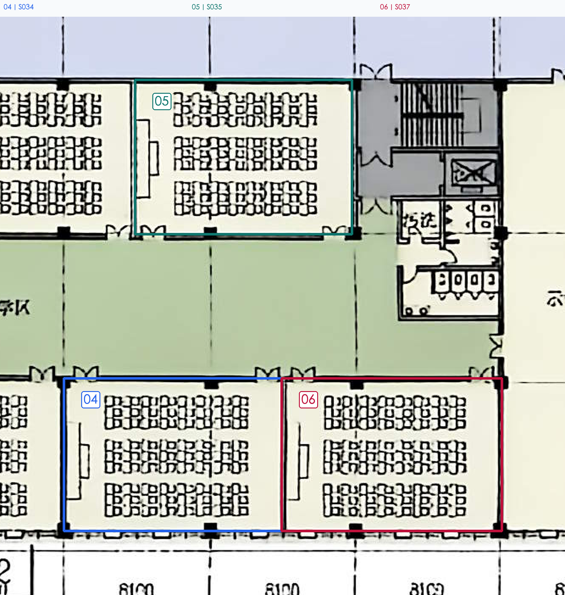

[查看同范围无标记原图](../21-25_名称核对_20261105/24_成都市第三人民医院住院综合楼/局部_02_无标记原图.png)

| 核对号 | S编号  | 预估名称（可改） | 备选名称  | 依据与把握                                                   | 我的确认／备注 | 核对号（重复） |
| --- | ---- | -------- | ----- | ------------------------------------------------------- | ------- | ------- |
| 04  | S034 | 教室       | 培训会议室 | 各候选共用依据：教学区内成排座椅与讲台；无清晰房名；现有证据不能可靠区分。 把握：中（旧稿预估，待本轮核对）。 | 培训会议室   | 04      |
| 05  | S035 | 教室       | 培训会议室 | 各候选共用依据：教学区内成排座椅与讲台；无清晰房名；现有证据不能可靠区分。 把握：中（旧稿预估，待本轮核对）。 | 培训会议室   | 05      |
| 06  | S037 | 教室       | 培训会议室 | 各候选共用依据：教学区内成排座椅与讲台；无清晰房名；现有证据不能可靠区分。 把握：中（旧稿预估，待本轮核对）。 | 培训会议室   | 06      |

### 07｜S041

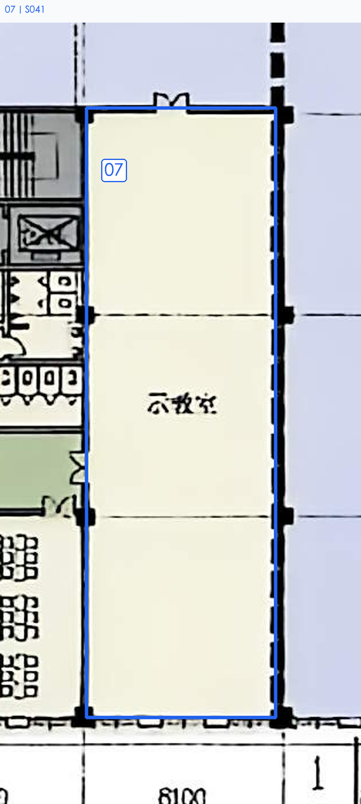

[查看同范围无标记原图](../21-25_名称核对_20261105/24_成都市第三人民医院住院综合楼/局部_03_无标记原图.png)

| 核对号 | S编号  | 预估名称（可改） | 备选名称 | 依据与把握                             | 我的确认／备注 | 核对号（重复） |
| --- | ---- | -------- | ---- | --------------------------------- | ------- | ------- |
| 07  | S041 | 示教室      | —    | 教学区末端大房正向可读“示教室”。 把握：高；本轮图面辨读已录入。 | 示教室     | 07      |

### 08—09｜S006、S008

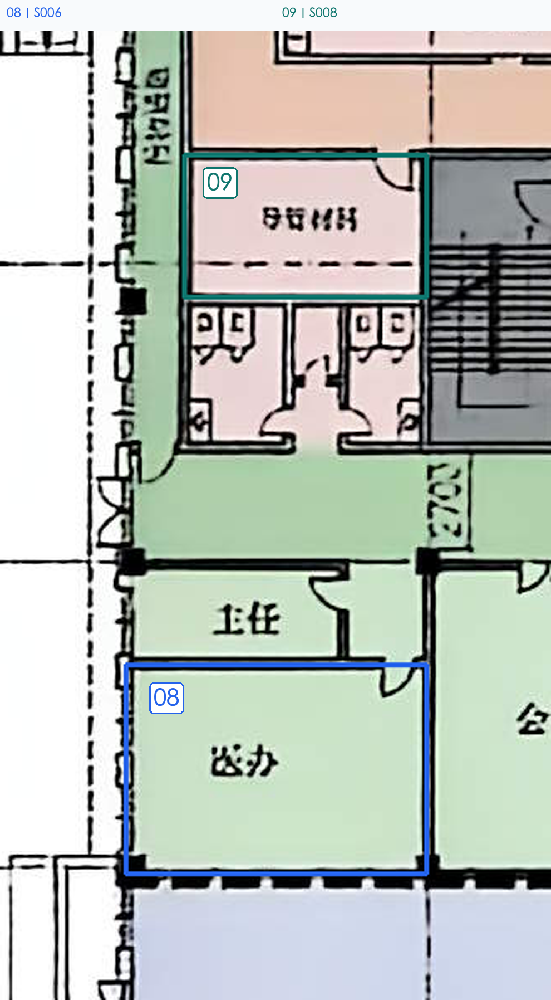

[查看同范围无标记原图](../21-25_名称核对_20261105/24_成都市第三人民医院住院综合楼/局部_04_无标记原图.png)

| 核对号 | S编号  | 预估名称（可改） | 备选名称       | 依据与把握                                            | 我的确认／备注 | 核对号（重复） |
| --- | ---- | -------- | ---------- | ------------------------------------------------ | ------- | ------- |
| 08  | S006 | 医办       | —          | 原图正向可读“医办”，不扩写科室或职务。 把握：高；本轮图面辨读已录入。             | 医办      | 08      |
| 09  | S008 | 导管材料（疑读） | 器械材料库（旧候选） | 正向放大后字样更接近“导管材料”；完整称谓仍不清。库房用途仅为候选，缺乏足够文字证据。把握：中。 | 导管材料    | 09      |

### 10—12｜S009、S013、S016

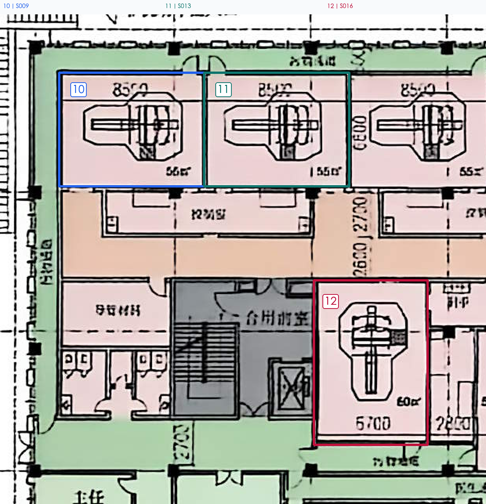

[查看同范围无标记原图](../21-25_名称核对_20261105/24_成都市第三人民医院住院综合楼/局部_05_无标记原图.png)

| 核对号 | S编号  | 预估名称（可改） | 备选名称  | 依据与把握                                                    | 我的确认／备注 | 核对号（重复） |
| --- | ---- | -------- | ----- | -------------------------------------------------------- | ------- | ------- |
| 10  | S009 | 介入手术室    | 血管造影室 | 各候选共用依据：大型C形臂及操作床图示；位于介入中心；现有证据不能可靠区分。 把握：中（旧稿预估，待本轮核对）。 | 血管造影室   | 10      |
| 11  | S013 | 介入手术室    | 血管造影室 | 各候选共用依据：大型C形臂及操作床图示；位于介入中心；现有证据不能可靠区分。 把握：中（旧稿预估，待本轮核对）。 | 血管造影室   | 11      |
| 12  | S016 | 介入手术室    | 血管造影室 | 各候选共用依据：大型C形臂与床位图示，邻控制区；现有证据不能可靠区分。 把握：中（旧稿预估，待本轮核对）。    | DR      | 12      |

### 13—14｜S017、S018

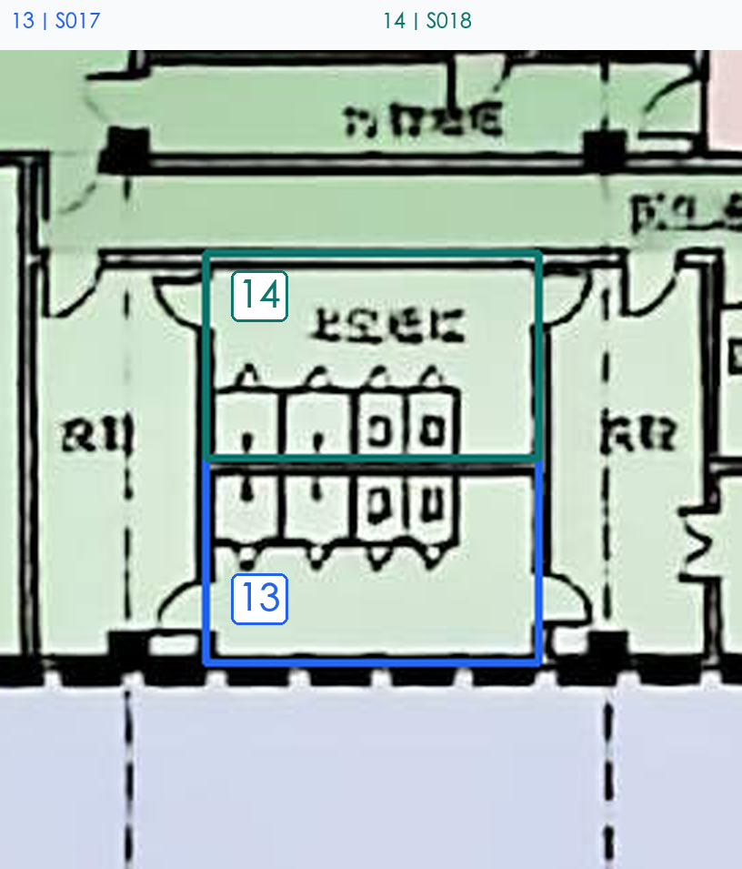

[查看同范围无标记原图](../21-25_名称核对_20261105/24_成都市第三人民医院住院综合楼/局部_06_无标记原图.png)

| 核对号 | S编号  | 预估名称（可改） | 备选名称 | 依据与把握                                                   | 我的确认／备注 | 核对号（重复） |
| --- | ---- | -------- | ---- | ------------------------------------------------------- | ------- | ------- |
| 13  | S017 | 医护更衣     | 淋浴   | 各候选共用依据：与上一房间成对布置，设施相似；现有证据不能可靠区分。 把握：中（旧稿预估，待本轮核对）。    | 男厕      | 13      |
| 14  | S018 | 医护更衣     | 淋浴   | 各候选共用依据：成组小隔间与衣物设施；位于医护流线；现有证据不能可靠区分。 把握：中（旧稿预估，待本轮核对）。 | 女厕      | 14      |

### 15—20｜S019、S020、S024、S025、S026、S028

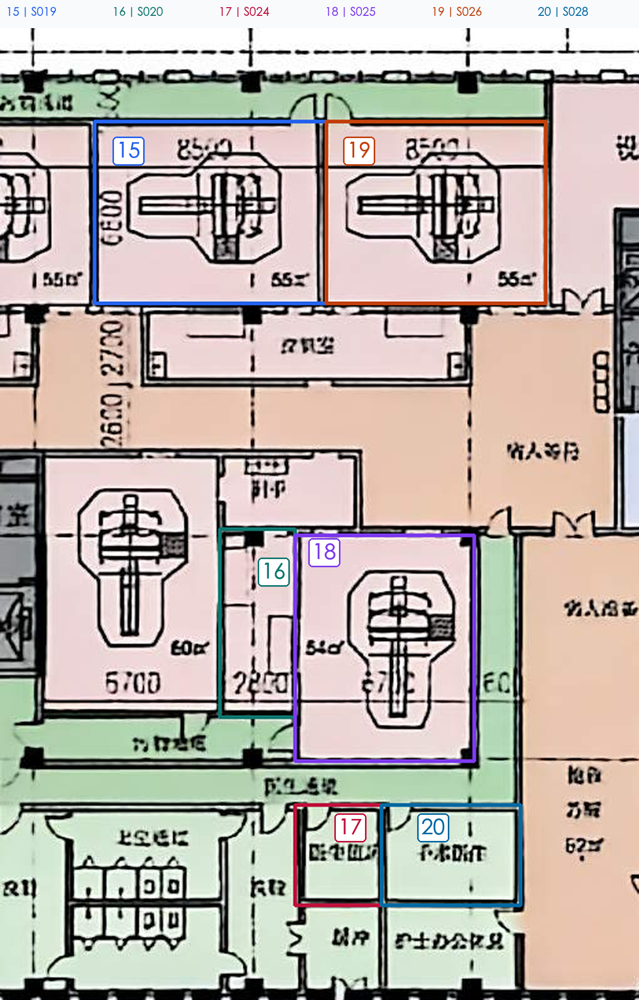

[查看同范围无标记原图](../21-25_名称核对_20261105/24_成都市第三人民医院住院综合楼/局部_07_无标记原图.png)

| 核对号 | S编号  | 预估名称（可改） | 备选名称      | 依据与把握                                                    | 我的确认／备注 | 核对号（重复） |
| --- | ---- | -------- | --------- | -------------------------------------------------------- | ------- | ------- |
| 15  | S019 | 介入手术室    | 血管造影室     | 各候选共用依据：大型C形臂及操作床图示；位于介入中心；现有证据不能可靠区分。 把握：中（旧稿预估，待本轮核对）。 | DR      | 15      |
| 16  | S020 | 控制室      | 操作间       | 各候选共用依据：介于两间介入机房之间的狭长隔间；现有证据不能可靠区分。 把握：中（旧稿预估，待本轮核对）。    | 设备间     | 16      |
| 17  | S024 | 配电间（疑读）  | 医生值班（旧候选） | 正向放大后字样疑似“配电间”，旧稿“医生值班”缺乏可靠依据；不据此确定用途。把握：低。              | 医生值班    | 17      |
| 18  | S025 | 介入手术室    | 血管造影室     | 各候选共用依据：与其他机房同类C形臂及床位图示；现有证据不能可靠区分。 把握：中（旧稿预估，待本轮核对）。    | X光      | 18      |
| 19  | S026 | 介入手术室    | 血管造影室     | 各候选共用依据：大型C形臂及操作床图示；位于介入中心；现有证据不能可靠区分。 把握：中（旧稿预估，待本轮核对）。 | DR      | 19      |
| 20  | S028 | 器械准备     | 工作间       | 原图有房名但字形仍不清；旧候选“器械准备／工作间”仅依片区功能推测，缺乏房间级证据。把握：低。          | 手术医生    | 20      |

### 21—22｜S042、S045

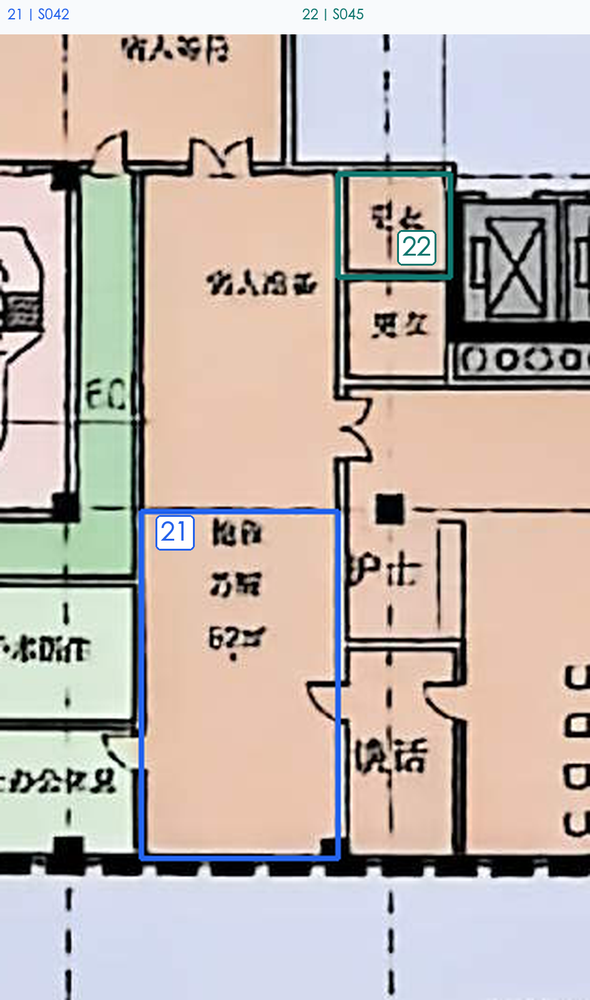

[查看同范围无标记原图](../21-25_名称核对_20261105/24_成都市第三人民医院住院综合楼/局部_08_无标记原图.png)

| 核对号 | S编号  | 预估名称（可改） | 备选名称 | 依据与把握                                                     | 我的确认／备注 | 核对号（重复） |
| --- | ---- | -------- | ---- | --------------------------------------------------------- | ------- | ------- |
| 21  | S042 | 麻醉苏醒     | —    | 原图两行可读“麻醉”“苏醒”；与病人准备区相邻，沿用既有功能分区轮廓。 把握：高；本轮图面辨读已录入。       | 抢救苏醒    | 21      |
| 22  | S045 | 科长办公室    | 谈话室  | 各候选共用依据：患者准备区旁小房；原图似“科长”但不清；现有证据不能可靠区分。 把握：低（旧稿预估，待本轮核对）。 | 更衣      | 22      |

### 23—28｜S061、S058、S066、S059、S062、S060

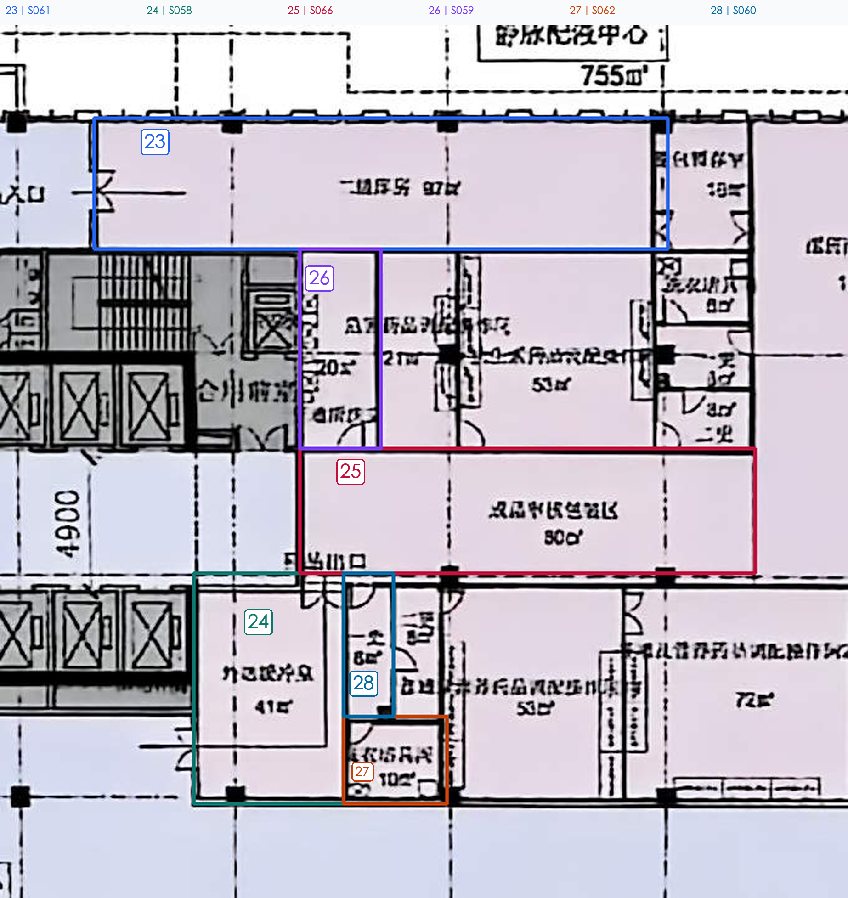

[查看同范围无标记原图](../21-25_名称核对_20261105/24_成都市第三人民医院住院综合楼/局部_09_无标记原图.png)

| 核对号 | S编号  | 预估名称（可改） | 备选名称  | 依据与把握                                                    | 我的确认／备注 | 核对号（重复） |
| --- | ---- | -------- | ----- | -------------------------------------------------------- | ------- | ------- |
| 23  | S061 | 配液支持区    | 洁净通道  | 各候选共用依据：配液中心北侧狭长区域，连有双扇门；现有证据不能可靠区分。 把握：低（旧稿预估，待本轮核对）。   | 二级库房    | 23      |
| 24  | S058 | 办公接待     | 配液支持  | 各候选共用依据：配液中心西南侧，入口朝公共区；现有证据不能可靠区分。 把握：低（旧稿预估，待本轮核对）。     | 外送缓冲室   | 24      |
| 25  | S066 | 成品暂存     | 配液支持区 | 各候选共用依据：配液区内狭长功能块，原名难以辨读；现有证据不能可靠区分。 把握：低（旧稿预估，待本轮核对）。   | 成品审核包装区 | 25      |
| 26  | S059 | 缓冲间      | 辅助准备间 | 各候选共用依据：静脉配液中心内分隔房间，原图文字不清；现有证据不能可靠区分。 把握：低（旧稿预估，待本轮核对）。 | 清洗室     | 26      |
| 27  | S062 | 清洁间      | 器具清洗  | 各候选共用依据：角部台盆类设施；现有证据不能可靠区分。 把握：低（旧稿预估，待本轮核对）。            | 洁具间     | 27      |
| 28  | S060 | 一更       | —     | 原图正向可读“一更”。 把握：高；本轮图面辨读已录入。                              | 一更      | 28      |

### 29—34｜S065、S063、S064、S067、S068、S073

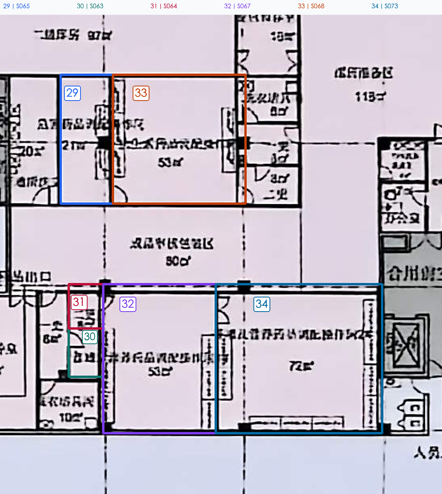

[查看同范围无标记原图](../21-25_名称核对_20261105/24_成都市第三人民医院住院综合楼/局部_10_无标记原图.png)

| 核对号 | S编号  | 预估名称（可改） | 备选名称 | 依据与把握                                                      | 我的确认／备注      | 核对号（重复） |
| --- | ---- | -------- | ---- | ---------------------------------------------------------- | ------------ | ------- |
| 29  | S065 | 配液准备     | 更衣缓冲 | 各候选共用依据：静脉配液中心内分隔房间，原图文字不清；现有证据不能可靠区分。 把握：低（旧稿预估，待本轮核对）。   | 药品调配         | 29      |
| 30  | S063 | 缓冲       | 准备间  | 各候选共用依据：静脉配液中心内分隔房间，原图文字不清；现有证据不能可靠区分。 把握：低（旧稿预估，待本轮核对）。   | 二更  31 32 合并 | 30      |
| 31  | S064 | 二更       | —    | 原图正向可读“二更”。 把握：高；本轮图面辨读已录入。                                | 二更 31 32 合并  | 31      |
| 32  | S067 | 药品准备     | 配液操作 | 各候选共用依据：三面连续工作台，原文含药品字样但全名不清；现有证据不能可靠区分。 把握：中（旧稿预估，待本轮核对）。 | 营养药品配置操作间    | 32      |
| 33  | S068 | 配液操作     | 药品准备 | 各候选共用依据：两侧布置连续工作台，房间文字不清；现有证据不能可靠区分。 把握：中（旧稿预估，待本轮核对）。     | 维生素配置操作间     | 33      |
| 34  | S073 | 配液操作     | 成品处理 | 各候选共用依据：大面积房间，四周工作台与设备图示；现有证据不能可靠区分。 把握：中（旧稿预估，待本轮核对）。     | 营养药品配置操作间    | 34      |

### 35—40｜S069、S070、S071、S072、S075、S078

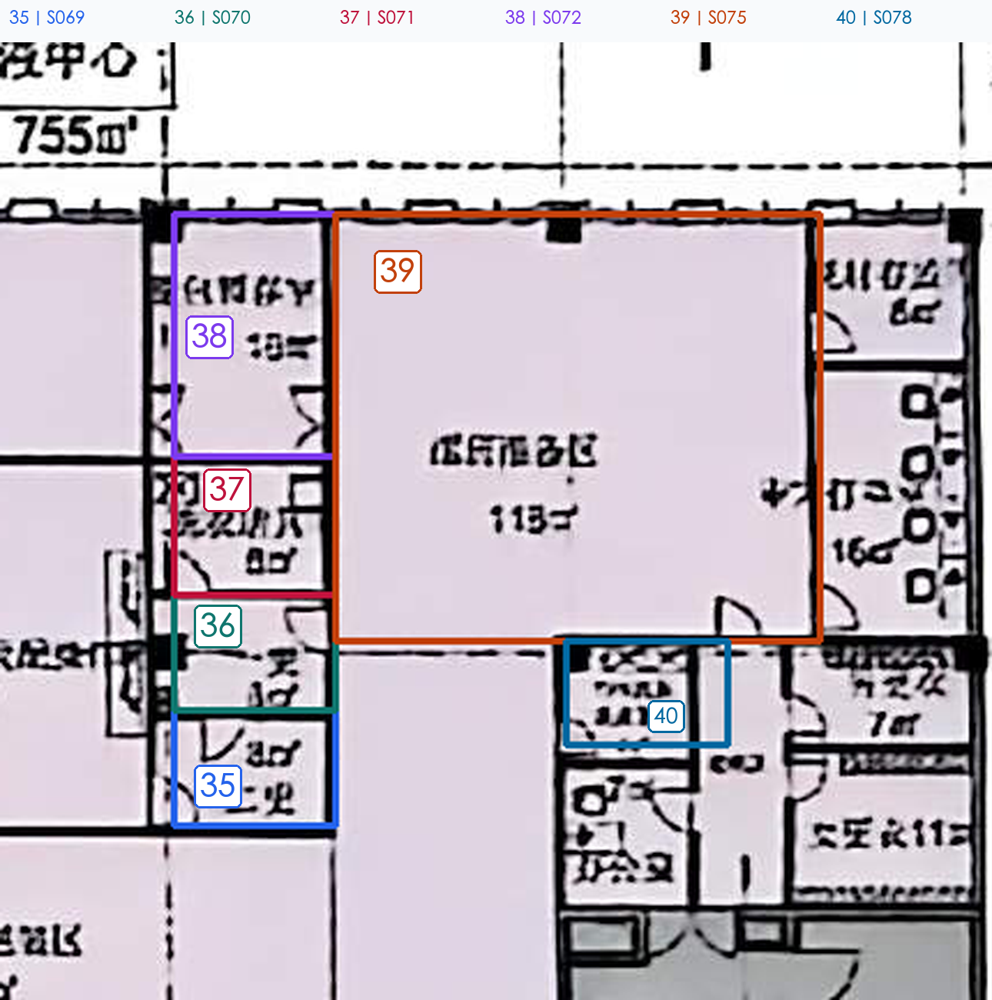

[查看同范围无标记原图](../21-25_名称核对_20261105/24_成都市第三人民医院住院综合楼/局部_11_无标记原图.png)

| 核对号 | S编号  | 预估名称（可改） | 备选名称 | 依据与把握                                                        | 我的确认／备注 | 核对号（重复） |
| --- | ---- | -------- | ---- | ------------------------------------------------------------ | ------- | ------- |
| 35  | S069 | 二更       | —    | 原图正向可读“二更”，与一更相邻。 把握：高；本轮图面辨读已录入。                            | 二更      | 35      |
| 36  | S070 | 一更       | —    | 原图正向可读“一更”，与二更相邻。 把握：高；本轮图面辨读已录入。                            | 一更      | 36      |
| 37  | S071 | 清洁间      | 传递间  | 各候选共用依据：狭小隔间，有台盆类设施；现有证据不能可靠区分。 把握：低（旧稿预估，待本轮核对）。            | 洗衣洁具    | 37      |
| 38  | S072 | 物料缓冲     | 收发前室 | 各候选共用依据：位于配液中心大型房间与北侧狭长区之间；现有证据不能可靠区分。 把握：低（旧稿预估，待本轮核对）。     | 暂存室     | 38      |
| 39  | S075 | 储存配药区    | 药品库  | 各候选共用依据：大面积房间，原房名可见“储存”字样但全名不清；现有证据不能可靠区分。 把握：中（旧稿预估，待本轮核对）。 | 摆药区准备区  | 39      |
| 40  | S078 | 清洁间      | 洗手间  | 各候选共用依据：静脉配液中心内分隔房间，原图文字不清；现有证据不能可靠区分。 把握：低（旧稿预估，待本轮核对）。     | 办公室     | 40      |

### 41—45｜S082、S083、S084、S085、S086

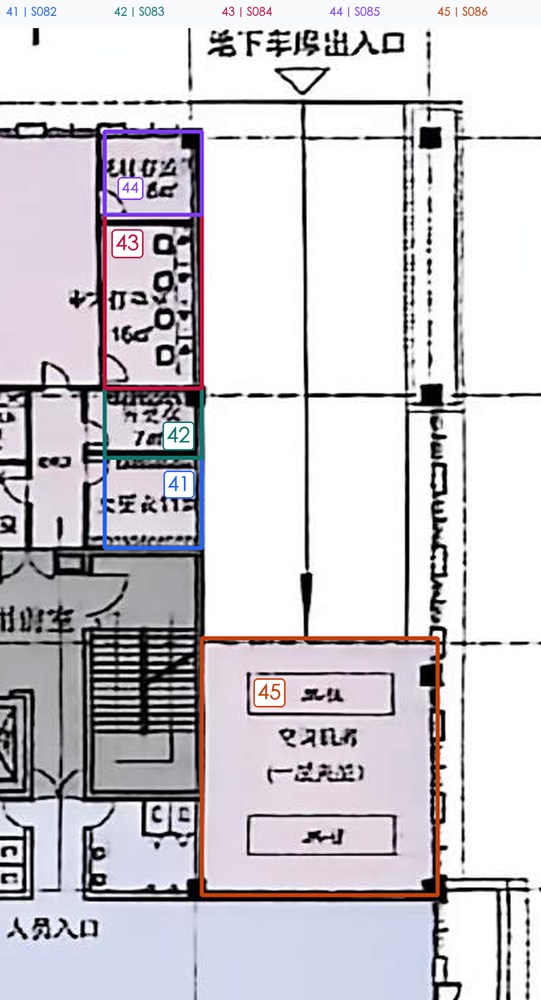

[查看同范围无标记原图](../21-25_名称核对_20261105/24_成都市第三人民医院住院综合楼/局部_12_无标记原图.png)

| 核对号 | S编号  | 预估名称（可改） | 备选名称 | 依据与把握                                                    | 我的确认／备注 | 核对号（重复） |
| --- | ---- | -------- | ---- | -------------------------------------------------------- | ------- | ------- |
| 41  | S082 | 二更衣      | 更衣   | 各候选共用依据：与上一小房成对，字样疑似“二更衣”；现有证据不能可靠区分。 把握：中（旧稿预估，待本轮核对）。  | 女更衣室    | 41      |
| 42  | S083 | 一更衣      | 换鞋   | 各候选共用依据：位于双更衣序列，字样不清；现有证据不能可靠区分。 把握：中（旧稿预估，待本轮核对）。       | 男更衣室    | 42      |
| 43  | S084 | 办公       | —    | 原图正向可读“办公”，不添加具体部门。 把握：高；本轮图面辨读已录入。                      | 审方打单室   | 43      |
| 44  | S085 | 清洁间      | 辅助间  | 各候选共用依据：静脉配液中心内分隔房间，原图文字不清；现有证据不能可靠区分。 把握：低（旧稿预估，待本轮核对）。 | 耗材存放室   | 44      |
| 45  | S086 | 收发区      | 配液支持 | 各候选共用依据：邻车辆坡道，室内有两组台面，原名不清；现有证据不能可靠区分。 把握：低（旧稿预估，待本轮核对）。 | 空调机房    | 45      |
