> 收尾前填写与复核记录快照。18行用户填写已全部采纳；最新完成状态见正式标注说明。

# 25 上海市第十人民医院内科病房综合楼｜一层标注

**状态：17项名称填写已同步；人员连通与清晰门洞已复核。仍有1项房名待确认（16／S069），整图暂未完成。**

**标注规模：**&#x39;7 个空间／区域，房间级单元 74 个、交通核 7 个、开放空间 15 个、功能块 1 个。

**类型与数量：**&#x5EFA;筑设备用房 9 个、卫生间 10 个、办公 9 个、诊室 5 个、建筑设备控制 4 个、影像检查 1 个、交通核 7 个、工作人员支持用房 7 个、检验 1 个、检查 6 个、库房 6 个、挂号收费 2 个、药房 1 个、通道 8 个、大厅 7 个、消毒供应 1 个、处置治疗 1 个、门斗 5 个、商业服务 1 个、辅助用房 1 个、未确认功能 1 个、服务区 1 个、会议教学 2 个、前室 1 个。

**连接关系：**&#x31;40 条，人员可达 106 条、服务联系 2 条、共墙 20 条、入口连接 12 条。

**入口：**&#x5E72;部特诊入口、探视入口、住院就诊入口、东侧入口、会议中心入口、西北疏散出口、特诊东北疏散出口、控制中心西侧北出口、会议支持区北出口、教室东侧北疏散出口、教室东侧南疏散出口、东南楼梯外侧出口。

**相对规模：**&#x5BA4;内非重叠标注区域的 `area_ratio` 合计为 1；绿化不参与。具体物理尺寸由生成环节按任务确定。施工级门构造及内部精确路线不纳入数据。

**门洞与开口：**&#x31;20 个红点，对应 104 条人员可达关系；其中门洞 104 个、无门开口 16 个。同一空间对可有多个开口，关系仍按空间对归并。其余 2 条人员可达关系无定位红点；区域连续及半墙等概念连通不编造门位，服务窗口及共墙不作为通行红点。

**名称待确认：**&#x53;069 名称未确认。此图尚不能宣布打标完成。

**图面范围：**&#x4EC5;当前原图所示一层，包含西侧干部特诊（诊室、化验区、药库及候诊）、X光／心电图／脑电图／B超／胃镜等医技检查、中央住院大厅与出入院办理、东侧会议教学中心及办公、接待、制作及储藏支持、南侧多功能教室及休息厅。本层未见病房单元，不把建筑名称中的“病房综合楼”当作本图存在病床的证据。

## 连通性复核（2026-11-05）

本轮按原图的可见门、无门开口、连续大厅／走廊复核；共墙和柜台服务联系不计入人员通路。97个节点按 access 构图时形成1个连通分量，均可沿已记录室内通路到达至少1个入口。此结论只说明图数据中的概念可达，不表达门禁、开放时段或消防合规。

### 已修正的通路

- R008：控制室 S008 经 X光 S009 进入；移除旧“控制室直接进北侧通道”的解释，门位见对应红点。
- R015：药库 S018 的门开向化验 S013；未见直接通向收费、药房 S024 的门，修正旧连接对象。
- R128、R129：补两间检查室 S019—诊室 S025、S020—诊室 S026 的可见门；各检查室保留原通向另一侧诊室的门。
- R074：衣帽、问询 S070 经管理 S071 进入会议教学中心 S077；原直接接大厅的关系改为 S070—S071。
- R130：补贵宾休息室 S079—茶水 S080 的可见侧门；保留二者各自通向主席台的门。
- 删除 R029（S028—S031，穿过检查房）、R030（S028—S032，仅角点相邻）、R043（S031—S044，实墙分隔）。特诊区通过 S034—S044 的清晰门连接住院大厅。
- 咖啡水吧台 S046 的工作人员入口经电梯厅 S076；柜台对住院大厅 S044、前厅休息厅 S094 仅记 service，不作穿行门洞。
- S010 保持原编号与交通核粒度，将图上可见的北侧入口平台纳入概念边界，保留西侧室外台阶在面积之外；其余空间轮廓不变，室内占比重新归一化。
- E007、E008、E010 的入口定位移至各自图上实际开口附近，入口编号、名称与所接空间保持不变。

### 概念连接与内部细节

两条门斗连接 R047（S047—S044）、R102（S093—S094）按门斗朝向与完整通行布局保留为**布局推断**，暂不编造精确门位；不是用户逐条确认。其他已定位开口均对应原图可见门／无门开口／连续交通区域的分界，P编号仅表示近似位置，不代表门宽或内部路线。

本轮不细究交通核内部的楼梯／电梯切换路线、卫生间隔间、管井与设备内部构造。管井外侧可见检修门保留概念连接及门位，不将其作为公共交通节点。S069 与通道的可见门可单独记录，其用途仍为 unknown。

**关键连通疑点：**&#x672C;轮未留下会改变主要通行组织的待确认项。**名称遗留：**&#x31;6／S069仍待填写；可在下面原表确认栏补充名称。完整原图、核对局部和已有填写继续保留。

## 房名与范围核对（2026-11-05）

本轮17项明确填写已同步至JSON和SVG；仅16／S069仍为“待确认”。以下18行填写原文、核对号和S编号全部保留；已同步项以“我的确认／备注”中的实际名称为准，旧候选及依据仅作历史记录。

可直接修改“预估名称（可改）”，再把“我的确认／备注”改成“已确认”；也可直接在确认栏填写实际名称，或在聊天中按 `25号 01=名称` 回复。未回答项保留 unknown。

25号本轮已复核人员连通与清晰门洞；当前仅16／S069用途待确认，原候选不自动采用。连通记录不代表允许公众进入管井、设备间或办公区域。

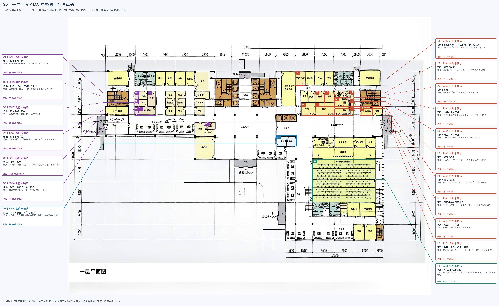

[原图](../../../标注试样/25_上海市第十人民医院内科病房综合楼/25_上海市第十人民医院内科病房综合楼_原图.jpg) · [现有标注 SVG](../../../标注试样/25_上海市第十人民医院内科病房综合楼/标注.svg)

### 01｜S011

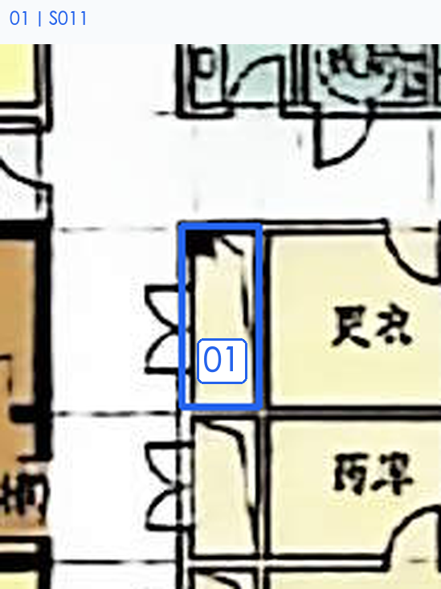

[查看同范围无标记原图](../../21-25_名称核对_20261105/25_上海市第十人民医院内科病房综合楼/局部_01_无标记原图.png)

| 核对号 | S编号  | 预估名称（可改） | 备选名称 | 依据与把握                                                       | 我的确认／备注 | 核对号（重复） |
| --- | ---- | -------- | ---- | ----------------------------------------------------------- | ------- | ------- |
| 01  | S011 | 设备小间     | 管井   | 各候选共用依据：更衣室左侧狭长围合，有门形线，无可读房名。；现有证据不能可靠区分。 把握：低（旧稿预估，待本轮核对）。 | 管井      | 01      |

### 02｜S013

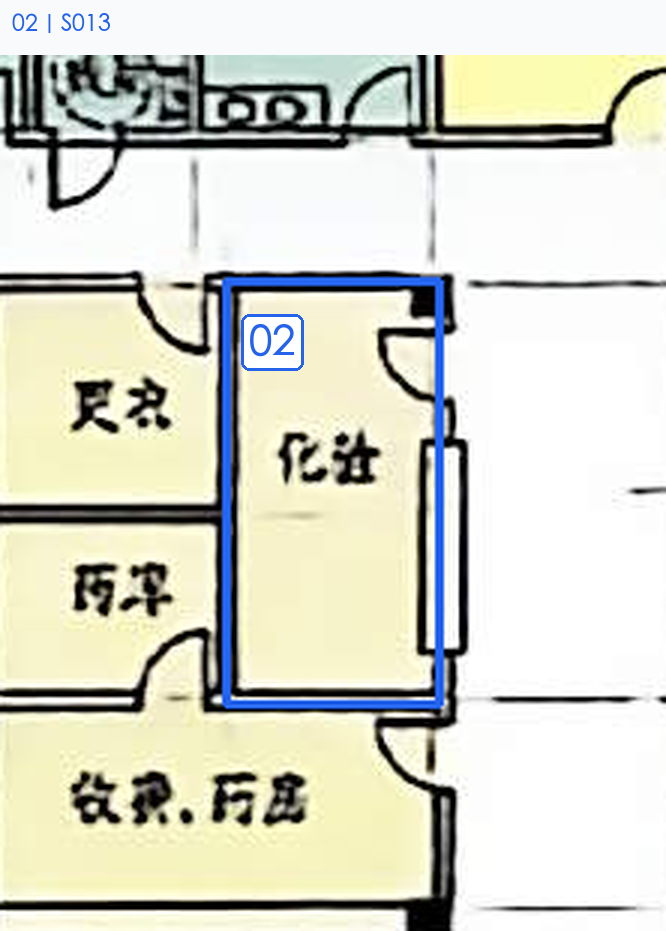

[查看同范围无标记原图](../../21-25_名称核对_20261105/25_上海市第十人民医院内科病房综合楼/局部_02_无标记原图.png)

| 核对号 | S编号  | 预估名称（可改）  | 备选名称 | 依据与把握                                                         | 我的确认／备注 | 核对号（重复） |
| --- | ---- | --------- | ---- | ------------------------------------------------------------- | ------- | ------- |
| 02  | S013 | 化注（化验、注射） | 化验   | 各候选共用依据：图面似写“化注”，房内有服务台形线，毗邻药库。；现有证据不能可靠区分。 把握：中（旧稿预估，待本轮核对）。 | 化验      | 02      |

### 03—04｜S017、S023

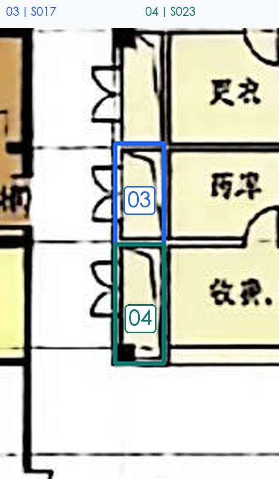

[查看同范围无标记原图](../../21-25_名称核对_20261105/25_上海市第十人民医院内科病房综合楼/局部_03_无标记原图.png)

| 核对号 | S编号  | 预估名称（可改） | 备选名称 | 依据与把握                                                          | 我的确认／备注 | 核对号（重复） |
| --- | ---- | -------- | ---- | -------------------------------------------------------------- | ------- | ------- |
| 03  | S017 | 设备小间     | 管井   | 各候选共用依据：药库左侧独立狭长围合，无可读房名。；现有证据不能可靠区分。 把握：低（旧稿预估，待本轮核对）。        | 管井      | 03      |
| 04  | S023 | 设备小间     | 管井   | 各候选共用依据：收费药房候选空间左侧第三个狭长围合，无可读房名。；现有证据不能可靠区分。 把握：低（旧稿预估，待本轮核对）。 | 管井      | 04      |

### 05｜S024

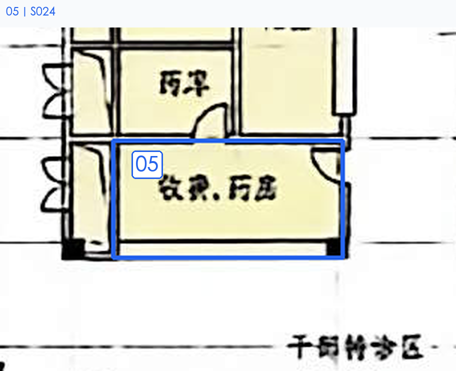

[查看同范围无标记原图](../../21-25_名称核对_20261105/25_上海市第十人民医院内科病房综合楼/局部_04_无标记原图.png)

| 核对号 | S编号  | 预估名称（可改） | 备选名称 | 依据与把握                                         | 我的确认／备注 | 核对号（重复） |
| --- | ---- | -------- | ---- | --------------------------------------------- | ------- | ------- |
| 05  | S024 | 收费、药房    | —    | 文字似“收费、药房”，邻药库与候诊区；末两字较模糊。 把握：较高（旧稿预估，待本轮核对）。 | 收费、药房   | 05      |

### 06｜S036

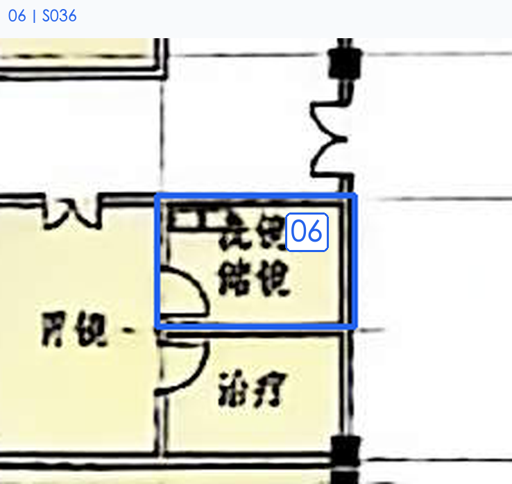

[查看同范围无标记原图](../../21-25_名称核对_20261105/25_上海市第十人民医院内科病房综合楼/局部_05_无标记原图.png)

| 核对号 | S编号  | 预估名称（可改） | 备选名称  | 依据与把握                                                       | 我的确认／备注 | 核对号（重复） |
| --- | ---- | -------- | ----- | ----------------------------------------------------------- | ------- | ------- |
| 06  | S036 | 洗镜、储镜    | 洗涤、储镜 | 各候选共用依据：胃镜房东侧相通小间，字迹似“洗…、储镜”。；现有证据不能可靠区分。 把握：中（旧稿预估，待本轮核对）。 | 洗镜、储镜   | 06      |

### 07｜S046

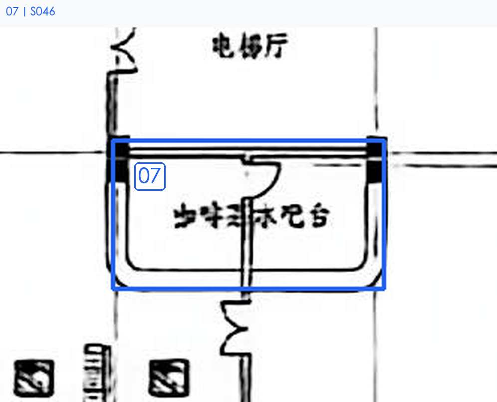

[查看同范围无标记原图](../../21-25_名称核对_20261105/25_上海市第十人民医院内科病房综合楼/局部_06_无标记原图.png)

| 核对号 | S编号  | 预估名称（可改） | 备选名称  | 依据与把握                                                            | 我的确认／备注 | 核对号（重复） |
| --- | ---- | -------- | ----- | ---------------------------------------------------------------- | ------- | ------- |
| 07  | S046 | 出入院服务台   | 自助服务台 | 各候选共用依据：U形柜台位于住院大厅与电梯厅交接处，台内房名未读清。；现有证据不能可靠区分。 把握：低（旧稿预估，待本轮核对）。 | 咖啡水吧台   | 07      |

### 08—10｜S049、S058、S059

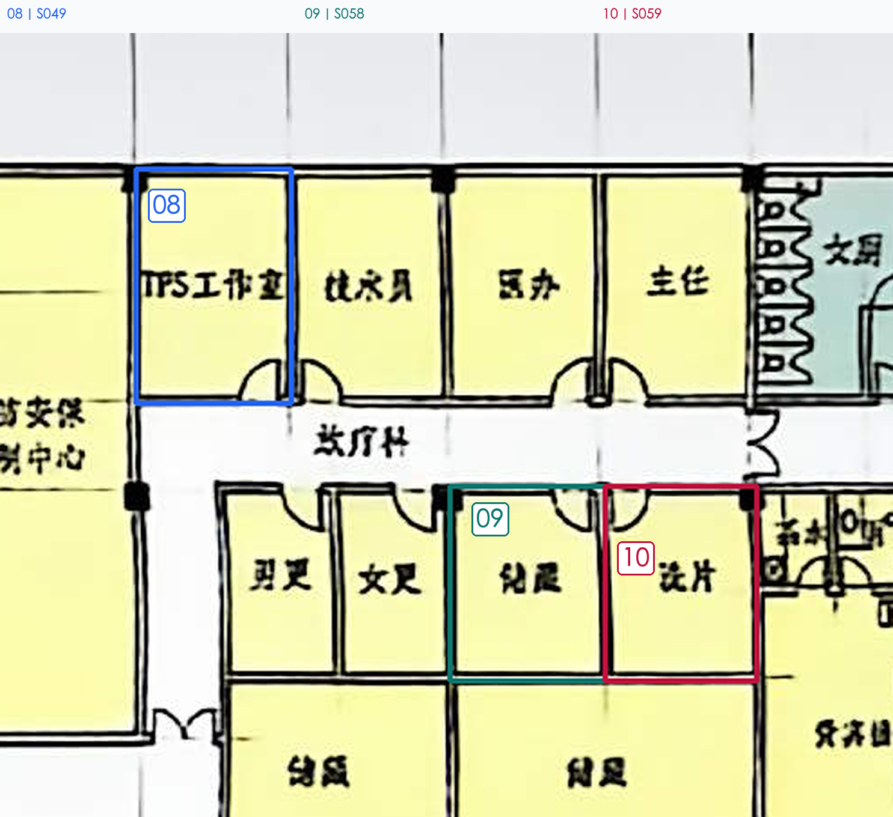

[查看同范围无标记原图](../../21-25_名称核对_20261105/25_上海市第十人民医院内科病房综合楼/局部_07_无标记原图.png)

| 核对号 | S编号  | 预估名称（可改） | 备选名称          | 依据与把握                                                          | 我的确认／备注 | 核对号（重复） |
| --- | ---- | -------- | ------------- | -------------------------------------------------------------- | ------- | ------- |
| 08  | S049 | ITFS工作室  | ITFS工作室（缩写待核） | 各候选共用依据：图面可读“工作室”，前缀似ITFS；不展开缩写。；现有证据不能可靠区分。 把握：中（旧稿预估，待本轮核对）。 | TPS工作室  | 08      |
| 09  | S058 | 制展       | 制版            | 各候选共用依据：图面似“制展”或“制版”，邻更衣与洗片候选房。；现有证据不能可靠区分。 把握：低（旧稿预估，待本轮核对）。  | 储藏      | 09      |
| 10  | S059 | 洗片       | —             | 图面似写“洗片”，与相邻制作区成组。 把握：较高（旧稿预估，待本轮核对）。                          | 洗片      | 10      |

### 11｜S063

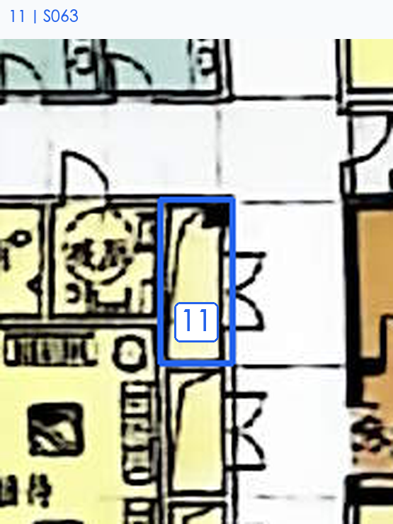

[查看同范围无标记原图](../../21-25_名称核对_20261105/25_上海市第十人民医院内科病房综合楼/局部_08_无标记原图.png)

| 核对号 | S编号  | 预估名称（可改） | 备选名称 | 依据与把握                                                         | 我的确认／备注 | 核对号（重复） |
| --- | ---- | -------- | ---- | ------------------------------------------------------------- | ------- | ------- |
| 11  | S063 | 设备小间     | 管井   | 各候选共用依据：接待候选区东侧上部狭长小间，有门形线，无房名。；现有证据不能可靠区分。 把握：低（旧稿预估，待本轮核对）。 | 管井      | 11      |

### 12｜S065

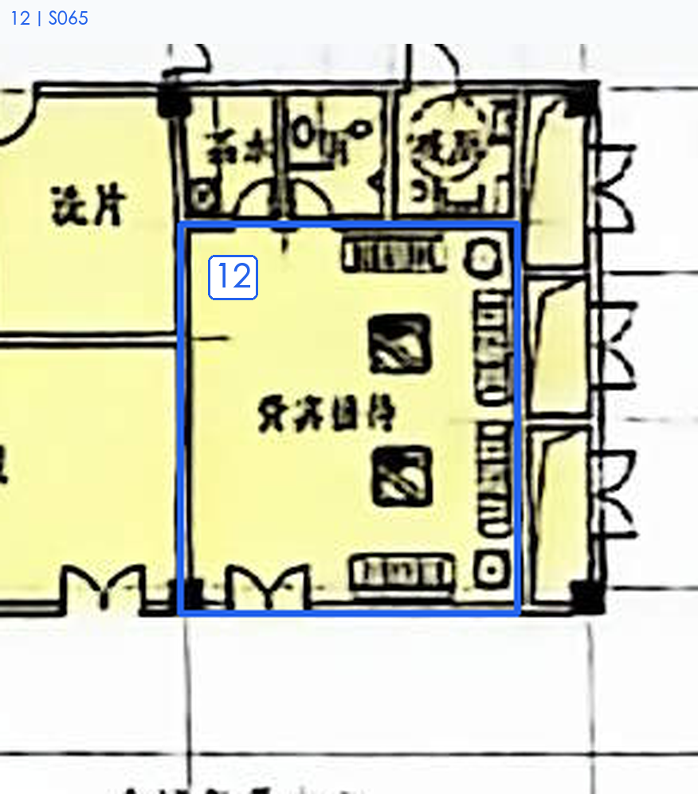

[查看同范围无标记原图](../../21-25_名称核对_20261105/25_上海市第十人民医院内科病房综合楼/局部_09_无标记原图.png)

| 核对号 | S编号  | 预估名称（可改） | 备选名称 | 依据与把握                                                     | 我的确认／备注 | 核对号（重复） |
| --- | ---- | -------- | ---- | --------------------------------------------------------- | ------- | ------- |
| 12  | S065 | 设备小间     | 管井   | 各候选共用依据：东侧中部狭长小间，与上下小间分别围合。；现有证据不能可靠区分。 把握：低（旧稿预估，待本轮核对）。 | 贵宾接待    | 12      |

### 13｜S066

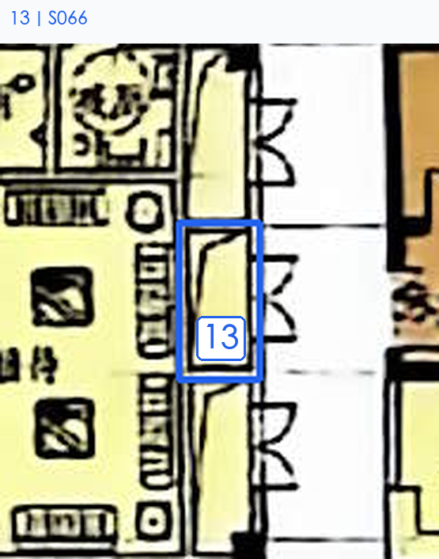

[查看同范围无标记原图](../../21-25_名称核对_20261105/25_上海市第十人民医院内科病房综合楼/局部_10_无标记原图.png)

| 核对号 | S编号  | 预估名称（可改） | 备选名称 | 依据与把握                                                         | 我的确认／备注 | 核对号（重复） |
| --- | ---- | -------- | ---- | ------------------------------------------------------------- | ------- | ------- |
| 13  | S066 | 编照       | 编录   | 各候选共用依据：可见两字，首字似“编”，具体用途无法可靠辨认。；现有证据不能可靠区分。 把握：低（旧稿预估，待本轮核对）。 | 管井      | 13      |

### 14—15｜S067、S068

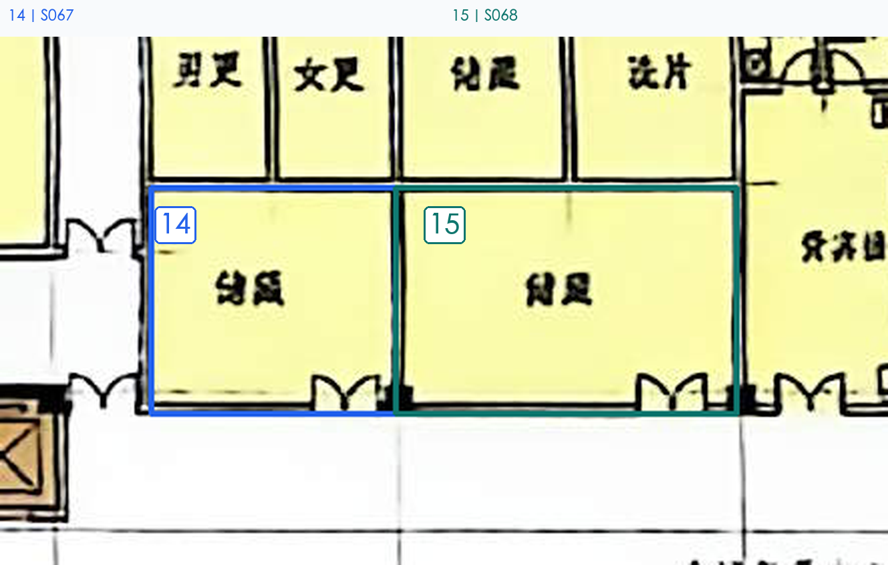

[查看同范围无标记原图](../../21-25_名称核对_20261105/25_上海市第十人民医院内科病房综合楼/局部_11_无标记原图.png)

| 核对号 | S编号  | 预估名称（可改） | 备选名称 | 依据与把握                                                            | 我的确认／备注 | 核对号（重复） |
| --- | ---- | -------- | ---- | ---------------------------------------------------------------- | ------- | ------- |
| 14  | S067 | 制展       | 制景   | 各候选共用依据：较大支持用房，字迹似“制展/制景”，功能待确认。；现有证据不能可靠区分。 把握：低（旧稿预估，待本轮核对）。   | 储藏      | 14      |
| 15  | S068 | 贵宾接待     | 贵宾休息 | 各候选共用依据：沙发茶几布置，旁有茶水与卫生间，字迹似“贵宾接待”。；现有证据不能可靠区分。 把握：中（旧稿预估，待本轮核对）。 | 储藏      | 15      |

### 16｜S069

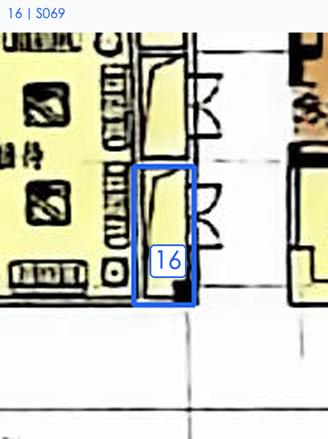

[查看同范围无标记原图](../../21-25_名称核对_20261105/25_上海市第十人民医院内科病房综合楼/局部_12_无标记原图.png)

| 核对号 | S编号  | 预估名称（可改） | 备选名称 | 依据与把握                                                 | 我的确认／备注 | 核对号（重复） |
| --- | ---- | -------- | ---- | ----------------------------------------------------- | ------- | ------- |
| 16  | S069 | 设备小间     | 管井   | 各候选共用依据：东侧下部狭长小间，无可读房名。；现有证据不能可靠区分。 把握：低（旧稿预估，待本轮核对）。 | 管井      | 16      |

### 17｜S070

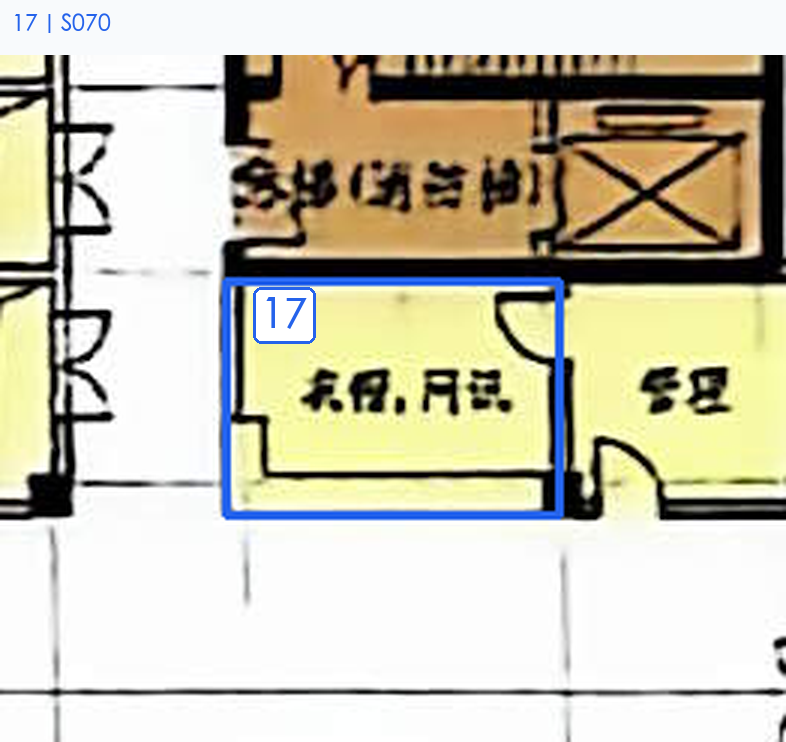

[查看同范围无标记原图](../../21-25_名称核对_20261105/25_上海市第十人民医院内科病房综合楼/局部_13_无标记原图.png)

| 核对号 | S编号  | 预估名称（可改） | 备选名称  | 依据与把握                                                            | 我的确认／备注 | 核对号（重复） |
| --- | ---- | -------- | ----- | ---------------------------------------------------------------- | ------- | ------- |
| 17  | S070 | 杂用、用具    | 备用、用具 | 各候选共用依据：交通核南侧，文字似“…用、用…”，缺乏可靠用途信息。；现有证据不能可靠区分。 把握：低（旧稿预估，待本轮核对）。 | 衣帽、问询   | 17      |

### 18｜S085

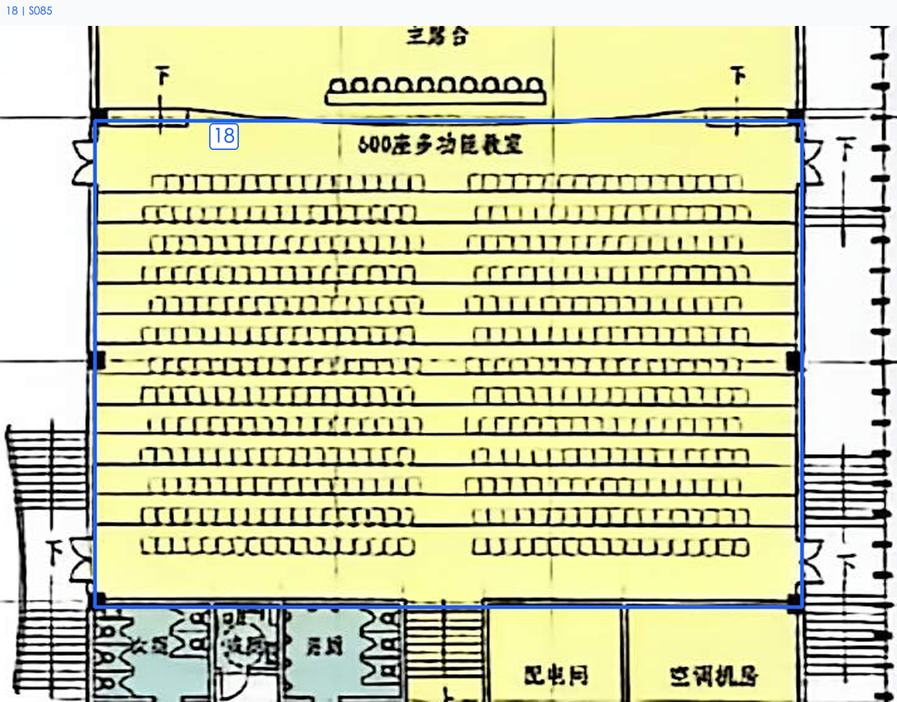

[查看同范围无标记原图](../../21-25_名称核对_20261105/25_上海市第十人民医院内科病房综合楼/局部_14_无标记原图.png)

| 核对号 | S编号  | 预估名称（可改）  | 备选名称 | 依据与把握                                              | 我的确认／备注   | 核对号（重复） |
| --- | ---- | --------- | ---- | -------------------------------------------------- | --------- | ------- |
| 18  | S085 | 600座多功能教室 | —    | 图上为阶梯排椅，文字似“600座多功能教室”；座数及末字需核。 把握：较高（旧稿预估，待本轮核对）。 | 600座多功能教室 | 18      |
