# 19号｜哈尔滨医科大学附属第四医院门诊外科楼（一层）

空间名称已齐；结构与关系仍以原图及人工核对为依据。

**标注规模：**173 个空间／区域，房间级单元 108 个、开放空间 40 个、交通核 20 个、功能块 3 个、半墙服务区 2 个。

**类型与数量：**挂号收费 9 个、大厅 20 个、门斗 8 个、建筑设备控制 1 个、办公 14 个、交通核 20 个、诊室 15 个、处置治疗 5 个、通道 21 个、商业服务 5 个、前室 5 个、护士站 1 个、配药用房 4 个、卫生间 6 个、服务工作区 4 个、药房 2 个、取药服务区 1 个、建筑设备用房 9 个、工作人员支持用房 6 个、库房 6 个、检验 4 个、消毒供应 3 个、留观 2 个、分诊 2 个。

**连接关系：**197 条，人员可达 181 条、服务联系 5 条、入口连接 11 条。

**入口：**住院入口、VIP住院入口、东北入口、东北侧入口、东侧中部入口、西侧中部入口、儿科入口、西侧门诊入口、东侧门诊入口、南部西侧出口、南部东侧出口。

**相对规模：**室内非重叠标注区域的 `area_ratio` 合计为 1；绿化不参与。具体物理尺寸由生成环节按任务确定。施工级门构造及内部精确路线不纳入数据。

**门洞与开口：**120 个红点，对应 117 条人员可达关系；其中门洞 120 个、无门开口 0 个。同一空间对可有多个开口，关系仍按空间对归并。其余 64 条人员可达关系无定位红点；区域连续及半墙等概念连通不编造门位，服务窗口及共墙不作为通行红点。

**本轮回填：**68/S114＝观察室（留观）、69/S115＝集中供氧室（建筑设备用房）、72/S118＝洗白室（消毒供应）。采用用户原名；“洗白室”不自行改字。173个空间／区域的名称均已确定。

**范围：**本图一层普通门诊、住院手续办理与交通支持、静点中心、血库、儿科、干部门诊及公共通道。室外台阶、雨篷和轴网不计入。其余原概念单元保留；S029补公共走道西北段、S064补药房门外通道、S027补至西侧门厅的连续通道，均不吞并已标房间。S028按用户填写为电梯前室；原S050按最新K01并入S061库房，S070为厕所前室；其余复合功能名按用户原名记录，不进一步穷尽小间细分。

**范围与编号记录：**原S050并入S061库房，旧核对24、31保留合并映射；S141地下车库入口、S174和S175按用户意见排除。其余稳定S编号、核对号、已有填写及120个门洞坐标保持不变。

**连通性：**S049—S034按用户说明直接打通；合并后的S061沿P034通S071。S034—S048前场转角衔接及S131—S112等连续公共地面关系按布局推断保留，详见补充说明；不虚构门位。关键连通待确认项0。

**本轮不细究的内部细节：**小井道内部、柜台后台通路、S089麻药室及S114附间未辨清的小门、交通核内部精确路线不另行穷尽；证据不足的关系留空，不能当作不相通或负例。

**核验状态：**按概念精度完成。房名：173个空间／区域全部具名，未定项0；范围：合并、排除及稳定映射已落实；连通性：关键待确认项0，120个门洞红点、197条关系保留。正式校验valid=true、names_complete=true、errors=[]；已目检全图及血库、护士站与库房、西侧密集局部。辅助小间内部精确路线不属于本轮穷尽范围。

## 补充说明

### K01｜已落实：S050并入S061库房

**你的两次补充（保留原文）：**

> **我的判断：049和034直接打通**。050向下方的门联通

**我的确认／备注：050和061 合并为库房**

**落实结果：**S049儿童输液室与S034护士站直接打通，保留概念人员可达关系R191。原S050与S061合并为库房，保留S061，旧核对24、31均回查到当前S061；其他S编号和核对号不重排。合并后的库房沿原门洞P034通S071公共通道，门洞编号及坐标保持不变。

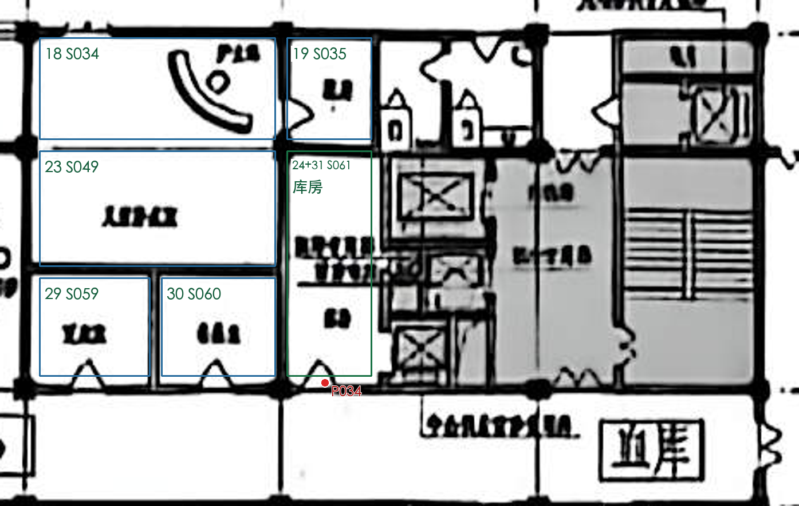

**判断来源：**合并及S049—S034打通来自用户明确填写。S034护士站弧形服务台前场接左侧候诊区S048的转角衔接，结合服务台朝向及已确认的输液室通行组织，按“布局推断”保存概念access；不表示经柜台穿行，不生成精确门位。

**状态：**K01已落实，无需继续回填连通性说明。68/S114、69/S115、72/S118本轮已按最新填写同步。

## 名称核对填写表

固定核对号与填写保留如下。旧24/S050已并入31/S061库房，原两行保留用于回查；独立空间清单中不再含S050。68/S114、69/S115、72/S118的最新填写已全部同步，当前无未定房名。原确认栏及核对号继续保留。已排除的84、93、94行只留作追溯，不代表仍在JSON中。

[查看原图](19_哈尔滨医科大学附属第四医院门诊外科楼_原图.jpg)｜[查看最新标注](标注.svg)

### 01—06｜北侧入口与门诊支持

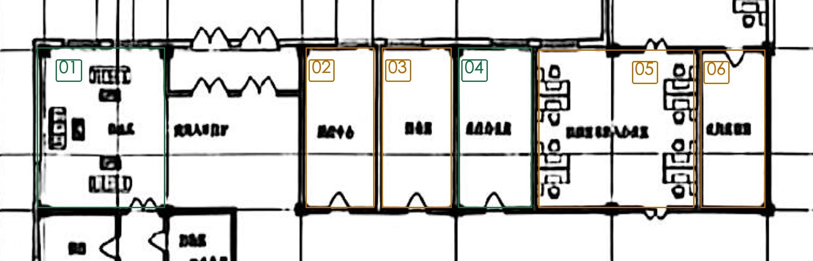

| 核对号 | S编号  | 预估名称（可改） | 备选名称 | 依据与把握                                                | 我的确认／备注 | 核对号（重复） |
| --- | ---- | -------- | ---- | ---------------------------------------------------- | ------- | ------- |
| 01  | S005 | 休息区      | —    | 用户填写为“休息区”；已按原名同步JSON/SVG，类别：大厅。原候选及用户填写前版本已备份。      | 休息区     | 01      |
| 02  | S007 | 消控中心     | —    | 用户填写为“消控中心”；已按原名同步JSON/SVG，类别：建筑设备控制。原候选及用户填写前版本已备份。 | 消控中心    | 02      |
| 03  | S008 | 财务室      | —    | 用户填写为“财务室”；已按原名同步JSON/SVG，类别：办公。原候选及用户填写前版本已备份。      | 财务室     | 03      |
| 04  | S009 | 主任办公室    | —    | 用户填写为“主任办公室”；已按原名同步JSON/SVG，类别：办公。原候选及用户填写前版本已备份。    | 主任办公室   | 04      |
| 05  | S010 | 办公室      | —    | 用户填写为“办公室”；已按原名同步JSON/SVG，类别：办公。原候选及用户填写前版本已备份。      | 办公室     | 05      |
| 06  | S011 | 办公室      | —    | 用户填写为“办公室”；已按原名同步JSON/SVG，类别：办公。原候选及用户填写前版本已备份。      | 办公室     | 06      |

### 07—12｜北侧入口与门诊支持

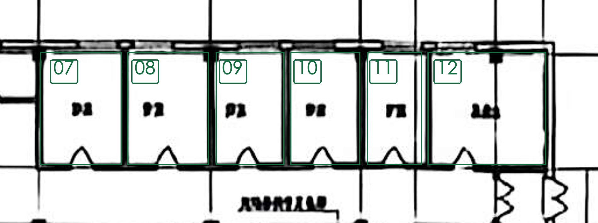

| 核对号 | S编号  | 预估名称（可改） | 备选名称 | 依据与把握                                             | 我的确认／备注 | 核对号（重复） |
| --- | ---- | -------- | ---- | ------------------------------------------------- | ------- | ------- |
| 07  | S016 | 诊室       | —    | 用户填写为“诊室”；已按原名同步JSON/SVG，类别：诊室。原候选及用户填写前版本已备份。    | 诊室      | 07      |
| 08  | S017 | 诊室       | —    | 用户填写为“诊室”；已按原名同步JSON/SVG，类别：诊室。原候选及用户填写前版本已备份。    | 诊室      | 08      |
| 09  | S018 | 诊室       | —    | 用户填写为“诊室”；已按原名同步JSON/SVG，类别：诊室。原候选及用户填写前版本已备份。    | 诊室      | 09      |
| 10  | S019 | 诊室       | —    | 用户填写为“诊室”；已按原名同步JSON/SVG，类别：诊室。原候选及用户填写前版本已备份。    | 诊室      | 10      |
| 11  | S020 | 诊室       | —    | 用户填写为“诊室”；已按原名同步JSON/SVG，类别：诊室。原候选及用户填写前版本已备份。    | 诊室      | 11      |
| 12  | S021 | 换药室      | —    | 用户填写为“换药室”；已按原名同步JSON/SVG，类别：处置治疗。原候选及用户填写前版本已备份。 | 换药室     | 12      |

### 13—13｜北侧入口与门诊支持

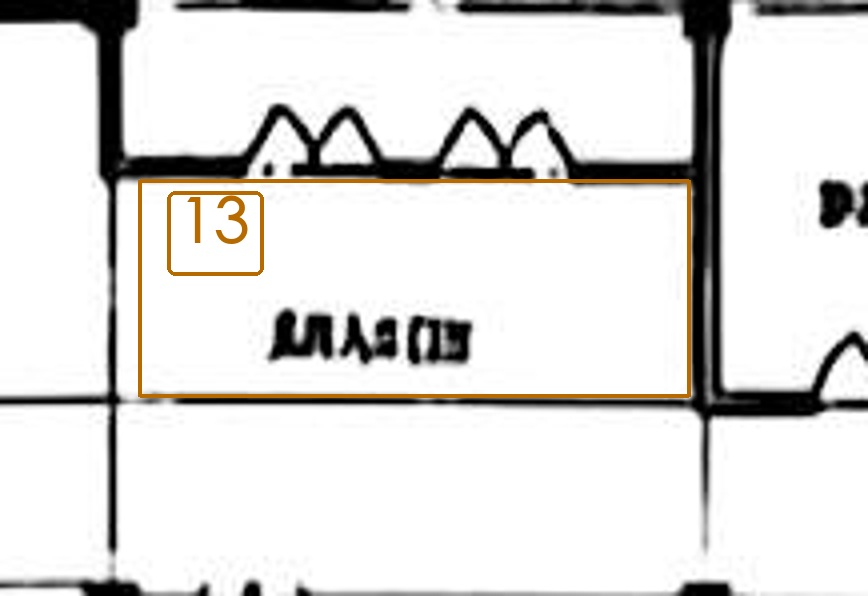

| 核对号 | S编号  | 预估名称（可改） | 备选名称 | 依据与把握                                              | 我的确认／备注 | 核对号（重复） |
| --- | ---- | -------- | ---- | -------------------------------------------------- | ------- | ------- |
| 13  | S023 | 儿科入口门厅   | —    | 用户填写为“儿科入口门厅”；已按原名同步JSON/SVG，类别：大厅。原候选及用户填写前版本已备份。 | 儿科入口门厅  | 13      |

### 14—15｜北侧入口与门诊支持

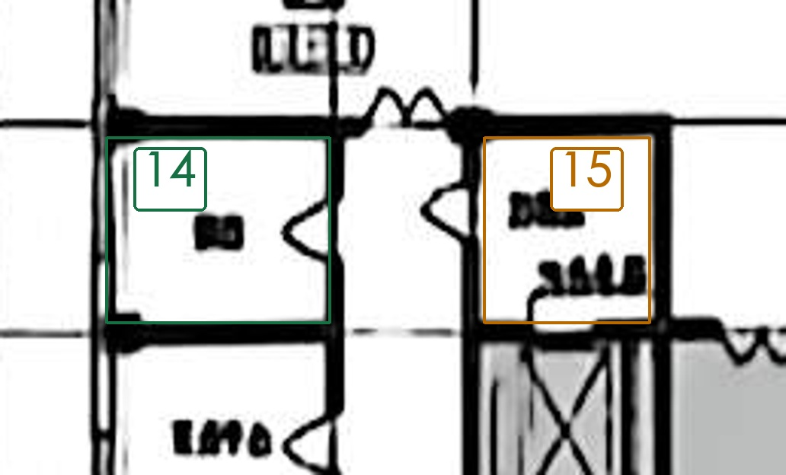

| 核对号 | S编号  | 预估名称（可改） | 备选名称 | 依据与把握                                            | 我的确认／备注 | 核对号（重复） |
| --- | ---- | -------- | ---- | ------------------------------------------------ | ------- | ------- |
| 14  | S026 | 银行       | —    | 用户填写为“银行”；已按原名同步JSON/SVG，类别：商业服务。原候选及用户填写前版本已备份。 | 银行      | 14      |
| 15  | S028 | 电梯前室     | —    | 用户填写为“电梯前室”；已按原名同步JSON/SVG，类别：前室。原候选及用户填写前版本已备份。 | 电梯前室    | 15      |

### 16—20｜北侧入口与门诊支持

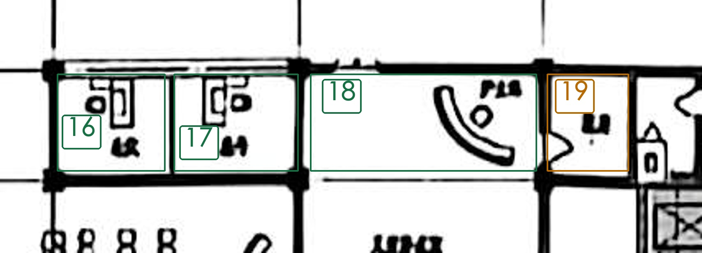

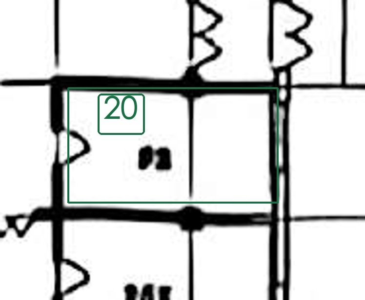

| 核对号 | S编号  | 预估名称（可改） | 备选名称 | 依据与把握                                            | 我的确认／备注 | 核对号（重复） |
| --- | ---- | -------- | ---- | ------------------------------------------------ | ------- | ------- |
| 16  | S032 | 收款       | —    | 用户填写为“收款”；已按原名同步JSON/SVG，类别：挂号收费。原候选及用户填写前版本已备份。 | 收款      | 16      |
| 17  | S033 | 挂号       | —    | 用户填写为“挂号”；已按原名同步JSON/SVG，类别：挂号收费。原候选及用户填写前版本已备份。 | 挂号      | 17      |
| 18  | S034 | 护士站      | —    | 用户填写为“护士站”；已按原名同步JSON/SVG，类别：护士站。原候选及用户填写前版本已备份。 | 护士站     | 18      |
| 19  | S035 | 配药       | —    | 用户填写为“配药”；已按原名同步JSON/SVG，类别：配药用房。原候选及用户填写前版本已备份。 | 配药      | 19      |
| 20  | S037 | 诊室       | —    | 用户填写为“诊室”；已按原名同步JSON/SVG，类别：诊室。原候选及用户填写前版本已备份。   | 诊室      | 20      |

### 21—22｜中部诊疗与配套

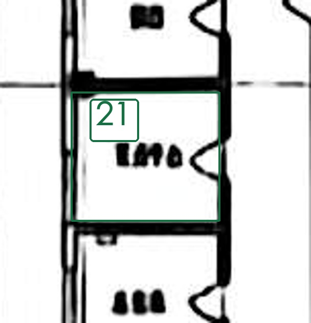

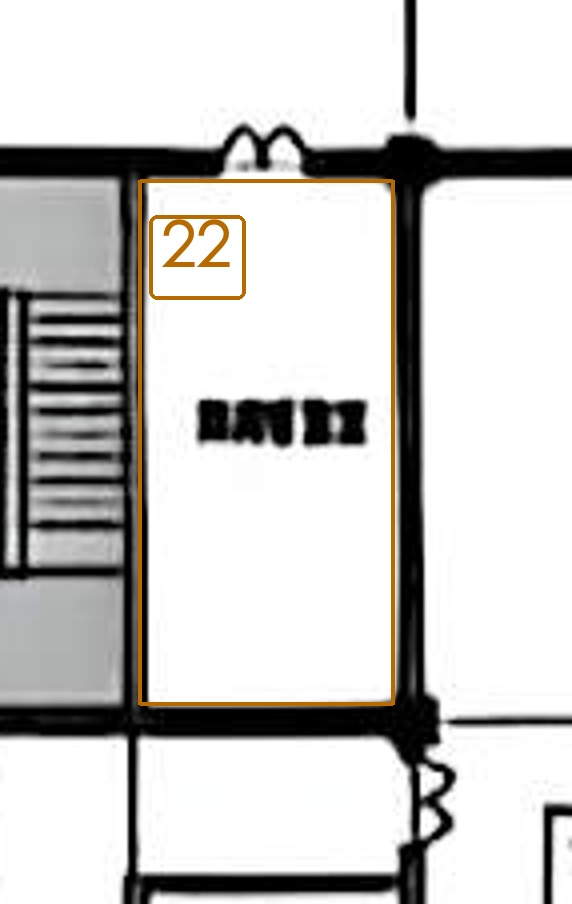

| 核对号 | S编号  | 预估名称（可改） | 备选名称 | 依据与把握                                                | 我的确认／备注 | 核对号（重复） |
| --- | ---- | -------- | ---- | ---------------------------------------------------- | ------- | ------- |
| 21  | S038 | 商务中心     | —    | 用户填写为“商务中心”；已按原名同步JSON/SVG，类别：商业服务。原候选及用户填写前版本已备份。   | 商务中心    | 21      |
| 22  | S040 | 用药咨询室    | —    | 用户填写为“用药咨询室”；已按原名同步JSON/SVG，类别：服务工作区。原候选及用户填写前版本已备份。 | 用药咨询室   | 22      |

### 23—25｜中部诊疗与配套

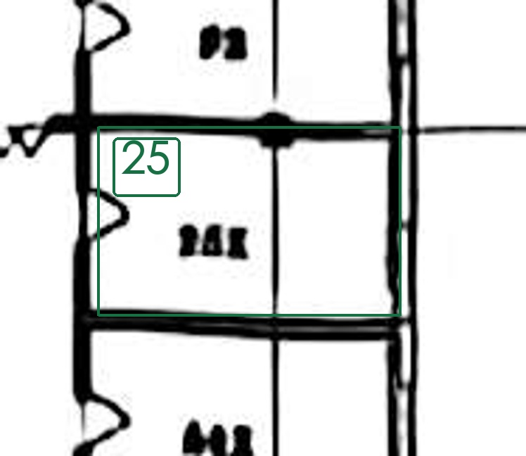

| 核对号 | S编号  | 预估名称（可改）  | 备选名称 | 依据与把握                                                               | 我的确认／备注 | 核对号（重复） |
| --- | ---- | --------- | ---- | ------------------------------------------------------------------- | ------- | ------- |
| 23  | S049 | 儿童输液室     | —    | 用户填写为“儿童输液室”；已按原名同步JSON/SVG，类别：处置治疗。原候选及用户填写前版本已备份。                 | 儿童输液室   | 23      |
| 24  | S050 | 已并入S061库房 | —    | 最新K01明确“050和061 合并为库房”；原S050退出独立空间，现属S061。保留本行原填写作历史记录，合并结论以补充说明为准。 | 电梯前室    | 24      |
| 25  | S053 | 主任室       | —    | 用户填写为“主任室”；已按原名同步JSON/SVG，类别：办公。原候选及用户填写前版本已备份。                     | 主任室     | 25      |

### 26—26｜中部诊疗与配套

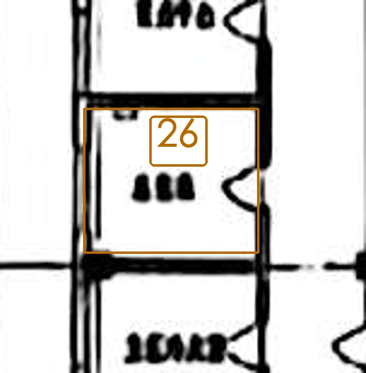

| 核对号 | S编号  | 预估名称（可改） | 备选名称 | 依据与把握                                             | 我的确认／备注 | 核对号（重复） |
| --- | ---- | -------- | ---- | ------------------------------------------------- | ------- | ------- |
| 26  | S054 | 复印室      | —    | 用户填写为“复印室”；已按原名同步JSON/SVG，类别：商业服务。原候选及用户填写前版本已备份。 | 复印室     | 26      |

### 27—32｜中部诊疗与配套

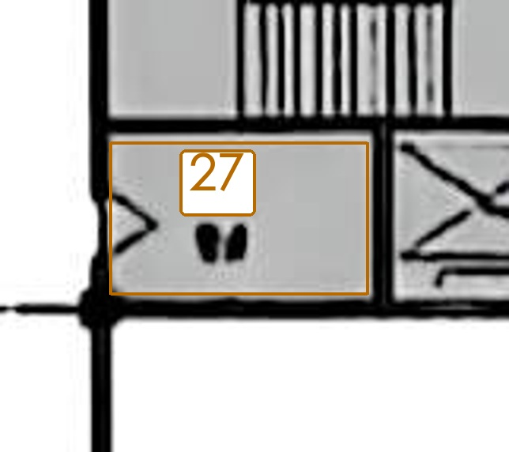

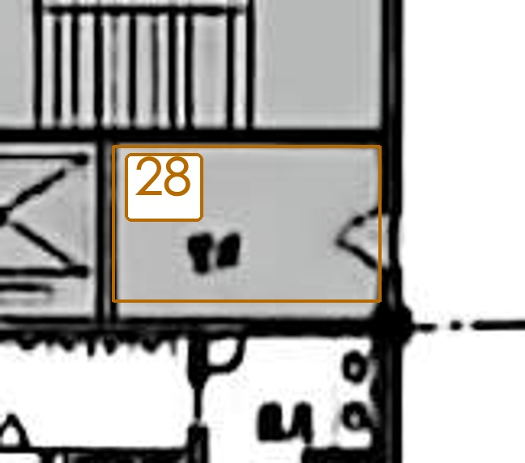

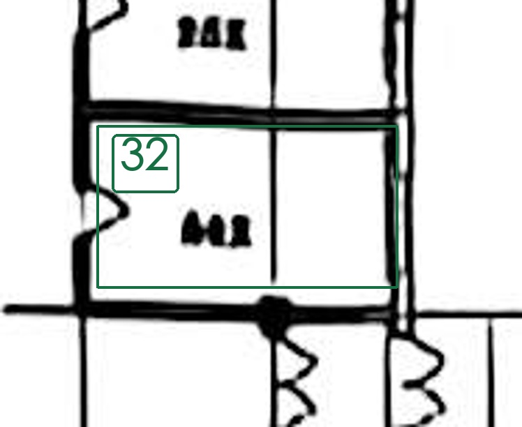

| 核对号 | S编号  | 预估名称（可改） | 备选名称 | 依据与把握                                                          | 我的确认／备注 | 核对号（重复） |
| --- | ---- | -------- | ---- | -------------------------------------------------------------- | ------- | ------- |
| 27  | S055 | 管井       | —    | 用户填写为“管井”；已按原名同步JSON/SVG，类别：建筑设备用房。原候选及用户填写前版本已备份。             | 管井      | 27      |
| 28  | S058 | 管井       | —    | 用户填写为“管井”；已按原名同步JSON/SVG，类别：建筑设备用房。原候选及用户填写前版本已备份。             | 管井      | 28      |
| 29  | S059 | 更衣室      | —    | 用户填写为“更衣室”；已按原名同步JSON/SVG，类别：工作人员支持用房。原候选及用户填写前版本已备份。          | 更衣室     | 29      |
| 30  | S060 | 备品室      | —    | 用户填写为“备品室”；已按原名同步JSON/SVG，类别：库房。原候选及用户填写前版本已备份。                | 备品室     | 30      |
| 31  | S061 | 库房       | —    | 最新K01确认S061库房合入原S050范围；保留S061及P034通向S071的原门洞。旧核对24、31现在对应同一库房。 | 库房      | 31      |
| 32  | S062 | 办公室      | —    | 用户填写为“办公室”；已按原名同步JSON/SVG，类别：办公。原候选及用户填写前版本已备份。                | 办公室     | 32      |

### 33—37｜中部诊疗与配套

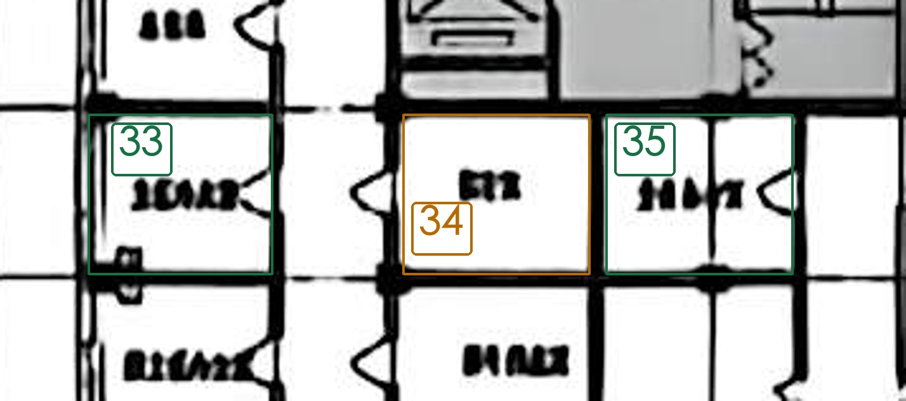

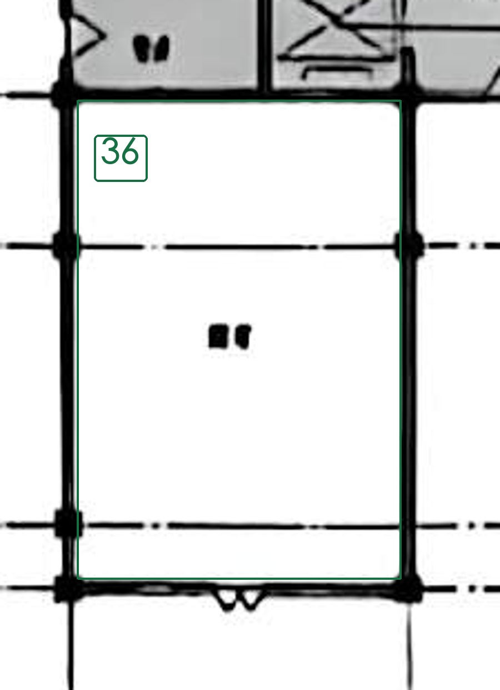

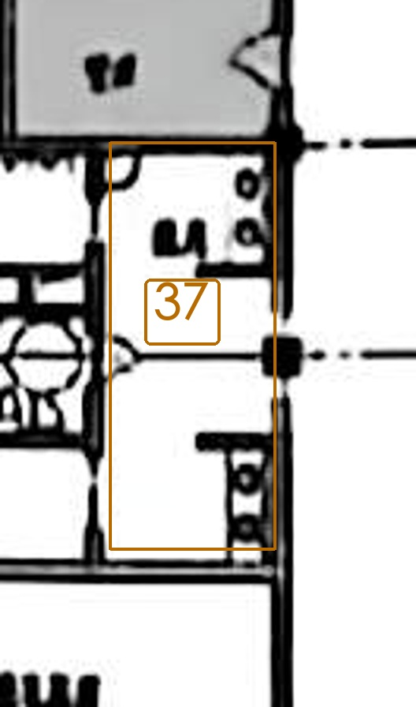

| 核对号 | S编号  | 预估名称（可改） | 备选名称 | 依据与把握                                              | 我的确认／备注 | 核对号（重复） |
| --- | ---- | -------- | ---- | -------------------------------------------------- | ------- | ------- |
| 33  | S063 | 主任办公室    | —    | 用户填写为“主任办公室”；已按原名同步JSON/SVG，类别：办公。原候选及用户填写前版本已备份。  | 主任办公室   | 33      |
| 34  | S065 | 保安室      | —    | 用户填写为“保安室”；已按原名同步JSON/SVG，类别：服务工作区。原候选及用户填写前版本已备份。 | 保安室     | 34      |
| 35  | S066 | 主任办公室    | —    | 用户填写为“主任办公室”；已按原名同步JSON/SVG，类别：办公。原候选及用户填写前版本已备份。  | 主任办公室   | 35      |
| 36  | S067 | 超市       | —    | 用户填写为“超市”；已按原名同步JSON/SVG，类别：商业服务。原候选及用户填写前版本已备份。   | 超市      | 36      |
| 37  | S070 | 厕所前室     | —    | 用户填写为“厕所前室”；已按原名同步JSON/SVG，类别：前室。原候选及用户填写前版本已备份。   | 厕所前室    | 37      |

### 38—41｜中部诊疗与配套

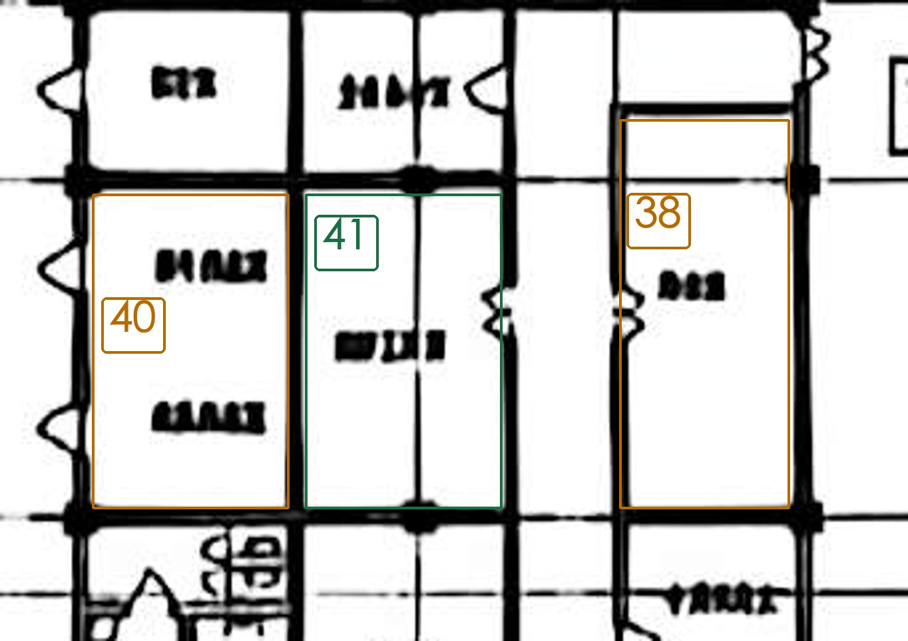

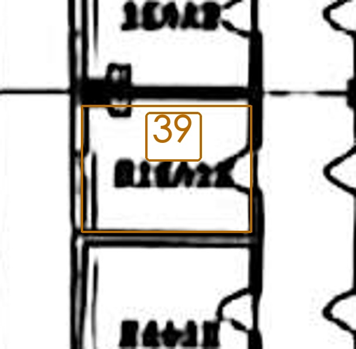

| 核对号 | S编号  | 预估名称（可改） | 备选名称 | 依据与把握                                               | 我的确认／备注 | 核对号（重复） |
| --- | ---- | -------- | ---- | --------------------------------------------------- | ------- | ------- |
| 38  | S073 | 办公室      | —    | 用户填写为“办公室”；已按原名同步JSON/SVG，类别：办公。原候选及用户填写前版本已备份。     | 办公室     | 38      |
| 39  | S074 | 副主任办公室   | —    | 用户填写为“副主任办公室”；已按原名同步JSON/SVG，类别：办公。原候选及用户填写前版本已备份。  | 副主任办公室  | 39      |
| 40  | S075 | 挂号示意室    | —    | 用户填写为“挂号示意室”；已按原名同步JSON/SVG，类别：挂号收费。原候选及用户填写前版本已备份。 | 挂号示意室   | 40      |
| 41  | S076 | 配药工作间    | —    | 用户填写为“配药工作间”；已按原名同步JSON/SVG，类别：配药用房。原候选及用户填写前版本已备份。 | 配药工作间   | 41      |

### 42—47｜中部诊疗与配套

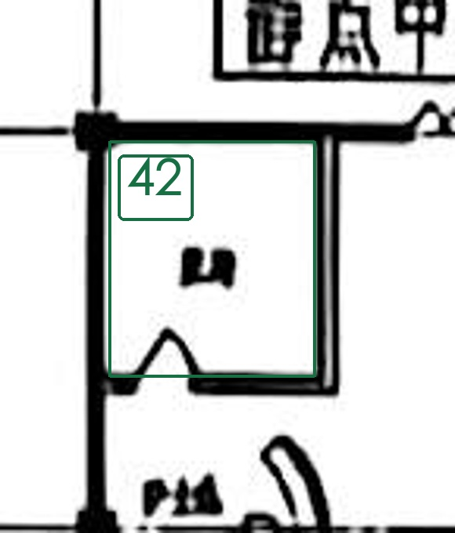

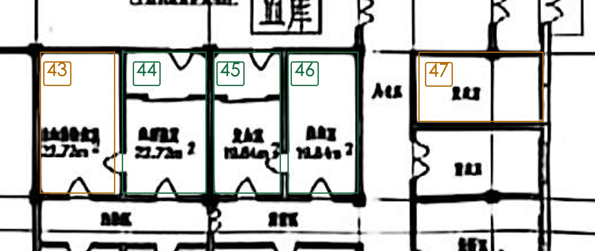

| 核对号 | S编号  | 预估名称（可改） | 备选名称 | 依据与把握                                                 | 我的确认／备注 | 核对号（重复） |
| --- | ---- | -------- | ---- | ----------------------------------------------------- | ------- | ------- |
| 42  | S077 | 配药       | —    | 用户填写为“配药”；已按原名同步JSON/SVG，类别：配药用房。原候选及用户填写前版本已备份。      | 配药      | 42      |
| 43  | S079 | 输血前检验室   | —    | 用户填写为“输血前检验室”；已按原名同步JSON/SVG，类别：检验。原候选及用户填写前版本已备份。    | 输血前检验室  | 43      |
| 44  | S080 | 血型鉴定     | —    | 用户填写为“血型鉴定”；已按原名同步JSON/SVG，类别：检验。原候选及用户填写前版本已备份。      | 血型鉴定    | 44      |
| 45  | S081 | 采血室      | —    | 用户填写为“采血室”；已按原名同步JSON/SVG，类别：检验。原候选及用户填写前版本已备份。       | 采血室     | 45      |
| 46  | S082 | 配血室      | —    | 用户填写为“配血室”；已按原名同步JSON/SVG，类别：检验。原候选及用户填写前版本已备份。       | 配血室     | 46      |
| 47  | S083 | 更衣室      | —    | 用户填写为“更衣室”；已按原名同步JSON/SVG，类别：工作人员支持用房。原候选及用户填写前版本已备份。 | 更衣室     | 47      |

### 48—48｜中部诊疗与配套

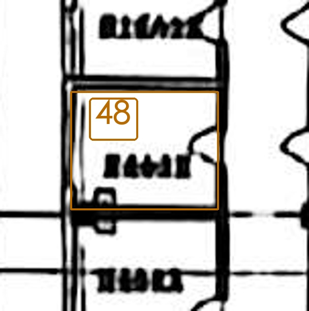

| 核对号 | S编号  | 预估名称（可改） | 备选名称 | 依据与把握                                             | 我的确认／备注 | 核对号（重复） |
| --- | ---- | -------- | ---- | ------------------------------------------------- | ------- | ------- |
| 48  | S084 | 财务办公室    | —    | 用户填写为“财务办公室”；已按原名同步JSON/SVG，类别：办公。原候选及用户填写前版本已备份。 | 财务办公室   | 48      |

### 49—49｜中部诊疗与配套

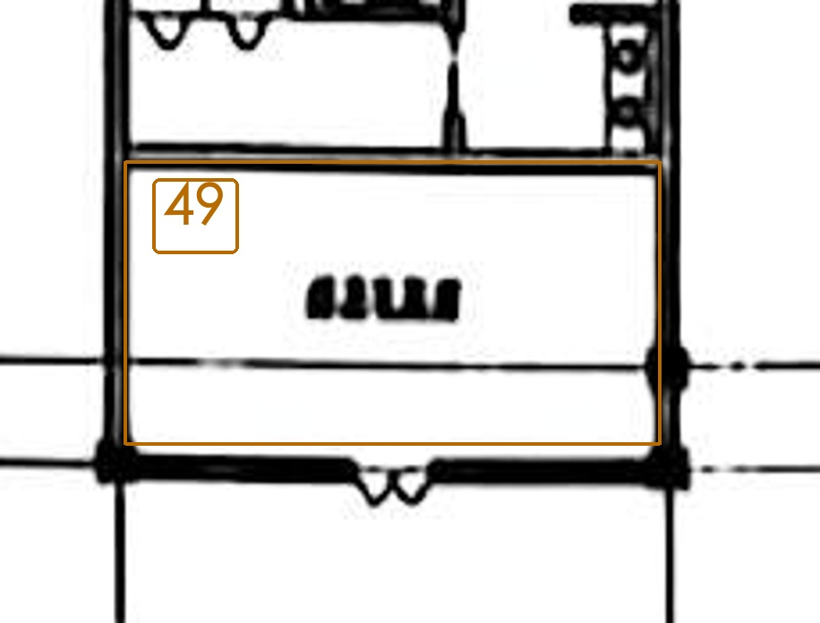

| 核对号 | S编号  | 预估名称（可改） | 备选名称 | 依据与把握                                              | 我的确认／备注 | 核对号（重复） |
| --- | ---- | -------- | ---- | -------------------------------------------------- | ------- | ------- |
| 49  | S085 | 鲜花超市     | —    | 用户填写为“鲜花超市”；已按原名同步JSON/SVG，类别：商业服务。原候选及用户填写前版本已备份。 | 鲜花超市    | 49      |

### 50—50｜中部诊疗与配套

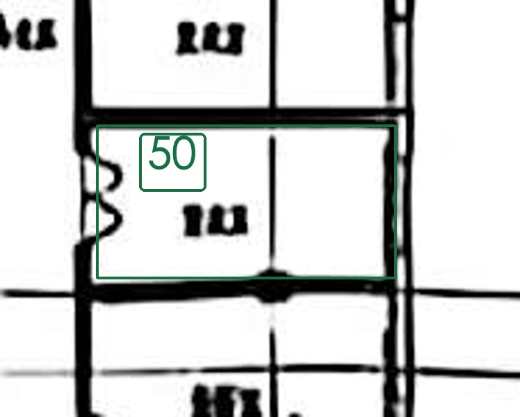

| 核对号 | S编号  | 预估名称（可改） | 备选名称 | 依据与把握                                                 | 我的确认／备注 | 核对号（重复） |
| --- | ---- | -------- | ---- | ----------------------------------------------------- | ------- | ------- |
| 50  | S086 | 更衣室      | —    | 用户填写为“更衣室”；已按原名同步JSON/SVG，类别：工作人员支持用房。原候选及用户填写前版本已备份。 | 更衣室     | 50      |

### 51—53｜中部诊疗与配套

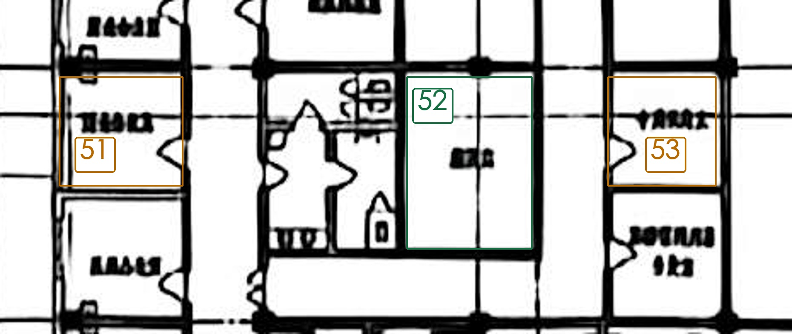

| 核对号 | S编号  | 预估名称（可改） | 备选名称 | 依据与把握                                                | 我的确认／备注 | 核对号（重复） |
| --- | ---- | -------- | ---- | ---------------------------------------------------- | ------- | ------- |
| 51  | S087 | 财务办公室    | —    | 用户填写为“财务办公室”；已按原名同步JSON/SVG，类别：办公。原候选及用户填写前版本已备份。    | 财务办公室   | 51      |
| 52  | S089 | 麻药室      | —    | 用户填写为“麻药室”；已按原名同步JSON/SVG，类别：药房。原候选及用户填写前版本已备份。      | 麻药室     | 52      |
| 53  | S090 | 中草药调剂室   | —    | 用户填写为“中草药调剂室”；已按原名同步JSON/SVG，类别：配药用房。原候选及用户填写前版本已备份。 | 中草药调剂室  | 53      |

### 54—58｜中部诊疗与配套

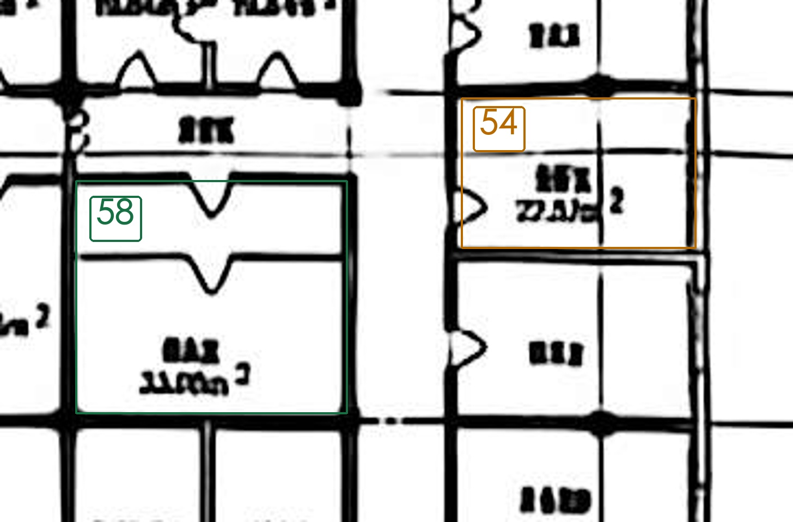

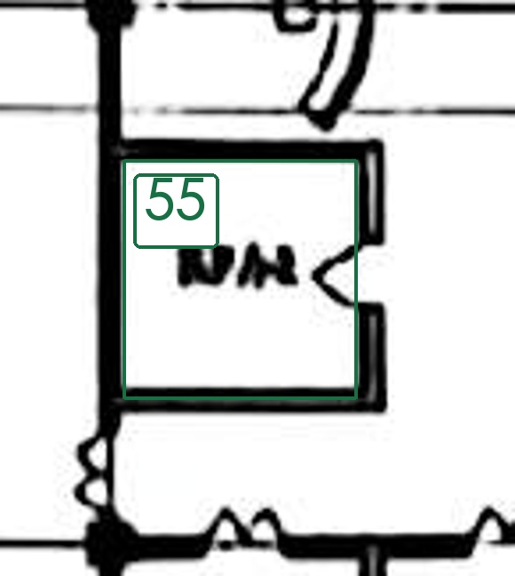

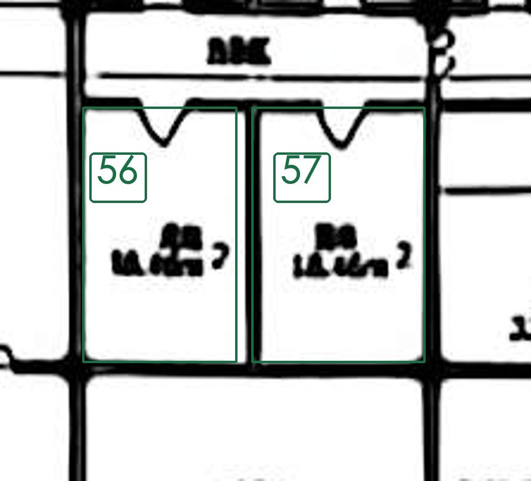

| 核对号 | S编号  | 预估名称（可改） | 备选名称 | 依据与把握                                                 | 我的确认／备注 | 核对号（重复） |
| --- | ---- | -------- | ---- | ----------------------------------------------------- | ------- | ------- |
| 54  | S092 | 资料室      | —    | 用户填写为“资料室”；已按原名同步JSON/SVG，类别：库房。原候选及用户填写前版本已备份。       | 资料室     | 54      |
| 55  | S094 | 医护办公     | —    | 用户填写为“医护办公”；已按原名同步JSON/SVG，类别：办公。原候选及用户填写前版本已备份。      | 医护办公    | 55      |
| 56  | S095 | 洗涤       | —    | 本行未新增用户确认；沿用上一轮本图已直接辨读并同步的名称。类别：消毒供应。如需修正，请继续在原确认栏填写。 | 待确认     | 56      |
| 57  | S096 | 消毒       | —    | 本行未新增用户确认；沿用上一轮本图已直接辨读并同步的名称。类别：消毒供应。如需修正，请继续在原确认栏填写。 | 待确认     | 57      |
| 58  | S097 | 储血室      | —    | 本行未新增用户确认；沿用上一轮本图已直接辨读并同步的名称。类别：库房。如需修正，请继续在原确认栏填写。   | 待确认     | 58      |

### 59—60｜中部诊疗与配套

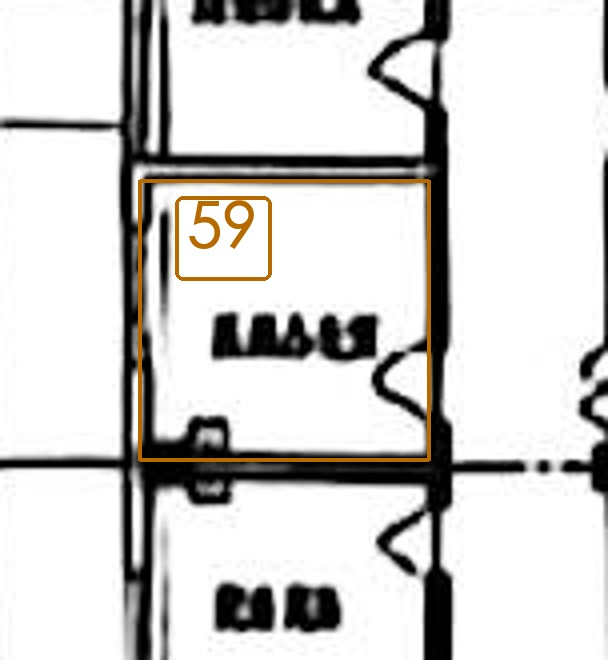

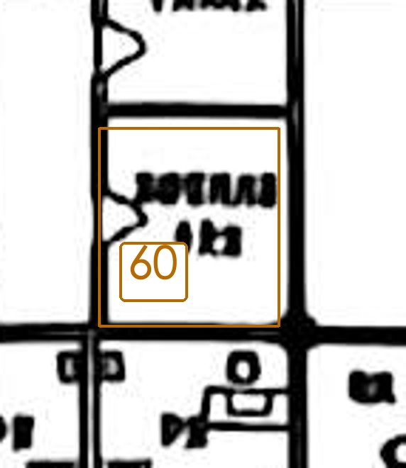

| 核对号 | S编号  | 预估名称（可改） | 备选名称 | 依据与把握                                              | 我的确认／备注 | 核对号（重复） |
| --- | ---- | -------- | ---- | -------------------------------------------------- | ------- | ------- |
| 59  | S098 | 医保办公室    | —    | 用户填写为“医保办公室”；已按原名同步JSON/SVG，类别：办公。原候选及用户填写前版本已备份。  | 医保办公室   | 59      |
| 60  | S099 | 分发室      | —    | 用户填写为“分发室”；已按原名同步JSON/SVG，类别：服务工作区。原候选及用户填写前版本已备份。 | 分发室     | 60      |

### 61—61｜中部诊疗与配套

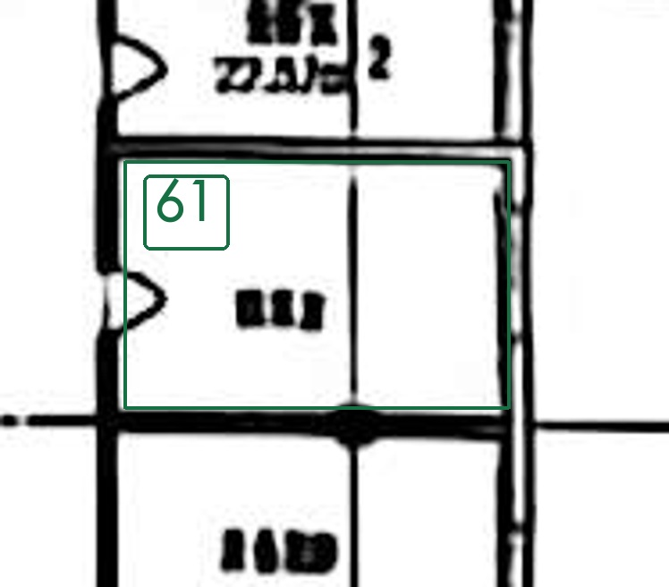

| 核对号 | S编号  | 预估名称（可改） | 备选名称 | 依据与把握                                           | 我的确认／备注 | 核对号（重复） |
| --- | ---- | -------- | ---- | ----------------------------------------------- | ------- | ------- |
| 61  | S100 | 储藏室      | —    | 用户填写为“储藏室”；已按原名同步JSON/SVG，类别：库房。原候选及用户填写前版本已备份。 | 储藏室     | 61      |

### 62—66｜南侧诊疗与儿科

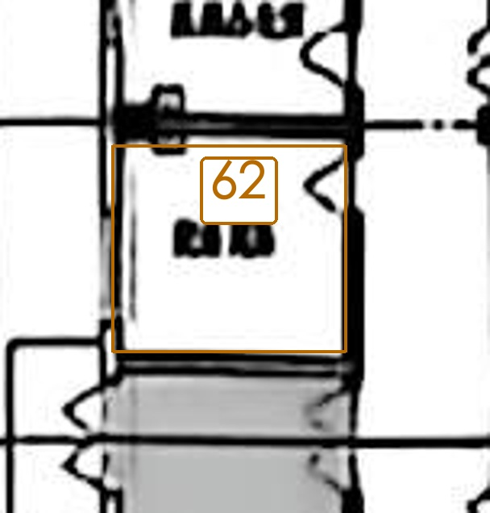

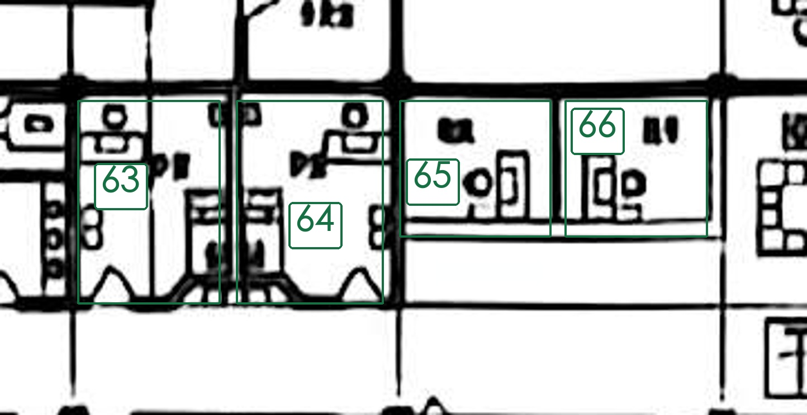

| 核对号 | S编号  | 预估名称（可改） | 备选名称 | 依据与把握                                                 | 我的确认／备注 | 核对号（重复） |
| --- | ---- | -------- | ---- | ----------------------------------------------------- | ------- | ------- |
| 62  | S101 | 设备维修     | —    | 用户填写为“设备维修”；已按原名同步JSON/SVG，类别：建筑设备用房。原候选及用户填写前版本已备份。  | 设备维修    | 62      |
| 63  | S103 | 诊室       | —    | 本行未新增用户确认；沿用上一轮本图已直接辨读并同步的名称。类别：诊室。如需修正，请继续在原确认栏填写。   | 待确认     | 63      |
| 64  | S104 | 诊室       | —    | 本行未新增用户确认；沿用上一轮本图已直接辨读并同步的名称。类别：诊室。如需修正，请继续在原确认栏填写。   | 待确认     | 64      |
| 65  | S105 | 收款       | —    | 本行未新增用户确认；沿用上一轮本图已直接辨读并同步的名称。类别：挂号收费。如需修正，请继续在原确认栏填写。 | 待确认     | 65      |
| 66  | S106 | 挂号       | —    | 本行未新增用户确认；沿用上一轮本图已直接辨读并同步的名称。类别：挂号收费。如需修正，请继续在原确认栏填写。 | 待确认     | 66      |

### 67—72｜南侧诊疗与儿科

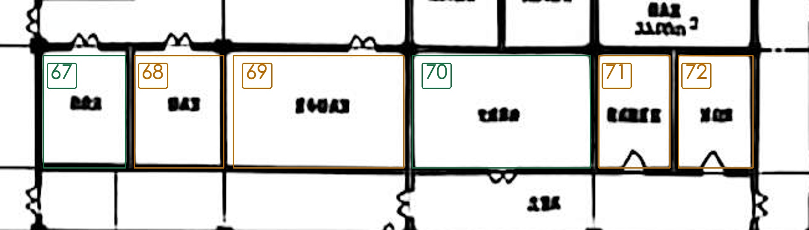

| 核对号 | S编号  | 预估名称（可改） | 备选名称     | 依据与把握                                                     | 我的确认／备注 | 核对号（重复） |
| --- | ---- | -------- | -------- | --------------------------------------------------------- | ------- | ------- |
| 67  | S113 | 观察室      | —        | 本行未新增用户确认；沿用上一轮本图已直接辨读并同步的名称。类别：留观。如需修正，请继续在原确认栏填写。       | 待确认     | 67      |
| 68 | S114 | 观察室 | — | 用户最新明确填写“观察室”；已按原名同步JSON/SVG，类别：留观。原候选、依据及填写前版本保存在外部备份。 | 观察室 | 68 |
| 69 | S115 | 集中供氧室 | — | 用户最新明确填写“集中供氧室”；已按原名同步JSON/SVG，类别：建筑设备用房。原候选、依据及填写前版本保存在外部备份。 | 集中供氧室 | 69 |
| 70  | S116 | 无菌库房     | —        | 本行未新增用户确认；沿用上一轮本图已直接辨读并同步的名称。类别：库房。如需修正，请继续在原确认栏填写。       | 待确认     | 70      |
| 71  | S117 | 值班室      | —        | 用户填写为“值班室”；已按原名同步JSON/SVG，类别：工作人员支持用房。原候选及用户填写前版本已备份。     | 值班室     | 71      |
| 72 | S118 | 洗白室 | — | 用户最新明确填写“洗白室”；已按原名同步JSON/SVG，类别：消毒供应。原候选、依据及填写前版本保存在外部备份。保留用户原名，不自行改字。 | 洗白室 | 72 |

### 73—73｜南侧诊疗与儿科

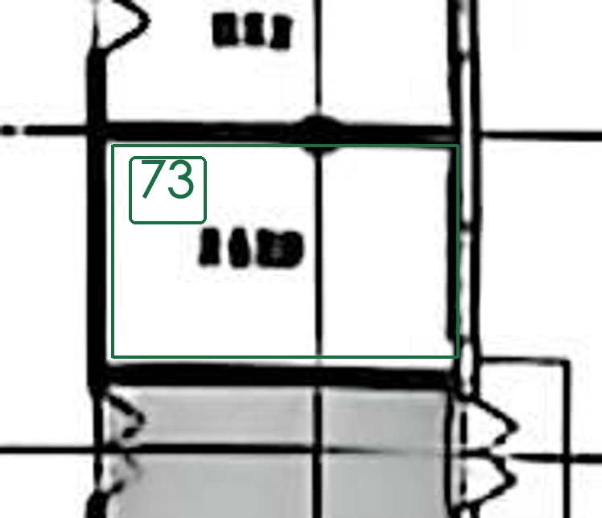

| 核对号 | S编号  | 预估名称（可改） | 备选名称 | 依据与把握                                               | 我的确认／备注 | 核对号（重复） |
| --- | ---- | -------- | ---- | --------------------------------------------------- | ------- | ------- |
| 73  | S119 | 设备间      | —    | 用户填写为“设备间”；已按原名同步JSON/SVG，类别：建筑设备用房。原候选及用户填写前版本已备份。 | 设备间     | 73      |

### 74—78｜南侧诊疗与儿科

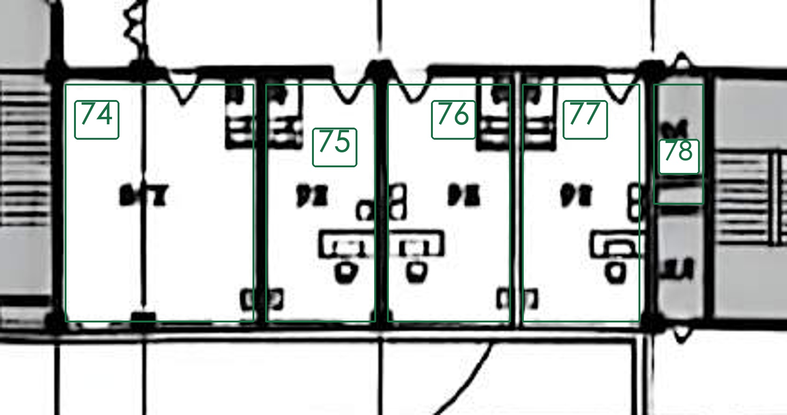

| 核对号 | S编号  | 预估名称（可改） | 备选名称 | 依据与把握                                                   | 我的确认／备注 | 核对号（重复） |
| --- | ---- | -------- | ---- | ------------------------------------------------------- | ------- | ------- |
| 74  | S124 | 治疗室      | —    | 本行未新增用户确认；沿用上一轮本图已直接辨读并同步的名称。类别：处置治疗。如需修正，请继续在原确认栏填写。   | 待确认     | 74      |
| 75  | S125 | 诊室       | —    | 本行未新增用户确认；沿用上一轮本图已直接辨读并同步的名称。类别：诊室。如需修正，请继续在原确认栏填写。     | 待确认     | 75      |
| 76  | S126 | 诊室       | —    | 本行未新增用户确认；沿用上一轮本图已直接辨读并同步的名称。类别：诊室。如需修正，请继续在原确认栏填写。     | 待确认     | 76      |
| 77  | S127 | 诊室       | —    | 本行未新增用户确认；沿用上一轮本图已直接辨读并同步的名称。类别：诊室。如需修正，请继续在原确认栏填写。     | 待确认     | 77      |
| 78  | S128 | 电井       | —    | 本行未新增用户确认；沿用上一轮本图已直接辨读并同步的名称。类别：建筑设备用房。如需修正，请继续在原确认栏填写。 | 待确认     | 78      |

### 79—79｜南侧诊疗与儿科

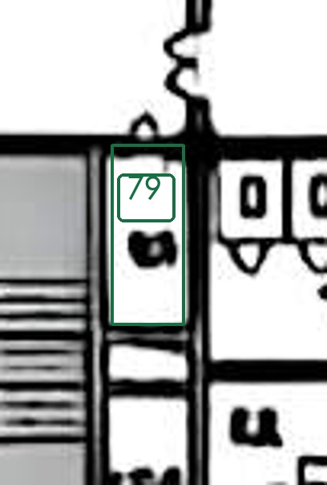

| 核对号 | S编号  | 预估名称（可改） | 备选名称 | 依据与把握                                                   | 我的确认／备注 | 核对号（重复） |
| --- | ---- | -------- | ---- | ------------------------------------------------------- | ------- | ------- |
| 79  | S133 | 电井       | —    | 本行未新增用户确认；沿用上一轮本图已直接辨读并同步的名称。类别：建筑设备用房。如需修正，请继续在原确认栏填写。 | 待确认     | 79      |

### 80—80｜南侧诊疗与儿科

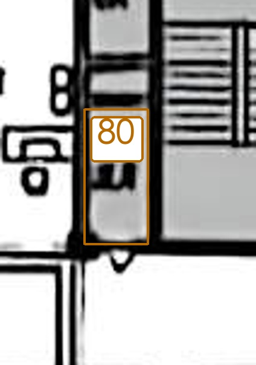

| 核对号 | S编号  | 预估名称（可改） | 备选名称 | 依据与把握                                              | 我的确认／备注  | 核对号（重复） |
| --- | ---- | -------- | ---- | -------------------------------------------------- | -------- | ------- |
| 80  | S137 | 管井       | —    | 2026-11-03用户聊天确认两处井道按“管井”记录，已同步JSON/SVG；类别：建筑设备用房。 | 管井（聊天确认） | 80      |

### 81—83｜南侧诊疗与儿科

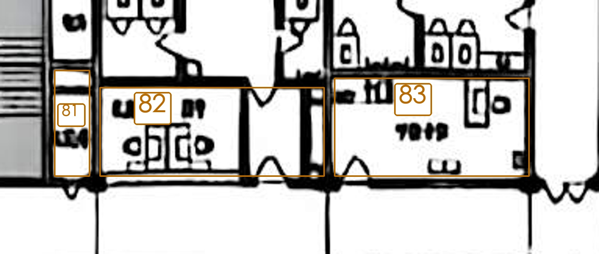

| 核对号 | S编号  | 预估名称（可改） | 备选名称 | 依据与把握                                                | 我的确认／备注  | 核对号（重复） |
| --- | ---- | -------- | ---- | ---------------------------------------------------- | -------- | ------- |
| 81  | S138 | 管井       | —    | 2026-11-03用户聊天确认两处井道按“管井”记录，已同步JSON/SVG；类别：建筑设备用房。   | 管井（聊天确认） | 81      |
| 82  | S139 | 观察、挂号    | —    | 用户填写为“观察、挂号”；已按原名同步JSON/SVG，类别：服务工作区。原候选及用户填写前版本已备份。 | 观察、挂号    | 82      |
| 83  | S140 | 预检分诊     | —    | 用户填写为“预检分诊”；已按原名同步JSON/SVG，类别：分诊。原候选及用户填写前版本已备份。     | 预检分诊     | 83      |

### 84—86｜南侧诊疗与儿科

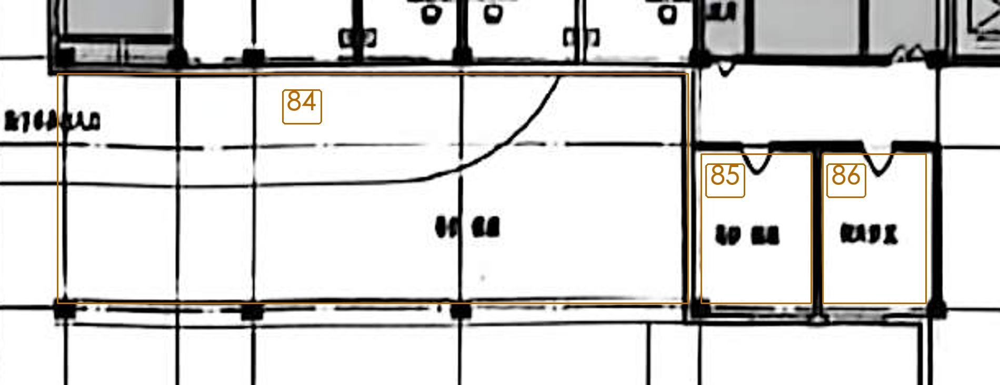

| 核对号 | S编号  | 预估名称（可改） | 备选名称     | 依据与把握                                             | 我的确认／备注        | 核对号（重复） |
| --- | ---- | -------- | -------- | ------------------------------------------------- | -------------- | ------- |
| 84  | S141 | 地下车库入口   | 暂无其他可靠候选 | 用户明确填写排除；本轮移出JSON和SVG，不参与室内面积归一化，保留原核对号与本行填写以便追溯。 | 地下车库入口，可以不计入考虑 | 84      |
| 85  | S146 | 导诊值班     | —        | 用户填写为“导诊值班”；已按原名同步JSON/SVG，类别：分诊。原候选及用户填写前版本已备份。  | 导诊值班           | 85      |
| 86  | S147 | 诊室       | —        | 用户填写为“诊室”；已按原名同步JSON/SVG，类别：诊室。原候选及用户填写前版本已备份。    | 诊室             | 86      |

### 87—90｜南侧诊疗与儿科

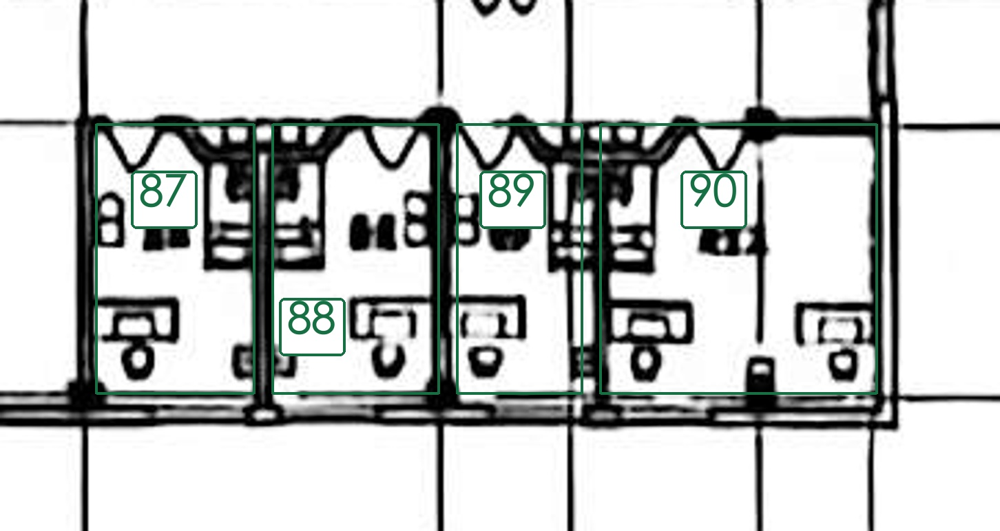

| 核对号 | S编号  | 预估名称（可改） | 备选名称 | 依据与把握                                             | 我的确认／备注 | 核对号（重复） |
| --- | ---- | -------- | ---- | ------------------------------------------------- | ------- | ------- |
| 87  | S151 | 儿科门诊     | —    | 用户填写为“儿科门诊”；已按原名同步JSON/SVG，类别：诊室。原候选及用户填写前版本已备份。  | 儿科门诊    | 87      |
| 88  | S152 | 儿科门诊     | —    | 用户填写为“儿科门诊”；已按原名同步JSON/SVG，类别：诊室。原候选及用户填写前版本已备份。  | 儿科门诊    | 88      |
| 89  | S153 | 儿科门诊     | —    | 用户填写为“儿科门诊”；已按原名同步JSON/SVG，类别：诊室。原候选及用户填写前版本已备份。  | 儿科门诊    | 89      |
| 90  | S154 | 处置室      | —    | 用户填写为“处置室”；已按原名同步JSON/SVG，类别：处置治疗。原候选及用户填写前版本已备份。 | 处置室     | 90      |

### 91—94｜南部门诊公共服务

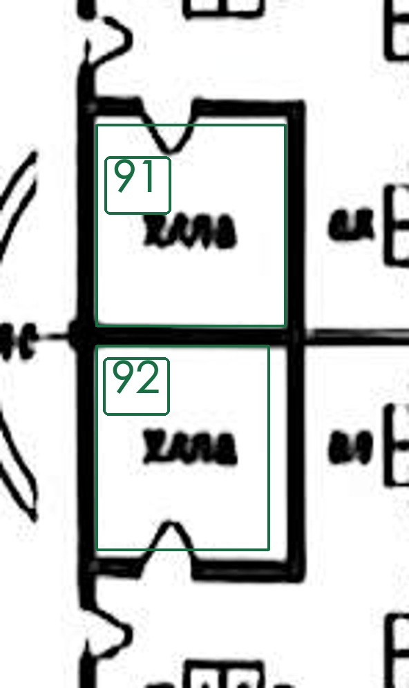

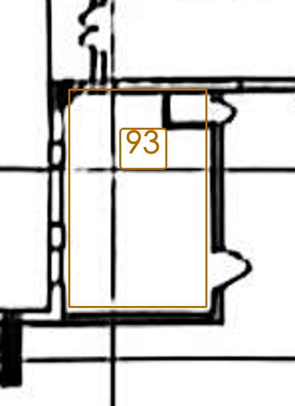

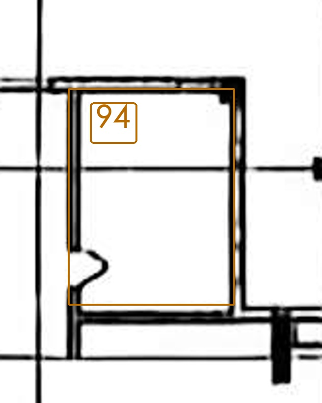

| 核对号 | S编号  | 预估名称（可改） | 备选名称 | 依据与把握                                                  | 我的确认／备注    | 核对号（重复） |
| --- | ---- | -------- | ---- | ------------------------------------------------------ | ---------- | ------- |
| 91  | S166 | 更衣休息     | —    | 用户填写为“更衣休息”；已按原名同步JSON/SVG，类别：工作人员支持用房。原候选及用户填写前版本已备份。 | 更衣休息       | 91      |
| 92  | S168 | 更衣休息     | —    | 用户填写为“更衣休息”；已按原名同步JSON/SVG，类别：工作人员支持用房。原候选及用户填写前版本已备份。 | 更衣休息       | 92      |
| 93  | S174 | 已排除      | —    | 用户明确填写排除；本轮移出JSON和SVG，不参与室内面积归一化，保留原核对号与本行填写以便追溯。      | 这个房间删除，不考虑 | 93      |
| 94  | S175 | 已排除      | —    | 用户明确填写排除；本轮移出JSON和SVG，不参与室内面积归一化，保留原核对号与本行填写以便追溯。      | 这个房间删除，不考虑 | 94      |
