# 23_西安经开医院｜标注与连通复核

**名称与类别已同步；连通复核推进中，尚有 K01 一项关键疑点待确认。**

**标注规模：**219 个空间／区域，开放空间 32 个、房间级单元 159 个、交通核 14 个、功能块 13 个、半墙服务区 1 个。

**类型与数量：**大厅 6 个、建筑设备用房 15 个、工作人员支持用房 16 个、检查 3 个、诊室 54 个、交通核 14 个、库房 9 个、前室 1 个、药房 5 个、影像检查 13 个、卫生间 15 个、处置治疗 5 个、器械用房 5 个、服务区 2 个、手术 1 个、挂号收费 2 个、通道 18 个、办公 12 个、会议教学 2 个、门斗 2 个、污物处理 1 个、建筑设备控制 2 个、患者准备 1 个、服务工作区 1 个、庭院／挑空空间 7 个、取药服务区 2 个、商业服务 1 个、留观 1 个、检验 2 个、配药用房 1 个。

**连接关系：**243 条，人员可达 225 条、服务联系 4 条、入口连接 14 条。

**入口：**北侧公共入口、南侧公共入口、东侧门厅入口、急诊东侧入口、放射西侧入口、老年门诊西侧入口、体检东侧入口、东侧门厅南门、药房西侧入口、中药房北侧入口、中段门诊东侧入口、中段门诊南侧入口、老年门诊西侧南门、放射南侧入口。

**相对规模：**室内非重叠标注区域的 `area_ratio` 合计为 1；7处已确认的露天／挑空内庭院不参与。具体物理尺寸由生成环节按任务确定。施工级门构造及内部精确路线不纳入数据。

**门洞与开口：**226 个红点，对应 200 条人员可达关系；其中门洞 224 个、无门开口 2 个。同一空间对可有多个开口，关系仍按空间对归并。其余 25 条人员可达关系无定位红点；区域连续及半墙等概念连通不编造门位，服务窗口及共墙不作为通行红点。

**范围与面积：**本图为西安经开医院一层平面（2444×3260），包含公共大厅、急诊、放射、外科、药房、老年门诊、中段门诊与体检片区。仅处理本图，沿用219个稳定S编号和现有轮廓。 S092、S096、S133、S146、S150、S197、S202 均按用户本轮确认记为露天／挑空内庭院，不计室内面积；已重新归一化。

**用户填写：**166项名称全部采用“我的确认／备注”栏的明确填写，去除纯排版换行标签；“总诊手术”“设备时”“用点机房”“特殊药瓶库”等均保留原名。具体名称与标准功能类别分别保存，不自动纠正或扩展原名。

**连通处理：**已撤下13条缺乏直接开口依据的旧关系，补记可见内门、公共交通核连接及药房人员入口。S086经S087、S089经S090、S101经S100、S103经相邻诊室、S106经S105、S207经S206、S210经相邻诊室、S213经S214、S216经S215进出；不再重复记为直达走廊。S164药库经S163及S165相连。S120/S125东侧柜台、S073挂号收费柜台及S165挂号取药柜台的服务关系与人员通行分开保存。

**布局推断与概念连续：**R238（S011↔S013）按电梯面向前室的布置记录；R239（S074↔S078）按大厅内交通核整体接入记录；R158（S165↔S166）按柜台北端的工作区出入组织保留概念连接，不编造红点。两处自动扶梯、开放采血区、大厅分段与同片区通道碎片按图面连续性保留无定位的access。S016卫生间按现有整体节点及西侧通道组织保留R045，内部入口不继续细分。上述为图面判断／布局推断，未标为用户已确认。

**本轮不细究的内部细节：**S045、S062更衣小间及S113、S115管井未补造入口；交通核内部电梯门、楼梯与前室的逐间路线不展开。缺少关系不代表不可达，亦不作为已确认负例。露天内庭院保留轮廓与编号，不用它们串联室内功能区。

**核验状态：**结构、名称、面积及SVG红点对应检查通过；原图未改动。K01关键连通疑点未解决前，本图仍不宣布完成。

[原图](23_西安经开医院_原图.jpg) · [标注SVG](标注.svg)

## 连通关键核对（2026-11-05）

可直接在K01图下方填写“我的确认／备注”；也可在聊天中回复 `K01=……`。无需确定门宽或施工构造。原候选K02经二次放大已自主解决，保留判读记录，不需填写。

### K01｜S028“总诊手术”的唯一进出路线

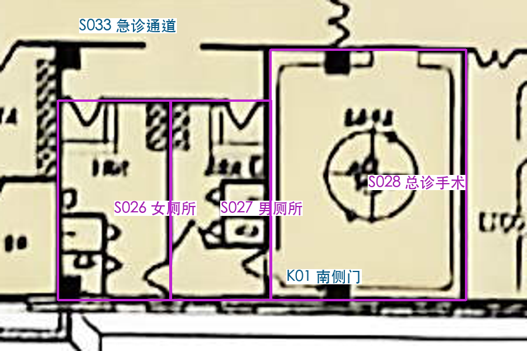

[同范围无标记原图](../../临时核对/23_西安经开医院_连通复核_20261105/K01_原图.png)

**问题：**S028是否经南侧共用前区连向急诊通道S033？该前区是否应从S026/S027的厕所范围中分出，或实际由其他方向进入？

**我的判断：**南侧西端可见门形开口；北侧未见可确认门口。南门外侧落在当前S027轮廓中，可能是与厕所共用的前区，不能直接写成“穿过男厕所进入手术室”。已撤下旧R055（S028↔S033），暂不建立未经确认的替代路线。

**我的确认／备注：**待填写（可填“经南侧公共前区连接S033”，或说明实际直接相连空间／方向）。

### K02｜已自主解决：S157西侧门接公共大厅

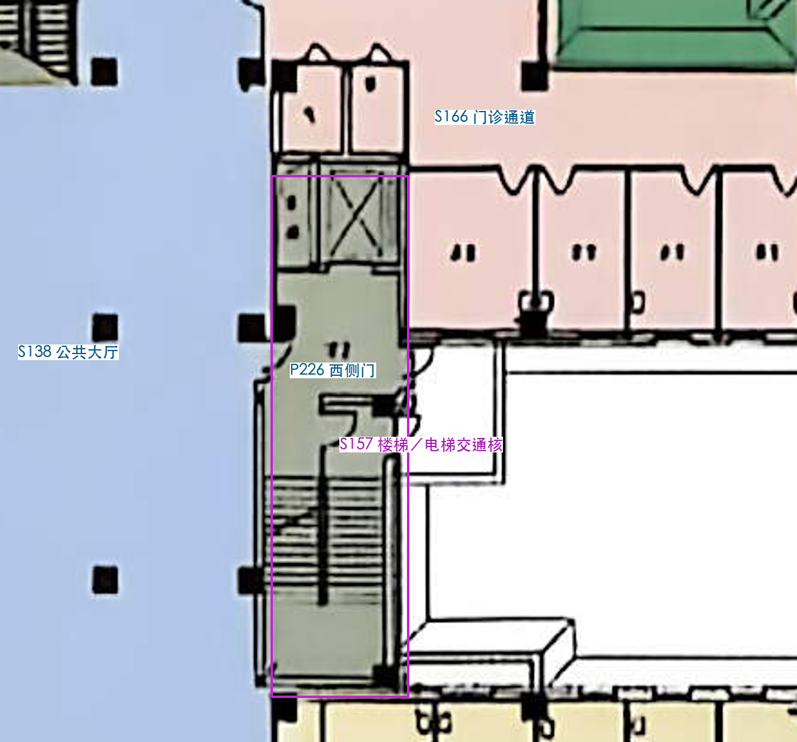

[同范围无标记原图](../../临时核对/23_西安经开医院_连通复核_20261105/K02_原图.png)

**判读结果：**二次放大可辨西侧门形开口，交通核S157直接接公共大厅S138，已记录R242及红点P226（1380，2220）。东侧另有向外的楼梯门，不据此编造通往S166的室内边。该项依据本图自主完成，无需用户确认。

展开：已同步的166项房名填写记录与原核对图

## 房名与范围核对（2026-11-05）

本轮166项已全部按用户填写同步。原始候选、依据和填写栏保留作为历史记录，以填写栏实际名称为准；核对号与S编号不变。

可直接修改“预估名称（可改）”，再把“我的确认／备注”改成“已确认”；也可直接在确认栏填写实际名称，或在聊天中按 `23号 01=名称` 回复。未回答项保留 unknown。

名称已同步；本图本轮连通与门位结果见上方概览；仅K01仍待确认，K02已自主解决。

[原图](23_西安经开医院_原图.jpg) · [现有标注 SVG](标注.svg)

**范围属性重点：**&#x53;092、S096、S133、S146、S150、S197、S202 请同时说明“露天／挑空”或“室内可步入”，用于确定是否计入室内相对面积。

### 01—06｜S002、S003、S004、S005、S006、S007

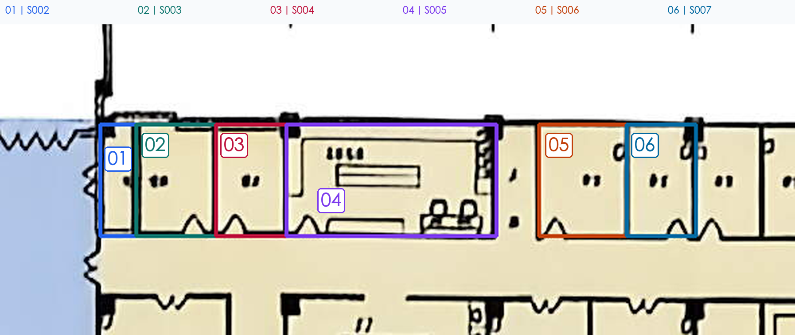

[查看同范围无标记原图](../../临时核对/21-25_名称核对_20261105/23_西安经开医院/局部_01_无标记原图.png)

| 核对号 | S编号  | 预估名称（可改） | 备选名称   | 依据与把握                                                 | 我的确认／备注 | 核对号（重复） |
| --- | ---- | -------- | ------ | ----------------------------------------------------- | ------- | ------- |
| 01  | S002 | 设备小间     | 储物间    | 各候选共用依据：狭长独立小间，无可辨认专用设备；现有证据不能可靠区分。 把握：低（旧稿预估，待本轮核对）。 | 强弱电     | 01      |
| 02  | S003 | 诊室       | 办公     | 各候选共用依据：沿外墙的小间，门朝南侧通道；现有证据不能可靠区分。 把握：低（旧稿预估，待本轮核对）。   | 值班      | 02      |
| 03  | S004 | 诊室       | 办公     | 各候选共用依据：沿外墙的小间，门朝南侧通道；现有证据不能可靠区分。 把握：低（旧稿预估，待本轮核对）。   | 值班      | 03      |
| 04  | S005 | 处置／抢救用房  | 治疗室    | 各候选共用依据：室内有长台／床形设备及座椅；现有证据不能可靠区分。 把握：中（旧稿预估，待本轮核对）。   | 急诊检查    | 04      |
| 05  | S006 | 诊室       | 急诊支持用房 | 各候选共用依据：小房间连续布置，门朝下侧通道；现有证据不能可靠区分。 把握：低（旧稿预估，待本轮核对）。  | 诊室      | 05      |
| 06  | S007 | 诊室       | 急诊支持用房 | 各候选共用依据：小房间连续布置，门朝下侧通道；现有证据不能可靠区分。 把握：低（旧稿预估，待本轮核对）。  | 诊室      | 06      |

### 07—12｜S008、S009、S010、S011、S013、S014

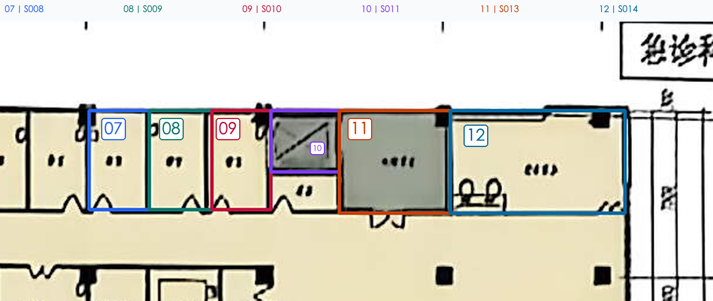

[查看同范围无标记原图](../../临时核对/21-25_名称核对_20261105/23_西安经开医院/局部_02_无标记原图.png)

| 核对号 | S编号  | 预估名称（可改） | 备选名称   | 依据与把握                                                | 我的确认／备注 | 核对号（重复） |
| --- | ---- | -------- | ------ | ---------------------------------------------------- | ------- | ------- |
| 07  | S008 | 诊室       | 急诊支持用房 | 各候选共用依据：小房间连续布置，门朝下侧通道；现有证据不能可靠区分。 把握：低（旧稿预估，待本轮核对）。 | 诊室      | 07      |
| 08  | S009 | 诊室       | 急诊支持用房 | 各候选共用依据：小房间连续布置，门朝下侧通道；现有证据不能可靠区分。 把握：低（旧稿预估，待本轮核对）。 | 诊室      | 08      |
| 09  | S010 | 诊室       | 急诊支持用房 | 各候选共用依据：小房间连续布置，门朝下侧通道；现有证据不能可靠区分。 把握：低（旧稿预估，待本轮核对）。 | 诊室      | 09      |
| 10  | S011 | 设备井／机房   | —      | 方形内有斜线，无法确认设备类型 把握：低（旧稿预估，待本轮核对）。                    | 电梯      | 10      |
| 11  | S013 | 设备机房     | 辅助用房   | 各候选共用依据：灰色独立房间，无清晰楼梯踏步；现有证据不能可靠区分。 把握：低（旧稿预估，待本轮核对）。 | 电梯前室    | 11      |
| 12  | S014 | 处置室      | 治疗室    | 各候选共用依据：大房间内有工作台及座椅；现有证据不能可靠区分。 把握：中（旧稿预估，待本轮核对）。    | 急诊药房    | 12      |

### 13｜S012

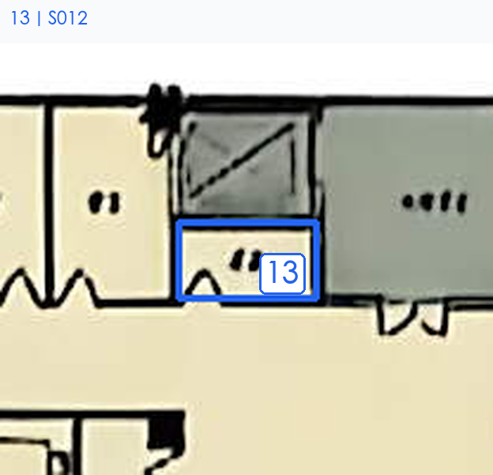

[查看同范围无标记原图](../../临时核对/21-25_名称核对_20261105/23_西安经开医院/局部_03_无标记原图.png)

| 核对号 | S编号  | 预估名称（可改） | 备选名称 | 依据与把握                                              | 我的确认／备注 | 核对号（重复） |
| --- | ---- | -------- | ---- | -------------------------------------------------- | ------- | ------- |
| 13  | S012 | 设备小间     | 储物间  | 各候选共用依据：设备井下方小间，门朝通道；现有证据不能可靠区分。 把握：低（旧稿预估，待本轮核对）。 | 库房      | 13      |

### 14—19｜S015、S017、S018、S019、S020、S021

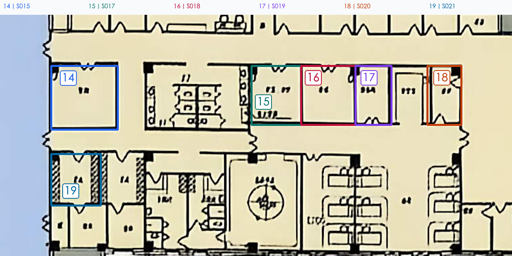

[查看同范围无标记原图](../../临时核对/21-25_名称核对_20261105/23_西安经开医院/局部_04_无标记原图.png)

| 核对号 | S编号  | 预估名称（可改） | 备选名称   | 依据与把握                                                      | 我的确认／备注 | 核对号（重复） |
| --- | ---- | -------- | ------ | ---------------------------------------------------------- | ------- | ------- |
| 14  | S015 | 诊室       | 急诊支持用房 | 各候选共用依据：靠大厅的独立小间；现有证据不能可靠区分。 把握：低（旧稿预估，待本轮核对）。             | B超      | 14      |
| 15  | S017 | 诊室       | 急诊支持用房 | 各候选共用依据：中排独立小间，房名模糊；现有证据不能可靠区分。 把握：低（旧稿预估，待本轮核对）。          | 处置、药房   | 15      |
| 16  | S018 | 诊室       | 急诊支持用房 | 各候选共用依据：中排独立小间，房名模糊；现有证据不能可靠区分。 把握：低（旧稿预估，待本轮核对）。          | 清创      | 16      |
| 17  | S019 | 诊室       | 急诊支持用房 | 各候选共用依据：中排独立小间，房名模糊；现有证据不能可靠区分。 把握：低（旧稿预估，待本轮核对）。          | 设备      | 17      |
| 18  | S020 | 处置准备间    | 辅助用房   | 各候选共用依据：东端小间，侧边和下部可见门口；现有证据不能可靠区分。 把握：低（旧稿预估，待本轮核对）。       | 治疗      | 18      |
| 19  | S021 | 处置支持用房   | 设备用房   | 各候选共用依据：北侧门口、两边密集斜线填充，具体功能不清；现有证据不能可靠区分。 把握：低（旧稿预估，待本轮核对）。 | 谈话      | 19      |

### 20—25｜S022、S028、S029、S026、S027、S023

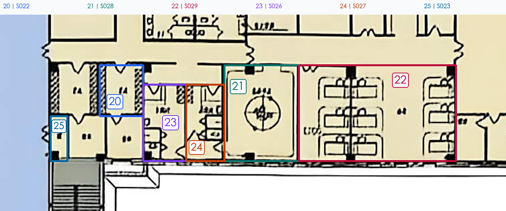

[查看同范围无标记原图](../../临时核对/21-25_名称核对_20261105/23_西安经开医院/局部_05_无标记原图.png)

| 核对号 | S编号  | 预估名称（可改） | 备选名称 | 依据与把握                                                      | 我的确认／备注 | 核对号（重复） |
| --- | ---- | -------- | ---- | ---------------------------------------------------------- | ------- | ------- |
| 20  | S022 | 处置支持用房   | 设备用房 | 各候选共用依据：北侧门口、两边密集斜线填充，具体功能不清；现有证据不能可靠区分。 把握：低（旧稿预估，待本轮核对）。 | 更衣      | 20      |
| 21  | S028 | 急诊手术室    | 抢救室  | 各候选共用依据：中心为圆形设备轮廓及床／台；现有证据不能可靠区分。 把握：中（旧稿预估，待本轮核对）。        | 总诊手术    | 21      |
| 22  | S029 | 留观室      | 输液室  | 各候选共用依据：多张病床成排布置，功能文字模糊；现有证据不能可靠区分。 把握：中（旧稿预估，待本轮核对）。      | 设备      | 22      |
| 23  | S026 | 处置支持用房   | 清洗用房 | 各候选共用依据：可见台面／器具，文字不清；现有证据不能可靠区分。 把握：低（旧稿预估，待本轮核对）。         | 女厕所     | 23      |
| 24  | S027 | 处置支持用房   | 清洗用房 | 各候选共用依据：与西侧支持小间相邻，内有成对器具；现有证据不能可靠区分。 把握：低（旧稿预估，待本轮核对）。     | 男厕所     | 24      |
| 25  | S023 | 设备小间     | 储物间  | 各候选共用依据：狭长边间，文字不清；现有证据不能可靠区分。 把握：低（旧稿预估，待本轮核对）。            | 暖通      | 25      |

### 26—28｜S024、S025、S030

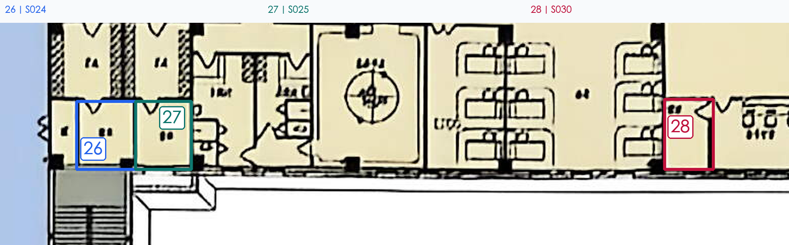

[查看同范围无标记原图](../../临时核对/21-25_名称核对_20261105/23_西安经开医院/局部_06_无标记原图.png)

| 核对号 | S编号  | 预估名称（可改） | 备选名称 | 依据与把握                                            | 我的确认／备注 | 核对号（重复） |
| --- | ---- | -------- | ---- | ------------------------------------------------ | ------- | ------- |
| 26  | S024 | 辅助用房     | 办公   | 各候选共用依据：两间小房间，门朝上方；现有证据不能可靠区分。 把握：低（旧稿预估，待本轮核对）。 | 值班      | 26      |
| 27  | S025 | 辅助用房     | 办公   | 各候选共用依据：两间小房间，门朝上方；现有证据不能可靠区分。 把握：低（旧稿预估，待本轮核对）。 | 值班      | 27      |
| 28  | S030 | 辅助小间     | 储物间  | 各候选共用依据：床区东侧狭小独立房间；现有证据不能可靠区分。 把握：低（旧稿预估，待本轮核对）。 | 值班      | 28      |

### 29｜S031

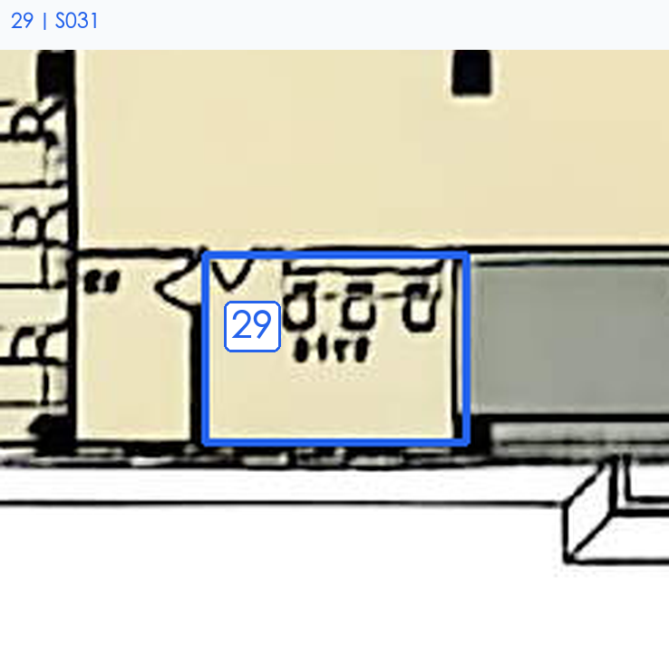

[查看同范围无标记原图](../../临时核对/21-25_名称核对_20261105/23_西安经开医院/局部_07_无标记原图.png)

| 核对号 | S编号  | 预估名称（可改） | 备选名称 | 依据与把握                                                    | 我的确认／备注 | 核对号（重复） |
| --- | ---- | -------- | ---- | -------------------------------------------------------- | ------- | ------- |
| 29  | S031 | 卫生间      | 清洗间  | 各候选共用依据：北侧排列三处卫生／清洗器具，无法细分；现有证据不能可靠区分。 把握：中（旧稿预估，待本轮核对）。 | 挂号与收费   | 29      |

### 30—34｜S038、S039、S040、S041、S042

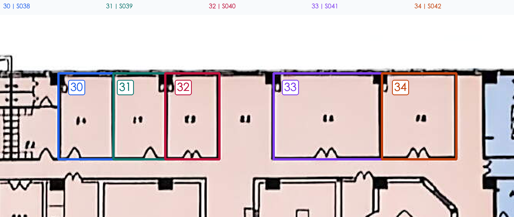

[查看同范围无标记原图](../../临时核对/21-25_名称核对_20261105/23_西安经开医院/局部_08_无标记原图.png)

| 核对号 | S编号  | 预估名称（可改） | 备选名称   | 依据与把握                                                 | 我的确认／备注 | 核对号（重复） |
| --- | ---- | -------- | ------ | ----------------------------------------------------- | ------- | ------- |
| 30  | S038 | 办公       | 放射支持用房 | 各候选共用依据：沿北外墙小间，无可辨认检查设备；现有证据不能可靠区分。 把握：低（旧稿预估，待本轮核对）。 | 办公      | 30      |
| 31  | S039 | 办公       | 放射支持用房 | 各候选共用依据：沿北外墙小间，无可辨认检查设备；现有证据不能可靠区分。 把握：低（旧稿预估，待本轮核对）。 | 主任      | 31      |
| 32  | S040 | 办公       | 放射支持用房 | 各候选共用依据：沿北外墙小间，无可辨认检查设备；现有证据不能可靠区分。 把握：低（旧稿预估，待本轮核对）。 | 医值      | 32      |
| 33  | S041 | 放射支持用房   | 办公     | 各候选共用依据：北侧较宽房间，具体房名不清；现有证据不能可靠区分。 把握：低（旧稿预估，待本轮核对）。   | 医办      | 33      |
| 34  | S042 | 放射支持用房   | 办公     | 各候选共用依据：北侧较宽房间，具体房名不清；现有证据不能可靠区分。 把握：低（旧稿预估，待本轮核对）。   | 示教室     | 34      |

### 35—38｜S043、S044、S045、S047

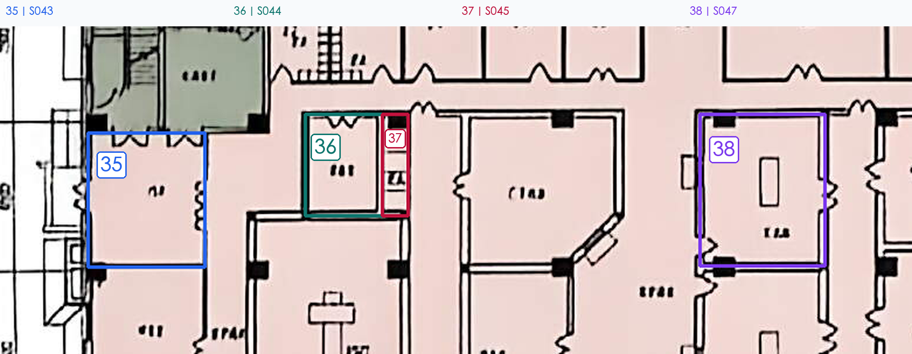

[查看同范围无标记原图](../../临时核对/21-25_名称核对_20261105/23_西安经开医院/局部_09_无标记原图.png)

| 核对号 | S编号  | 预估名称（可改） | 备选名称   | 依据与把握                                                    | 我的确认／备注 | 核对号（重复） |
| --- | ---- | -------- | ------ | -------------------------------------------------------- | ------- | ------- |
| 35  | S043 | 登记／服务区   | 放射支持用房 | 各候选共用依据：西侧入口相邻小间，内无明确设备；现有证据不能可靠区分。 把握：低（旧稿预估，待本轮核对）。    | 门厅      | 35      |
| 36  | S044 | 放射支持用房   | 设备用房   | 各候选共用依据：设备室北侧小间；现有证据不能可靠区分。 把握：低（旧稿预估，待本轮核对）。            | 设备时     | 36      |
| 37  | S045 | 设备间      | 辅助小间   | 各候选共用依据：狭长分隔区域，局部条纹不能确定为楼梯；现有证据不能可靠区分。 把握：低（旧稿预估，待本轮核对）。 | 更衣      | 37      |
| 38  | S047 | X线检查室    | 检查工作室  | 各候选共用依据：中心有单床／台，位于放射片区；现有证据不能可靠区分。 把握：中（旧稿预估，待本轮核对）。     | X光机     | 38      |

### 39—40｜S048、S050

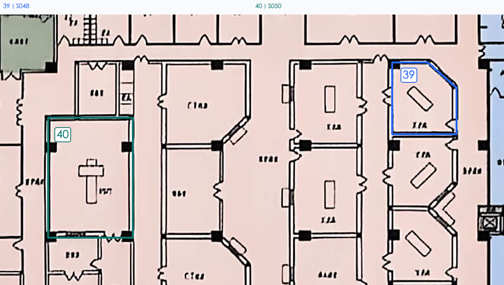

[查看同范围无标记原图](../../临时核对/21-25_名称核对_20261105/23_西安经开医院/局部_10_无标记原图.png)

| 核对号 | S编号  | 预估名称（可改） | 备选名称  | 依据与把握                                             | 我的确认／备注 | 核对号（重复） |
| --- | ---- | -------- | ----- | ------------------------------------------------- | ------- | ------- |
| 39  | S048 | X线检查室    | 放射检查室 | 各候选共用依据：斜角隔墙内有检查台；现有证据不能可靠区分。 把握：中（旧稿预估，待本轮核对）。   | X光机     | 39      |
| 40  | S050 | X线检查室    | 影像设备室 | 各候选共用依据：可见十字形大型设备轮廓；现有证据不能可靠区分。 把握：中（旧稿预估，待本轮核对）。 | MRI     | 40      |

### 41—43｜S049、S051、S052

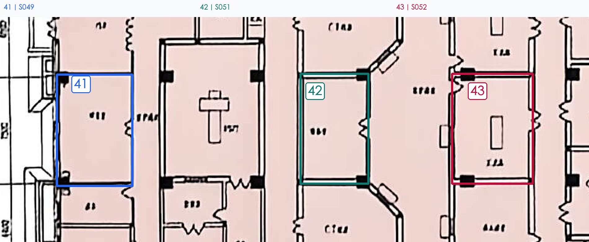

[查看同范围无标记原图](../../临时核对/21-25_名称核对_20261105/23_西安经开医院/局部_11_无标记原图.png)

| 核对号 | S编号  | 预估名称（可改） | 备选名称   | 依据与把握                                                   | 我的确认／备注 | 核对号（重复） |
| --- | ---- | -------- | ------ | ------------------------------------------------------- | ------- | ------- |
| 41  | S049 | 放射支持用房   | 办公     | 各候选共用依据：西外墙大房间，门朝内部通道；现有证据不能可靠区分。 把握：低（旧稿预估，待本轮核对）。     | 回收室     | 41      |
| 42  | S051 | 控制／操作室   | 放射支持用房 | 各候选共用依据：两间CT室之间的房间，未见大型设备；现有证据不能可靠区分。 把握：中（旧稿预估，待本轮核对）。 | 设备室     | 42      |
| 43  | S052 | X线检查室    | 检查工作室  | 各候选共用依据：中心有检查台，门向东侧通道；现有证据不能可靠区分。 把握：中（旧稿预估，待本轮核对）。     | X光机     | 43      |

### 44—45｜S053、S060

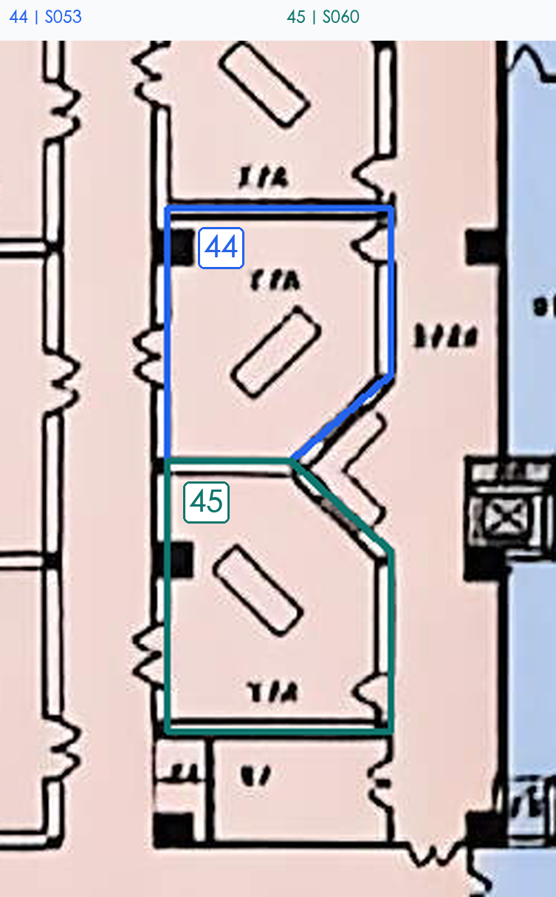

[查看同范围无标记原图](../../临时核对/21-25_名称核对_20261105/23_西安经开医院/局部_12_无标记原图.png)

| 核对号 | S编号  | 预估名称（可改） | 备选名称  | 依据与把握                                           | 我的确认／备注 | 核对号（重复） |
| --- | ---- | -------- | ----- | ----------------------------------------------- | ------- | ------- |
| 44  | S053 | X线检查室    | 放射检查室 | 各候选共用依据：斜角隔墙内有检查台；现有证据不能可靠区分。 把握：中（旧稿预估，待本轮核对）。 | X光机     | 44      |
| 45  | S060 | X线检查室    | 放射检查室 | 各候选共用依据：斜角房间内有检查台；现有证据不能可靠区分。 把握：中（旧稿预估，待本轮核对）。 | X光机     | 45      |

### 46—51｜S054、S055、S057、S059、S063、S056

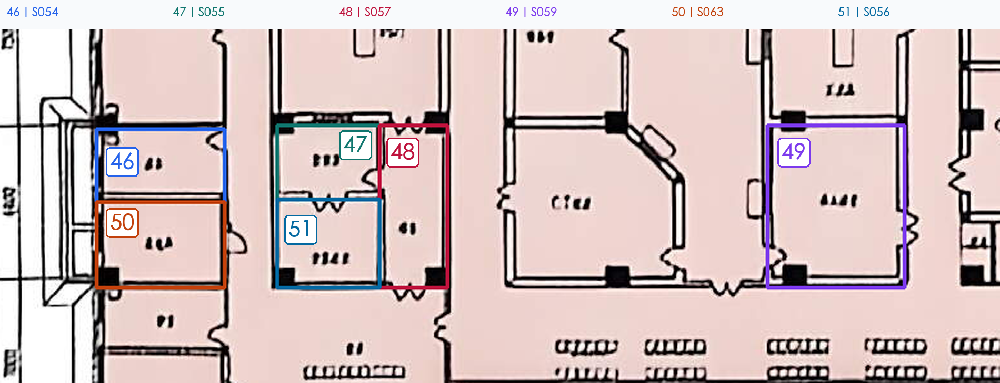

[查看同范围无标记原图](../../临时核对/21-25_名称核对_20261105/23_西安经开医院/局部_13_无标记原图.png)

| 核对号 | S编号  | 预估名称（可改） | 备选名称  | 依据与把握                                             | 我的确认／备注 | 核对号（重复） |
| --- | ---- | -------- | ----- | ------------------------------------------------- | ------- | ------- |
| 46  | S054 | 辅助用房     | 办公    | 各候选共用依据：西侧小房间，门向东侧；现有证据不能可靠区分。 把握：低（旧稿预估，待本轮核对）。  | 办公      | 46      |
| 47  | S055 | 放射支持用房   | 办公    | 各候选共用依据：设备室下方小间；现有证据不能可靠区分。 把握：低（旧稿预估，待本轮核对）。     | 控制室     | 47      |
| 48  | S057 | 放射支持用房   | 办公    | 各候选共用依据：狭长独立房间，向下开门；现有证据不能可靠区分。 把握：低（旧稿预估，待本轮核对）。 | 准备间     | 48      |
| 49  | S059 | 放射检查室    | 检查工作室 | 各候选共用依据：中心有检查台；现有证据不能可靠区分。 把握：中（旧稿预估，待本轮核对）。      | 介入治疗    | 49      |
| 50  | S063 | 放射支持用房   | 办公    | 各候选共用依据：西侧中等房间；现有证据不能可靠区分。 把握：低（旧稿预估，待本轮核对）。      | 配电间     | 50      |
| 51  | S056 | 放射支持用房   | 办公    | 各候选共用依据：设备室下方小间；现有证据不能可靠区分。 把握：低（旧稿预估，待本轮核对）。     | 计算机室    | 51      |

### 52—53｜S062、S061

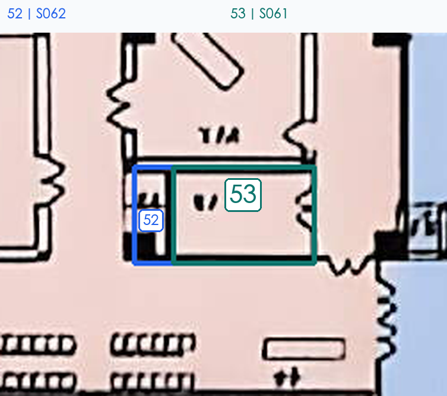

[查看同范围无标记原图](../../临时核对/21-25_名称核对_20261105/23_西安经开医院/局部_14_无标记原图.png)

| 核对号 | S编号  | 预估名称（可改） | 备选名称 | 依据与把握                                           | 我的确认／备注 | 核对号（重复） |
| --- | ---- | -------- | ---- | ----------------------------------------------- | ------- | ------- |
| 52  | S062 | 设备小间     | 储物间  | 各候选共用依据：检查室下方狭小分隔；现有证据不能可靠区分。 把握：低（旧稿预估，待本轮核对）。 | 更衣      | 52      |
| 53  | S061 | 控制／操作室   | 辅助用房 | 各候选共用依据：检查室下方小间；现有证据不能可靠区分。 把握：低（旧稿预估，待本轮核对）。   | 取片      | 53      |

### 54—55｜S064、S065

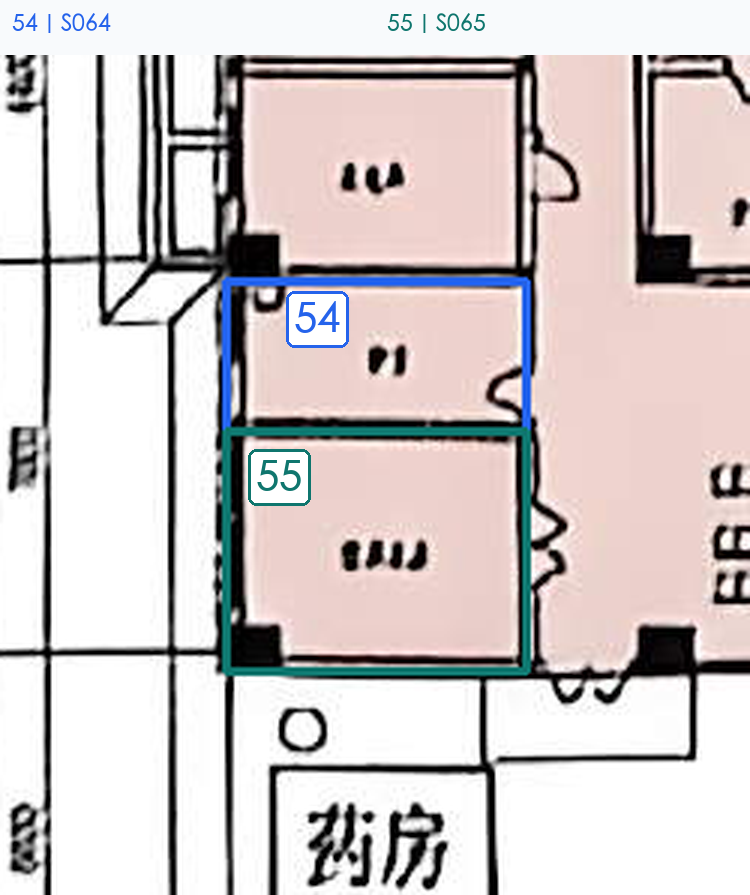

[查看同范围无标记原图](../../临时核对/21-25_名称核对_20261105/23_西安经开医院/局部_15_无标记原图.png)

| 核对号 | S编号  | 预估名称（可改） | 备选名称 | 依据与把握                                        | 我的确认／备注 | 核对号（重复） |
| --- | ---- | -------- | ---- | -------------------------------------------- | ------- | ------- |
| 54  | S064 | 辅助用房     | 办公   | 各候选共用依据：西侧小房间；现有证据不能可靠区分。 把握：低（旧稿预估，待本轮核对）。  | 诊室      | 54      |
| 55  | S065 | 放射支持用房   | 办公   | 各候选共用依据：西侧末端房间；现有证据不能可靠区分。 把握：低（旧稿预估，待本轮核对）。 | 空调机房    | 55      |

### 56—57｜S072、S073

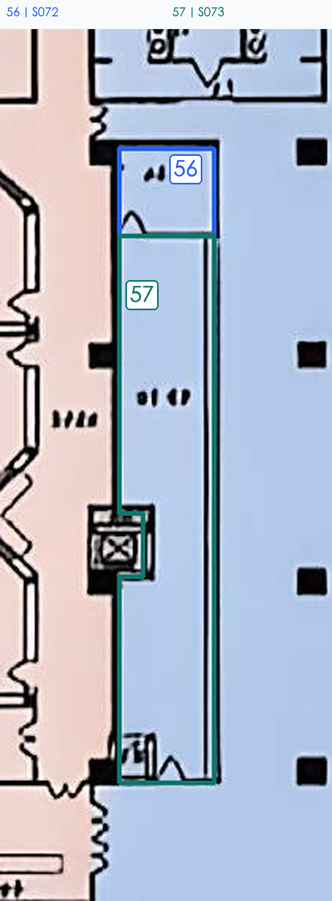

[查看同范围无标记原图](../../临时核对/21-25_名称核对_20261105/23_西安经开医院/局部_16_无标记原图.png)

| 核对号 | S编号  | 预估名称（可改） | 备选名称    | 依据与把握                                                     | 我的确认／备注 | 核对号（重复） |
| --- | ---- | -------- | ------- | --------------------------------------------------------- | ------- | ------- |
| 56  | S072 | 公共服务小间   | 管理用房    | 各候选共用依据：公共大厅西侧独立小间；现有证据不能可靠区分。 把握：低（旧稿预估，待本轮核对）。          | 办公      | 56      |
| 57  | S073 | 公共服务工作区  | 挂号收费服务区 | 各候选共用依据：大厅边缘狭长连续带，未清晰显示服务柜台；现有证据不能可靠区分。 把握：低（旧稿预估，待本轮核对）。 | 挂号收费    | 57      |

### 58—63｜S081、S082、S083、S084、S085、S086

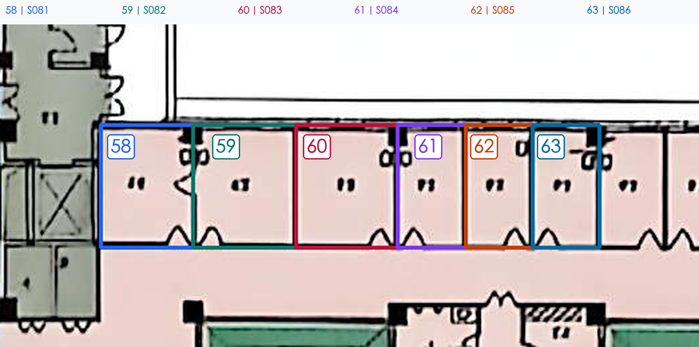

[查看同范围无标记原图](../../临时核对/21-25_名称核对_20261105/23_西安经开医院/局部_17_无标记原图.png)

| 核对号 | S编号  | 预估名称（可改） | 备选名称   | 依据与把握                                                       | 我的确认／备注 | 核对号（重复） |
| --- | ---- | -------- | ------ | ----------------------------------------------------------- | ------- | ------- |
| 58  | S081 | 诊室       | 外科诊疗用房 | 各候选共用依据：连续诊疗小间，均沿通道布置；相邻部分有内门；现有证据不能可靠区分。 把握：中（旧稿预估，待本轮核对）。 | 石膏      | 58      |
| 59  | S082 | 诊室       | 外科诊疗用房 | 各候选共用依据：连续诊疗小间，均沿通道布置；相邻部分有内门；现有证据不能可靠区分。 把握：中（旧稿预估，待本轮核对）。 | 处置      | 59      |
| 60  | S083 | 诊室       | 外科诊疗用房 | 各候选共用依据：连续诊疗小间，均沿通道布置；相邻部分有内门；现有证据不能可靠区分。 把握：中（旧稿预估，待本轮核对）。 | 诊室      | 60      |
| 61  | S084 | 诊室       | 外科诊疗用房 | 各候选共用依据：连续诊疗小间，均沿通道布置；相邻部分有内门；现有证据不能可靠区分。 把握：中（旧稿预估，待本轮核对）。 | 诊室      | 61      |
| 62  | S085 | 诊室       | 外科诊疗用房 | 各候选共用依据：连续诊疗小间，均沿通道布置；相邻部分有内门；现有证据不能可靠区分。 把握：中（旧稿预估，待本轮核对）。 | 诊室      | 62      |
| 63  | S086 | 诊室       | 外科诊疗用房 | 各候选共用依据：连续诊疗小间，均沿通道布置；相邻部分有内门；现有证据不能可靠区分。 把握：中（旧稿预估，待本轮核对）。 | 诊室      | 63      |

### 64—69｜S087、S088、S089、S090、S091、S092

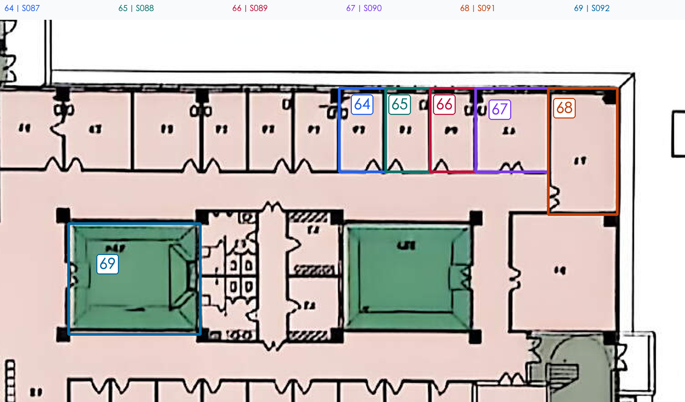

[查看同范围无标记原图](../../临时核对/21-25_名称核对_20261105/23_西安经开医院/局部_18_无标记原图.png)

| 核对号 | S编号  | 预估名称（可改） | 备选名称   | 依据与把握                                                       | 我的确认／备注 | 核对号（重复） |
| --- | ---- | -------- | ------ | ----------------------------------------------------------- | ------- | ------- |
| 64  | S087 | 诊室       | 外科诊疗用房 | 各候选共用依据：连续诊疗小间，均沿通道布置；相邻部分有内门；现有证据不能可靠区分。 把握：中（旧稿预估，待本轮核对）。 | 诊室      | 64      |
| 65  | S088 | 诊室       | 外科诊疗用房 | 各候选共用依据：连续诊疗小间，均沿通道布置；相邻部分有内门；现有证据不能可靠区分。 把握：中（旧稿预估，待本轮核对）。 | 诊室      | 65      |
| 66  | S089 | 诊室       | 外科诊疗用房 | 各候选共用依据：连续诊疗小间，均沿通道布置；相邻部分有内门；现有证据不能可靠区分。 把握：中（旧稿预估，待本轮核对）。 | 诊室      | 66      |
| 67  | S090 | 诊室       | 外科诊疗用房 | 各候选共用依据：连续诊疗小间，均沿通道布置；相邻部分有内门；现有证据不能可靠区分。 把握：中（旧稿预估，待本轮核对）。 | 医办      | 67      |
| 68  | S091 | 诊室       | 处置室    | 各候选共用依据：东端较大房间，门朝西侧通道；现有证据不能可靠区分。 把握：中（旧稿预估，待本轮核对）。         | 主任      | 68      |
| 69  | S092 | 露天采光庭院   | 室内中庭   | 各候选共用依据：绿色矩形，内部斜线边框；是否露天不清；现有证据不能可靠区分。 把握：中（旧稿预估，待本轮核对）。    | 内庭院     | 69      |

### 70—75｜S094、S096、S097、S095、S098、S099

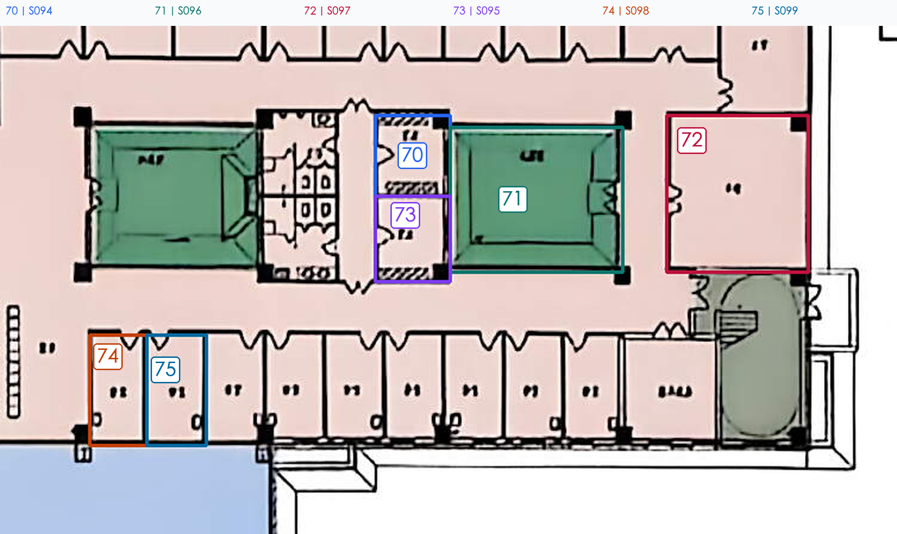

[查看同范围无标记原图](../../临时核对/21-25_名称核对_20261105/23_西安经开医院/局部_19_无标记原图.png)

| 核对号 | S编号  | 预估名称（可改） | 备选名称   | 依据与把握                                                     | 我的确认／备注 | 核对号（重复） |
| --- | ---- | -------- | ------ | --------------------------------------------------------- | ------- | ------- |
| 70  | S094 | 辅助用房     | 器械／储物间 | 各候选共用依据：卫生间东侧小间，端部密集填充；现有证据不能可靠区分。 把握：低（旧稿预估，待本轮核对）。      | 更衣      | 70      |
| 71  | S096 | 露天采光庭院   | 室内中庭   | 各候选共用依据：绿色矩形，内有边框与斜线；开敞性未确定；现有证据不能可靠区分。 把握：中（旧稿预估，待本轮核对）。 | 内庭院     | 71      |
| 72  | S097 | 治疗室      | 诊室     | 各候选共用依据：东侧较大独立房间，门向西；现有证据不能可靠区分。 把握：中（旧稿预估，待本轮核对）。        | 示教室     | 72      |
| 73  | S095 | 辅助用房     | 器械／储物间 | 各候选共用依据：卫生间东侧下排小间；现有证据不能可靠区分。 把握：低（旧稿预估，待本轮核对）。           | 更衣      | 73      |
| 74  | S098 | 诊室       | 外科诊疗用房 | 各候选共用依据：南排连续诊疗小间，门朝上侧；现有证据不能可靠区分。 把握：中（旧稿预估，待本轮核对）。       | 诊室      | 74      |
| 75  | S099 | 诊室       | 外科诊疗用房 | 各候选共用依据：南排连续诊疗小间，门朝上侧；现有证据不能可靠区分。 把握：中（旧稿预估，待本轮核对）。       | 诊室      | 75      |

### 76—81｜S100、S101、S102、S103、S104、S105

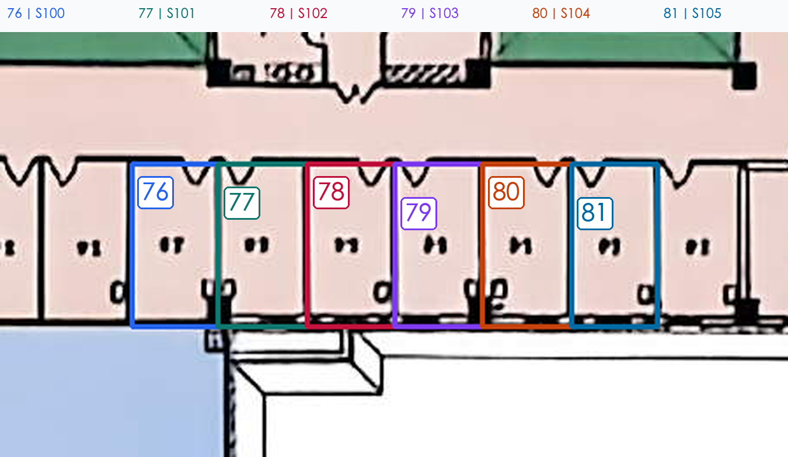

[查看同范围无标记原图](../../临时核对/21-25_名称核对_20261105/23_西安经开医院/局部_20_无标记原图.png)

| 核对号 | S编号  | 预估名称（可改） | 备选名称   | 依据与把握                                               | 我的确认／备注 | 核对号（重复） |
| --- | ---- | -------- | ------ | --------------------------------------------------- | ------- | ------- |
| 76  | S100 | 诊室       | 外科诊疗用房 | 各候选共用依据：南排连续诊疗小间，门朝上侧；现有证据不能可靠区分。 把握：中（旧稿预估，待本轮核对）。 | 诊室      | 76      |
| 77  | S101 | 诊室       | 外科诊疗用房 | 各候选共用依据：南排连续诊疗小间，门朝上侧；现有证据不能可靠区分。 把握：中（旧稿预估，待本轮核对）。 | 诊室      | 77      |
| 78  | S102 | 诊室       | 外科诊疗用房 | 各候选共用依据：南排连续诊疗小间，门朝上侧；现有证据不能可靠区分。 把握：中（旧稿预估，待本轮核对）。 | 诊室      | 78      |
| 79  | S103 | 诊室       | 外科诊疗用房 | 各候选共用依据：南排连续诊疗小间，门朝上侧；现有证据不能可靠区分。 把握：中（旧稿预估，待本轮核对）。 | 诊室      | 79      |
| 80  | S104 | 诊室       | 外科诊疗用房 | 各候选共用依据：南排连续诊疗小间，门朝上侧；现有证据不能可靠区分。 把握：中（旧稿预估，待本轮核对）。 | 诊室      | 80      |
| 81  | S105 | 诊室       | 外科诊疗用房 | 各候选共用依据：南排连续诊疗小间，门朝上侧；现有证据不能可靠区分。 把握：中（旧稿预估，待本轮核对）。 | 诊室      | 81      |

### 82—83｜S106、S107

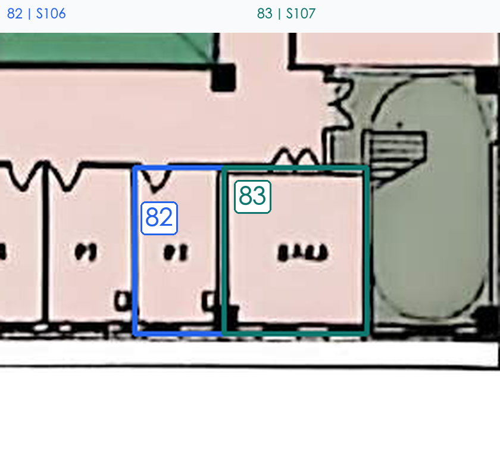

[查看同范围无标记原图](../../临时核对/21-25_名称核对_20261105/23_西安经开医院/局部_21_无标记原图.png)

| 核对号 | S编号  | 预估名称（可改） | 备选名称   | 依据与把握                                               | 我的确认／备注 | 核对号（重复） |
| --- | ---- | -------- | ------ | --------------------------------------------------- | ------- | ------- |
| 82  | S106 | 诊室       | 外科诊疗用房 | 各候选共用依据：南排连续诊疗小间，门朝上侧；现有证据不能可靠区分。 把握：中（旧稿预估，待本轮核对）。 | 诊室      | 82      |
| 83  | S107 | 诊室       | 外科诊疗用房 | 各候选共用依据：南排连续诊疗小间，门朝上侧；现有证据不能可靠区分。 把握：中（旧稿预估，待本轮核对）。 | 新风机房    | 83      |

### 84—89｜S113、S114、S115、S117、S118、S119

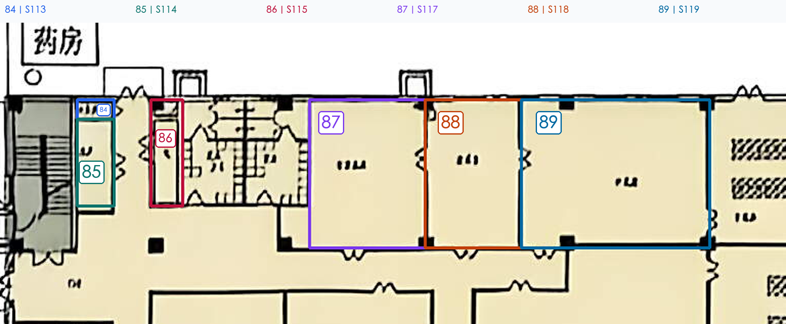

[查看同范围无标记原图](../../临时核对/21-25_名称核对_20261105/23_西安经开医院/局部_22_无标记原图.png)

| 核对号 | S编号  | 预估名称（可改） | 备选名称   | 依据与把握                                                    | 我的确认／备注 | 核对号（重复） |
| --- | ---- | -------- | ------ | -------------------------------------------------------- | ------- | ------- |
| 84  | S113 | 设备小间     | 储物间    | 各候选共用依据：楼梯东侧极小分隔，文字不清；现有证据不能可靠区分。 把握：低（旧稿预估，待本轮核对）。      | 管井      | 84      |
| 85  | S114 | 药房支持用房   | 管理用房   | 各候选共用依据：楼梯旁狭长独立小间；现有证据不能可靠区分。 把握：低（旧稿预估，待本轮核对）。          | 茶水间     | 85      |
| 86  | S115 | 设备小间     | 药房支持用房 | 各候选共用依据：卫生间旁狭长小间；现有证据不能可靠区分。 把握：低（旧稿预估，待本轮核对）。           | 管井      | 86      |
| 87  | S117 | 药房       | 药品支持用房 | 各候选共用依据：较大房间，无可辨识货架，位于药房片区；现有证据不能可靠区分。 把握：中（旧稿预估，待本轮核对）。 | 中草药房    | 87      |
| 88  | S118 | 药房       | 药品支持用房 | 各候选共用依据：与西侧房间有内门，外门朝南；现有证据不能可靠区分。 把握：中（旧稿预估，待本轮核对）。      | 取药室     | 88      |
| 89  | S119 | 药房       | 药库     | 各候选共用依据：大面积独立房间，东侧与货架区相连；现有证据不能可靠区分。 把握：中（旧稿预估，待本轮核对）。   | 中药库     | 89      |

### 90—92｜S120、S124、S125

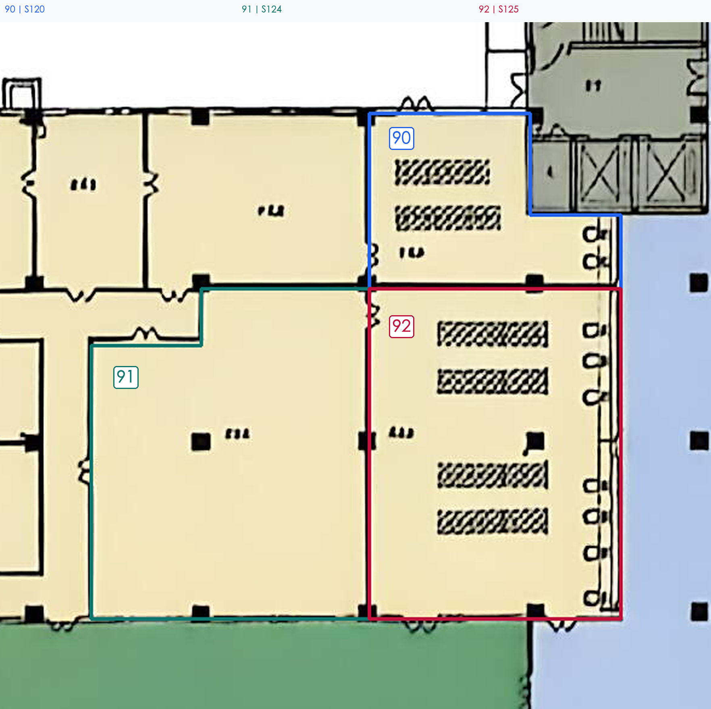

[查看同范围无标记原图](../../临时核对/21-25_名称核对_20261105/23_西安经开医院/局部_23_无标记原图.png)

| 核对号 | S编号  | 预估名称（可改） | 备选名称  | 依据与把握                                                  | 我的确认／备注 | 核对号（重复） |
| --- | ---- | -------- | ----- | ------------------------------------------------------ | ------- | ------- |
| 90  | S120 | 药库       | 药房调剂区 | 各候选共用依据：两排密集货架，东侧有座椅／服务台；现有证据不能可靠区分。 把握：中（旧稿预估，待本轮核对）。 | 中药房     | 90      |
| 91  | S124 | 药房       | 药库    | 各候选共用依据：药房片区中部大房间，西侧有门；现有证据不能可靠区分。 把握：中（旧稿预估，待本轮核对）。   | 西药库     | 91      |
| 92  | S125 | 药房调剂区    | 药库    | 各候选共用依据：四排密集货架，东侧多处服务器具；现有证据不能可靠区分。 把握：中（旧稿预估，待本轮核对）。  | 西药房     | 92      |

### 93—98｜S122、S123、S121、S126、S127、S128

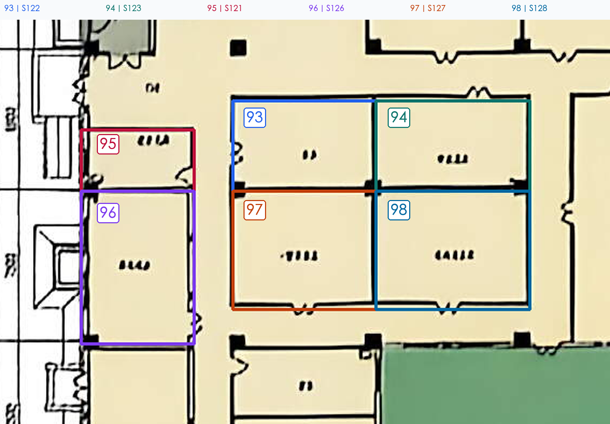

[查看同范围无标记原图](../../临时核对/21-25_名称核对_20261105/23_西安经开医院/局部_24_无标记原图.png)

| 核对号 | S编号  | 预估名称（可改） | 备选名称   | 依据与把握                                             | 我的确认／备注 | 核对号（重复） |
| --- | ---- | -------- | ------ | ------------------------------------------------- | ------- | ------- |
| 93  | S122 | 办公       | 药房支持用房 | 各候选共用依据：中央四格房间的左上间；现有证据不能可靠区分。 把握：低（旧稿预估，待本轮核对）。  | 办公      | 93      |
| 94  | S123 | 药房支持用房   | 办公     | 各候选共用依据：中央四格房间的右上间；现有证据不能可靠区分。 把握：低（旧稿预估，待本轮核对）。  | 中药药库    | 94      |
| 95  | S121 | 药房支持用房   | 办公     | 各候选共用依据：西侧小间，房名不清；现有证据不能可靠区分。 把握：低（旧稿预估，待本轮核对）。   | 统计记账    | 95      |
| 96  | S126 | 药房支持用房   | 办公     | 各候选共用依据：西侧较大房间，东侧开门；现有证据不能可靠区分。 把握：低（旧稿预估，待本轮核对）。 | 用点机房    | 96      |
| 97  | S127 | 药房支持用房   | 办公     | 各候选共用依据：中央四格房间的左下间；现有证据不能可靠区分。 把握：低（旧稿预估，待本轮核对）。  | 一般药品库   | 97      |
| 98  | S128 | 药房支持用房   | 办公     | 各候选共用依据：中央四格房间的右下间；现有证据不能可靠区分。 把握：低（旧稿预估，待本轮核对）。  | 特殊药瓶库   | 98      |

### 99—100｜S129、S130

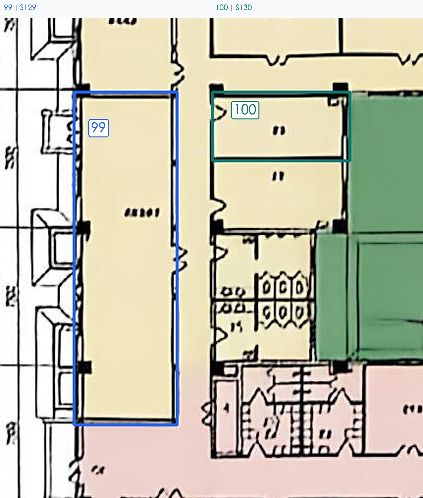

[查看同范围无标记原图](../../临时核对/21-25_名称核对_20261105/23_西安经开医院/局部_25_无标记原图.png)

| 核对号 | S编号  | 预估名称（可改） | 备选名称   | 依据与把握                                                  | 我的确认／备注 | 核对号（重复） |
| --- | ---- | -------- | ------ | ------------------------------------------------------ | ------- | ------- |
| 99  | S129 | 药房／药库    | 药品支持用房 | 各候选共用依据：西侧长条大房间，与通道有多处开口；现有证据不能可靠区分。 把握：中（旧稿预估，待本轮核对）。 | 消防监控室   | 99      |
| 100 | S130 | 办公       | 药房支持用房 | 各候选共用依据：院落西侧小间，门向西；现有证据不能可靠区分。 把握：低（旧稿预估，待本轮核对）。       | 财务      | 100     |

### 101｜S133

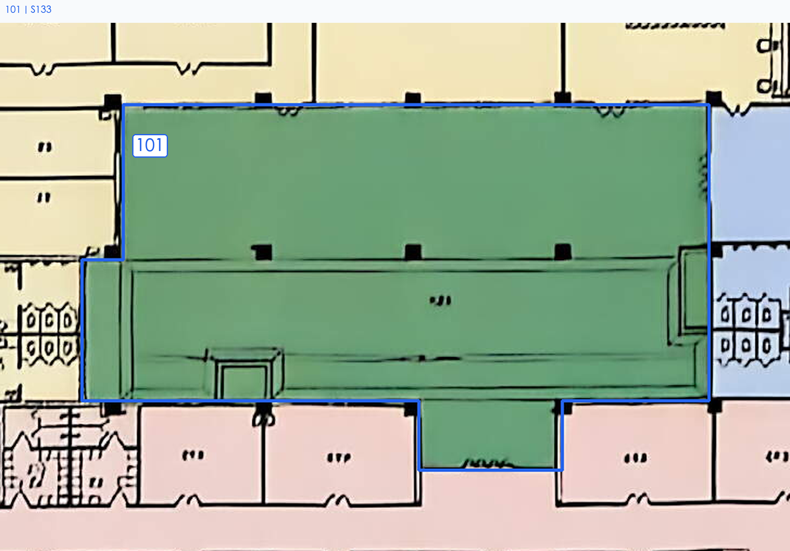

[查看同范围无标记原图](../../临时核对/21-25_名称核对_20261105/23_西安经开医院/局部_26_无标记原图.png)

| 核对号 | S编号  | 预估名称（可改） | 备选名称 | 依据与把握                                                              | 我的确认／备注 | 核对号（重复） |
| --- | ---- | -------- | ---- | ------------------------------------------------------------------ | ------- | ------- |
| 101 | S133 | 露天庭院／绿化  | 室内中庭 | 各候选共用依据：大面积绿色连续区域，局部有门／边框，需确认是否计室内面积；现有证据不能可靠区分。 把握：中（旧稿预估，待本轮核对）。 | 内庭院     | 101     |

### 102｜S131

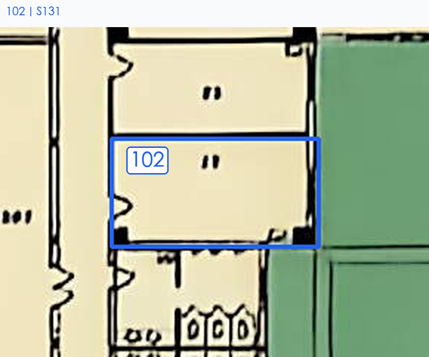

[查看同范围无标记原图](../../临时核对/21-25_名称核对_20261105/23_西安经开医院/局部_27_无标记原图.png)

| 核对号 | S编号  | 预估名称（可改） | 备选名称   | 依据与把握                                            | 我的确认／备注 | 核对号（重复） |
| --- | ---- | -------- | ------ | ------------------------------------------------ | ------- | ------- |
| 102 | S131 | 办公       | 药房支持用房 | 各候选共用依据：院落西侧小间，门向西；现有证据不能可靠区分。 把握：低（旧稿预估，待本轮核对）。 | 主任      | 102     |

### 103—108｜S141、S142、S143、S144、S146、S148

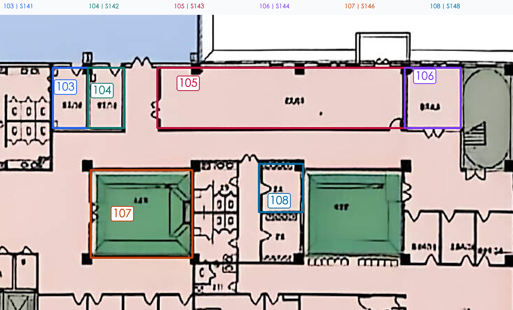

[查看同范围无标记原图](../../临时核对/21-25_名称核对_20261105/23_西安经开医院/局部_28_无标记原图.png)

| 核对号 | S编号  | 预估名称（可改） | 备选名称   | 依据与把握                                                  | 我的确认／备注 | 核对号（重复） |
| --- | ---- | -------- | ------ | ------------------------------------------------------ | ------- | ------- |
| 103 | S141 | 办公       | 诊疗支持用房 | 各候选共用依据：北侧两间小房间，门朝外侧；现有证据不能可靠区分。 把握：低（旧稿预估，待本轮核对）。     | 便民门诊    | 103     |
| 104 | S142 | 办公       | 诊疗支持用房 | 各候选共用依据：北侧两间小房间，门朝外侧；现有证据不能可靠区分。 把握：低（旧稿预估，待本轮核对）。     | 便民门诊    | 104     |
| 105 | S143 | 治疗室      | 诊疗工作区  | 各候选共用依据：北侧长条大房间，西侧和东南侧有门；现有证据不能可靠区分。 把握：低（旧稿预估，待本轮核对）。 | 便民超市    | 105     |
| 106 | S144 | 诊疗支持用房   | 办公     | 各候选共用依据：东端楼梯旁小间；现有证据不能可靠区分。 把握：低（旧稿预估，待本轮核对）。          | 新风机房    | 106     |
| 107 | S146 | 露天采光庭院   | 室内中庭   | 各候选共用依据：绿色矩形，内部斜边框，开敞性不清；现有证据不能可靠区分。 把握：中（旧稿预估，待本轮核对）。 | 内庭院     | 107     |
| 108 | S148 | 辅助用房     | 器械／储物间 | 各候选共用依据：卫生间东侧两间小房间的上间；现有证据不能可靠区分。 把握：低（旧稿预估，待本轮核对）。    | 更衣      | 108     |

### 109—113｜S150、S149、S151、S152、S153

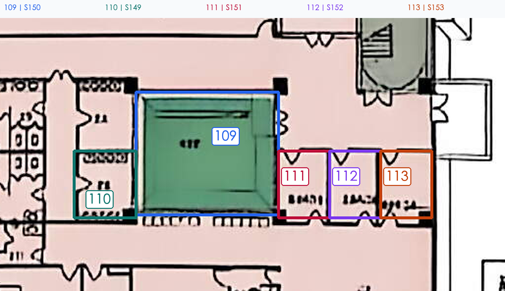

[查看同范围无标记原图](../../临时核对/21-25_名称核对_20261105/23_西安经开医院/局部_29_无标记原图.png)

| 核对号 | S编号  | 预估名称（可改） | 备选名称   | 依据与把握                                                | 我的确认／备注 | 核对号（重复） |
| --- | ---- | -------- | ------ | ---------------------------------------------------- | ------- | ------- |
| 109 | S150 | 露天采光庭院   | 室内中庭   | 各候选共用依据：绿色矩形，是否露天尚未确定；现有证据不能可靠区分。 把握：中（旧稿预估，待本轮核对）。  | 内庭院     | 109     |
| 110 | S149 | 辅助用房     | 器械／储物间 | 各候选共用依据：卫生间东侧两间小房间的下间；现有证据不能可靠区分。 把握：低（旧稿预估，待本轮核对）。  | 更衣      | 110     |
| 111 | S151 | 诊疗支持用房   | 办公     | 各候选共用依据：东侧连续三小间，门朝上下通道；现有证据不能可靠区分。 把握：低（旧稿预估，待本轮核对）。 | 诊室      | 111     |
| 112 | S152 | 诊疗支持用房   | 办公     | 各候选共用依据：东侧连续三小间，门朝上下通道；现有证据不能可靠区分。 把握：低（旧稿预估，待本轮核对）。 | 诊室      | 112     |
| 113 | S153 | 诊疗支持用房   | 办公     | 各候选共用依据：东侧连续三小间，门朝上下通道；现有证据不能可靠区分。 把握：低（旧稿预估，待本轮核对）。 | 诊室      | 113     |

### 114—119｜S154、S155、S158、S159、S160、S161

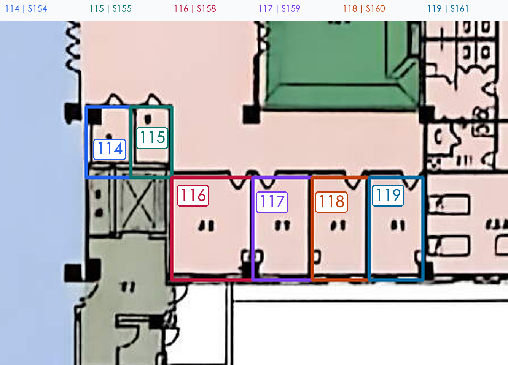

[查看同范围无标记原图](../../临时核对/21-25_名称核对_20261105/23_西安经开医院/局部_30_无标记原图.png)

| 核对号 | S编号  | 预估名称（可改） | 备选名称   | 依据与把握                                          | 我的确认／备注 | 核对号（重复） |
| --- | ---- | -------- | ------ | ---------------------------------------------- | ------- | ------- |
| 114 | S154 | 设备小间     | 辅助用房   | 各候选共用依据：电梯上方小间；现有证据不能可靠区分。 把握：低（旧稿预估，待本轮核对）。   | 管井      | 114     |
| 115 | S155 | 设备小间     | 辅助用房   | 各候选共用依据：电梯上方小间；现有证据不能可靠区分。 把握：低（旧稿预估，待本轮核对）。   | 管井      | 115     |
| 116 | S158 | 诊室       | 诊疗支持用房 | 各候选共用依据：南侧连续独立小间；现有证据不能可靠区分。 把握：中（旧稿预估，待本轮核对）。 | 诊室      | 116     |
| 117 | S159 | 诊室       | 诊疗支持用房 | 各候选共用依据：南侧连续独立小间；现有证据不能可靠区分。 把握：中（旧稿预估，待本轮核对）。 | 诊室      | 117     |
| 118 | S160 | 诊室       | 诊疗支持用房 | 各候选共用依据：南侧连续独立小间；现有证据不能可靠区分。 把握：中（旧稿预估，待本轮核对）。 | 诊室      | 118     |
| 119 | S161 | 诊室       | 诊疗支持用房 | 各候选共用依据：南侧连续独立小间；现有证据不能可靠区分。 把握：中（旧稿预估，待本轮核对）。 | 诊室      | 119     |

### 120—123｜S162、S163、S164、S165

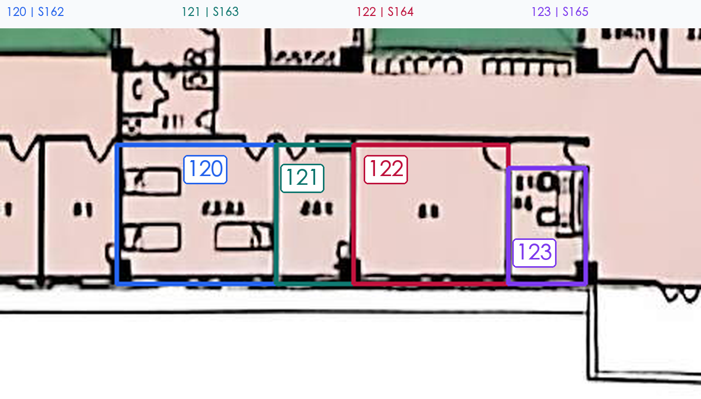

[查看同范围无标记原图](../../临时核对/21-25_名称核对_20261105/23_西安经开医院/局部_31_无标记原图.png)

| 核对号 | S编号  | 预估名称（可改） | 备选名称   | 依据与把握                                               | 我的确认／备注 | 核对号（重复） |
| --- | ---- | -------- | ------ | --------------------------------------------------- | ------- | ------- |
| 120 | S162 | 治疗室      | 观察室    | 各候选共用依据：可见三张床／治疗台；现有证据不能可靠区分。 把握：中（旧稿预估，待本轮核对）。     | 观察室     | 120     |
| 121 | S163 | 诊疗支持用房   | 办公     | 各候选共用依据：床区东侧小间；现有证据不能可靠区分。 把握：低（旧稿预估，待本轮核对）。        | 检验      | 121     |
| 122 | S164 | 诊室       | 治疗室    | 各候选共用依据：南侧中等房间，门在北侧；现有证据不能可靠区分。 把握：低（旧稿预估，待本轮核对）。   | 药库      | 122     |
| 123 | S165 | 服务工作区    | 诊疗支持用房 | 各候选共用依据：东侧通道旁，可见桌椅／器具；现有证据不能可靠区分。 把握：低（旧稿预估，待本轮核对）。 | 挂号取药    | 123     |

### 124—126｜S167、S169、S170

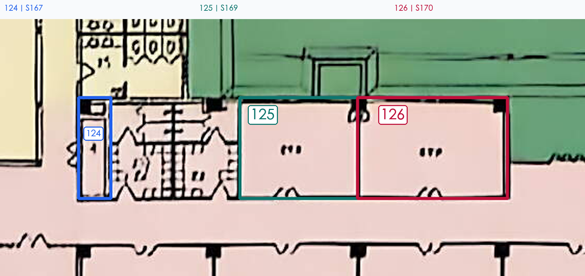

[查看同范围无标记原图](../../临时核对/21-25_名称核对_20261105/23_西安经开医院/局部_32_无标记原图.png)

| 核对号 | S编号  | 预估名称（可改） | 备选名称     | 依据与把握                                           | 我的确认／备注 | 核对号（重复） |
| --- | ---- | -------- | -------- | ----------------------------------------------- | ------- | ------- |
| 124 | S167 | 设备小间     | 辅助用房     | 各候选共用依据：卫生间西侧狭长小间；现有证据不能可靠区分。 把握：低（旧稿预估，待本轮核对）。 | 管井      | 124     |
| 125 | S169 | 诊室       | 老年门诊支持用房 | 各候选共用依据：北侧两个较大房间；现有证据不能可靠区分。 把握：中（旧稿预估，待本轮核对）。  | 诊室      | 125     |
| 126 | S170 | 诊室       | 老年门诊支持用房 | 各候选共用依据：北侧两个较大房间；现有证据不能可靠区分。 把握：中（旧稿预估，待本轮核对）。  | 诊室      | 126     |

### 127—128｜S171、S172

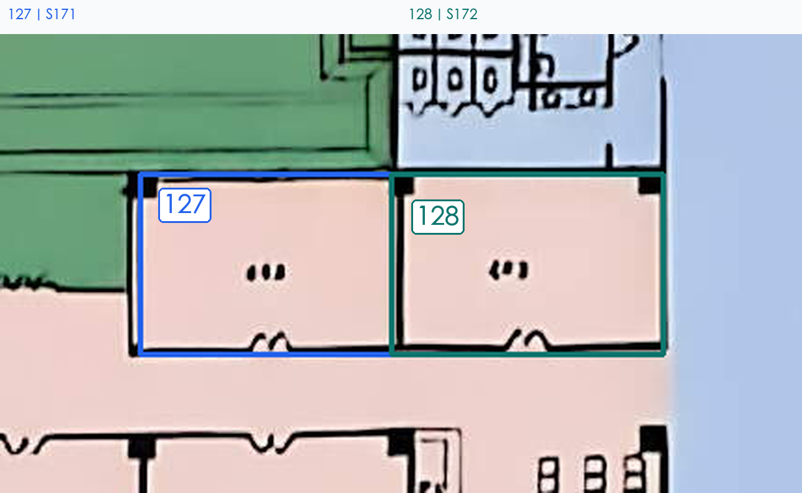

[查看同范围无标记原图](../../临时核对/21-25_名称核对_20261105/23_西安经开医院/局部_33_无标记原图.png)

| 核对号 | S编号  | 预估名称（可改） | 备选名称     | 依据与把握                                           | 我的确认／备注 | 核对号（重复） |
| --- | ---- | -------- | -------- | ----------------------------------------------- | ------- | ------- |
| 127 | S171 | 诊室       | 老年门诊支持用房 | 各候选共用依据：院落东南侧两个房间；现有证据不能可靠区分。 把握：中（旧稿预估，待本轮核对）。 | 诊室      | 127     |
| 128 | S172 | 诊室       | 老年门诊支持用房 | 各候选共用依据：院落东南侧两个房间；现有证据不能可靠区分。 把握：中（旧稿预估，待本轮核对）。 | 诊室      | 128     |

### 129—133｜S173、S174、S175、S176、S177

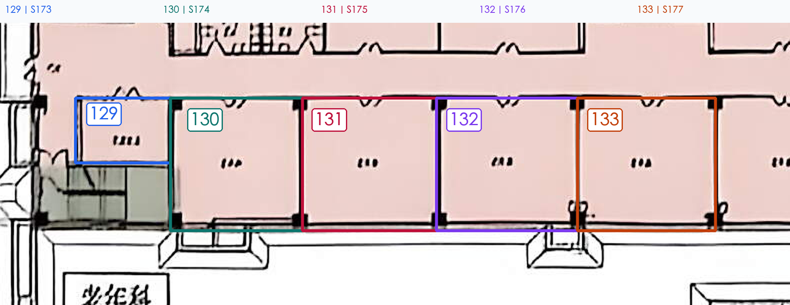

[查看同范围无标记原图](../../临时核对/21-25_名称核对_20261105/23_西安经开医院/局部_34_无标记原图.png)

| 核对号 | S编号  | 预估名称（可改） | 备选名称 | 依据与把握                                                      | 我的确认／备注 | 核对号（重复） |
| --- | ---- | -------- | ---- | ---------------------------------------------------------- | ------- | ------- |
| 129 | S173 | 诊室       | 辅助用房 | 各候选共用依据：西端小间，北侧有门；现有证据不能可靠区分。 把握：低（旧稿预估，待本轮核对）。            | 空调机房    | 129     |
| 130 | S174 | 诊室       | 治疗室  | 各候选共用依据：南排房间较大，朝北开门，部分相邻内门可见；现有证据不能可靠区分。 把握：中（旧稿预估，待本轮核对）。 | 诊室      | 130     |
| 131 | S175 | 诊室       | 治疗室  | 各候选共用依据：南排房间较大，朝北开门，部分相邻内门可见；现有证据不能可靠区分。 把握：中（旧稿预估，待本轮核对）。 | 诊室      | 131     |
| 132 | S176 | 诊室       | 治疗室  | 各候选共用依据：南排房间较大，朝北开门，部分相邻内门可见；现有证据不能可靠区分。 把握：中（旧稿预估，待本轮核对）。 | 诊室      | 132     |
| 133 | S177 | 诊室       | 治疗室  | 各候选共用依据：南排房间较大，朝北开门，部分相邻内门可见；现有证据不能可靠区分。 把握：中（旧稿预估，待本轮核对）。 | 诊室      | 133     |

### 134｜S178

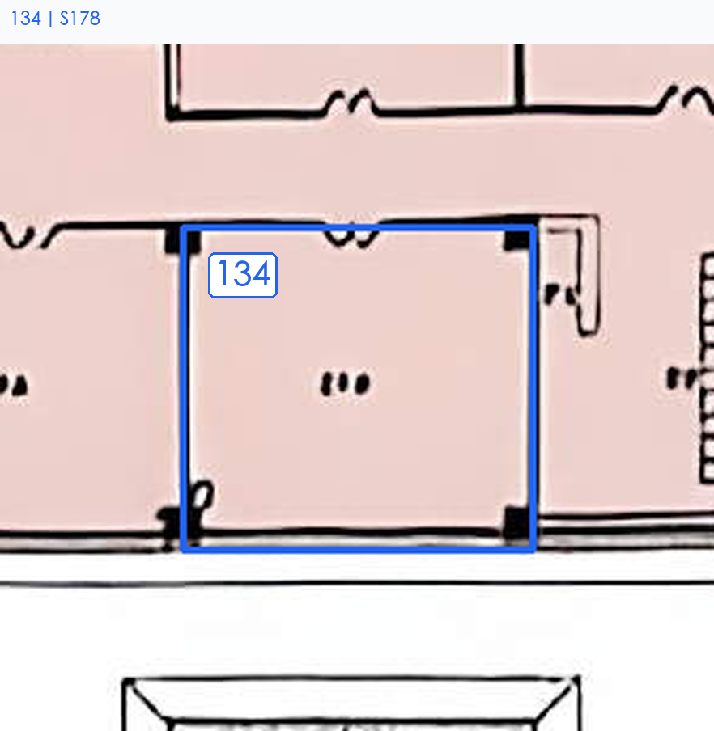

[查看同范围无标记原图](../../临时核对/21-25_名称核对_20261105/23_西安经开医院/局部_35_无标记原图.png)

| 核对号 | S编号  | 预估名称（可改） | 备选名称 | 依据与把握                                                      | 我的确认／备注 | 核对号（重复） |
| --- | ---- | -------- | ---- | ---------------------------------------------------------- | ------- | ------- |
| 134 | S178 | 诊室       | 治疗室  | 各候选共用依据：南排房间较大，朝北开门，部分相邻内门可见；现有证据不能可靠区分。 把握：中（旧稿预估，待本轮核对）。 | 诊室      | 134     |

### 135—140｜S182、S183、S184、S185、S186、S187

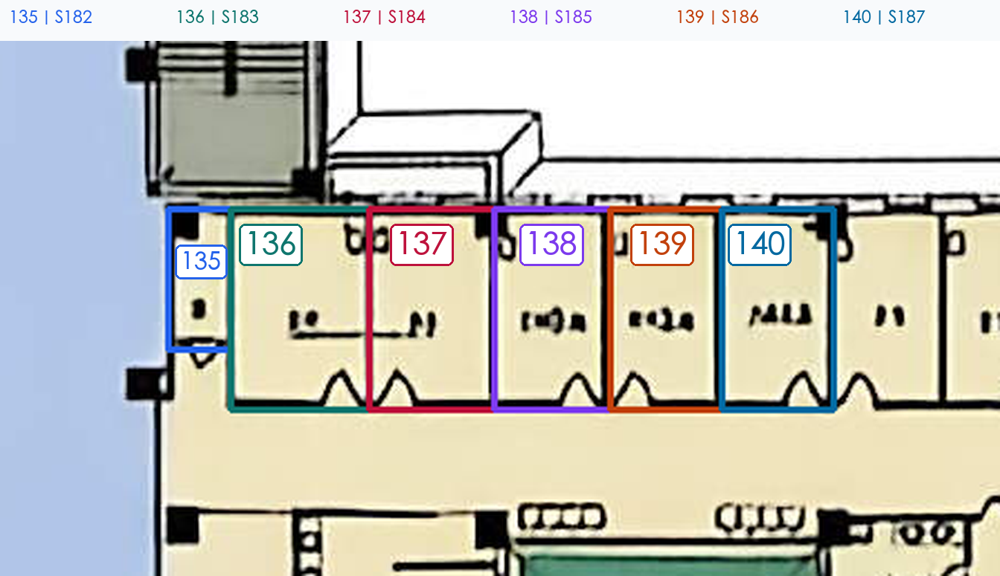

[查看同范围无标记原图](../../临时核对/21-25_名称核对_20261105/23_西安经开医院/局部_36_无标记原图.png)

| 核对号 | S编号  | 预估名称（可改） | 备选名称 | 依据与把握                                                 | 我的确认／备注 | 核对号（重复） |
| --- | ---- | -------- | ---- | ----------------------------------------------------- | ------- | ------- |
| 135 | S182 | 设备小间     | 储物间  | 各候选共用依据：北排西端狭小分隔；现有证据不能可靠区分。 把握：低（旧稿预估，待本轮核对）。        | 管井      | 135     |
| 136 | S183 | 体检诊室     | 检查室  | 各候选共用依据：沿北外墙连续小间，部分内门可见；现有证据不能可靠区分。 把握：中（旧稿预估，待本轮核对）。 | 妇科诊室    | 136     |
| 137 | S184 | 体检诊室     | 检查室  | 各候选共用依据：沿北外墙连续小间，部分内门可见；现有证据不能可靠区分。 把握：中（旧稿预估，待本轮核对）。 | 妇科诊室    | 137     |
| 138 | S185 | 体检诊室     | 检查室  | 各候选共用依据：沿北外墙连续小间，部分内门可见；现有证据不能可靠区分。 把握：中（旧稿预估，待本轮核对）。 | 妇科B超    | 138     |
| 139 | S186 | 体检诊室     | 检查室  | 各候选共用依据：沿北外墙连续小间，部分内门可见；现有证据不能可靠区分。 把握：中（旧稿预估，待本轮核对）。 | 妇科B超    | 139     |
| 140 | S187 | 体检诊室     | 检查室  | 各候选共用依据：沿北外墙连续小间，部分内门可见；现有证据不能可靠区分。 把握：中（旧稿预估，待本轮核对）。 | 妇科乳腺    | 140     |

### 141—146｜S188、S189、S190、S191、S192、S193

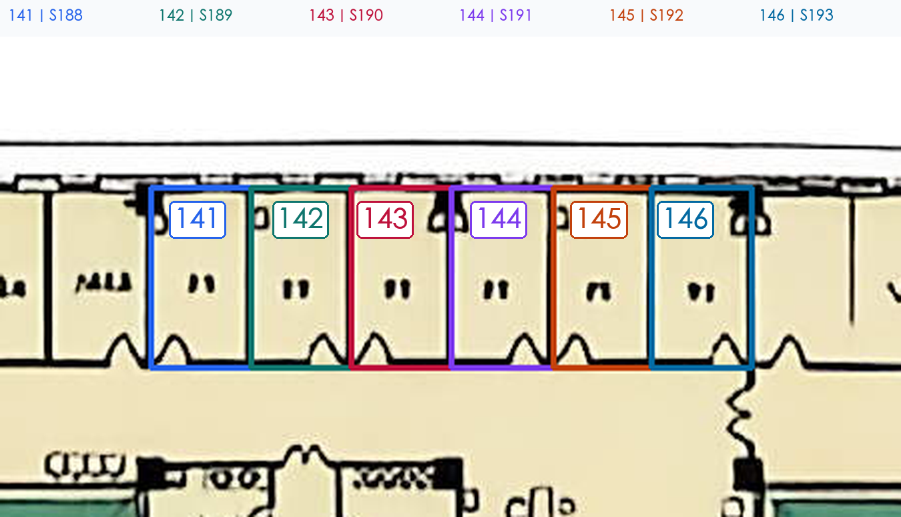

[查看同范围无标记原图](../../临时核对/21-25_名称核对_20261105/23_西安经开医院/局部_37_无标记原图.png)

| 核对号 | S编号  | 预估名称（可改） | 备选名称 | 依据与把握                                                 | 我的确认／备注  | 核对号（重复） |
| --- | ---- | -------- | ---- | ----------------------------------------------------- | -------- | ------- |
| 141 | S188 | 体检诊室     | 检查室  | 各候选共用依据：沿北外墙连续小间，部分内门可见；现有证据不能可靠区分。 把握：中（旧稿预估，待本轮核对）。 | 诊室       | 141     |
| 142 | S189 | 体检诊室     | 检查室  | 各候选共用依据：沿北外墙连续小间，部分内门可见；现有证据不能可靠区分。 把握：中（旧稿预估，待本轮核对）。 | 诊室       | 142     |
| 143 | S190 | 体检诊室     | 检查室  | 各候选共用依据：沿北外墙连续小间，部分内门可见；现有证据不能可靠区分。 把握：中（旧稿预估，待本轮核对）。 | 诊室       | 143     |
| 144 | S191 | 体检诊室     | 检查室  | 各候选共用依据：沿北外墙连续小间，部分内门可见；现有证据不能可靠区分。 把握：中（旧稿预估，待本轮核对）。 | 诊室       | 144     |
| 145 | S192 | 体检诊室     | 检查室  | 各候选共用依据：沿北外墙连续小间，部分内门可见；现有证据不能可靠区分。 把握：中（旧稿预估，待本轮核对）。 | 诊室       | 145     |
| 146 | S193 | 体检诊室     | 检查室  | 各候选共用依据：沿北外墙连续小间，部分内门可见；现有证据不能可靠区分。 把握：中（旧稿预估，待本轮核对）。 | 诊室  | 146     |

### 147—152｜S194、S197、S199、S201、S202、S200

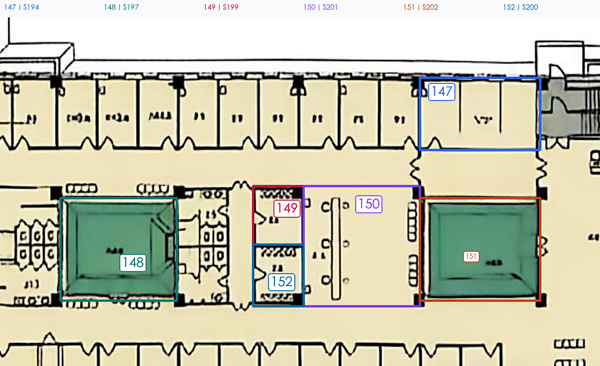

[查看同范围无标记原图](../../临时核对/21-25_名称核对_20261105/23_西安经开医院/局部_38_无标记原图.png)

| 核对号 | S编号  | 预估名称（可改） | 备选名称   | 依据与把握                                                   | 我的确认／备注 | 核对号（重复） |
| --- | ---- | -------- | ------ | ------------------------------------------------------- | ------- | ------- |
| 147 | S194 | 检查室      | 体检工作区  | 各候选共用依据：东端较宽房间，内部细线不作为隔墙；现有证据不能可靠区分。 把握：中（旧稿预估，待本轮核对）。  | VIP室    | 147     |
| 148 | S197 | 露天采光庭院   | 室内中庭   | 各候选共用依据：绿色矩形，内部斜边框；开敞性未确定；现有证据不能可靠区分。 把握：中（旧稿预估，待本轮核对）。 | 内庭院     | 148     |
| 149 | S199 | 辅助用房     | 器械／储物间 | 各候选共用依据：卫生间东侧上间，内有台面／器具；现有证据不能可靠区分。 把握：低（旧稿预估，待本轮核对）。   | 更衣      | 149     |
| 150 | S201 | 服务／分诊工作区 | 体检工作区  | 各候选共用依据：中央长台及座椅，两侧连续开放；现有证据不能可靠区分。 把握：中（旧稿预估，待本轮核对）。    | 采血      | 150     |
| 151 | S202 | 露天采光庭院   | 室内中庭   | 各候选共用依据：绿色矩形，东侧边界有门形开口；现有证据不能可靠区分。 把握：中（旧稿预估，待本轮核对）。    | 内庭院     | 151     |
| 152 | S200 | 辅助用房     | 器械／储物间 | 各候选共用依据：卫生间东侧下间，内有台面／器具；现有证据不能可靠区分。 把握：低（旧稿预估，待本轮核对）。   | 更衣      | 152     |

### 153—158｜S203、S204、S205、S206、S207、S208

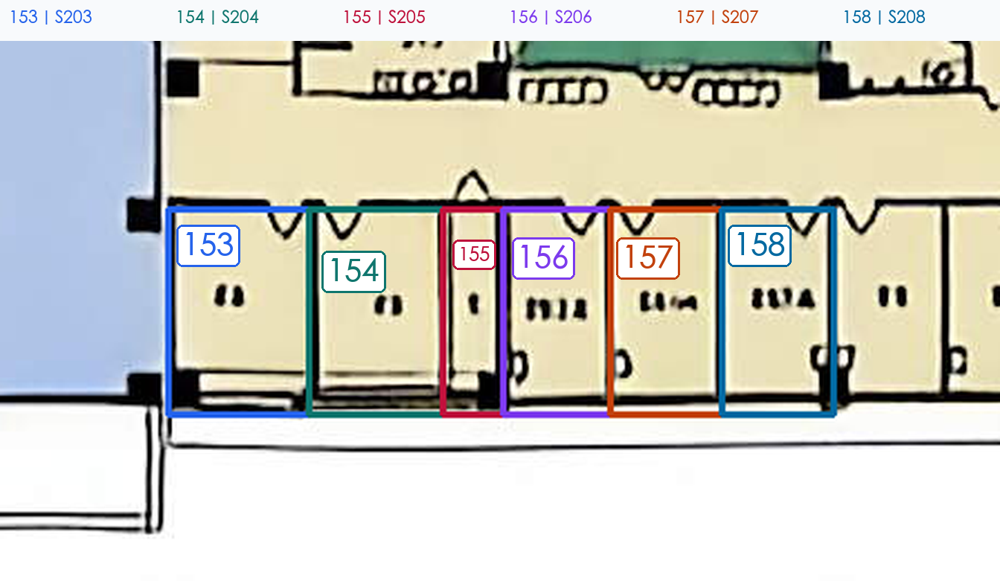

[查看同范围无标记原图](../../临时核对/21-25_名称核对_20261105/23_西安经开医院/局部_39_无标记原图.png)

| 核对号 | S编号  | 预估名称（可改） | 备选名称 | 依据与把握                                               | 我的确认／备注 | 核对号（重复） |
| --- | ---- | -------- | ---- | --------------------------------------------------- | ------- | ------- |
| 153 | S203 | 体检诊室     | 检查室  | 各候选共用依据：南排连续小间，门朝北侧；现有证据不能可靠区分。 把握：中（旧稿预估，待本轮核对）。   | 库房      | 153     |
| 154 | S204 | 体检诊室     | 检查室  | 各候选共用依据：南排连续小间，门朝北侧；现有证据不能可靠区分。 把握：中（旧稿预估，待本轮核对）。   | 库房      | 154     |
| 155 | S205 | 设备小间     | 辅助用房 | 各候选共用依据：南排狭长分隔；现有证据不能可靠区分。 把握：低（旧稿预估，待本轮核对）。        | 管井      | 155     |
| 156 | S206 | 体检诊室     | 检查室  | 各候选共用依据：南排连续房间，部分内门可见；现有证据不能可靠区分。 把握：中（旧稿预估，待本轮核对）。 | 男性B超    | 156     |
| 157 | S207 | 体检诊室     | 检查室  | 各候选共用依据：南排连续房间，部分内门可见；现有证据不能可靠区分。 把握：中（旧稿预估，待本轮核对）。 | 男性心电    | 157     |
| 158 | S208 | 体检诊室     | 检查室  | 各候选共用依据：南排连续房间，部分内门可见；现有证据不能可靠区分。 把握：中（旧稿预估，待本轮核对）。 | 男性B超    | 158     |

### 159—164｜S209、S210、S211、S212、S213、S214

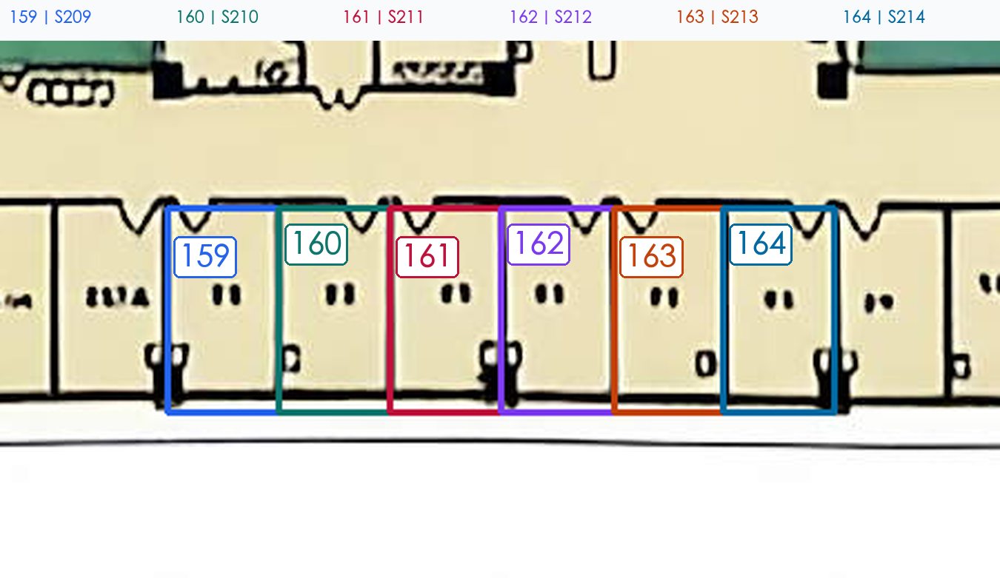

[查看同范围无标记原图](../../临时核对/21-25_名称核对_20261105/23_西安经开医院/局部_40_无标记原图.png)

| 核对号 | S编号  | 预估名称（可改） | 备选名称 | 依据与把握                                               | 我的确认／备注 | 核对号（重复） |
| --- | ---- | -------- | ---- | --------------------------------------------------- | ------- | ------- |
| 159 | S209 | 体检诊室     | 检查室  | 各候选共用依据：南排连续房间，部分内门可见；现有证据不能可靠区分。 把握：中（旧稿预估，待本轮核对）。 | 诊室      | 159     |
| 160 | S210 | 体检诊室     | 检查室  | 各候选共用依据：南排连续房间，部分内门可见；现有证据不能可靠区分。 把握：中（旧稿预估，待本轮核对）。 | 诊室      | 160     |
| 161 | S211 | 体检诊室     | 检查室  | 各候选共用依据：南排连续房间，部分内门可见；现有证据不能可靠区分。 把握：中（旧稿预估，待本轮核对）。 | 诊室      | 161     |
| 162 | S212 | 体检诊室     | 检查室  | 各候选共用依据：南排连续房间，部分内门可见；现有证据不能可靠区分。 把握：中（旧稿预估，待本轮核对）。 | 诊室      | 162     |
| 163 | S213 | 体检诊室     | 检查室  | 各候选共用依据：南排连续房间，部分内门可见；现有证据不能可靠区分。 把握：中（旧稿预估，待本轮核对）。 | 诊室      | 163     |
| 164 | S214 | 体检诊室     | 检查室  | 各候选共用依据：南排连续房间，部分内门可见；现有证据不能可靠区分。 把握：中（旧稿预估，待本轮核对）。 | 诊室      | 164     |

### 165—166｜S215、S216

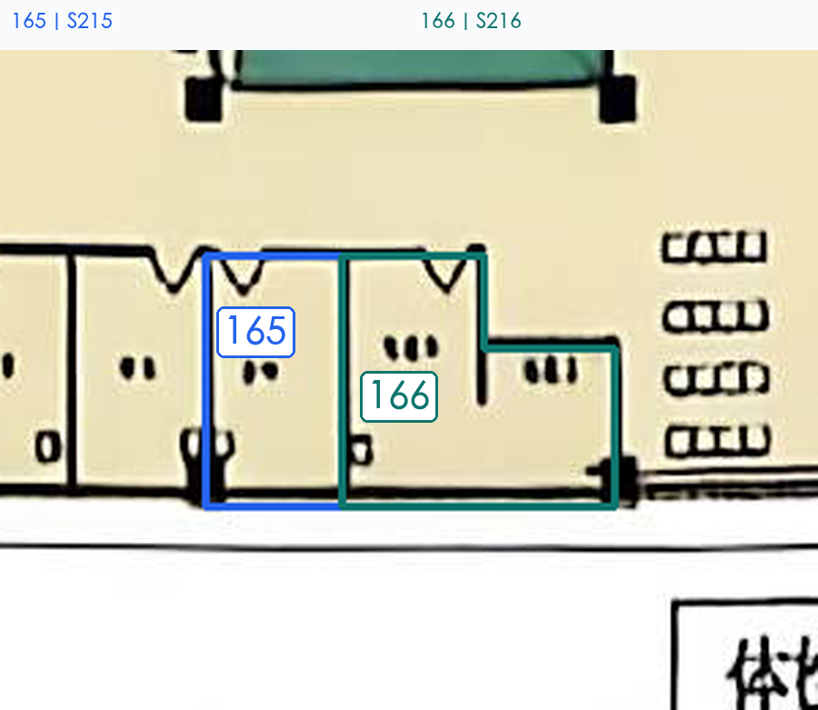

[查看同范围无标记原图](../../临时核对/21-25_名称核对_20261105/23_西安经开医院/局部_41_无标记原图.png)

| 核对号 | S编号  | 预估名称（可改） | 备选名称 | 依据与把握                                                   | 我的确认／备注 | 核对号（重复） |
| --- | ---- | -------- | ---- | ------------------------------------------------------- | ------- | ------- |
| 165 | S215 | 体检诊室     | 检查室  | 各候选共用依据：南排连续房间，部分内门可见；现有证据不能可靠区分。 把握：中（旧稿预估，待本轮核对）。     | 办公      | 165     |
| 166 | S216 | 体检诊室     | 辅助用房 | 各候选共用依据：东南端折形房间，内部是否另分间不清；现有证据不能可靠区分。 把握：低（旧稿预估，待本轮核对）。 | 调钡室     | 166     |

