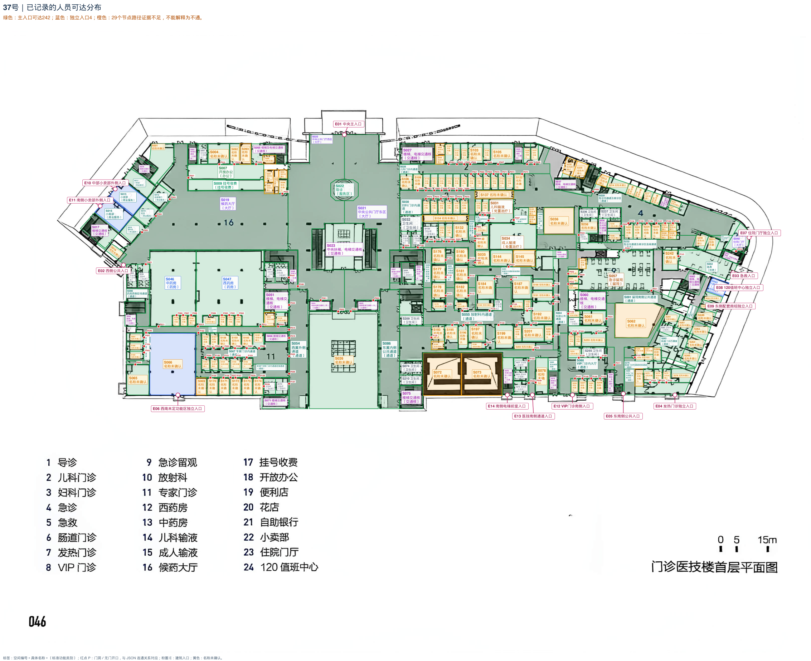
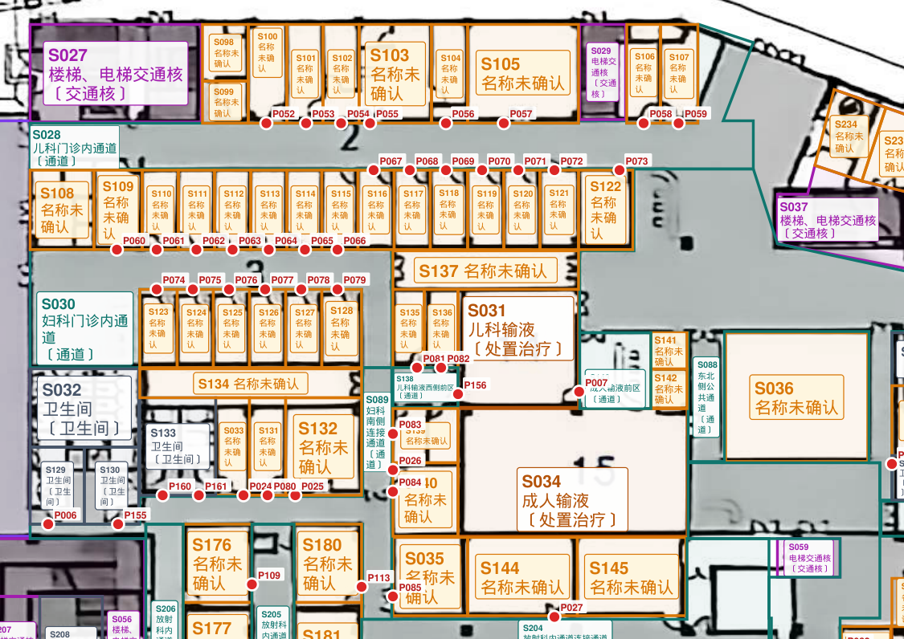
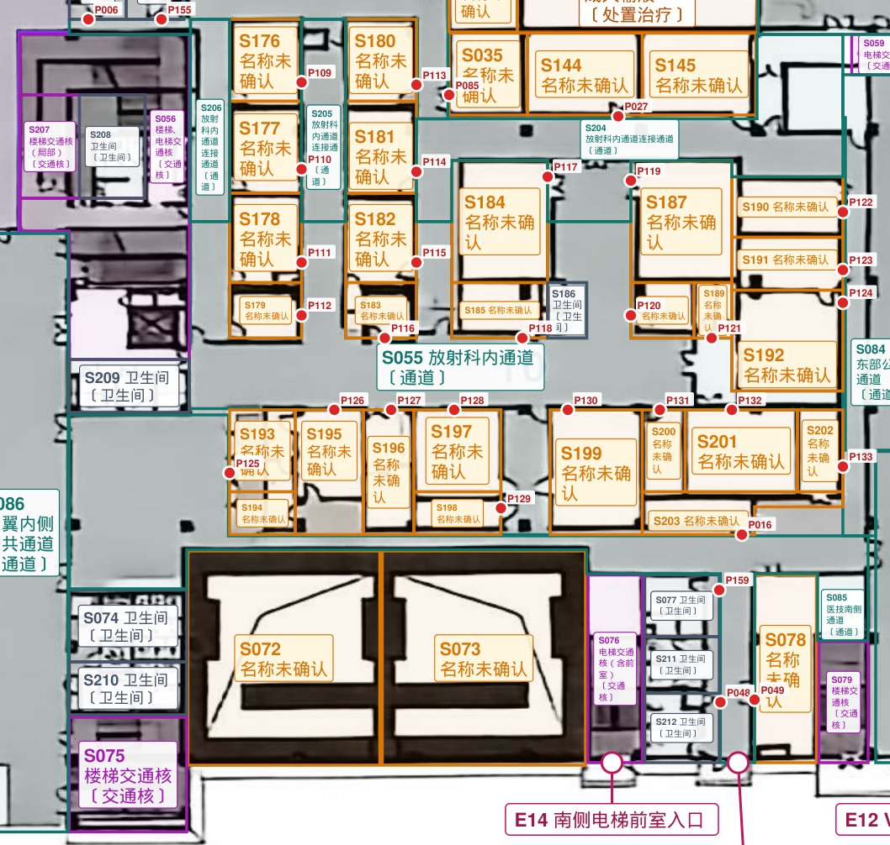
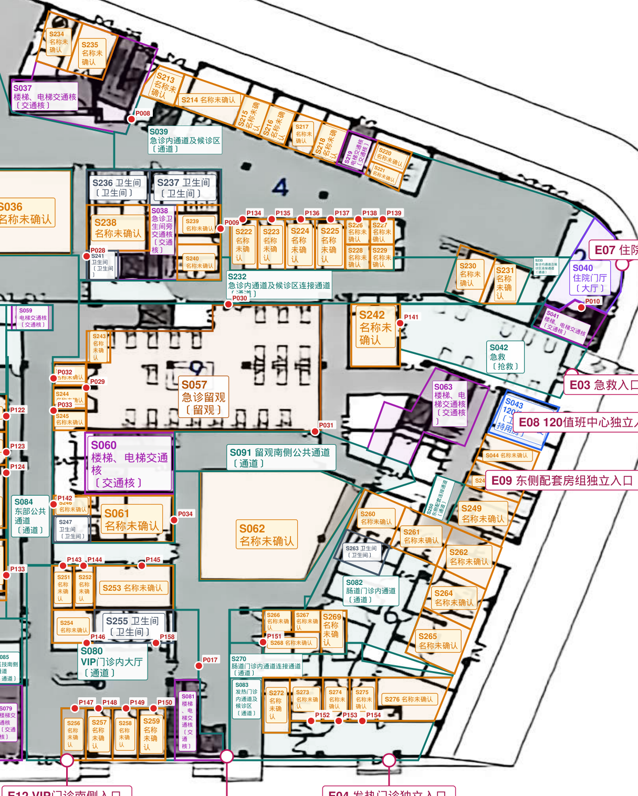

# 37号｜逐空间粗轮廓与连通分析

**状态：**本轮完成版，采用“逐空间粗轮廓＋主要连通”的约定口径。按当前证据收尾，无须等待新增证据；房名缺失及无可靠入口的范围继续保留未知，不视为漏标或确认不通。

**规模：**275个单元；265条access、3条service、5条shared_wall、14处入口；161个门洞定位对应157条access，另108条为无定位概念连接。

[原图](37_广州中医药大学紫合梅州医院_原图.jpg) · [当前标注图](标注.svg)

**可达性：**主入口经现有access可达242个节点，计入各独立外门后共246个；另29个节点缺少可证实的入口路径。后者不表示不相通，也不作负样本。

绿色表示主入口可达，蓝色表示独立外门，橙色表示路径证据不足；颜色不代表门禁权限。

## 主要通行组织

- 西侧：中央门厅S020 ↔ 西翼通道S054 ↔ 药房后场S053；后场分别进入中药房S046、西药房S047，并经门进入专家门诊内通道S067。
- 妇儿：门厅S021 → 妇科通道S030 → 南侧通道S089 → 输液前区S138 → 儿科输液S031 → 成人输液前区S143 → 成人输液S034；儿科通道S028经S088连接急诊。
- 医技：门厅S021 → 东翼通道S086 → 医技通道S085；放射科内通道S055同时接南侧通道S085与东部通道S084。
- 急诊：S088 → 急诊通道S039/S232 → 急救S042、留观S057、住院门厅S040；留观南通道S091接东侧公共带S250。
- 东南：东部通道S084分别连接VIP大厅S080、肠道门诊通道S082及发热门诊通道S083；内部前区按实际组织分段连接。

## 本轮校正

- 补齐S138—S089、S138—S031、S143—S034，以及放射科内外通道等拆分后遗漏的关系。
- 卫生间及交通核分别按可辨门口、共用前区和布局组织补连；共墙、柜台服务不当作人员门。
- P006移至实际南向门并改接S089；撤回西侧墙上的误点P140，该组实际入口保留P028。新P号从P155续编，不复用P140。
- S097、S134、S137无贯通证据，恢复unknown，不再用“通道”名称暗示可穿行；S207按图面纠正为交通核局部。

## 独立入口与信息缺失

S066保留独立外门E06；S043保留120值班入口E08；S013、S015分别保留商铺外门E10、E11。未通过室外总节点把这些空间强行连进主楼网络。

原K01：S066内部是否另接专家门诊仍未知，但独立入口明确，本轮无需必答。原K02：S072/S073厚边界单元性质及入口信息缺失，保留unknown和轮廓，不编造门或连接。原题号及处理依据保存在外部记录。

**未记录入口路径的29个单元：**S006、S008、S036、S052、S062、S069、S072、S073、S093、S094、S095、S097、S098、S099、S134、S137、S141、S142、S145、S194、S213、S228、S229、S234、S235、S243、S266、S267、S272。

**功能缺失：**175个单元保持unknown；房名不可读不等于漏标，不要求逐项猜名。S026、S036、S062等范围的庭院/室内性质若有新证据再更新；确定庭院/挑空后统一不计面积。

[原名称填写与连通问题存档](../../临时核对/37_广州中医药大学紫合梅州医院/20261107_连通分析前备份_134616/标注说明.md) · [可放大的连通分布图](../../临时核对/37_广州中医药大学紫合梅州医院/连通分析_可达分布.svg)
