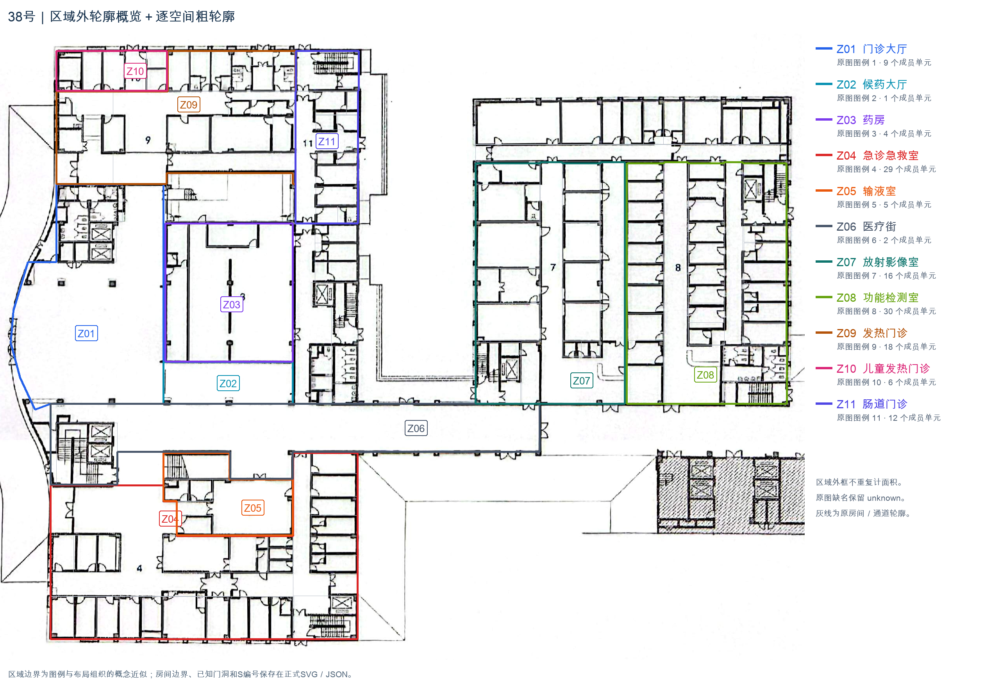
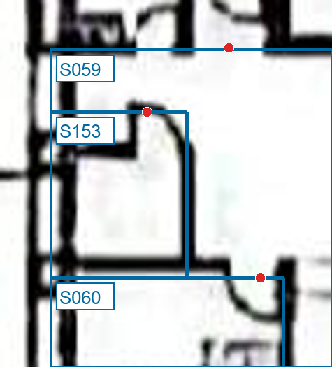
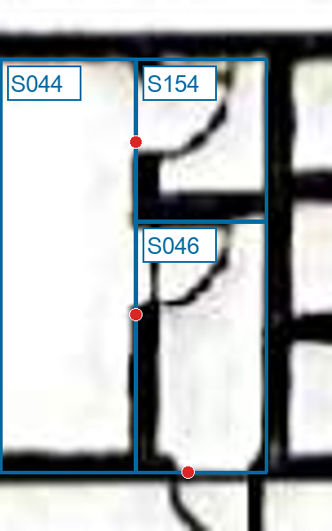

# 38号梅州市蕉岭县中医医院｜区域级粗轮廓与主要连通

<!-- annotation:summary:start -->
**状态：**区域级粗轮廓：本轮完成。原图缺失具体房名118项，保留unknown，不要求逐项补名。

**规模：**153个空间，168条关系，149个门洞／开口。

[原图](38_梅州市蕉岭县中医医院_原图.jpg) · [标注图](标注.svg)
<!-- annotation:summary:end -->

**区域概览：**11个图例区域保留粗外轮廓，内部可辨空间逐个保留S编号；区域叠加不重复计面积。118个单元具体房名缺失，继续保留unknown，无需逐项猜名。

[打开概览原尺寸](../../临时核对/38_梅州市蕉岭县中医医院/20261107_区域粗轮廓补充/区域轮廓概览.png)

## 本轮补充

- 新增S153：感染门诊公共通道旁的独立围合小间，从S059中扣出；原图用途未标。
- 新增S154：急诊中央S046中的独立小间，按可见隔墙拆出，S046保留较大原单元；两间均保留unknown。
- 新增3条可达关系及P147—P149三处可见门洞；儿童发热片区的内部单元按图例10校正所属范围。
- 其余S/R/P/E编号沿用。原S023、R025、E10退役号不复用；旧核对号01—116保留，新增单元续117、118。

## 主要连通与信息缺失

- 门诊大厅S001、候药大厅S010和医疗街S002衔接；急诊、输液经各自公共通道接入医疗街。
- 放射影像公共通道S103、功能检测公共通道S126分别接医技横向通道S100；内部房间按实际可辨门洞连接。
- 发热入口按S078→S077→S081→S065记录；儿童发热与肠道门诊保持各自入口及公共区。
- 原K01：S038小门方向未画清，保留面向医疗街S002的概念联系R015，记为布局推断而非用户确认；S002与输液S039已有清晰连接，精确楼梯门向不改变本轮主要交通组织，不再必答。原K02已按可见侧门解决。
- 主入口经现有access可达151个单元，计入各独立外门后可达151个。其余2个单元入口证据不足，保留未知，不表示不通，也不作负例。

区域边界为概念近似，不能当作实测科室面积。医技外缘及公共配套中归属未明的单元保留现有scope，未强行归入图例科室；完整房名语义仍缺失，未来模型补名需另行检验。
