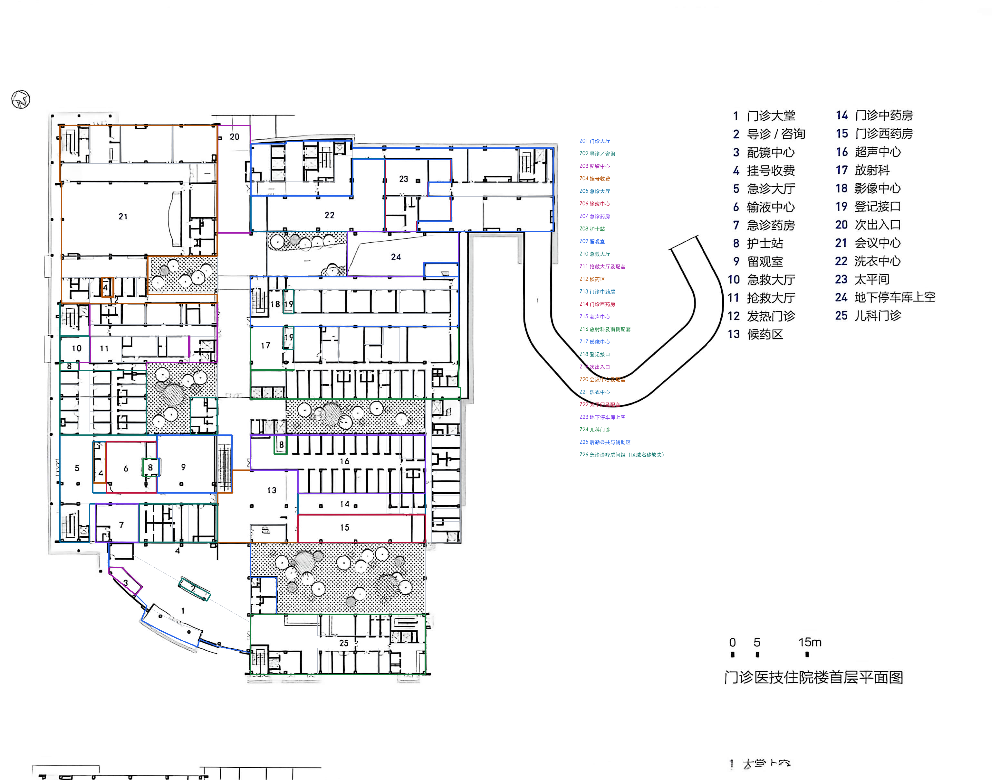

# 39_梅州市蕉岭县人民医院｜区域级粗轮廓标注

<!-- annotation:summary:start -->
**状态：**区域级粗轮廓：本轮完成。原图缺失具体房名114项，保留unknown，不要求逐项补名。

**规模：**181个空间，195条关系，181个门洞／开口。

[原图](39_梅州市蕉岭县人民医院_原图.jpg) · [标注图](标注.svg)
<!-- annotation:summary:end -->

**范围：**26个区域外轮廓，内部可辨围合逐个保留S编号；本轮由107个空间细分为181个，新增编号续接。区域叠加不进入spaces，不重复计面积。

**连通：**177条人员可达，11条服务联系，7个入口；166条可达关系定位181个门洞／开口，另11条为无定位概念连接。服务窗口及共墙不自动作为通行。

**资料缺失：**114项专门房名继续保留unknown，`names_complete=false`；本轮完成口径是区域级粗轮廓，不能解释为全部房名已识别。旧名称候选、固定核对号和原填写均保存在本轮备份及review_state，无需逐项猜名。

[打开概览原尺寸](../../临时核对/39_梅州市蕉岭县人民医院/20261107_区域粗轮廓/区域轮廓概览.png)

已知区域标题保存在区域成员映射；拆出的无名小间不把整科室名称当成具体用途。交通核整体保留，家具、床位、柜台及厕位不拆成房间。已确定的庭院／绿化继续不计室内面积；用途未明的空白块不擅自认作庭院。

**仍保留未知：**

- 39号专门房名及部分辅助单元出入口未在资料中注明；保持unknown和空缺关系。
- 会议中心与次入口门厅的内部连通未明确；已知南门朝庭院，不宣称整院室内全连通。

原连通核对题已按本轮范围复核：辅助房门或内部捷径未画清时保留未知，不等同于已确认不相通；相应依据和原题保存在外部记录。未记录关系不能用作不连通负例。
