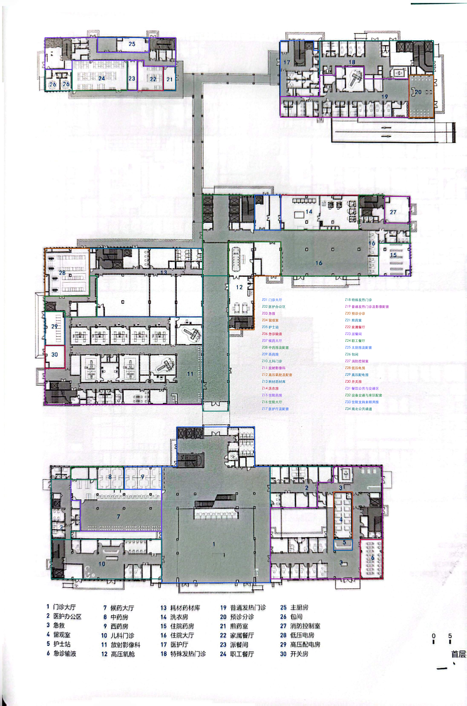

# 40_云浮市郁南县中医院｜区域级粗轮廓标注

<!-- annotation:summary:start -->
**状态：**区域级粗轮廓：本轮完成。原图缺失具体房名103项，保留unknown，不要求逐项补名。

**规模：**167个空间，187条关系，150个门洞／开口。

[原图](40_云浮市郁南县中医院_原图.jpg) · [标注图](标注.svg)
<!-- annotation:summary:end -->

**范围：**34个区域外轮廓，内部可辨围合逐个保留S编号；本轮由73个空间细分为167个，新增编号续接。区域叠加不进入spaces，不重复计面积。

**连通：**154条人员可达，2条服务联系，23个入口；137条可达关系定位150个门洞／开口，另17条为无定位概念连接。服务窗口及共墙不自动作为通行。

**资料缺失：**103项专门房名继续保留unknown，`names_complete=false`；本轮完成口径是区域级粗轮廓，不能解释为全部房名已识别。旧名称候选、固定核对号和原填写均保存在本轮备份及review_state，无需逐项猜名。

[打开概览原尺寸](../../临时核对/40_云浮市郁南县中医院/20261107_区域粗轮廓/区域轮廓概览.png)

已知区域标题保存在区域成员映射；拆出的无名小间不把整科室名称当成具体用途。交通核整体保留，家具、床位、柜台及厕位不拆成房间。已确定的庭院／绿化继续不计室内面积；用途未明的空白块不擅自认作庭院。

**仍保留未知：**

- 原图未给出各科室内部专门房名；S020、S057、S068、S069等用途仍无充分证据，未强制视为庭院。
- 住院药房人员入口、医护缓冲及S069内部路径保持未知；service与共墙均未转为access。

原连通核对题已按本轮范围复核：辅助房门或内部捷径未画清时保留未知，不等同于已确认不相通；相应依据和原题保存在外部记录。未记录关系不能用作不连通负例。
