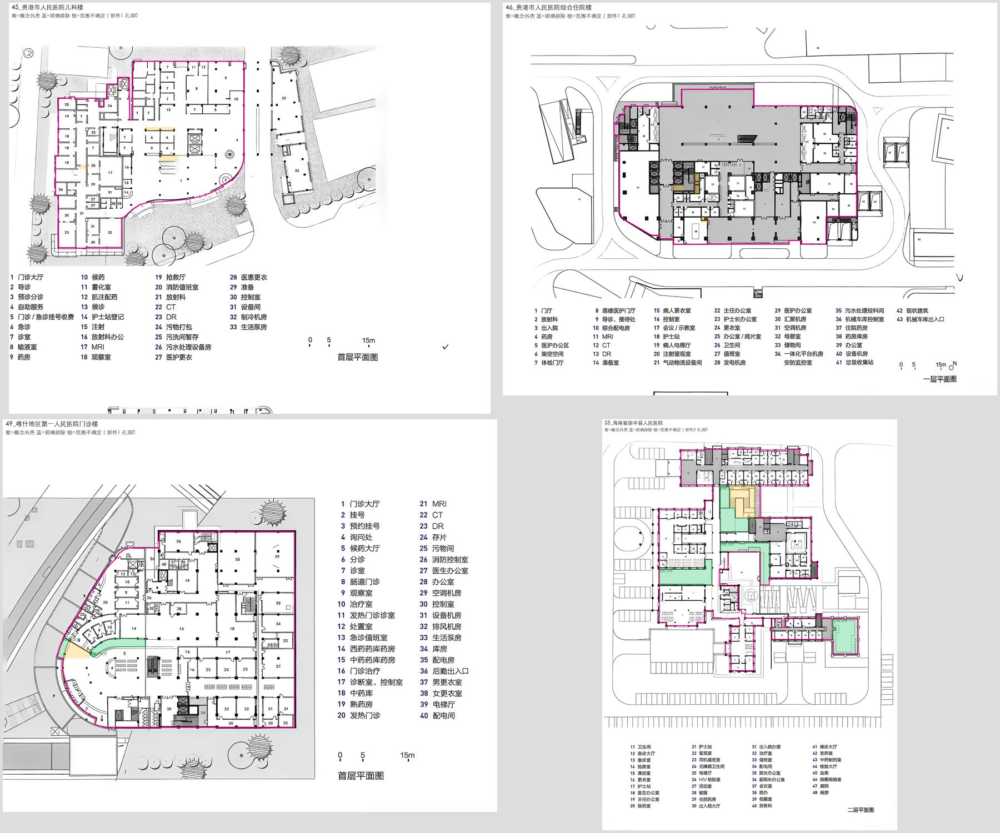

# 用户标记处理结果

来源：你在《范围不确定项.md》中的标记。原文与处理前适配记录均保存在user_feedback目录；当前《范围不确定项.md》未覆盖。

| 图号 | 用户标记 | 本轮处理 |
| --- | --- | --- |
| 45 | 删除32、33 | 对应独立设备附楼Z03：图例32为S025、33为S026，连同附属小块S027/S028退出训练范围；重新提取仅主楼的边界，不删除原标注。 |
| 46 | 删除这个部分，重新构造边界 | S071退出训练范围，关联关系/入口一并移出训练标签，重新提取主楼外壳。 |
| 49 | 那就是大厅的一部分 | S081/S082在训练适配中确认为室内大厅局部，保留S编号、几何分片，不自动补边或合并。 |
| 53 | 圈出部分都是室内大厅的一部分 | S038/S082/S085/S122在训练适配中确认为室内大厅局部，保留S编号和原几何。 |

53图均已恢复边界条件任务。训练样本保留8,431个节点；相对原8,436个节点，5个退出指定训练范围。原212个正式文件哈希一致。40号4个、50号2个原有局部范围不确定节点仍使用几何mask，不影响两图已核验外壳。

13项单元测试及全量校验通过。未划分测试集，未启动训练。

