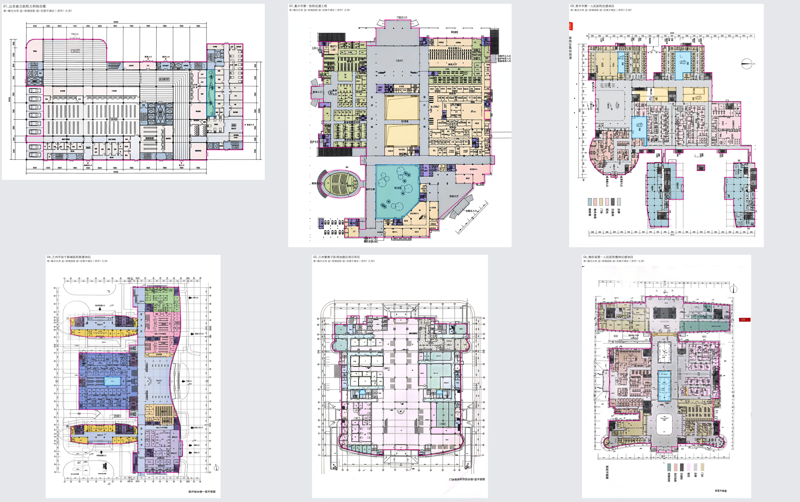
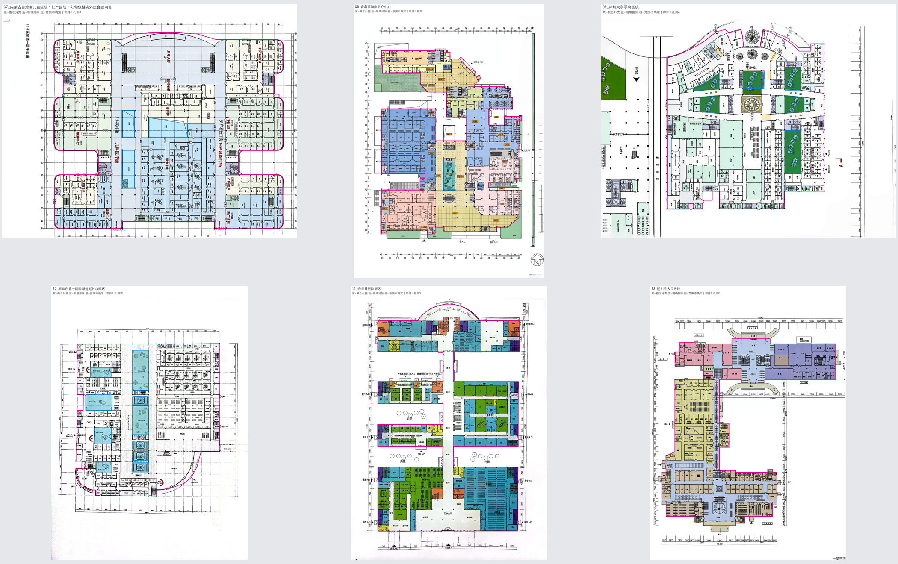
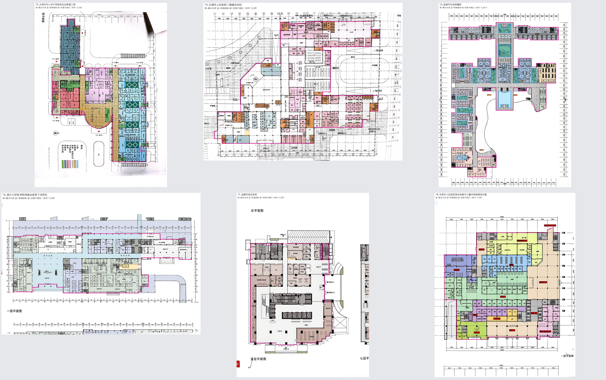
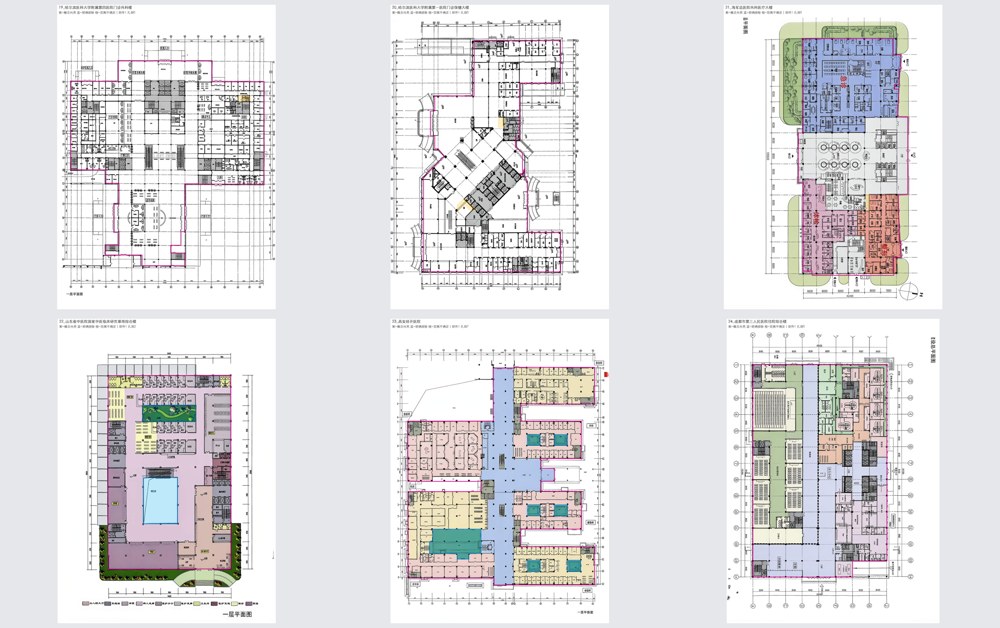
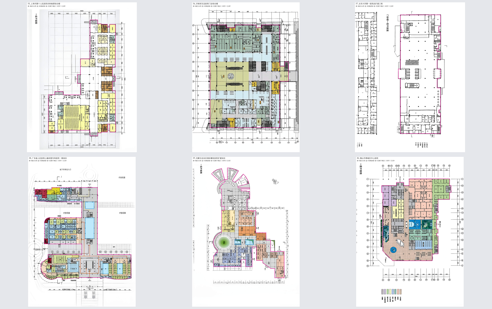
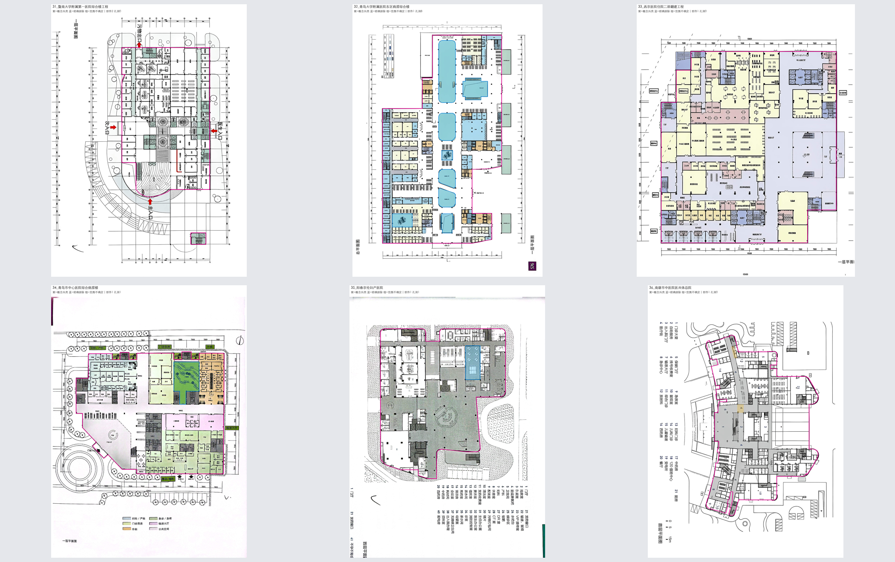
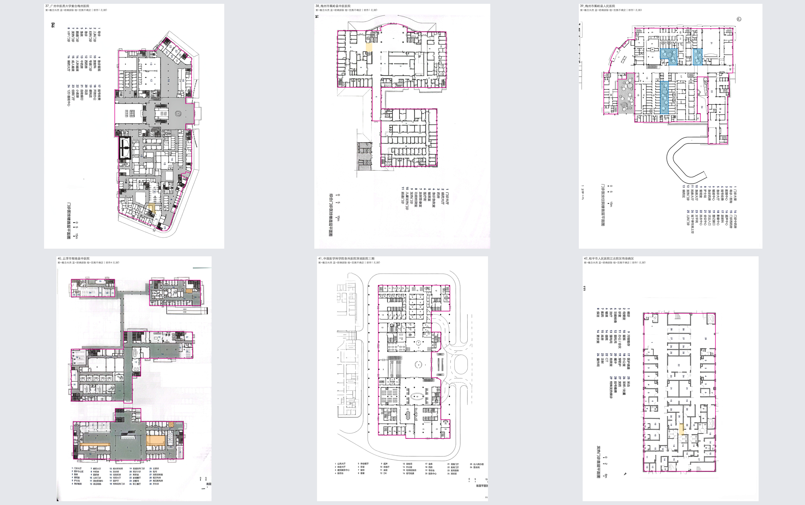
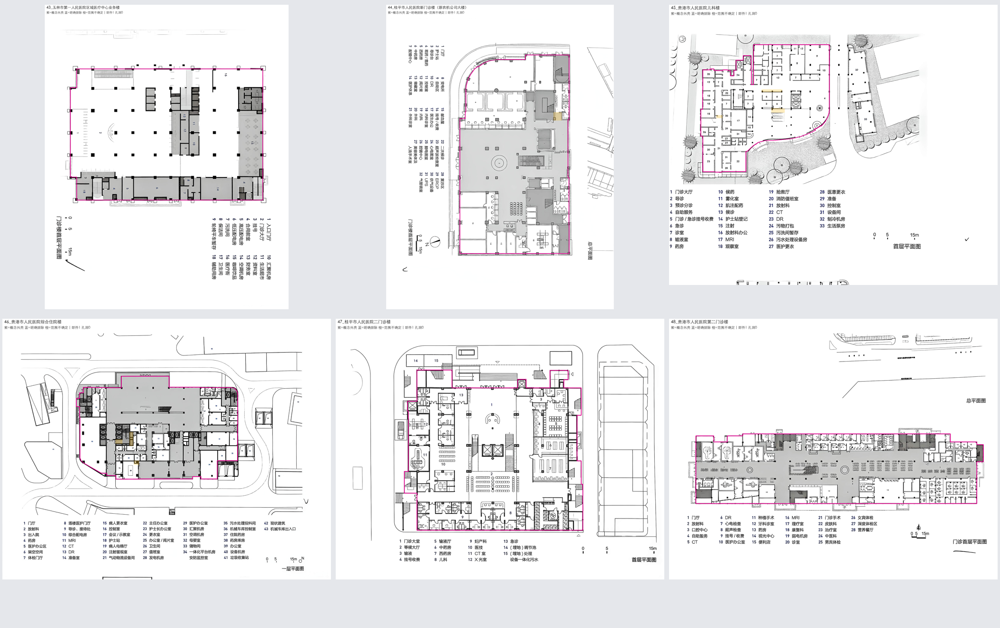
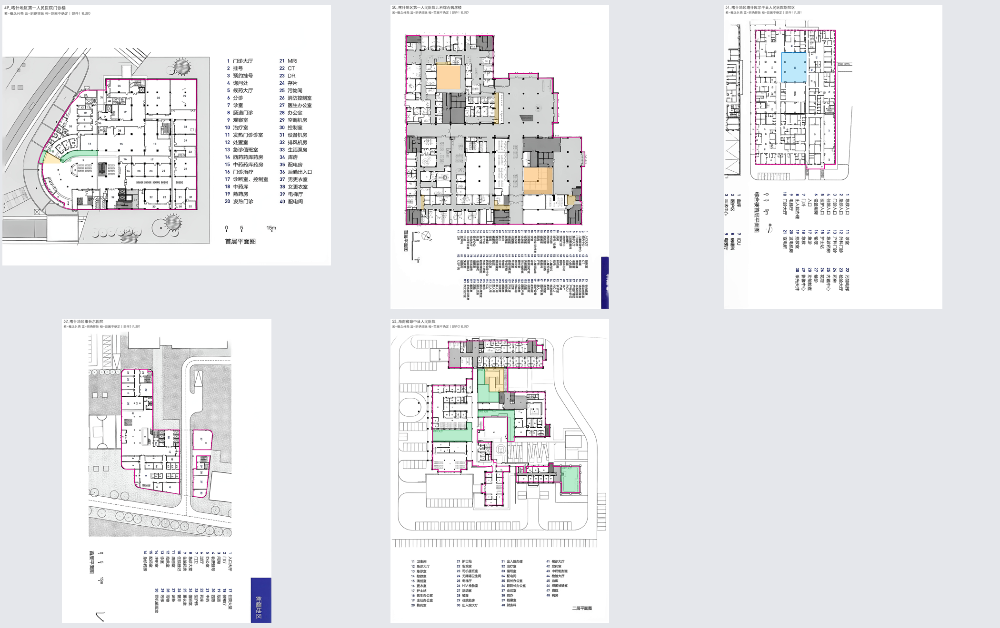

# 53图概念边界核验清单

已包含用户标记：45号排除设备附楼，46号排除S071，49/53号标记区确认为大厅。原始标注不变；详见[标记处理结果](标记处理结果.md)。

| 图号与项目 | 部件 | 孔洞 | 边界条件监督 | 局部几何mask | 核验说明 |
| --- | ---: | ---: | --- | --- | --- |
| [01_山东省立医院儿科综合楼](边界记录/01_山东省立医院儿科综合楼.json) | 1 | 1 | 可用 | 无 | 逐图叠加核对北侧折线与东翼；保留中部明确排除带。 [叠加图](边界预览/01_山东省立医院儿科综合楼.png) |
| [02_嘉兴市第一医院迁建工程](边界记录/02_嘉兴市第一医院迁建工程.json) | 1 | 1 | 可用 | 无 | 核对弧形附翼及东西南北出入口；中央未标注白色内区单独记不确定内域，不宣称均为可布置室内。 [叠加图](边界预览/02_嘉兴市第一医院迁建工程.png) |
| [03_晋中市第一人民医院迁建项目](边界记录/03_晋中市第一人民医院迁建项目.json) | 2 | 3 | 可用 | 无 | 保留主楼与独立小单元两个部件；庭院/绿化排除，中央未分配内区另列。 [叠加图](边界预览/03_晋中市第一人民医院迁建项目.png) |
| [04_兰州市安宁新城医院新建项目](边界记录/04_兰州市安宁新城医院新建项目.json) | 1 | 1 | 可用 | 无 | 核对三条西翼与东侧连续大厅外缘；入口凹口与已知排除项保留。 [叠加图](边界预览/04_兰州市安宁新城医院新建项目.png) |
| [05_兰州重离子医用加速应用示范区](边界记录/05_兰州重离子医用加速应用示范区.json) | 1 | 2 | 可用 | 无 | 以已标注医疗平面外缘为范围，图上更外侧弧形结构线不作房间边界；保留两处明确排除。 [叠加图](边界预览/05_兰州重离子医用加速应用示范区.png) |
| [06_鹿邑县第一人民医院整体迁建项目](边界记录/06_鹿邑县第一人民医院整体迁建项目.json) | 1 | 1 | 可用 | 无 | 墙厚碎缝闭合后核对主楼及北翼；中部明确庭院保留，未标注内区不纳入完整分区监督。 [叠加图](边界预览/06_鹿邑县第一人民医院整体迁建项目.png) |
| [07_内蒙古自治区儿童医院、妇产医院、妇幼保健院外迁合建项目](边界记录/07_内蒙古自治区儿童医院、妇产医院、妇幼保健院外迁合建项目.json) | 1 | 3 | 可用 | 无 | 核对六个侧翼与顶部大跨空间外缘；保留三处明确内空区，不沿室内碎缝绘建筑外壳。 [叠加图](边界预览/07_内蒙古自治区儿童医院、妇产医院、妇幼保健院外迁合建项目.png) |
| [08_青岛西海岸医疗中心](边界记录/08_青岛西海岸医疗中心.json) | 1 | 1 | 可用 | 无 | 核对南入口及东北斜边，未扩大到室外景观；保留中央明确庭院。 [叠加图](边界预览/08_青岛西海岸医疗中心.png) |
| [09_深圳大学学府医院](边界记录/09_深圳大学学府医院.json) | 1 | 6 | 可用 | 无 | 核对北侧弧形外缘及底部凹口，排除左侧不属于当前标注的图块；保留六处明确孔洞。 [叠加图](边界预览/09_深圳大学学府医院.png) |
| [10_石家庄第一医院新建赵卜口院区](边界记录/10_石家庄第一医院新建赵卜口院区.json) | 1 | 10 | 可用 | 无 | 核对折线和西南弧边；保留中部连续庭院及其它已标注排除项。 [叠加图](边界预览/10_石家庄第一医院新建赵卜口院区.png) |
| [11_寿县县医院新区](边界记录/11_寿县县医院新区.json) | 1 | 0 | 可用 | 无 | 保留上下两组团及实际中部连接带；室外大开敞凹区未填平。 [叠加图](边界预览/11_寿县县医院新区.png) |
| [12_遂川县人民医院](边界记录/12_遂川县人民医院.json) | 1 | 0 | 可用 | 无 | 核对上下两翼与连接段，边界不扩大到室外环路、入口广场或附属线条。 [叠加图](边界预览/12_遂川县人民医院.png) |
| [13_天津市中心妇产科医院迁址新建工程](边界记录/13_天津市中心妇产科医院迁址新建工程.json) | 1 | 4 | 可用 | 无 | 按可辨主体外缘保留上部狭长翼及东侧医技翼；拍摄页有遮挡/透视，限概念相对几何，不做米制监督。 [叠加图](边界预览/13_天津市中心妇产科医院迁址新建工程.png) |
| [14_无锡市人民医院二期建设项目](边界记录/14_无锡市人民医院二期建设项目.json) | 1 | 0 | 可用 | 无 | 核对北、东与西南折边；去除室内墙厚缝，外侧轴网和行车线不入域。 [叠加图](边界预览/14_无锡市人民医院二期建设项目.png) |
| [15_盐城市妇幼保健院](边界记录/15_盐城市妇幼保健院.json) | 1 | 12 | 可用 | 无 | 核对北部长条与南侧多翼；所有明确庭院/内空排除保留，未填平两翼间室外大凹口。 [叠加图](边界预览/15_盐城市妇幼保健院.png) |
| [16_浙江大学医学院邵逸夫医院下沙院区](边界记录/16_浙江大学医学院邵逸夫医院下沙院区.json) | 1 | 0 | 可用 | 无 | 只取上方已标注单层平面，排除页底另一图残片及外围未标注附带范围。 [叠加图](边界预览/16_浙江大学医学院邵逸夫医院下沙院区.png) |
| [17_成都市西区医院](边界记录/17_成都市西区医院.json) | 1 | 0 | 可用 | 无 | 只取已标注的主要平面，排除右侧另一楼层图；保留凸出小房和外轮廓凹口。 [叠加图](边界预览/17_成都市西区医院.png) |
| [18_东营市人民医院急诊急救中心暨内科病房综合楼](边界记录/18_东营市人民医院急诊急救中心暨内科病房综合楼.json) | 1 | 0 | 可用 | 无 | 核对主体及北入口突部，外侧道路和尺寸链未入域。 [叠加图](边界预览/18_东营市人民医院急诊急救中心暨内科病房综合楼.png) |
| [19_哈尔滨医科大学附属第四医院门诊外科楼](边界记录/19_哈尔滨医科大学附属第四医院门诊外科楼.json) | 1 | 0 | 可用 | 无 | 核对上部大矩形主翼与南侧狭长入口翼；墙厚闭合不填平主翼两侧室外。 [叠加图](边界预览/19_哈尔滨医科大学附属第四医院门诊外科楼.png) |
| [20_哈尔滨医科大学附属第一医院门诊保健大楼](边界记录/20_哈尔滨医科大学附属第一医院门诊保健大楼.json) | 1 | 0 | 可用 | 无 | 保留中部斜向大厅及上下矩形翼，外侧雨棚/入口曲线不扩大为已知房间域。 [叠加图](边界预览/20_哈尔滨医科大学附属第一医院门诊保健大楼.png) |
| [21_海军总医院外科医疗大楼](边界记录/21_海军总医院外科医疗大楼.json) | 1 | 0 | 可用 | 无 | 主体长条医疗空间边界与景观带分开；不将外围绿色景观纳入室内。 [叠加图](边界预览/21_海军总医院外科医疗大楼.png) |
| [22_山东省中医院国家中医临床研究基地综合楼](边界记录/22_山东省中医院国家中医临床研究基地综合楼.json) | 1 | 2 | 可用 | 无 | 保留两处明确内庭院及外缘折口，室外绿化不纳入室内面积。 [叠加图](边界预览/22_山东省中医院国家中医临床研究基地综合楼.png) |
| [23_西安经开医院](边界记录/23_西安经开医院.json) | 1 | 7 | 可用 | 无 | 核对多翼及连接大厅；保留七处明确排除域。 [叠加图](边界预览/23_西安经开医院.png) |
| [24_成都市第三人民医院住院综合楼](边界记录/24_成都市第三人民医院住院综合楼.json) | 1 | 0 | 可用 | 无 | 核对矩形主楼折口，使用整层外壳而不是内部大型功能块边界。 [叠加图](边界预览/24_成都市第三人民医院住院综合楼.png) |
| [25_上海市第十人民医院内科病房综合楼](边界记录/25_上海市第十人民医院内科病房综合楼.json) | 1 | 0 | 可用 | 无 | 核对L形单层标注外缘及南侧小突部；外侧轴网空白不入域。 [叠加图](边界预览/25_上海市第十人民医院内科病房综合楼.png) |
| [26_济南军区总医院门诊综合楼](边界记录/26_济南军区总医院门诊综合楼.json) | 1 | 0 | 可用 | 无 | 核对主平面外缘，排除西侧与东侧无关附图/室外，保留当前标注范围。 [叠加图](边界预览/26_济南军区总医院门诊综合楼.png) |
| [27_北京大学第一医院改扩建工程](边界记录/27_北京大学第一医院改扩建工程.json) | 1 | 0 | 可用 | 无 | 仅取右侧完整已标注平面，排除左侧附图残片；未知功能保留，不补内部隔墙。 [叠加图](边界预览/27_北京大学第一医院改扩建工程.png) |
| [28_广东省人民医院心脑血管专科医院一期项目](边界记录/28_广东省人民医院心脑血管专科医院一期项目.json) | 1 | 4 | 可用 | 无 | 保留三组医疗翼和实际连接带；庭院与外侧行车道路分开。 [叠加图](边界预览/28_广东省人民医院心脑血管专科医院一期项目.png) |
| [29_内蒙古自治区国际蒙医医院扩建项目](边界记录/29_内蒙古自治区国际蒙医医院扩建项目.json) | 2 | 2 | 可用 | 无 | 保留弧形北翼、南侧多翼及当前独立小部件；未凭包围盒跨填组团间空地。 [叠加图](边界预览/29_内蒙古自治区国际蒙医医院扩建项目.png) |
| [30_佛山市禅城区中心医院](边界记录/30_佛山市禅城区中心医院.json) | 1 | 4 | 可用 | 无 | 核对主体斜边/折边，保留四处明确庭院或排除项。 [叠加图](边界预览/30_佛山市禅城区中心医院.png) |
| [31_暨南大学附属第一医院综合楼工程](边界记录/31_暨南大学附属第一医院综合楼工程.json) | 2 | 0 | 可用 | 无 | 保留主楼与下方独立小单元，不跨室外将两者粘连；范围沿用现有单层标注。 [叠加图](边界预览/31_暨南大学附属第一医院综合楼工程.png) |
| [32_青岛大学附属医院东区病房综合楼](边界记录/32_青岛大学附属医院东区病房综合楼.json) | 1 | 8 | 可用 | 无 | 保留八处明确内庭院/内空，东侧折线与外部附属线分开。 [叠加图](边界预览/32_青岛大学附属医院东区病房综合楼.png) |
| [33_西京医院住院二部翻建工程](边界记录/33_西京医院住院二部翻建工程.json) | 1 | 0 | 可用 | 无 | 核对北侧斜折、东侧大厅及南侧外缘，墙厚碎缝不作为外壳孔洞。 [叠加图](边界预览/33_西京医院住院二部翻建工程.png) |
| [34_青岛市中心医院综合病房楼](边界记录/34_青岛市中心医院综合病房楼.json) | 1 | 1 | 可用 | 无 | 核对主体南部斜边与外缘凹口；东侧明确庭院保留。 [叠加图](边界预览/34_青岛市中心医院综合病房楼.png) |
| [35_阳春京伦妇产医院](边界记录/35_阳春京伦妇产医院.json) | 1 | 1 | 可用 | 无 | 核对曲折外缘与公共大厅；保留明确内空区，室外景观未并入。 [叠加图](边界预览/35_阳春京伦妇产医院.png) |
| [36_南雄市中医院医共体总院](边界记录/36_南雄市中医院医共体总院.json) | 1 | 0 | 可用 | 无 | 核对旋转图面中的多翼外缘，原图方向不改；scope不作为具体小间名称。 [叠加图](边界预览/36_南雄市中医院医共体总院.png) |
| [37_广州中医药大学紫合梅州医院](边界记录/37_广州中医药大学紫合梅州医院.json) | 1 | 0 | 可用 | 无 | 核对上下两主段及中部连接，保留斜边；未分配内区另记，不补猜用途。 [叠加图](边界预览/37_广州中医药大学紫合梅州医院.png) |
| [38_梅州市蕉岭县中医医院](边界记录/38_梅州市蕉岭县中医医院.json) | 1 | 0 | 可用 | 无 | 核对北部组团、狭长连接及南部梳状翼，旁侧室外线和道路不入域。 [叠加图](边界预览/38_梅州市蕉岭县中医医院.png) |
| [39_梅州市蕉岭县人民医院](边界记录/39_梅州市蕉岭县人民医院.json) | 1 | 3 | 可用 | 无 | 核对主体与南侧窄翼，保留三处明确排除，原未定位发热门诊不扩展为新范围。 [叠加图](边界预览/39_梅州市蕉岭县人民医院.png) |
| [40_云浮市郁南县中医院](边界记录/40_云浮市郁南县中医院.json) | 4 | 0 | 可用 | S020,S057,S068,S069 | 保留四个当前独立几何部件，不跨未标注路径强接；四处室内外属性未知空间屏蔽几何监督。 [叠加图](边界预览/40_云浮市郁南县中医院.png) |
| [41_中国医学科学院阜外医院深圳医院三期](边界记录/41_中国医学科学院阜外医院深圳医院三期.json) | 1 | 0 | 可用 | 无 | 核对长条主楼外缘及入口折口，排除周边道路与总图线。 [叠加图](边界预览/41_中国医学科学院阜外医院深圳医院三期.png) |
| [42_桂平市人民医院江北院区传染病区](边界记录/42_桂平市人民医院江北院区传染病区.json) | 1 | 0 | 可用 | 无 | 核对狭长传染病门诊主体，不将上下尺寸/文字纳入；开放服务区保留原粒度。 [叠加图](边界预览/42_桂平市人民医院江北院区传染病区.png) |
| [43_玉林市第一人民医院区域医疗中心业务楼](边界记录/43_玉林市第一人民医院区域医疗中心业务楼.json) | 1 | 0 | 可用 | 无 | 核对矩形主体和南侧附房外缘；大公共空间统计线不当外墙。 [叠加图](边界预览/43_玉林市第一人民医院区域医疗中心业务楼.png) |
| [44_桂平市人民医院新门诊楼（原农机公司大楼）](边界记录/44_桂平市人民医院新门诊楼（原农机公司大楼）.json) | 1 | 0 | 可用 | 无 | 核对西北弧形与南侧折口；原图外侧车道不入域。 [叠加图](边界预览/44_桂平市人民医院新门诊楼（原农机公司大楼）.png) |
| [45_贵港市人民医院儿科楼](边界记录/45_贵港市人民医院儿科楼.json) | 1 | 0 | 可用 | 无 | 按用户标记排除图例32/33对应独立设备附楼Z03（S025—S028），仅保留主楼；删除关联标签，不跨室外补边。 [叠加图](边界预览/45_贵港市人民医院儿科楼.png) |
| [46_贵港市人民医院综合住院楼](边界记录/46_贵港市人民医院综合住院楼.json) | 1 | 0 | 可用 | 无 | 按用户标记移除原橙色S071范围并重新提取外壳，其关联关系一并退出训练标签；主楼其它空间沿用。 [叠加图](边界预览/46_贵港市人民医院综合住院楼.png) |
| [47_桂平市人民医院二门诊楼](边界记录/47_桂平市人民医院二门诊楼.json) | 1 | 0 | 可用 | 无 | 核对公共大厅主体及四周附属小间，原无名狭长单元不补用途。 [叠加图](边界预览/47_桂平市人民医院二门诊楼.png) |
| [48_贵港市人民医院第二门诊楼](边界记录/48_贵港市人民医院第二门诊楼.json) | 1 | 0 | 可用 | 无 | 只取下方已标注长条门诊平面，排除页上总图道路和其它线条。 [叠加图](边界预览/48_贵港市人民医院第二门诊楼.png) |
| [49_喀什地区第一人民医院门诊楼](边界记录/49_喀什地区第一人民医院门诊楼.json) | 1 | 0 | 可用 | 无 | 按用户标记确认原圈出范围均为室内大厅局部；保留S编号和几何分片，不自动合并空间或补造连接。 [叠加图](边界预览/49_喀什地区第一人民医院门诊楼.png) |
| [50_喀什地区第一人民医院儿科综合病房楼](边界记录/50_喀什地区第一人民医院儿科综合病房楼.json) | 1 | 0 | 可用 | S010,S105 | 核对首层主楼外缘；S010/S105无名内向空区只记不确定区，不确认为庭院或室内。 [叠加图](边界预览/50_喀什地区第一人民医院儿科综合病房楼.png) |
| [51_喀什地区塔什库尔干县人民医院新院区](边界记录/51_喀什地区塔什库尔干县人民医院新院区.json) | 1 | 1 | 可用 | 无 | 只取完整综合楼已标注首层，排除页底另一层；S025采光天井按明确排除保存。 [叠加图](边界预览/51_喀什地区塔什库尔干县人民医院新院区.png) |
| [52_喀什地区维吾尔医院](边界记录/52_喀什地区维吾尔医院.json) | 3 | 0 | 可用 | 无 | 保留道路两侧主楼与设备/污物附属部件，未把道路填成室内或虚构跨路边。 [叠加图](边界预览/52_喀什地区维吾尔医院.png) |
| [53_海南省琼中县人民医院](边界记录/53_海南省琼中县人民医院.json) | 2 | 0 | 可用 | 无 | 按用户标记确认原圈出范围均为室内大厅局部；保留S编号和几何分片，不自动合并空间或补造连接。 [叠加图](边界预览/53_海南省琼中县人民医院.png) |

